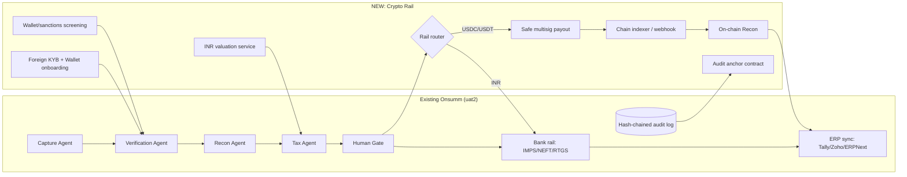

# Onsumm Crypto Rail · Hacker House Goa 2026

> **One AI finance layer for every rupee and every token.**

This build adds a **stablecoin rail** to Onsumm's existing payables engine. It lets foreign (cross-border) B2B businesses send and receive USDC/USDT through the same flow Onsumm already runs for INR: **Capture → Verify → Recon → Tax → Human gate → Payout → Books → Audit**.

Everything below is **added beside** the current INR flow. The `uat2` IMPS/NEFT/RTGS path is left untouched. Crypto becomes a second `payment_rail` that the existing agents can route to.

---

## 1. Demo we're shipping (Sat 31 Oct)

1. **Onboard** *Lumen Labs Pte Ltd* (Singapore), a foreign client paying in USDC. KYB passes, its treasury Safe is connected and its UBO is screened.
2. **Onboard** a vendor, *Nova Design LLC* (US). The vendor proves it owns its wallet by signing a message, and the wallet is screened.
3. The vendor sends its invoice on **WhatsApp**. Capture reads it and finds `$4,200 USDC`.
4. **Recon Agent flags** a line that doesn't match the contract (`$600` over the PO) and holds the bill.
5. The founder approves the corrected **$3,600** and the **Safe multisig** signs. USDC goes out on **Base Sepolia**.
6. **On-chain Recon** sees the transfer, matches the tx hash to the bill and marks it *Paid & Reconciled*.
7. **Tax engine** stores the INR value at the time of payment, works out withholding, and posts to Tally/ERPNext.
8. The **audit Merkle root** is anchored on-chain. Anyone can paste a bill ID and verify its proof.

---

## 2. Architecture (what's new vs. existing)



**Rule we don't break:** a payout wallet is **only ever read from the verified vendor master**. A wallet address printed on an invoice is never used. (That's the crypto version of our "verified-only payouts" guarantee.)

---

## 3. Changes, module by module (in build order)

### 3.0 Org onboarding: foreign B2B entity (NEW)

| Step | What we build | Notes |
|---|---|---|
| Entity profile | Legal name, country, registration no., tax residency, functional currency | Adds `jurisdiction` and `is_resident_india` to the org |
| KYB | Upload incorporation docs and UBO list (≥25%) | Hackathon: manual review screen. Later: KYB provider API |
| Sanctions | Screen entity and UBOs against OFAC/UN/EU lists | Hackathon: static list lookup. Later: Chainalysis/TRM/ComplyAdvantage |
| Treasury wallet | Connect an existing **Safe** or create one; set approver signers and threshold | Map Onsumm approval roles to Safe signers |
| Rail policy | Allowed chains (Base, Polygon), tokens (USDC, USDT) and per-tx/daily limits | Stored as `org_rail_policy` |

### 3.1 Vendor / counterparty onboarding (EXTEND existing vendor master)

- **Wallet proof of ownership.** The vendor signs an EIP-712 / SIWE (EIP-4361) message from the vendor portal, and we verify the signature on the server. It works like a penny-drop test, but for wallets.
- **Wallet screening.** The address is checked against a sanctions/high-risk list. Any hit blocks the vendor.
- **Foreign tax docs.** Collect TRC, Form 10F and a no-PE declaration (for DTAA rates), or W-8BEN-E for US counterparties. If PAN is missing, flag that higher withholding may apply.
- **Travel Rule fields.** Store originator/beneficiary name, address and wallet for each transfer.
- **Wallet change = re-verify.** If a vendor's wallet changes, the vendor is frozen until a new signature is given **and** an admin approves. This blocks the most common crypto AP fraud.

### 3.2 Capture Agent (EXTEND)

- Parse `currency` (USD/USDC/USDT/INR), `chain` and the invoice's preferred settlement rail.
- Extract any wallet address on the invoice **only to compare it**. If it differs from the vendor master, raise `WALLET_MISMATCH` (treat as a likely phishing invoice).
- Handle foreign invoice formats: no GSTIN, VAT IDs and SWIFT details.

### 3.3 Verification Agent (EXTEND)

New checks that run alongside GSTIN/PAN/MSME:
`vendor_wallet_verified`, `wallet_not_sanctioned`, `token_allowed_by_policy`, `amount_within_limits`, `tax_docs_present`.

### 3.4 Recon Agent (EXTEND)

- Three-way match stays the same (bill · PO/contract · payment). The **payment** side can now be a tx hash instead of a UTR.
- The overbilling and duplicate rules work unchanged, because they compare amounts in invoice currency.
- Add a **duplicate across rails** check: the same invoice can't be paid once in INR and again in USDC.

### 3.5 Tax Agent (EXTEND)

| Case | Treatment to implement | Status |
|---|---|---|
| Paying a foreign vendor for services | Withholding on the INR value under s.195, at the DTAA rate if TRC/10F are on file | Rule engine |
| Paying in USDC (the company disposes of a VDA) | Record cost basis and gain/loss on the stablecoin itself. Flag VDA-transfer TDS (s.194S) where applicable | Flag + report |
| INR valuation | Store the USD-INR reference rate and USDC/USD price **at block timestamp** for every transfer | `fx_snapshots` |
| GST | Import of services → reverse charge entry | Ledger rule |

> Our tax engine produces **suggested** treatments for the CA to review. Final sign-off stays with the client's CA, the same as today.

### 3.6 Human Gate + Payout (NEW rail)

- **Rail router** after approval: `INR → existing bank flow`, `USDC/USDT → crypto payout`.
- The crypto payout **proposes a Safe transaction** (ERC-20 `transfer`). Onsumm approvers sign it in the Onsumm UI, and execution happens only when the Safe threshold is met. **Onsumm never holds keys.**
- An idempotency key (`bill_id + payout_attempt`) prevents double sends. The bill is locked while a tx is pending.
- Pending, confirmed and failed states come from the indexer, with N-block confirmations.

### 3.7 On-chain Recon + Indexer (NEW)

- Listen for ERC-20 `Transfer` events to and from org wallets (webhook from Alchemy/QuickNode, or polling with `viem`).
- Match on `tx_hash` (Onsumm-initiated payments) or on `amount + counterparty wallet + time window` (inbound payments from foreign clients). Inbound payments reconcile against **receivables**.
- Gas fees are posted as a separate expense line.

### 3.8 Books / ERP sync (EXTEND)

- New ledgers: `Crypto Assets – USDC`, `Crypto Gas Fees`, `Gain/Loss on VDA`, `Withholding Tax Payable – 195`.
- The voucher stores the tx hash and explorer link in its narration. All 15+ existing validations still run before sync.

### 3.9 Audit Anchor (NEW)

- We already hash-chain audit events. Every *N* hours (or on demand for the demo), we build a **Merkle root** over new events and call `OnsummAnchor.anchor(root, fromSeq, toSeq)`.
- Public verify page: `/verify/:billId` returns the Merkle proof and checks it against the on-chain root.

### 3.10 Ask Onsumm co-pilot (EXTEND)

New intents: *"show USDC payouts this month"*, *"which vendors have unverified wallets"*, *"total withholding on foreign vendors"*, *"unreconciled inbound transfers"*.

---

## 4. Data model changes

```sql
-- org-level
ALTER TABLE orgs ADD COLUMN jurisdiction TEXT, ADD COLUMN is_resident_india BOOLEAN DEFAULT true,
                 ADD COLUMN kyb_status TEXT DEFAULT 'pending';           -- pending|approved|rejected
CREATE TABLE org_ubos (id UUID PK, org_id UUID, name TEXT, country TEXT, ownership_pct NUMERIC, screening_status TEXT);
CREATE TABLE org_wallets (id UUID PK, org_id UUID, chain TEXT, address TEXT, type TEXT,  -- safe|eoa
                          safe_threshold INT, created_at TIMESTAMPTZ);
CREATE TABLE org_rail_policy (org_id UUID PK, allowed_chains TEXT[], allowed_tokens TEXT[],
                              per_tx_limit_usd NUMERIC, daily_limit_usd NUMERIC);

-- vendor-level
CREATE TABLE vendor_wallets (id UUID PK, vendor_id UUID, chain TEXT, address TEXT,
                             ownership_sig TEXT, verified_at TIMESTAMPTZ, screening_status TEXT,
                             status TEXT);                                -- active|frozen|revoked
ALTER TABLE vendors ADD COLUMN country TEXT, ADD COLUMN tax_docs JSONB,  -- TRC, 10F, W-8BEN-E refs
                    ADD COLUMN preferred_rail TEXT DEFAULT 'INR';

-- bills & payments
ALTER TABLE bills ADD COLUMN currency TEXT DEFAULT 'INR', ADD COLUMN settlement_rail TEXT;
ALTER TABLE payments ADD COLUMN rail TEXT DEFAULT 'BANK',                -- BANK|CRYPTO
                     ADD COLUMN chain TEXT, ADD COLUMN token TEXT, ADD COLUMN tx_hash TEXT,
                     ADD COLUMN safe_tx_hash TEXT, ADD COLUMN confirmations INT,
                     ADD COLUMN gas_fee_native NUMERIC;
CREATE TABLE fx_snapshots (id UUID PK, payment_id UUID, usd_inr NUMERIC, token_usd NUMERIC,
                           source TEXT, block_time TIMESTAMPTZ);
CREATE TABLE chain_transfers (id UUID PK, chain TEXT, tx_hash TEXT, log_index INT, token TEXT,
                              from_addr TEXT, to_addr TEXT, amount NUMERIC, block_time TIMESTAMPTZ,
                              matched_payment_id UUID, matched_invoice_id UUID);
CREATE TABLE audit_anchors (id UUID PK, merkle_root TEXT, from_seq BIGINT, to_seq BIGINT,
                            chain TEXT, tx_hash TEXT, anchored_at TIMESTAMPTZ);
```

---

## 5. New API surface

| Method | Endpoint | Purpose |
|---|---|---|
| POST | `/onboarding/org/kyb` | Submit entity and UBO details |
| POST | `/onboarding/org/wallets` | Connect a Safe/EOA treasury wallet |
| PUT | `/orgs/:id/rail-policy` | Set chains, tokens and limits |
| GET | `/vendor-portal/wallet/challenge` | Get the SIWE/EIP-712 message to sign |
| POST | `/vendor-portal/wallet/verify` | Submit a signature and run screening |
| POST | `/payments/:billId/crypto/propose` | Create the Safe tx proposal after approval |
| POST | `/payments/:id/crypto/sign` | Approver signs the Safe tx |
| POST | `/webhooks/chain` | Indexer/webhook ingestion of transfers |
| POST | `/audit/anchor` | Build and anchor a Merkle root |
| GET | `/verify/:billId` | Public proof verification |

---

## 6. Repo layout (new folders: adapt to the `uat2` structure)

```
/contracts
  OnsummAnchor.sol             # anchor(root, fromSeq, toSeq) + event
  script/Deploy.s.sol          # Foundry deploy to Base Sepolia
/services/crypto-rail
  onboarding/kyb.ts            # entity + UBO + screening
  wallets/siwe.ts              # challenge + signature verify (viem)
  wallets/screening.ts         # sanctions list check
  payout/safe.ts               # Safe Protocol Kit: propose/sign/execute
  payout/router.ts             # INR vs CRYPTO routing after human gate
  indexer/listener.ts          # Transfer event listener / webhook handler
  recon/onchain-match.ts       # tx ↔ bill / invoice matching
  tax/fx.ts                    # USD-INR + token price at block time
  tax/rules-crossborder.ts     # s.195 / DTAA / VDA flags
  audit/merkle.ts              # build root + proofs from audit log
/web
  onboarding/ForeignKyb.tsx
  vendor-portal/ConnectWallet.tsx   # wagmi + RainbowKit
  approvals/CryptoPayoutCard.tsx
  verify/[billId].tsx
```

**Libraries:** `viem`, `wagmi`, `@safe-global/protocol-kit` + `api-kit`, `siwe`, `merkletreejs` (or `@openzeppelin/merkle-tree`), Foundry.

---

## 7. Environment

```bash
CHAIN=base-sepolia
RPC_URL=https://sepolia.base.org
USDC_ADDRESS=0x036CbD53842c5426634e7929541eC2318f3dCF7e   # Circle test USDC on Base Sepolia — verify before use
SAFE_ADDRESS=0x...                                       # org treasury Safe (testnet)
ANCHOR_CONTRACT=0x...
ANCHOR_SIGNER_KEY=...                                    # only signs anchor txs, holds no funds
WEBHOOK_SECRET=...
FX_SOURCE=fixed|api                                      # demo: fixed rate, logged
```

---

## 8. Hackathon plan

| When | Owner | Deliverable |
|---|---|---|
| **Thu 29 Oct** | Backend | Migrations, rail router, vendor wallet SIWE verify |
| | Contracts | `OnsummAnchor.sol` deployed to Base Sepolia, Safe created with 2 signers |
| | Frontend | Foreign KYB screen, vendor Connect Wallet |
| **Fri 30 Oct** | Backend | Safe propose/sign/execute, indexer + on-chain recon |
| | Tax | FX snapshot, s.195 withholding calc, new ledgers in ERPNext/Tally sync |
| | Frontend | Crypto payout approval card, tx status, `/verify/:billId` |
| **Sat 31 Oct (AM)** | All | End-to-end demo run on seeded data, backup recording, pitch |

**Must-have:** onboarding → wallet verify → overbilling flag → approve → USDC payout → on-chain recon → books entry.
**Nice-to-have:** inbound receivables from foreign clients, Merkle anchor + public verify, co-pilot intents.

---

## 9. Compliance notes / open questions

These are **design guardrails, not legal advice**. They need to be confirmed with counsel/CA before anything goes to mainnet.

- **Testnet only** for the hackathon. No real funds, no custody. Onsumm never holds keys; the client's Safe does.
- **India-resident clients:** FEMA rules on export realisation and paying foreign vendors in stablecoins are unsettled. For residents, the crypto rail stays **off by default**, and the INR/bank rail remains primary.
- **Foreign entities** (the target user for this build) use the crypto rail. Onsumm acts as software that orchestrates and records, not as an exchange or custodian.
- **FIU-IND / PMLA:** check whether any future feature (e.g. on/off-ramp) would make Onsumm a VDA service provider that must register.
- **VDA tax** (s.115BBH, s.194S) and **cross-border withholding** (s.195, DTAA): the engine flags these and the client's CA confirms them.
- **Travel Rule:** originator/beneficiary data is captured for every transfer from day one.

---

## 10. Out of scope (this weekend)

Fiat on/off-ramp, mainnet, non-EVM chains, automated KYB vendor integration, live sanctions APIs, multi-entity consolidation.
