# Onsumm Platform — Architecture & Diagram Atlas

**Onsumm.ai** is a multi-tenant, event-driven accounts-payable platform. Every bill moves through one governed pipeline — **Capture → Verify → Reconcile → Tax → Human gate → Payout → Books → Audit** — and settles on two rails: **INR over IMPS** (Lendix → ICICI / AU Bank) and **USDC through a client-owned Safe multisig on Base**. Every state change is written to a hash-chained audit log whose Merkle root is anchored on-chain daily.

This README is the single entry point to the platform documentation. It holds the architecture summary, the scalability design, and an **atlas of every diagram** in the documentation set, each linked to the section that explains it.

| | |
|---|---|
| **As of** | 2026-10-31 · commit `6e1278f` |
| **Diagram format** | Mermaid (renders natively on GitHub, GitLab, VS Code, Notion) |
| **Audience** | Engineering, product, QA, operations, security and audit |

---

## Contents

1. [Platform at a glance](#1-platform-at-a-glance)
2. [Reference architecture](#2-reference-architecture)
3. [Architecture principles](#3-architecture-principles)
4. [Scalability and reliability design](#4-scalability-and-reliability-design)
5. [Security posture](#5-security-posture)
6. [Documentation set](#6-documentation-set)
7. [Getting started](#7-getting-started)
8. [Diagram atlas](#8-diagram-atlas)

---

## 1. Platform at a glance

| Dimension | Value |
|---|---|
| Deployable units | 4 — React SPA, FastAPI API, pipeline engine, Nova reconciliation service (+ Windows Tally agent, Solidity anchor contract) |
| HTTP surface | 44 routers · 308 routes · OpenAPI · Prometheus `/metrics` |
| Event-driven workers | 12 CDC pipeline workers + 3 Review Hub workers + 4 in-API schedulers |
| Compliance detectors | 17 deterministic adapters + LLM review agent with claim verification |
| Payment rails | IMPS (INR) · USDC on Base (Safe multisig, threshold signatures) |
| Licensable services | 26 services across 5 categories · 3 packages (starter, growth, enterprise) |
| Jurisdictions | Country packs (`gst`, `pan`, `tds_india`, `bank_india`, `imps`, `msme`) — India and international from one codebase |
| Integrations | OpenAI, Sarvam, Sandbox.co.in, Lendix, Base RPC, Safe, Google, Microsoft, SMTP, Tally, Apideck ERPs, SAP, Nova |
| Audit | Per-tenant SHA-256 hash chain · daily Merkle anchor on Base · public, browser-verifiable proofs |
| Quality gates | Architecture snapshot tests (tenant scoping, licence mapping, 404-not-403), ~70 pytest modules, Foundry tests, Vitest, CI on every frontend PR |
| Documentation | 9 documents · ~7,000 lines · 149 diagrams |

---

## 2. Reference architecture

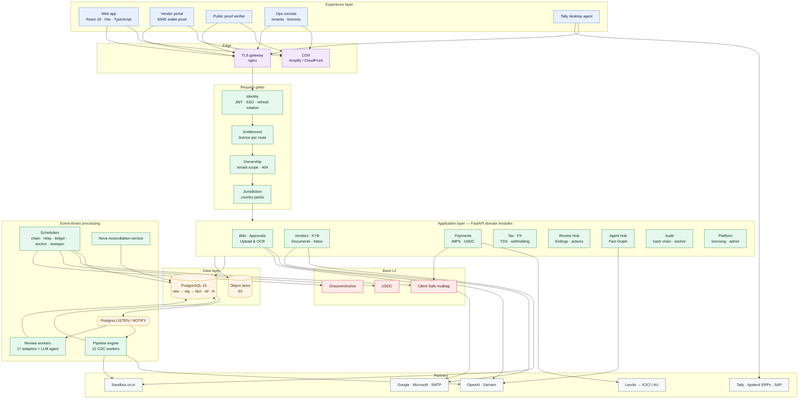

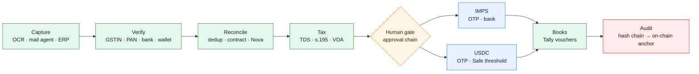

---

## 3. Architecture principles

| Principle | How the platform applies it |
|---|---|
| **Event-driven core** | Postgres triggers emit `NOTIFY` in the same transaction as the write; workers drain on startup, then react to events with a safety poll. No message broker to operate. |
| **Medallion data model** | `raw_` (as received) → `stg_` (validated) → `fact_` (system of record). Every value traces back to its source document. |
| **Modular monolith with hard seams** | 44 domain routers; routers never import routers; shared logic lives in `core/` and `domain/`. Any module can be extracted into a service without rewriting callers. |
| **Ports and adapters** | `Rail`, `BankAdapter`, `CustodyProvider`, `ScreeningProvider`, `RulePack` and `FindingAdapter` are protocols. New banks, custodians, screening vendors, tax regimes and detectors plug in without touching callers. |
| **Defence in depth** | Identity → entitlement → impersonation → role/capability → ownership → jurisdiction, each a separate module and each pinned by tests. |
| **Verified-only money movement** | Beneficiaries come only from the verified vendor master; OTP on every payout; threshold signatures for USDC; the platform never holds client keys. |
| **Idempotency everywhere** | `tran_ref_no` reuse, payout idempotency keys, Safe nonce queue, unique chain-log keys, open-finding keys, atomic claims. |
| **Tamper-evident by construction** | DB-trigger hash chain; daily per-tenant Merkle roots anchored on Base; proofs verifiable by anyone in a browser. |
| **Configuration over code for jurisdictions** | Country packs and rails switch features per tenant; India and international run on one codebase. |
| **Human-in-the-loop AI** | LLM output is redacted in, verified out, budget-capped, and never moves money; agents create drafts and findings, people decide. |

---

## 4. Scalability and reliability design

### 4.1 What scales today

| Mechanism | Effect |
|---|---|
| Stateless SPA on a CDN | Frontend scales with no servers |
| Advisory-lock singletons (`875_291_004_417`–`421`) | Pipeline, review workers, sweeper, crypto scheduler and anchor builder are safe to run on many replicas — exactly one instance is active per loop |
| `FOR UPDATE SKIP LOCKED` claiming | Workers process rows in parallel without double-processing |
| Batch + backoff tuning per worker | Backfill 200 / incremental 50 rows, 5 s poll, 60 s idle, exponential error backoff capped at 120 s |
| Tenant sharding hook | `PIPELINE_TENANT_ID` pins a pipeline instance to a tenant set |
| Independent services | Nova reconciliation deploys and scales separately; Tally agents run at customer sites |
| Bounded external calls | Sandbox semaphore (5), RPC range halving and failover, LLM timeouts, retries and daily cost caps |
| Metrics by route template | Cardinality-safe Prometheus metrics; DB-pool gauge exposes connection leaks before they cause outages |

### 4.2 Target scale-out architecture

> **Target state.** Production today runs one API replica per environment. The diagram below is the scale-out design the current seams were built for; section 4.3 lists the work that unlocks it.

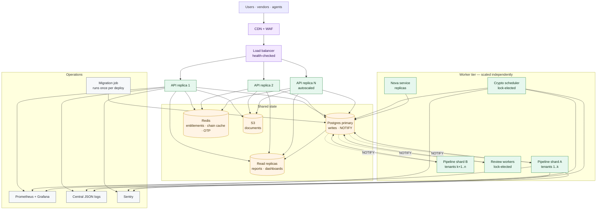

### 4.3 Scale-out roadmap

| Step | Change | Unlocks |
|---|---|---|
| 1 | Move per-process caches (approval chain, entitlements, notifications) and the password-reset OTP to Postgres or Redis | Multiple API replicas behind a load balancer |
| 2 | Run DDL as a one-off migration job per deploy instead of on every boot | Fast, safe rolling restarts |
| 3 | Close DB connections in `finally` (85 sites) and alert on the pool gauge | Stable pools under load |
| 4 | Read replica for reports, dashboards and Review Hub counts | Read scaling without loading the primary |
| 5 | Shard pipeline workers by tenant via `PIPELINE_TENANT_ID` / `pipeline_enabled` | Linear worker throughput |
| 6 | Separate dev database and secrets; CD pipeline with health-gated rollout | Safe, frequent releases |
| 7 | Postgres Row-Level Security as a second isolation layer | Defence in depth for large multi-tenant scale |
| 8 | Provider-backed sanctions screening and live FX through existing protocols | Production-grade crypto rail |

### 4.4 Reliability controls

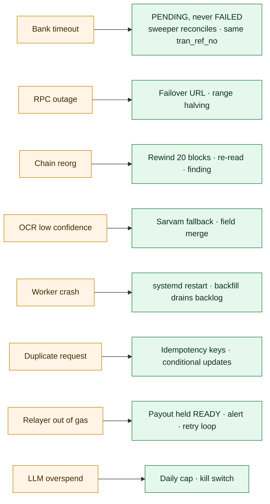

---

## 5. Security posture

| Control area | Implementation |
|---|---|
| Identity | bcrypt, HS256 JWT (60 min), rotating refresh tokens with reuse detection, SSO via single-use codes, no tokens in URLs |
| Authorisation | Role → capability model, per-route licensing, jurisdiction packs, read-only impersonation |
| Tenant isolation | JWT-derived tenant on every query, 404 on foreign rows, route-coverage snapshot tests |
| Money movement | Verified beneficiaries, OTP, admin role, logged overrides, Safe threshold signatures, dual control above $10,000, sanctions screening, 24 h wallet cooling |
| Secrets | Hashes for tokens, OTPs and agent keys; Fernet for OAuth and partner keys; RSA payloads to the bank |
| Audit | Hash chain + on-chain anchoring + public proofs; approval, admin, gateway and review audit trails |
| Open items | Tracked with priorities in [07 Security §12](docs/platform/07_SECURITY.md#12-open-findings-and-remediation-plan) |

---

## 6. Documentation set

| # | Document | Scope |
|---|---|---|
| 01 | [High-Level Design](docs/platform/01_HLD.md) | Context, containers, modules, rails, events, data, integrations, security, deployment, NFRs, decisions, risks |
| 02 | [Low-Level Design](docs/platform/02_LLD.md) | Code layout, request pipeline, class diagrams for every module, internal sequences, algorithms, concurrency, configuration, testing |
| 03 | [User Flows](docs/platform/03_USER_FLOWS.md) | Routes, roles, 25 end-to-end flows, error catalogue |
| 04 | [Data Model](docs/platform/04_DATA_MODEL.md) | Schema sources, ER diagrams, every state machine, triggers, tenancy |
| 05 | [API Reference](docs/platform/05_API_REFERENCE.md) | 44 routers, 308 routes, access rules, error codes, examples |
| 06 | [Deployment & Operations](docs/platform/06_DEPLOYMENT_OPERATIONS.md) | Environments, CI, releases, jobs, monitoring, runbooks, DR |
| 07 | [Security](docs/platform/07_SECURITY.md) | Trust boundaries, controls, STRIDE threat model, remediation plan |
| 08 | [Integrations](docs/platform/08_INTEGRATIONS.md) | Every partner integration and its failure handling |
| 09 | [Glossary & Status](docs/platform/09_GLOSSARY_AND_STATUS.md) | Terms, feature status, decision log, open questions |

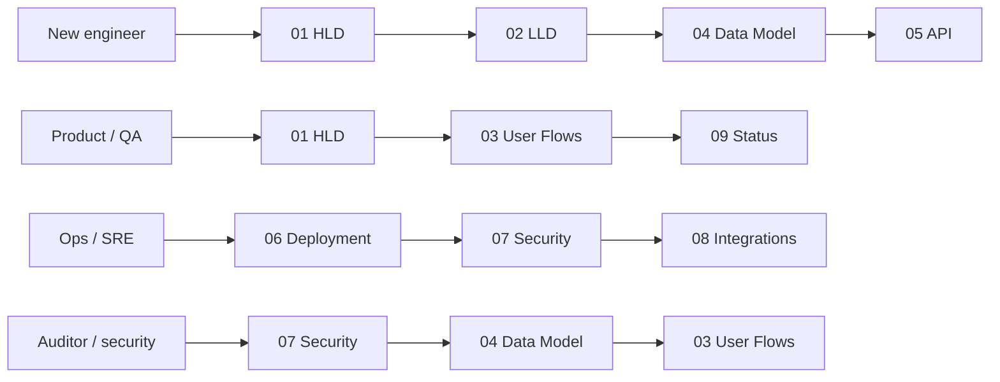

---

## 7. Getting started

### Prerequisites

| Tool | Version |
|---|---|
| Python | 3.11 (`backend_ocr/.python-version`) |
| PostgreSQL | 15 |
| Node.js | 18+ |
| Poppler | `brew install poppler` (PDF → image for OCR) |
| Foundry | only for `contracts/` |

### Run locally

```bash
# 1. Backend dependencies
pip install -r backend_ocr/requirements.txt -r requirements.txt

# 2. Environment
cp .env.example .env        # set DB_*, OPENAI_API_KEY, JWT_SECRET, APPROVAL_SECRET at minimum

# 3. API on :8001 (runs startup DDL)
./backend_ocr/run.sh

# 4. Pipeline engine (12 CDC workers)
python main.py

# 5. Frontend on :5173
cd frontend && npm install && npm run dev
```

Optional: Nova service `cd services/nova_reconciliation && uvicorn app.main:app --port 8100`; crypto rail needs `RPC_URL` and `USDC_ADDRESS` (Base Sepolia) — see [02 LLD §20](docs/platform/02_LLD.md#20-configuration-reference).

### Verify and test

```bash
curl http://localhost:8001/health          # backend
tail -f logs/pipeline.log                   # pipeline: triggers installed, workers started
pytest tests/ -v --tb=short                 # backend tests
cd frontend && npm run verify               # typecheck, lint, format, tests
cd contracts && forge test                  # smart contract
```

### Repository layout

| Path | Contents |
|---|---|
| `backend_ocr/app/` | FastAPI API: `routers/`, `domain/`, `core/`, `security/`, `integrations/`, `review/`, `ai/` |
| `main.py`, `pipelines/`, `utils/` | Pipeline engine and shared OCR / TDS / fiscal utilities |
| `frontend/` | React SPA, admin console, vendor portal, proof verifier |
| `services/nova_reconciliation/` | Nova 3-way reconciliation microservice |
| `tally_agent/`, `tally2database/` | Windows Tally agent and Tally XML library |
| `contracts/` | `OnsummAnchor.sol` (Foundry) |
| `scripts/`, `jobs/` | Migrations, backfills, seeds, FY reset |
| `tests/` | pytest suites (incl. `tests/crypto/`) |
| `docs/platform/` | This documentation set |
| `docs/TECHNICAL_REFERENCE.md` | Previous endpoint-by-endpoint technical reference |

---

## 8. Diagram atlas

Every diagram from the documentation set, in document order. Each entry names its type and links to the section that explains it.


### 8.0 Atlas summary

149 diagrams across 9 documents (plus 5 in the sections above).

| Document | Flowchart | Sequence | State machine | Class diagram | ER diagram | User journey | Schedule | Total |
|---|---:|---:|---:|---:|---:|---:|---:|---:|
| [01 High-Level Design](docs/platform/01_HLD.md) | 13 | 2 | · | · | · | · | · | **15** |
| [02 Low-Level Design](docs/platform/02_LLD.md) | 14 | 7 | 1 | 16 | · | · | · | **38** |
| [03 User Flows](docs/platform/03_USER_FLOWS.md) | 21 | 25 | 4 | · | · | 1 | · | **51** |
| [04 Data Model](docs/platform/04_DATA_MODEL.md) | 2 | · | 16 | · | 8 | · | · | **26** |
| [05 API Reference](docs/platform/05_API_REFERENCE.md) | 1 | · | · | · | · | · | · | **1** |
| [06 Deployment & Operations](docs/platform/06_DEPLOYMENT_OPERATIONS.md) | 5 | 1 | · | · | · | · | 1 | **7** |
| [07 Security](docs/platform/07_SECURITY.md) | 4 | 1 | · | · | · | · | · | **5** |
| [08 Integrations](docs/platform/08_INTEGRATIONS.md) | 4 | 2 | · | · | · | · | · | **6** |
| [09 Glossary & Status](docs/platform/09_GLOSSARY_AND_STATUS.md) | · | · | · | · | · | · | · | **0** |
| **All** | **64** | **38** | **21** | **16** | **8** | **1** | **1** | **149** |

### 8.1 01 High-Level Design

Source: [01_HLD.md](docs/platform/01_HLD.md) · 15 diagrams

| ID | Diagram | Type |
|---|---|---|
| [D01-01](#d01-01-purpose-and-scope) | Purpose and scope | Flowchart |
| [D01-02](#d01-02-actors-and-personas) | Actors and personas | Flowchart |
| [D01-03](#d01-03-system-context) | System context | Flowchart |
| [D01-04](#d01-04-architecture-overview-containers) | Architecture overview (containers) | Flowchart |
| [D01-05](#d01-05-logical-architecture--the-bill-lifecycle) | Logical architecture — the bill lifecycle | Flowchart |
| [D01-06](#d01-06-functional-modules) | Functional modules | Flowchart |
| [D01-07](#d01-07-payment-rails--rail-selection) | Payment rails › Rail selection | Flowchart |
| [D01-08](#d01-08-payment-rails--inr-imps-rail--high-level) | Payment rails › INR (IMPS) rail — high level | Sequence |
| [D01-09](#d01-09-payment-rails--usdc-rail--high-level) | Payment rails › USDC rail — high level | Sequence |
| [D01-10](#d01-10-event-driven-automation-core) | Event-driven automation core | Flowchart |
| [D01-11](#d01-11-data-architecture) | Data architecture | Flowchart |
| [D01-12](#d01-12-integration-architecture) | Integration architecture | Flowchart |
| [D01-13](#d01-13-security-architecture) | Security architecture | Flowchart |
| [D01-14](#d01-14-multi-tenancy-licensing-and-jurisdiction) | Multi-tenancy, licensing and jurisdiction | Flowchart |
| [D01-15](#d01-15-deployment-architecture) | Deployment architecture | Flowchart |

#### D01-01 Purpose and scope

*Flowchart* · from [01 High-Level Design › 1. Purpose and scope](docs/platform/01_HLD.md#1-purpose-and-scope)

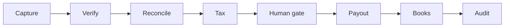

#### D01-02 Actors and personas

*Flowchart* · from [01 High-Level Design › 2. Actors and personas](docs/platform/01_HLD.md#2-actors-and-personas)

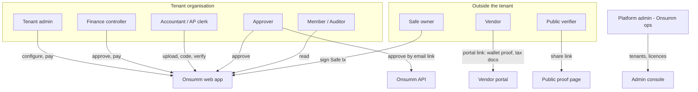

#### D01-03 System context

*Flowchart* · from [01 High-Level Design › 3. System context](docs/platform/01_HLD.md#3-system-context)

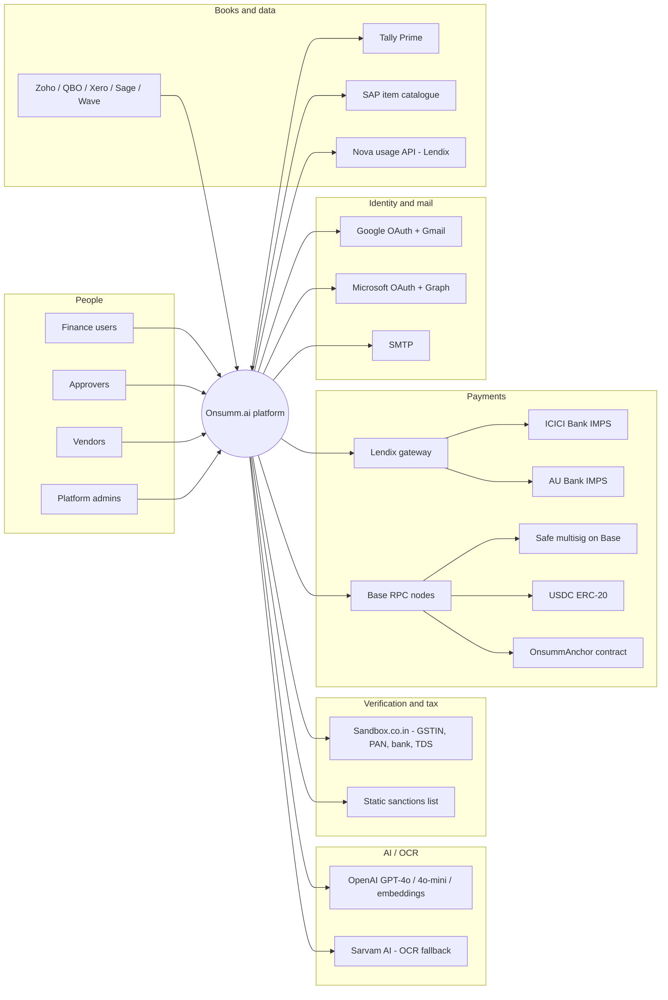

#### D01-04 Architecture overview (containers)

*Flowchart* · from [01 High-Level Design › 4. Architecture overview (containers)](docs/platform/01_HLD.md#4-architecture-overview-containers)

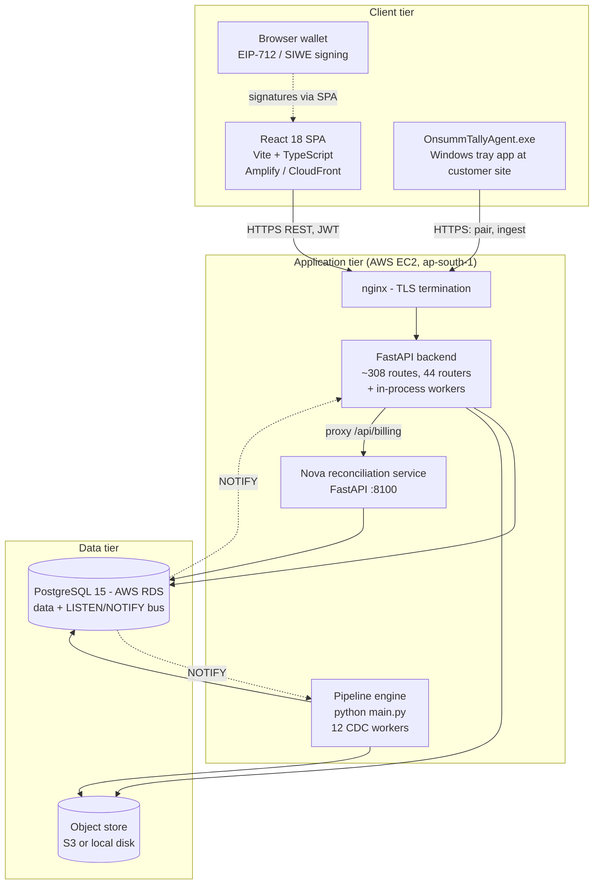

#### D01-05 Logical architecture — the bill lifecycle

*Flowchart* · from [01 High-Level Design › 5. Logical architecture — the bill lifecycle](docs/platform/01_HLD.md#5-logical-architecture--the-bill-lifecycle)

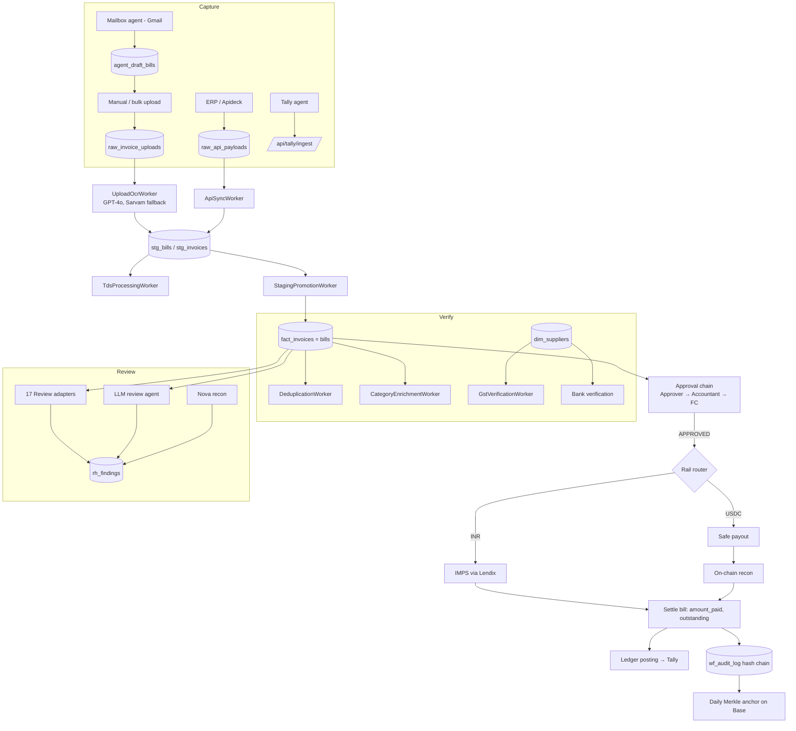

#### D01-06 Functional modules

*Flowchart* · from [01 High-Level Design › 6. Functional modules](docs/platform/01_HLD.md#6-functional-modules)

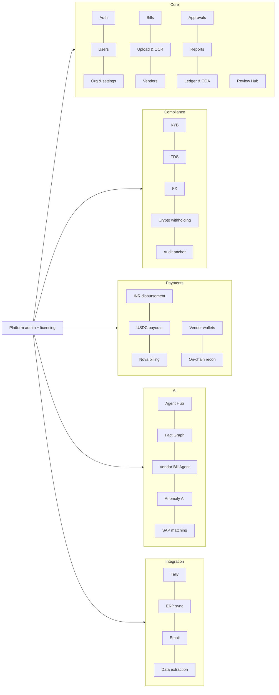

#### D01-07 Payment rails › Rail selection

*Flowchart* · from [01 High-Level Design › 7.1 Rail selection](docs/platform/01_HLD.md#71-rail-selection)

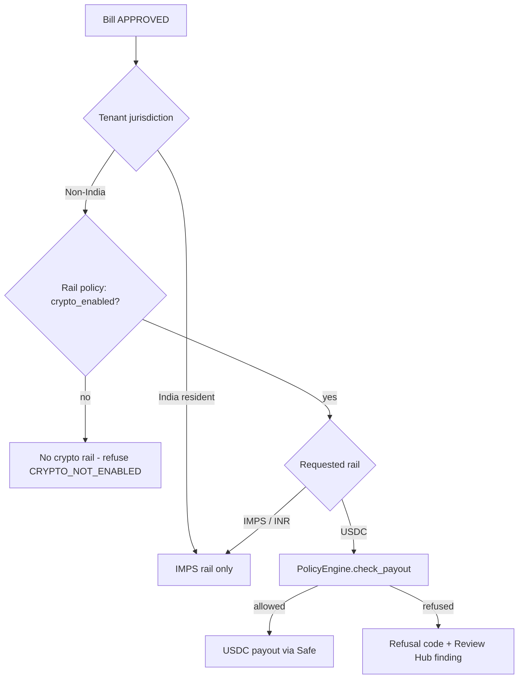

#### D01-08 Payment rails › INR (IMPS) rail — high level

*Sequence* · from [01 High-Level Design › 7.2 INR (IMPS) rail — high level](docs/platform/01_HLD.md#72-inr-imps-rail--high-level)

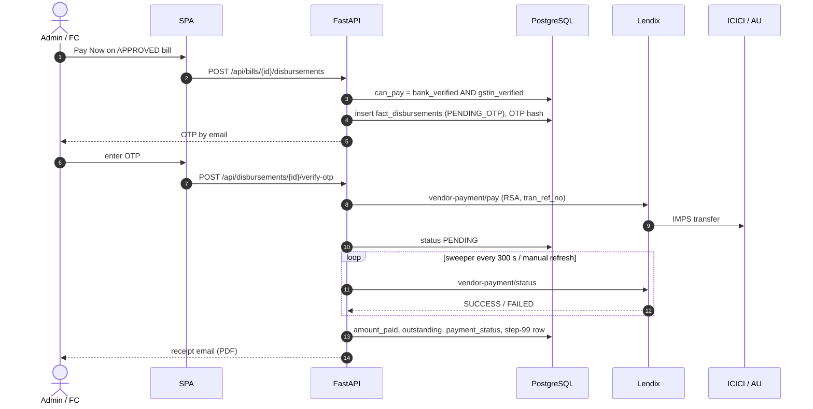

#### D01-09 Payment rails › USDC rail — high level

*Sequence* · from [01 High-Level Design › 7.3 USDC rail — high level](docs/platform/01_HLD.md#73-usdc-rail--high-level)

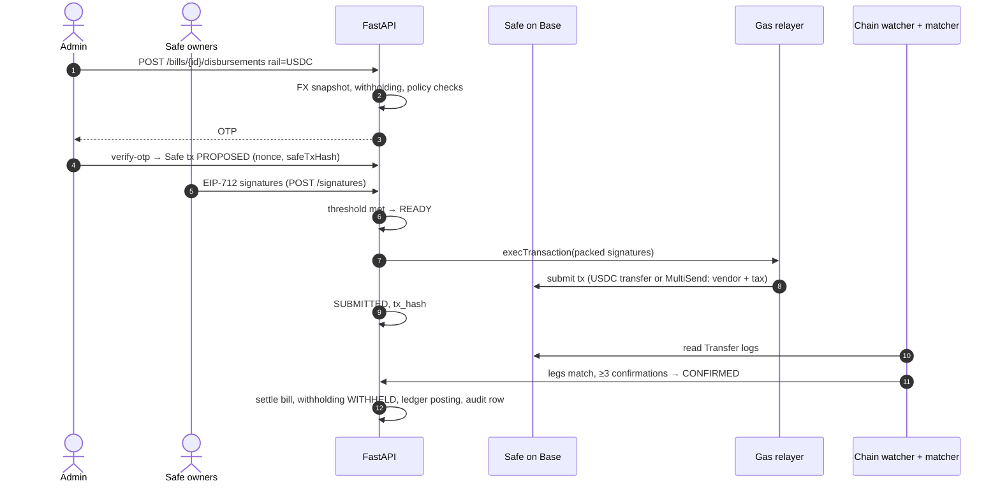

#### D01-10 Event-driven automation core

*Flowchart* · from [01 High-Level Design › 8. Event-driven automation core](docs/platform/01_HLD.md#8-event-driven-automation-core)

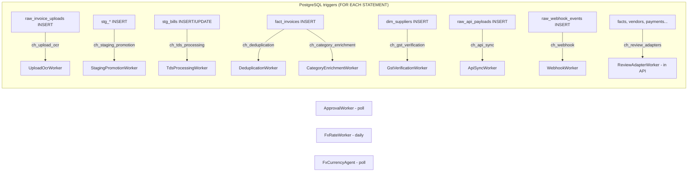

#### D01-11 Data architecture

*Flowchart* · from [01 High-Level Design › 10. Data architecture](docs/platform/01_HLD.md#10-data-architecture)

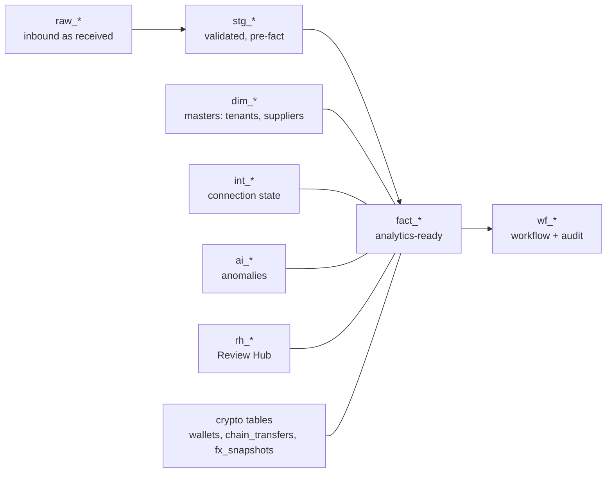

#### D01-12 Integration architecture

*Flowchart* · from [01 High-Level Design › 11. Integration architecture](docs/platform/01_HLD.md#11-integration-architecture)

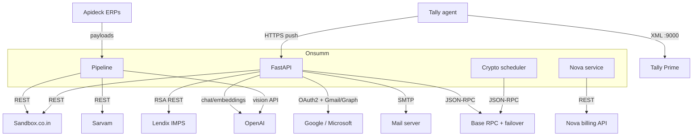

#### D01-13 Security architecture

*Flowchart* · from [01 High-Level Design › 12. Security architecture](docs/platform/01_HLD.md#12-security-architecture)

```mermaid
flowchart LR
    REQ[HTTP request] --> OBS[observability: request id, metrics]
    OBS --> AC[auth_context: verify JWT → tenant, user, role]
    AC --> LG[license_gate: route → service → entitled?]
    LG --> IG[impersonation_gate: read-only sessions]
    IG --> RT[Router handler]
    RT --> CAP[require_capability: view/edit/approve/verify/pay/admin]
    CAP --> OWN[tenancy.assert_owned → 404 if not tenant's]
    OWN --> JUR[jurisdiction_guard: pack enabled?]
    JUR --> DB[(DB, tenant_id predicate)]
```

#### D01-14 Multi-tenancy, licensing and jurisdiction

*Flowchart* · from [01 High-Level Design › 13. Multi-tenancy, licensing and jurisdiction](docs/platform/01_HLD.md#13-multi-tenancy-licensing-and-jurisdiction)

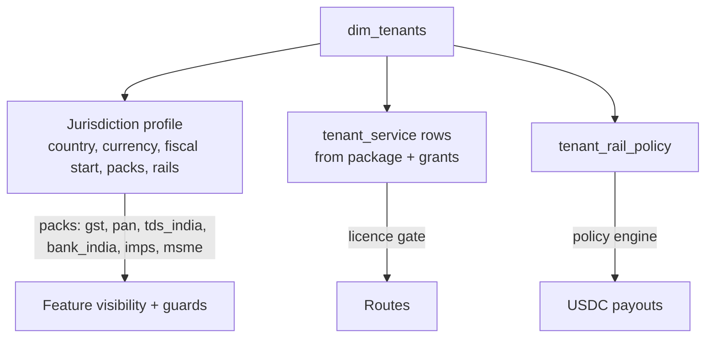

#### D01-15 Deployment architecture

*Flowchart* · from [01 High-Level Design › 14. Deployment architecture](docs/platform/01_HLD.md#14-deployment-architecture)

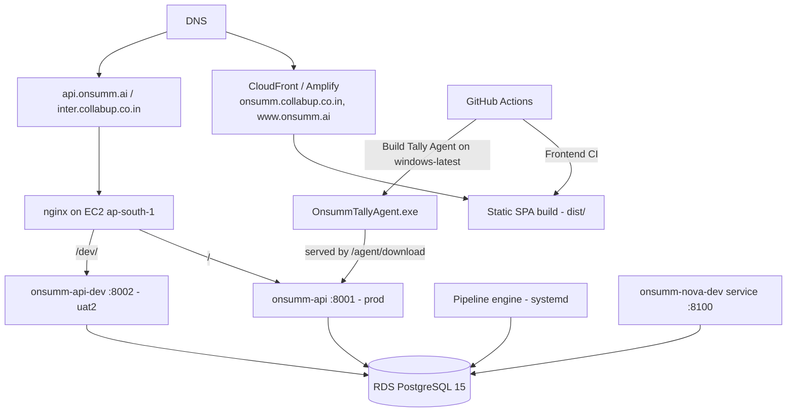

[Back to atlas summary](#80-atlas-summary)

---

### 8.2 02 Low-Level Design

Source: [02_LLD.md](docs/platform/02_LLD.md) · 38 diagrams

| ID | Diagram | Type |
|---|---|---|
| [D02-01](#d02-01-backend-layering-and-dependency-rules) | Backend layering and dependency rules | Flowchart |
| [D02-02](#d02-02-request-processing-pipeline) | Request processing pipeline | Sequence |
| [D02-03](#d02-03-security-module-classes) | Security module classes | Class diagram |
| [D02-04](#d02-04-core-module-classes) | Core module classes | Class diagram |
| [D02-05](#d02-05-pipeline-engine-cdc-workers--class-hierarchy) | Pipeline engine (CDC workers) › Class hierarchy | Class diagram |
| [D02-06](#d02-06-pipeline-engine-cdc-workers--worker-lifecycle) | Pipeline engine (CDC workers) › Worker lifecycle | State machine |
| [D02-07](#d02-07-pipeline-engine-cdc-workers--runner) | Pipeline engine (CDC workers) › Runner | Sequence |
| [D02-08](#d02-08-pipeline-engine-cdc-workers--ocr-merge-rule-uploadocrworker) | Pipeline engine (CDC workers) › OCR merge rule (UploadOcrWorker) | Flowchart |
| [D02-09](#d02-09-review-hub--detection-side-classes) | Review Hub › Detection-side classes | Class diagram |
| [D02-10](#d02-10-review-hub--finding-model-and-helpers) | Review Hub › Finding model and helpers | Class diagram |
| [D02-11](#d02-11-review-hub--adapter-worker-cycle) | Review Hub › Adapter worker cycle | Sequence |
| [D02-12](#d02-12-review-hub--llm-review-agent) | Review Hub › LLM review agent | Sequence |
| [D02-13](#d02-13-inr-disbursement-module--classes) | INR disbursement module › Classes | Class diagram |
| [D02-14](#d02-14-inr-disbursement-module--verify-otp-internals) | INR disbursement module › Verify-OTP internals | Flowchart |
| [D02-15](#d02-15-crypto-rail--class-model--payout-composition) | Crypto rail — class model › Payout composition | Class diagram |
| [D02-16](#d02-16-crypto-rail--class-model--custody-chain-screening-and-wallets) | Crypto rail — class model › Custody, chain, screening and wallets | Class diagram |
| [D02-17](#d02-17-crypto-rail--class-model--withholding-rule-packs-part-1-of-2) | Crypto rail — class model › Withholding rule packs (part 1 of 2) | Class diagram |
| [D02-18](#d02-18-crypto-rail--class-model--withholding-rule-packs-part-2-of-2) | Crypto rail — class model › Withholding rule packs (part 2 of 2) | Flowchart |
| [D02-19](#d02-19-crypto-rail--class-model--recon-watcher-ledger-findings) | Crypto rail — class model › Recon, watcher, ledger, findings | Class diagram |
| [D02-20](#d02-20-crypto-rail--class-model--crypto-scheduler) | Crypto rail — class model › Crypto scheduler | Flowchart |
| [D02-21](#d02-21-crypto-rail--internal-sequences--payoutserviceprepare) | Crypto rail — internal sequences › `PayoutService.prepare` | Sequence |
| [D02-22](#d02-22-crypto-rail--internal-sequences--release_after_otp-and-nonce-selection) | Crypto rail — internal sequences › `release_after_otp` and nonce selection | Flowchart |
| [D02-23](#d02-23-crypto-rail--internal-sequences--add_signature-and-_relay) | Crypto rail — internal sequences › `add_signature` and `_relay` | Sequence |
| [D02-24](#d02-24-crypto-rail--internal-sequences--mark_confirmed) | Crypto rail — internal sequences › `mark_confirmed` | Flowchart |
| [D02-25](#d02-25-crypto-rail--internal-sequences--chain-watcher-tick-with-reorg-handling) | Crypto rail — internal sequences › Chain watcher tick with reorg handling | Flowchart |
| [D02-26](#d02-26-audit-chain-and-anchoring--classes) | Audit chain and anchoring › Classes | Class diagram |
| [D02-27](#d02-27-audit-chain-and-anchoring--merkle-construction) | Audit chain and anchoring › Merkle construction | Flowchart |
| [D02-28](#d02-28-smart-contract-onsummanchor) | Smart contract: OnsummAnchor | Class diagram |
| [D02-29](#d02-29-ai--llm-layer-and-fact-graph) | AI / LLM layer and Fact Graph | Class diagram |
| [D02-30](#d02-30-ingest-and-ocr--domainingestingest_invoice-transaction) | Ingest and OCR › `domain/ingest.ingest_invoice` transaction | Sequence |
| [D02-31](#d02-31-ingest-and-ocr--synchronous-ocr-endpoint) | Ingest and OCR › Synchronous OCR endpoint | Flowchart |
| [D02-32](#d02-32-approval-chain-engine-part-1-of-2) | Approval chain engine (part 1 of 2) | Flowchart |
| [D02-33](#d02-33-approval-chain-engine-part-2-of-2) | Approval chain engine (part 2 of 2) | Flowchart |
| [D02-34](#d02-34-nova-reconciliation-service) | Nova reconciliation service | Class diagram |
| [D02-35](#d02-35-tally-agent-and-connector) | Tally agent and connector | Class diagram |
| [D02-36](#d02-36-frontend-lld--module-structure) | Frontend LLD › Module structure | Flowchart |
| [D02-37](#d02-37-frontend-lld--key-frontend-components-classes) | Frontend LLD › Key frontend components (classes) | Class diagram |
| [D02-38](#d02-38-error-handling-and-observability) | Error handling and observability | Flowchart |

#### D02-01 Backend layering and dependency rules

*Flowchart* · from [02 Low-Level Design › 2. Backend layering and dependency rules](docs/platform/02_LLD.md#2-backend-layering-and-dependency-rules)

```mermaid
flowchart TB
    R[routers/* - HTTP surface]
    D[domain/* - business logic]
    RV[review/* - detection]
    I[integrations/* - outbound clients]
    C[core/* - shared building blocks]
    S[security/* - identity, tenancy, entitlement]
    CFG[config.py - env + DB pool]
    DB[(PostgreSQL)]

    R --> D
    R --> C
    R --> S
    R --> I
    D --> I
    D --> C
    RV --> D
    RV --> C
    I --> CFG
    C --> CFG
    S --> CFG
    CFG --> DB
```

#### D02-02 Request processing pipeline

*Sequence* · from [02 Low-Level Design › 3. Request processing pipeline](docs/platform/02_LLD.md#3-request-processing-pipeline)

```mermaid
sequenceDiagram
    autonumber
    participant C as Client
    participant RA as ReviewAuditMiddleware (ASGI)
    participant CORS as CORSMiddleware
    participant OBS as observability _observe
    participant AC as auth_context
    participant LG as license_gate
    participant IG as impersonation_gate
    participant H as Route handler
    participant DB

    C->>RA: HTTP request
    RA->>CORS: pass (records /api/review mutations + X-Review-Finding)
    CORS->>OBS: pass
    OBS->>OBS: X-Request-ID (generate if absent), IN_PROGRESS++
    OBS->>AC: dependency
    AC->>AC: public path? else decode JWT (HS256 JWT_SECRET or RBAC keys)
    AC->>AC: set contextvars: tenant, user, role, impersonation
    AC->>LG: dependency
    LG->>LG: service_for_route(method, template) - longest match
    LG->>DB: entitlements(tenant) - cached 300 s
    alt not entitled and LICENSE_ENFORCEMENT=enforce
        LG-->>C: 403
    end
    LG->>IG: dependency
    IG->>IG: impersonation token and write method? → 403 (allowlist empty)
    IG->>H: call
    H->>H: require_tenant(), require_role / require_capability / require_service / require_pack
    H->>DB: queries with AND tenant_id = %s
    H->>H: assert_owned → 404 on foreign rows
    H-->>OBS: response
    OBS->>OBS: REQUESTS{method,route,status}, LATENCY, scrub 5xx body
    OBS-->>C: response + X-Request-ID
```

#### D02-03 Security module classes

*Class diagram* · from [02 Low-Level Design › 4. Security module classes](docs/platform/02_LLD.md#4-security-module-classes)

```mermaid
classDiagram
    direction LR
    class auth {
        <<module>>
        +PUBLIC_PATHS: set
        +PUBLIC_PREFIXES: tuple
        +PLATFORM_PREFIX = "/api/admin/"
        +decode_token(token) dict
        +auth_context(request) async
        +require_tenant() str
        +current_user() str
        +current_roles() list
        +require_role(*allowed) Depends
        +require_platform_role(min_role) Depends
        +current_impersonation() dict
    }
    class capabilities {
        <<module>>
        +CAPABILITY_ROLES: dict
        +GLOBAL_VIEW_ROLES
        +READ_ONLY_ROLES
        +can(role, capability) bool
        +require_capability(cap) Depends
    }
    class ServiceDef {
        <<frozen dataclass>>
        +key: str
        +display_name: str
        +category: str
        +is_core: bool
        +default_enabled: bool
        +metered_unit: str
        +description: str
    }
    class services {
        <<module>>
        +SERVICES: tuple~ServiceDef~
        +CATEGORIES
        +SERVICE_KEYS
        +CORE_KEYS
        +BY_KEY
        +METERED
    }
    class Entitlements {
        <<frozen dataclass>>
        +enabled: frozenset
        +limits: dict
    }
    class licensing {
        <<module>>
        -_RULES: list
        +service_for_route(method, template) str
        +entitlements(tenant_id) Entitlements
        +license_gate(request) async
        +impersonation_gate(request) async
        +require_service(key) Depends
        +invalidate(tenant_id)
    }
    class tenancy {
        <<module>>
        +assert_owned(cur, table, id, tenant)
        +owned_bill(cur, id, tenant)
        +owned_vendor(cur, id, tenant)
        +owned_attachment(cur, id, tenant)
    }
    services "1" o-- "26" ServiceDef
    licensing ..> Entitlements : builds
    licensing ..> services : keys
    capabilities ..> auth : current_roles
    tenancy ..> auth : require_tenant
```

#### D02-04 Core module classes

*Class diagram* · from [02 Low-Level Design › 5. Core module classes](docs/platform/02_LLD.md#5-core-module-classes)

```mermaid
classDiagram
    direction LR
    class Jurisdiction {
        <<frozen dataclass>>
        +profile: str
        +country_code: str
        +base_currency: str
        +is_resident_india: bool
        +locale: str
        +timezone: str
        +fiscal_year_start_month: int
        +tax_id_label: str
        +indirect_tax_label: str
        +packs: dict
        +rails: tuple
        +has(pack) bool
        +to_dict() dict
    }
    class jurisdiction {
        <<module>>
        +INDIA: Jurisdiction
        +build(row) Jurisdiction
        +get_jurisdiction(tenant_id) Jurisdiction
        +has_pack(tenant_id, pack) bool
        +pack_enabled_sql(pack) str
    }
    class jurisdiction_guard {
        <<module>>
        +require_pack(pack) Depends
        +assert_pack(tenant_id, pack)
    }
    class approval_chain {
        <<module>>
        +PENDING_APPROVER
        +PENDING_ACCOUNTANT
        +PENDING_FC
        +load_chain(tenant, department) list
        +statuses(chain) list
        +allowed_roles(chain, status) set
        -cache TTL 300 s
    }
    class tokens {
        <<module>>
        +build_access_token(user) str
        +mint_refresh_token() str
        +hash_token(raw) str
        ACCESS_TOKEN_TTL_MIN = 60
        REFRESH_TOKEN_TTL_DAYS = 30
    }
    class PoolConn {
        <<context manager>>
        +__enter__() connection
        +__exit__() returns to pool
    }
    class object_store {
        <<module>>
        +put(key, bytes)
        +get(key) bytes
        +signed_url(key) str
        S3 or local disk
    }
    class observability {
        <<module>>
        +install(app)
        REQUESTS Counter
        LATENCY Histogram
        IN_PROGRESS Gauge
        UNHANDLED Counter
        POOL_IN_USE Gauge
        POOL_MAX Gauge
    }
    class JsonFormatter
    class RequestIdFilter
    JsonFormatter --|> logging_Formatter
    RequestIdFilter --|> logging_Filter
    jurisdiction o-- Jurisdiction
    jurisdiction_guard ..> jurisdiction
    observability ..> JsonFormatter
    observability ..> RequestIdFilter
```

#### D02-05 Pipeline engine (CDC workers) › Class hierarchy

*Class diagram* · from [02 Low-Level Design › 6.1 Class hierarchy](docs/platform/02_LLD.md#61-class-hierarchy)

```mermaid
classDiagram
    class BaseWorker {
        <<abstract>>
        +name: str = "base"
        +notify_channel: str or None
        +skip_backfill: bool = False
        #_cfg: dict
        #_current_batch_size: int
        +batch_size: int
        +run() async
        #_run_backfill() async
        #_run_incremental() async
        #_run_listen_notify() async
        #_run_poll() async
        +process_batch()* int
        +log_error(table, id, err)
        +log_audit(conn, ...)$
        #_safe(coro)
    }
    class ApiSyncWorker {
        name = api_sync
        ch_api_sync
    }
    class WebhookWorker {
        name = webhook
        ch_webhook
    }
    class UploadOcrWorker {
        name = upload_ocr / ch_upload_ocr
        -_advance_received()
        -_advance_ocr_primary()
        -_advance_ocr_fallback()
        -_advance_validating()
    }
    class StagingPromotionWorker {
        name = staging_promotion
        -_promote_invoices()
        -_promote_bills()
        -_promote_payments()
    }
    class ApprovalWorker {
        name = approval
        poll
        skip_backfill
    }
    class DeduplicationWorker {
        name = deduplication
    }
    class GstVerificationWorker {
        name = gst_verification
        -_get_token()
        -_verify_gstin()
        -_decide()
        -_process_table()
    }
    class BankVerificationWorker {
        name = bank_verification
        DISABLED
    }
    class CategoryEnrichmentWorker {
        name = category_enrichment
    }
    class TdsProcessingWorker {
        name = tds_processing
        -_process_one()
        -_settle_not_applicable()
        -_write()
    }
    class FxRateWorker {
        name = fx_rate
        overrides run()
    }
    class FxCurrencyAgent {
        name = fx_agent
        GPT-4o-mini notes
    }
    class TallyReadWorker {
        name = tally_read
        DISABLED
    }
    class TallySyncWorker {
        name = tally_sync
        DISABLED
    }

    BaseWorker <|-- ApiSyncWorker
    BaseWorker <|-- WebhookWorker
    BaseWorker <|-- UploadOcrWorker
    BaseWorker <|-- StagingPromotionWorker
    BaseWorker <|-- ApprovalWorker
    BaseWorker <|-- DeduplicationWorker
    BaseWorker <|-- GstVerificationWorker
    BaseWorker <|-- BankVerificationWorker
    BaseWorker <|-- CategoryEnrichmentWorker
    BaseWorker <|-- TdsProcessingWorker
    BaseWorker <|-- FxRateWorker
    BaseWorker <|-- FxCurrencyAgent
    BaseWorker <|-- TallyReadWorker
    BaseWorker <|-- TallySyncWorker
```

#### D02-06 Pipeline engine (CDC workers) › Worker lifecycle

*State machine* · from [02 Low-Level Design › 6.2 Worker lifecycle](docs/platform/02_LLD.md#62-worker-lifecycle)

```mermaid
stateDiagram-v2
    [*] --> Backfill: run()
    [*] --> Incremental: skip_backfill
    state Backfill {
        [*] --> Drain
        Drain --> Drain: process_batch() returned backfill_batch rows
        Drain --> [*]: fewer rows than batch
    }
    Backfill --> Incremental
    state Incremental {
        [*] --> Mode
        Mode --> Listen: notify_channel set
        Mode --> Poll: no channel
        Listen --> Work: NOTIFY received or idle_poll_interval_s (60 s) safety poll
        Work --> Listen: drained
        Poll --> Work2: poll_interval_s (5 s)
        Work2 --> Poll: rows processed (reset backoff)
        Work2 --> Backoff: no rows / error
        Backoff --> Poll: exponential, cap error_backoff_cap_s (120 s)
    }
```

#### D02-07 Pipeline engine (CDC workers) › Runner

*Sequence* · from [02 Low-Level Design › 6.3 Runner](docs/platform/02_LLD.md#63-runner)

```mermaid
sequenceDiagram
    participant M as main.py
    participant DB
    participant W as Workers
    M->>DB: init_pool (asyncpg min 2 / max 10)
    M->>DB: pg_try_advisory_lock(875_291_004_417)
    alt lock held elsewhere
        M-->>M: exit(1)
    end
    M->>DB: create_notify_triggers()
    M->>W: asyncio.create_task(worker.run()) × 11 enabled
    Note over M: logs/pipeline.log + logs/<worker>.log via _WorkerLogFilter
    M->>M: SIGINT/SIGTERM → _shutdown → _watchdog cancels tasks
```

#### D02-08 Pipeline engine (CDC workers) › OCR merge rule (UploadOcrWorker)

*Flowchart* · from [02 Low-Level Design › 6.4 OCR merge rule (UploadOcrWorker)](docs/platform/02_LLD.md#64-ocr-merge-rule-uploadocrworker)

```mermaid
flowchart TD
    A[PREPROCESSING: PDF → images via pdftoppm] --> B[GPT-4o vision extraction + per-field confidence]
    B --> C{overall confidence >= 0.6?}
    C -->|yes| V[VALIDATING]
    C -->|no| D[OCR_FALLBACK: Sarvam AI]
    D --> E[Per field: keep value with higher confidence weight]
    E --> F[ocr_engine = MERGED] --> V
    V --> G{Required fields + totals consistent?}
    G -->|yes| H[insert stg_bills / stg_invoices → DONE]
    G -->|no| ERR[ERROR + raw_ingestion_errors]
```

#### D02-09 Review Hub › Detection-side classes

*Class diagram* · from [02 Low-Level Design › 7.1 Detection-side classes](docs/platform/02_LLD.md#71-detection-side-classes)

```mermaid
classDiagram
    class BaseWorker_review {
        <<abstract>>
        copy of pipelines/base.py
    }
    class ReviewAdapterWorker {
        name = review_adapters
        notify_channel = ch_review_adapters
        SCAN_LIMIT = 500
        +process_batch() int
    }
    class ReviewAgentWorker {
        name = review_agent
        notify_channel = ch_review_agent
        skip_backfill = True
    }
    class CommExtractionWorker {
        name = comm_extraction
        notify_channel = ch_comm_extract
        skip_backfill = True
    }
    BaseWorker_review <|-- ReviewAdapterWorker
    BaseWorker_review <|-- ReviewAgentWorker
    BaseWorker_review <|-- CommExtractionWorker

    class FindingAdapter {
        <<abstract>>
        +detector: str
        +family: str
        +source_service: str = "bills"
        +scan(conn, tenant_id, limit)* AsyncIterator~FindingDraft~
    }
    class AnomaliesAdapter
    class ApprovalStallsAdapter
    class BillCodingAdapter
    class BillingDiscrepanciesAdapter
    class CommStallAdapter
    class ContractBillVarianceAdapter
    class FxAlertsAdapter
    class GstNameOverwriteAdapter
    class IngestionErrorsAdapter
    class MappingQueueAdapter
    class MasterDataConflictAdapter
    class OcrQualityAdapter
    class PaymentFailuresAdapter
    class StagingValidationAdapter
    class VendorComplianceAdapter
    class VendorDuplicatesAdapter
    class VendorIdentityAdapter
    FindingAdapter <|-- AnomaliesAdapter
    FindingAdapter <|-- ApprovalStallsAdapter
    FindingAdapter <|-- BillCodingAdapter
    FindingAdapter <|-- BillingDiscrepanciesAdapter
    FindingAdapter <|-- CommStallAdapter
    FindingAdapter <|-- ContractBillVarianceAdapter
    FindingAdapter <|-- FxAlertsAdapter
    FindingAdapter <|-- GstNameOverwriteAdapter
    FindingAdapter <|-- IngestionErrorsAdapter
    FindingAdapter <|-- MappingQueueAdapter
    FindingAdapter <|-- MasterDataConflictAdapter
    FindingAdapter <|-- OcrQualityAdapter
    FindingAdapter <|-- PaymentFailuresAdapter
    FindingAdapter <|-- StagingValidationAdapter
    FindingAdapter <|-- VendorComplianceAdapter
    FindingAdapter <|-- VendorDuplicatesAdapter
    FindingAdapter <|-- VendorIdentityAdapter
    ReviewAdapterWorker o-- "17" FindingAdapter : ALL_ADAPTERS
```

#### D02-10 Review Hub › Finding model and helpers

*Class diagram* · from [02 Low-Level Design › 7.2 Finding model and helpers](docs/platform/02_LLD.md#72-finding-model-and-helpers)

```mermaid
classDiagram
    class FindingDraft {
        <<dataclass>>
        +tenant_id
        +finding_type
        +family
        +subject_type
        +subject_id
        +severity
        +title
        +deep_link
        +condition_hash
        +detector
        +detail
        +entities
        +confidence
        +verification
        +money_at_risk
        +money_currency
        +money_at_risk_inr
        +due_at
        +evidence
        +actions
        +audience_roles
        +audience_users
        +audience_departments
        +required_capability
        +source_service
        +detector_version
        +agent_run_id
        +model
        +cost_usd
        +type_id
        +key_qualifier
        +finding_key() str
    }
    class store {
        <<module>>
        +upsert_finding(conn, draft)
        +sweep_autoresolve(conn, detector, seen_keys)
        +apply_suppression(conn, tenant)
        +record_event(conn, finding_id, type)
        +set_status(conn, id, status, reason)
        +undo(conn, token)
    }
    class Audience {
        +roles
        +users
        +departments
        +capability
    }
    class routing {
        <<module>>
        +audience_for_bill_status(status) Audience
        +vendor_audience() Audience
        +payment_audience() Audience
    }
    class ranking {
        <<module>>
        +rank_score(finding) float
        +lane_for(finding) str
    }
    class Subject
    class Decision
    class triage {
        <<module>>
        +should_review(subject) Decision
        +idempotency_key(subject) str
    }
    class Verdict {
        +status
        +checked
        +refuted
        +values
        +note
    }
    class verifier {
        <<module>>
        +verify_claims(dossier, claims) Verdict
        +log_reject()
    }
    class Redactor {
        +mapping
        +scrub(text) str
        +restore(text) str
    }
    class ReviewAuditMiddleware {
        <<ASGI>>
        writes rh_audit_log with before/after snapshots
    }
    store ..> FindingDraft
    routing ..> Audience
    triage ..> Subject
    triage ..> Decision
    verifier ..> Verdict
```

#### D02-11 Review Hub › Adapter worker cycle

*Sequence* · from [02 Low-Level Design › 7.3 Adapter worker cycle](docs/platform/02_LLD.md#73-adapter-worker-cycle)

```mermaid
sequenceDiagram
    participant DB
    participant W as ReviewAdapterWorker
    participant A as FindingAdapter (each)
    participant S as store
    DB-->>W: NOTIFY ch_review_adapters
    loop each tenant
        loop each licensed adapter
            W->>A: scan(conn, tenant, 500)
            A-->>W: FindingDraft stream
            W->>S: upsert_finding (partial unique tenant_id + finding_key while open)
            Note over S: new → DETECTED, OPEN<br/>same key, changed condition_hash → REDETECTED, ACK → OPEN
            W->>S: sweep_autoresolve(keys not re-asserted → AUTO_RESOLVED)
        end
        W->>S: apply_suppression
    end
```

#### D02-12 Review Hub › LLM review agent

*Sequence* · from [02 Low-Level Design › 7.4 LLM review agent](docs/platform/02_LLD.md#74-llm-review-agent)

```mermaid
sequenceDiagram
    participant API as POST /api/review/rescan
    participant DB
    participant AW as ReviewAgentWorker
    participant T as triage
    participant DS as dossier
    participant RD as Redactor
    participant LLM as ai/llm.complete_json
    participant VF as verifier
    participant S as store
    API->>DB: rh_review_requests PENDING (idempotency_key)
    DB-->>AW: NOTIFY ch_review_agent
    AW->>DB: claim → RUNNING
    AW->>T: should_review(subject)
    alt skip
        AW->>DB: SKIPPED
    else review
        AW->>DS: build_bill_dossier + dossier_hash
        AW->>RD: scrub PII, fence untrusted text
        AW->>LLM: prompt (tier cheap/standard/deep), budget check
        LLM-->>AW: JSON claims + usage (agent_runs)
        AW->>VF: verify_claims against DB values
        alt refuted
            AW->>DB: rh_finding_rejects
        else verified / unverifiable
            AW->>S: upsert_finding (detector agent:*)
        end
        AW->>DB: DONE
    end
```

#### D02-13 INR disbursement module › Classes

*Class diagram* · from [02 Low-Level Design › 8.1 Classes](docs/platform/02_LLD.md#81-classes)

```mermaid
classDiagram
    direction LR
    class Rail {
        <<interface>>
        +name: str
        +currency_kind: str
        +available_for(jurisdiction, policy) bool
    }
    class ImpsRail {
        <<frozen dataclass>>
    }
    class UsdcRail {
        <<frozen dataclass>>
        refuses India-resident tenants
    }
    Rail <|.. ImpsRail
    Rail <|.. UsdcRail

    class BankAdapter {
        <<interface>>
        +code: str
        +label: str
        +to_txn_status(wire) str
        +is_terminal(status) bool
        +may_reinitiate(status) bool
        +explain(code) str
    }
    class BankAdapterImpl {
        +code
        +label
        +wire
        +txn_status
        +terminal
        +explain
        +reinitiate
        +min_amount
        +max_amount
        +bulk_max
        +check_amount(amount)
        +check_batch(n)
    }
    BankAdapter <|.. BankAdapterImpl
    BankAdapterImpl ..> icici : wraps
    BankAdapterImpl ..> hdfc : wraps
    BankAdapterImpl ..> au_bank : wraps
    class icici {
        <<module>> ActCodeInfo TypedDict
    }
    class hdfc {
        <<module>> HdfcStatusInfo TypedDict
    }
    class au_bank {
        <<module>> AuStatusInfo TypedDict
    }

    class imps_client {
        <<module>>
        +vendor_payment_pay(payload) dict
        +vendor_payment_status(tran_ref_no) dict
        RSA-encrypted payloads
    }
    class ImpsApiError
    imps_client ..> ImpsApiError

    class disbursement_router {
        <<router>>
        -_tid()
        -_resolve_beneficiary()
        -_assert_imps_available()
        -_assert_not_already_in_flight()
        -_real_imps_initiate()
        -_forced_success_initiate()
        -_canonical_status()
        -_apply_success()
        -_expire_stale_otps()
        +reconcile_disbursement()
    }
    disbursement_router ..> imps_client
    disbursement_router ..> BankAdapter : for_bank()
    disbursement_router ..> PayoutService : rail == USDC

    class Receipt {
        <<frozen dataclass>>
        +payer_name
        +vendor_name
        +beneficiary_name
        +beneficiary_account
        +paid_at
        +bills: tuple~ReceiptBill~
        +method
        +total()
        +references()
    }
    class ReceiptBill {
        <<frozen dataclass>>
        +number
        +amount
        +date
        +reference
        +outstanding
    }
    Receipt o-- ReceiptBill
    class notify {
        <<module>> enqueue_payment_receipt
        send_payment_receipt
    }
    class sweeper {
        <<module>> sweep_once
        run_sweeper
    }
    notify ..> Receipt
    sweeper ..> disbursement_router : reconcile_disbursement
```

#### D02-14 INR disbursement module › Verify-OTP internals

*Flowchart* · from [02 Low-Level Design › 8.2 Verify-OTP internals](docs/platform/02_LLD.md#82-verify-otp-internals)

```mermaid
flowchart TD
    A[POST verify-otp] --> B[SELECT ... FOR UPDATE, tenant + id]
    B --> C{status = PENDING_OTP?}
    C -->|no| X1[400 not awaiting OTP]
    C -->|yes| D{expired? and not demo OTP}
    D -->|yes| X2[status FAILED, audit otp_expired, 400]
    D -->|no| E{attempts >= 5?}
    E -->|yes| X3[400]
    E -->|no| F{sha256 matches?}
    F -->|no| X4[attempts++, audit otp_failed, 400]
    F -->|yes| G{rail}
    G -->|USDC| U[PayoutService.release_after_otp]
    G -->|IMPS| H[audit otp_verified, commit]
    H --> I[_real_imps_initiate: Lendix pay with tran_ref_no]
    I -->|exception after hand-off| P[PENDING, outcome unknown]
    I --> J[_canonical_status]
    J -->|SUCCESS| K[_apply_success]
    J -->|FAILED| L[FAILED + act_code explain]
    J -->|other| P
    K --> M[remitter balance −, bill amount_paid/outstanding/payment_status, step 99, receipt]
```

#### D02-15 Crypto rail — class model › Payout composition

*Class diagram* · from [02 Low-Level Design › 9.1 Payout composition](docs/platform/02_LLD.md#91-payout-composition)

```mermaid
classDiagram
    direction TB
    class PayoutService {
        +PayoutService(chain=None, custody=None)
        +preview_withholding(cur, tenant, invoice, amount)
        +prepare(cur, tenant, invoice, amount, user) dict
        +release_after_otp(cur, tenant, disbursement_id) dict
        +safe_tx_view(cur, tenant, id) dict
        +add_signature(cur, tenant, id, signer, sig) dict
        +retry_ready(cur)
        +status(cur, tenant, id) dict
        +pending(cur, tenant) list
        +repropose(cur, tenant, id)
        +keep_only(cur, tenant, id)
        +cancel(cur, tenant, id, reason)
        -_relay(cur, row)
        -_demo_settle(cur, row)
        -_nonce_queue(cur, treasury)
        -_free_nonce(cur, treasury)
        -_sync_safe(cur, treasury)
        -_fresh_screening(cur, wallet)
        -_inflight(cur, tenant, invoice)
        -_daily_total_usd(cur, tenant)
    }
    class PolicyEngine {
        +check_tenant(jurisdiction, policy) PolicyResult
        +check_payout(ctx) PolicyResult
        +needs_dual_control(amount_usd, policy) bool
    }
    class PolicyResult {
        +allowed: bool
        +codes: list
        +messages: list
        +refuse(code, msg)
        +as_dict()
    }
    class PayoutContext {
        +tenant_id
        +is_resident_india
        +policy
        +chain
        +token
        +wallet
        +screening_result
        +amount_usd
        +daily_total_usd
        +gross_units
        +treasury_balance_units
        +outstanding
        +amount
        +inflight_amount
        +inflight_rails
        +now
    }
    class FxService {
        +usd_rate(ccy)$
        +quote(bill_ccy, amount) FxSnapshot
        +snapshot(cur, ...) FxSnapshot
        +load(cur, id) FxSnapshot
    }
    class FxSnapshot {
        <<frozen>>
        +id
        +token
        +token_usd
        +usd_functional
        +usd_inr
        +bill_currency
        +usd_bill
        +source
        +bill_to_units(amount) int
        +rate_for(ccy)
        +fiat_to_units(amount, ccy) int
        +bill_to_usd(amount)
    }
    class WithholdingEngine {
        +select_pack(inp) RulePack
        +compute(inp, snapshot, gross_units) WithholdingResult
    }
    class CryptoSettings {
        <<frozen>>
        +chain
        +chain_id
        +rpc_urls
        +explorer_url
        +usdc_address
        +usdc_decimals
        +multisend_call_only_address
        +relayer_key
        +anchor_signer_key
        +anchor_contract
        +confirmations
        +watch_poll_seconds
        +screening_list_path
        +vendor_portal_token_ttl_hours
        +portal_base_url
        +fx_source
        +settlement_mode
        +demo_settlement() bool
        +configured() bool
    }
    class EvmChain
    class SafeCustody
    class WalletService
    class RailRouter {
        +normalise(name)
        +select(cur, tenant, requested) tuple
        +available(cur, tenant) list
    }

    PayoutService *-- PolicyEngine
    PayoutService *-- FxService
    PayoutService *-- WithholdingEngine
    PayoutService o-- CryptoSettings
    PayoutService o-- EvmChain : lazy
    PayoutService o-- SafeCustody : lazy
    PayoutService ..> WalletService : active_wallet
    PolicyEngine ..> PayoutContext
    PolicyEngine ..> PolicyResult
    FxService ..> FxSnapshot
    RailRouter *-- PolicyEngine
```

#### D02-16 Crypto rail — class model › Custody, chain, screening and wallets

*Class diagram* · from [02 Low-Level Design › 9.2 Custody, chain, screening and wallets](docs/platform/02_LLD.md#92-custody-chain-screening-and-wallets)

```mermaid
classDiagram
    direction LR
    class CustodyProvider {
        <<interface>>
        +info(address) SafeInfo
        +balance(address) int
        +build_payout(safe, transfers, nonce) dict
        +tx_hash(tx) bytes
        +recover_signer(tx_hash, sig) str
        +execute(safe, tx, signatures) str
    }
    class SafeCustody {
        +SafeCustody(chain, multisend_address, relayer)
        +simulate(safe, tx) bool
    }
    class PartnerCustody {
        +PartnerCustody(partner, api_key_ref)
        all methods raise NotImplementedError
    }
    CustodyProvider <|.. SafeCustody
    CustodyProvider <|.. PartnerCustody
    class Transfer {
        <<frozen>>
        +to
        +amount_units
    }
    class SafeInfo {
        <<frozen>>
        +address
        +owners: tuple
        +threshold
        +nonce
    }
    class GasRelayer {
        +GasRelayer(chain, private_key, min_gas_wei)
        +gas_balance() int
        +submit(safe, calldata) str
    }
    class RelayerError {
        +code: RELAYER_NOT_CONFIGURED or OUT_OF_GAS or RELAY_FAILED
    }
    class SafeTxRefused {
        +code
    }
    class EvmChain {
        +EvmChain(settings)
        +w3()
        +latest_block() int
        +block_hash(n)
        +block_time(n)
        +get_receipt(tx)
        +get_transaction(tx)
        +confirmations_of(tx) int
        +is_valid_address(a) bool
        +is_contract(a) bool
        +native_balance(a) int
        +usdc_balance(a) int
        +eth_call(tx)
        +get_transfer_logs(from, to, addrs) list
        +send_tx(tx) str
        +explorer_tx(h) str
        -_call() RPC failover
    }
    class TransferLog {
        <<dataclass>>
    }
    SafeCustody o-- GasRelayer
    SafeCustody o-- EvmChain
    GasRelayer o-- EvmChain
    SafeCustody ..> Transfer
    SafeCustody ..> SafeInfo
    SafeCustody ..> SafeTxRefused
    GasRelayer ..> RelayerError
    EvmChain ..> TransferLog

    class ScreeningProvider {
        <<interface>>
        +name
        +screen(chain, address) ScreeningResult
        +screen_name(name) ScreeningResult
    }
    class StaticListScreening {
        +StaticListScreening(list_path)
        +reload()
    }
    class ScreeningResult {
        <<frozen>>
        +result: CLEAR or HIT or ERROR
        +provider
        +risk_score
        +categories
        +raw
        +is_hit() bool
    }
    ScreeningProvider <|.. StaticListScreening
    StaticListScreening ..> ScreeningResult

    class SiweMessage {
        <<frozen>>
        +domain
        +address
        +statement
        +uri
        +chain_id
        +nonce
        +issued_at
        +expiration_time
        +text() str
    }
    class SiweVerifier {
        +SiweVerifier(domain, uri, chain_id, ttl=10 min)
        +build_message(address, statement) SiweMessage
        +parse(text)$ SiweMessage
        +verify(text, signature) str
    }
    class SiweError {
        +code
    }
    class WalletService {
        +invite(cur, tenant, supplier, email)
        +list(cur, tenant, supplier)
        +approve(cur, tenant, supplier, wallet, user)
        +freeze(cur, tenant, supplier, wallet, reason)
        +active_wallet(cur, tenant, supplier, chain)
        +portal_context(token)
        +challenge(token, chain, address)
        +verify(token, message, signature)
        +save_tax_doc(token, doc)
    }
    WalletService *-- SiweVerifier
    WalletService ..> ScreeningProvider
    SiweVerifier ..> SiweMessage
    SiweVerifier ..> SiweError
```

#### D02-17 Crypto rail — class model › Withholding rule packs (part 1 of 2)

*Class diagram* · from [02 Low-Level Design › 9.3 Withholding rule packs](docs/platform/02_LLD.md#93-withholding-rule-packs)

```mermaid
classDiagram
    class RulePack {
        <<interface>>
        +code: str
        +rule_for(inp: WithholdingInput) Rule
    }
    class ConfigurablePack {
        code = SG-DEMO (configurable)
        rules entered by tax adviser
    }
    class IndiaServicesPack {
        code = IN-SERVICES
        uses bill TDS engine result
    }
    class IndiaNonResidentPack {
        code = IN-195
        20% default, treaty rate with TRC + 10F
    }
    class IndiaVdaPack {
        code = IN-VDA
        1%, 20% without PAN, thresholds 50k / 10k
    }
    RulePack <|.. ConfigurablePack
    RulePack <|.. IndiaServicesPack
    RulePack <|.. IndiaNonResidentPack
    RulePack <|.. IndiaVdaPack
    class Rule {
        <<frozen>>
        +code
        +rate
        +base_amount
        +base_currency
        +requires_signoff
        +note
    }
    class WithholdingInput {
        +rail
        +tenant_settings
        +tenant_is_resident_india
        +supplier_category
        +supplier_pan
        +supplier_tax_docs
        +supplier_is_resident_india
        +bill_amount
        +bill_currency
        +bill_tds_amount
        +bill_tds_rate
        +bill_tds_section
        +is_vda_purchase
        +vda_payer_specified_person
        +vda_year_to_date_inr
        +amount_inr
    }
    class WithholdingResult {
        <<frozen>>
        +rule_pack
        +rule_code
        +rate
        +base_amount
        +base_currency
        +tax_amount
        +amount_units
        +gross_units
        +net_units
        +requires_signoff
        +note
    }
    class WithholdingEngine
    WithholdingEngine o-- "4" RulePack : PACKS
    RulePack ..> Rule
    WithholdingEngine ..> WithholdingInput
    WithholdingEngine ..> WithholdingResult
```

#### D02-18 Crypto rail — class model › Withholding rule packs (part 2 of 2)

*Flowchart* · from [02 Low-Level Design › 9.3 Withholding rule packs](docs/platform/02_LLD.md#93-withholding-rule-packs)

```mermaid
flowchart TD
    A[select_pack] --> B{VDA purchase and India-resident tenant?}
    B -->|yes| VDA[IN-VDA]
    B -->|no| C{India-resident tenant?}
    C -->|yes| D{Vendor resident?}
    D -->|yes| SVC[IN-SERVICES]
    D -->|no| NR[IN-195]
    C -->|no| E[settings_jsonb.crypto_withholding.pack, default SG-DEMO<br/>no rule = 0% + sign-off required]
    VDA & SVC & NR & E --> F[tax = base × rate, round half-up to cent]
    F --> G[convert at frozen snapshot, round DOWN to units, cap at gross]
    G --> H[net = gross − withheld]
```

#### D02-19 Crypto rail — class model › Recon, watcher, ledger, findings

*Class diagram* · from [02 Low-Level Design › 9.4 Recon, watcher, ledger, findings](docs/platform/02_LLD.md#94-recon-watcher-ledger-findings)

```mermaid
classDiagram
    class ChainWatcher {
        +ChainWatcher(chain: EvmChain)
        +tick(conn, from_block)
        -_handle_reorg()
        -_load_cursor()
        -_save_cursor()
        -_logs() halves range on RPC refusal
        -_upsert()
        REORG_WINDOW = 20
        MAX_RANGE = 2000
        MAX_CHUNKS_PER_TICK = 10
        FIRST_RUN_LOOKBACK = 2000
        CONFIRMATION_TRACK_LIMIT = 64
    }
    class OnchainMatcher {
        +OnchainMatcher(chain)
        +run(conn)
        -_match_outbound()
        -_unmatched_outbound()
        -_record()
        -_advance()
        -_classify_inbound()
        -_check_submitted()
        STUCK_AFTER_MINUTES = 30
    }
    class ExpectedLeg {
        +to_address
        +amount_units
        +match_type: PAYOUT or TAX
    }
    class TransferRow {
        +id
        +tx_hash
        +token_contract
        +to_address
        +amount_units
        +confirmations
        +removed
    }
    class MatchOutcome {
        +matches
        +mismatches
        +missing
        +decision: CONFIRMED or CONFIRMING or MISMATCH or PENDING
    }
    class ContractRateCheck {
        +run()
    }
    class TallyPaymentVoucherBuilder {
        +build(voucher) xml
    }
    class LedgerPoster {
        +LedgerPoster(builder)
        +process_pending(conn, limit)
        MAX_ATTEMPTS = 5
    }
    class findings {
        <<module>>
        +FINDING_CODES: code → family, severity
        +raise_finding(cur, tenant, code, entity_type, entity_id, ...)
        +list_open()
    }
    ChainWatcher o-- EvmChain
    OnchainMatcher o-- EvmChain
    OnchainMatcher ..> ExpectedLeg
    OnchainMatcher ..> TransferRow
    OnchainMatcher ..> MatchOutcome
    OnchainMatcher ..> payouts : mark_confirming / mark_confirmed / mark_failed
    LedgerPoster o-- TallyPaymentVoucherBuilder
    OnchainMatcher ..> findings
```

#### D02-20 Crypto rail — class model › Crypto scheduler

*Flowchart* · from [02 Low-Level Design › 9.5 Crypto scheduler](docs/platform/02_LLD.md#95-crypto-scheduler)

```mermaid
flowchart LR
    S[start_crypto_workers<br/>advisory lock 875_291_004_420, retry 30 s] --> L1[chain loop: WATCH_POLL_SECONDS 4 s<br/>ChainWatcher.tick + OnchainMatcher.run]
    S --> L2[relay loop: 30 s<br/>retry_ready_payouts]
    S --> L3[ledger loop: 30 s<br/>LedgerPoster.process_pending]
    S --> L4[anchor loop: daily 00:05 UTC<br/>AnchorService.anchor_now, only if ANCHOR_SIGNER_KEY]
```

#### D02-21 Crypto rail — internal sequences › `PayoutService.prepare`

*Sequence* · from [02 Low-Level Design › 10.1 `PayoutService.prepare`](docs/platform/02_LLD.md#101-payoutserviceprepare)

```mermaid
sequenceDiagram
    autonumber
    participant R as disbursement router
    participant P as PayoutService
    participant PE as PolicyEngine
    participant WS as WalletService
    participant FX as FxService
    participant WE as WithholdingEngine
    participant SC as SafeCustody
    participant DB

    R->>P: prepare(cur, tenant, invoice, amount, user)
    P->>PE: check_tenant (residency, enabled)
    P->>P: validate amount <= outstanding
    P->>WS: active_wallet(supplier, chain)
    P->>DB: TREASURY + TAX treasury_wallets
    P->>FX: snapshot(cur) → fx_snapshots
    P->>P: gross_units = bill_to_units(amount) rounded down
    P->>WE: compute(inp, snapshot, gross_units)
    alt tax > 0 and no TAX wallet
        P-->>R: refuse NO_TAX_WALLET
    end
    P->>SC: balance(treasury)
    P->>P: available = balance − units held by nonce-holding payouts
    P->>P: _fresh_screening(wallet) within 24 h
    P->>PE: check_payout(PayoutContext)
    alt refused
        P->>DB: finding if DUPLICATE_ACROSS_RAILS
        P-->>R: PolicyResult codes
    end
    P->>P: _sync_safe(treasury): owners, threshold
    P->>DB: fact_disbursements (rail USDC, PENDING_OTP, OTP hash)
    P->>DB: crypto_disbursement_details (AWAITING_RELEASE, idempotency_key)
    P->>DB: crypto_withholdings (CALCULATED)
    opt requires_signoff
        P->>DB: WITHHOLDING_SIGNOFF_REQUIRED finding
    end
    P->>DB: wf_audit_log
    P-->>R: {disbursement_id, otp_sent_to, preview}
```

#### D02-22 Crypto rail — internal sequences › `release_after_otp` and nonce selection

*Flowchart* · from [02 Low-Level Design › 10.2 `release_after_otp` and nonce selection](docs/platform/02_LLD.md#102-release_after_otp-and-nonce-selection)

```mermaid
flowchart TD
    A[OTP verified] --> B{settlement_mode demo?}
    B -->|yes| N1[nonce = Safe current nonce]
    B -->|no| N2[nonce = max of Safe nonce, highest nonce held by this treasury + 1]
    N1 & N2 --> C{withholding legs?}
    C -->|no| T1[single USDC transfer call to vendor]
    C -->|yes| T2[DELEGATECALL MultiSendCallOnly: vendor net + TAX wallet leg]
    T1 & T2 --> D[assert_safe_operation, build_safe_tx]
    D --> E[safe_tx_hash = EIP-712 hash]
    E --> F[store safe_tx_hash, safe_nonce → PENDING / PROPOSED]
```

#### D02-23 Crypto rail — internal sequences › `add_signature` and `_relay`

*Sequence* · from [02 Low-Level Design › 10.3 `add_signature` and `_relay`](docs/platform/02_LLD.md#103-add_signature-and-_relay)

```mermaid
sequenceDiagram
    autonumber
    participant API
    participant P as PayoutService
    participant SC as SafeCustody
    participant Rel as GasRelayer
    participant DB
    API->>P: add_signature(id, signer, sig)
    P->>DB: load row (must be SIGNABLE)
    P->>P: recompute safe_tx_hash, must equal stored
    P->>SC: recover_signer(hash, sig) == signer
    P->>SC: info(safe) live owners, threshold, nonce
    alt signer not owner
        P-->>API: 403 NOT_A_SAFE_OWNER
    else Safe nonce > safe_nonce
        P->>DB: FAILED / REPLACED
    else
        P->>DB: upsert crypto_payout_signatures
        alt count < threshold
            P->>DB: PARTIALLY_SIGNED
        else threshold met
            P->>DB: READY
            P->>P: _relay
            alt earlier nonce still queued or balance short
                P->>DB: stay READY with hold reason
            else demo
                P->>SC: simulate (eth_call)
                P->>DB: simulated chain_transfers + run matcher
            else chain
                P->>SC: execute: pack_signatures ascending owner → exec_transaction_calldata
                SC->>Rel: submit(safe, calldata) gasPrice 0, refundReceiver 0
                Rel-->>P: tx_hash
                P->>DB: SUBMITTED, tx_hash
            end
        end
    end
```

#### D02-24 Crypto rail — internal sequences › `mark_confirmed`

*Flowchart* · from [02 Low-Level Design › 10.4 `mark_confirmed`](docs/platform/02_LLD.md#104-mark_confirmed)

```mermaid
flowchart LR
    A[OnchainMatcher decision CONFIRMED] --> B[fact_invoices: amount_paid +, outstanding −, payment_status paid/partial]
    B --> C[bill_approval_chain step 99]
    C --> D[fact_disbursements SUCCESS, sub_status CONFIRMED]
    D --> E[crypto_withholdings WITHHELD]
    E --> F[wf_audit_log row]
    F --> G[savepoint: enqueue_payout_posting → ledger_postings PENDING]
```

#### D02-25 Crypto rail — internal sequences › Chain watcher tick with reorg handling

*Flowchart* · from [02 Low-Level Design › 10.5 Chain watcher tick with reorg handling](docs/platform/02_LLD.md#105-chain-watcher-tick-with-reorg-handling)

```mermaid
flowchart TD
    A[tick] --> B[load cursor block + hash]
    B --> C{block_hash at cursor still the same?}
    C -->|no| D[rewind REORG_WINDOW 20 blocks, mark rows above as removed, REORG_DETECTED finding]
    C -->|yes| E[range = cursor+1 .. min latest, +MAX_RANGE]
    D --> E
    E --> F[get_transfer_logs USDC contract, from/to watched wallets]
    F -->|RPC refuses range| G[halve range, retry]
    F --> H[upsert chain_transfers by chain, tx_hash, log_index, direction]
    H --> I[refresh confirmations for latest 64 tracked]
    I --> J[save cursor with block hash]
    J --> K{chunks < MAX_CHUNKS_PER_TICK 10 and behind?}
    K -->|yes| E
    K -->|no| L[done]
```

#### D02-26 Audit chain and anchoring › Classes

*Class diagram* · from [02 Low-Level Design › 11.1 Classes](docs/platform/02_LLD.md#111-classes)

```mermaid
classDiagram
    class hasher {
        <<module>>
        +ZERO_HASH
        +canonical_text(row) str
        +row_hash(prev, canonical) str
        +verify_rows(rows) result
        +verify_chain(conn, tenant) first_broken_seq
    }
    class MerkleBuilder {
        +MerkleBuilder(leaves)
        +root() bytes
        +proof(i) list
    }
    class anchor {
        <<module>>
        +leaf(salt, row_hash) bytes
        +node(a, b) bytes  sorted pair
        +top_leaf(tenant, root) bytes
        +verify_proof(leaf, proof, root) bool
        +encode_anchor_calldata(root, from, to) bytes
        +decode_anchor_calldata(data)
        +encode_contract_call(root, from, to) bytes
        +make_share_token(log_id) str
        +read_share_token(token) log_id
    }
    class AnchorResult {
        +anchor
        +rows
    }
    class AnchorService {
        +anchor_now(conn) AnchorResult
        -_submit(anchor)
        +refresh_status(conn)
    }
    class ProofService {
        +bundle(conn, tenant, log_id) dict
    }
    class ProofError {
        +status
        +message
    }
    AnchorService ..> MerkleBuilder
    AnchorService ..> EvmChain
    AnchorService ..> AnchorResult
    ProofService ..> MerkleBuilder
    ProofService ..> ProofError
```

#### D02-27 Audit chain and anchoring › Merkle construction

*Flowchart* · from [02 Low-Level Design › 11.2 Merkle construction](docs/platform/02_LLD.md#112-merkle-construction)

```mermaid
flowchart BT
    subgraph TenantA["Tenant A tree"]
        A1["leaf = sha256(0x00 ‖ saltA ‖ row_hash 1)"]
        A2["leaf = sha256(0x00 ‖ saltA ‖ row_hash 2)"]
        A3["leaf ... row n"]
        AN["node = sha256(0x01 ‖ min ‖ max)"]
        ARoot["tenant root A"]
        A1 --> AN
        A2 --> AN
        AN --> ARoot
        A3 --> ARoot
    end
    subgraph TenantB["Tenant B tree"]
        BRoot["tenant root B"]
    end
    TA["top leaf = sha256(0x02 ‖ tenant A uuid ‖ root A)"]
    TB["top leaf = sha256(0x02 ‖ tenant B uuid ‖ root B)"]
    ARoot --> TA
    BRoot --> TB
    TOP["global Merkle root → anchored on Base"]
    TA --> TOP
    TB --> TOP
```

#### D02-28 Smart contract: OnsummAnchor

*Class diagram* · from [02 Low-Level Design › 12. Smart contract: OnsummAnchor](docs/platform/02_LLD.md#12-smart-contract-onsummanchor)

```mermaid
classDiagram
    class OnsummAnchor {
        <<contract>>
        +address owner
        +address anchorer
        +uint256 count
        +mapping uint256 to Anchor anchors
        +constructor(address initialAnchorer)
        +setAnchorer(address a) onlyOwner
        +anchor(bytes32 root, uint64 fromSeq, uint64 toSeq) returns uint256 onlyAnchorer
    }
    class Anchor {
        <<struct>>
        +bytes32 root
        +uint64 fromSeq
        +uint64 toSeq
        +uint64 timestamp
    }
    class Events {
        <<events>>
        Anchored(uint256 indexed id, bytes32 root, uint64 fromSeq, uint64 toSeq, uint64 timestamp)
        AnchorerChanged(address)
    }
    class Errors {
        <<errors>>
        NotOwner
        NotAnchorer
        EmptyRoot
        BadRange
    }
    OnsummAnchor *-- Anchor
    OnsummAnchor ..> Events
    OnsummAnchor ..> Errors
```

#### D02-29 AI / LLM layer and Fact Graph

*Class diagram* · from [02 Low-Level Design › 13. AI / LLM layer and Fact Graph](docs/platform/02_LLD.md#13-ai--llm-layer-and-fact-graph)

```mermaid
classDiagram
    class llm {
        <<module>>
        +complete_json(prompt, schema, model, tier) async LLMResult
        +price(model, in, out) float
        +check_budget(tenant) 
        +record_usage(tenant, result)
        +validate(json, schema)
        LLM_TIMEOUT_S = 60
        LLM_MAX_ATTEMPTS = 3
        LLM_KILL_SWITCH
        AGENT_DAILY_CAP_USD = 5
    }
    class LLMResult {
        +content
        +model
        +input_tokens
        +output_tokens
        +cost_usd
        +latency_ms
        +attempts
        +raw_text
        +steps
    }
    class LLMError
    class LLMRefused
    llm ..> LLMResult
    llm ..> LLMError
    llm ..> LLMRefused
    class fact_graph {
        <<module>>
        node types: tenant, vendor, bill, contact, fact
        relations: owns, has_bill, poc_of, constrains, about
        +upsert_node()
        +upsert_edge()
        +enrich_*()
        +search_facts(query) embeddings text-embedding-3-small 1536
        +neighbors(node)
        +fetch_graph(tenant)
        +assemble_payment_context(bill)
    }
```

#### D02-30 Ingest and OCR › `domain/ingest.ingest_invoice` transaction

*Sequence* · from [02 Low-Level Design › 14.1 `domain/ingest.ingest_invoice` transaction](docs/platform/02_LLD.md#141-domainingestingest_invoice-transaction)

```mermaid
sequenceDiagram
    autonumber
    participant R as POST /api/invoices/ingest
    participant I as ingest_invoice
    participant DB
    participant OS as object_store
    R->>I: payload, tenant, user
    I->>DB: BEGIN
    I->>DB: _ensure_tenant
    I->>DB: _upsert_supplier (dim_suppliers + supplier_gstns, new = UNVERIFIED)
    I->>DB: _upsert_upload (raw_invoice_uploads DONE, file bytes)
    I->>OS: put PDF (S3 if enabled)
    I->>DB: _insert_ocr_result (raw_ocr_results)
    I->>DB: _upsert_bill (stg_bills DRAFT, OK, PENDING)
    I->>DB: _upsert_fact_invoice (AP, DRAFT, UPLOAD, FX conversion)
    alt invoice number exists
        I->>DB: update existing, is_duplicate = true
    end
    I->>DB: stg_bill_line_items (SAP auto-map), ledger_mapping_log
    I->>DB: COMMIT
    I-->>R: invoice_id, is_duplicate
    R->>DB: stamp brand_id, cost_center_id
    R-)R: background fact-graph enrichment
```

#### D02-31 Ingest and OCR › Synchronous OCR endpoint

*Flowchart* · from [02 Low-Level Design › 14.2 Synchronous OCR endpoint](docs/platform/02_LLD.md#142-synchronous-ocr-endpoint)

```mermaid
flowchart TD
    A[POST /api/invoices/ocr] --> B[set jurisdiction prompt GST or VAT]
    B --> C[image → PDF, enforce page limit]
    C --> D[save to UPLOADS_DIR]
    D --> E{integrations/invoice_gate.check_is_invoice}
    E -->|NotAnInvoice| F[return _not_invoice]
    E -->|ok| G[utils/ocr_engine.process_pdf_async]
    G --> H[return payload + _source_file]
```

#### D02-32 Approval chain engine (part 1 of 2)

*Flowchart* · from [02 Low-Level Design › 15. Approval chain engine](docs/platform/02_LLD.md#15-approval-chain-engine)

```mermaid
flowchart TD
    A[load_chain tenant, department] --> B{department-specific rows?}
    B -->|yes| C[use them]
    B -->|no| D{tenant default rows department NULL?}
    D -->|yes| C
    D -->|no| E[DEFAULT_APPROVAL_CHAIN]
    C & E --> F[non-locked steps in order → PENDING_APPROVER, PENDING_ACCOUNTANT, PENDING_FC, PENDING_STEP_n]
    F --> G[allowed_roles = step.role + admin, assignees filter by name except admin]
```

#### D02-33 Approval chain engine (part 2 of 2)

*Flowchart* · from [02 Low-Level Design › 15. Approval chain engine](docs/platform/02_LLD.md#15-approval-chain-engine)

```mermaid
flowchart TD
    S[bill_action] --> T{action}
    T -->|submit| U{status DRAFT or NEEDS_REVISION?}
    U -->|yes| U1[statuses 0 or APPROVED if empty chain]
    T -->|approve| V{actor_role allowed and name ok?}
    V -->|yes| V1{returned via multi-step send-back?}
    V1 -->|yes| V2[jump to step that sent it back]
    V1 -->|no| V3[next status or APPROVED]
    T -->|send_back| W[target_status earlier step or NEEDS_REVISION, else previous]
    T -->|priority_change| X[audit only]
    U1 & V2 & V3 & W & X --> Y[UPDATE fact_invoices, INSERT bill_approval_chain, clear notification cache]
    Y --> Z[thread: _send_approval_email with signed links]
```

#### D02-34 Nova reconciliation service

*Class diagram* · from [02 Low-Level Design › 16. Nova reconciliation service](docs/platform/02_LLD.md#16-nova-reconciliation-service)

```mermaid
classDiagram
    class NovaModule {
        +module
        +apiCallCount
        +billableOperations
        +costPerOperationRupees
        +totalCostRupees
    }
    class NovaApiData {
        +vendor
        +month
        +modules: list~NovaModule~
        +totals
    }
    class NovaApiResponse {
        +success
        +data: NovaApiData
        +timestamp
        +referenceId
    }
    class InvoiceLine {
        +line_item_id
        +description
        +quantity
        +rate
        +amount
        +allowed_variance
    }
    class ReconcileRequest {
        +bill_id
        +tenant_id
        +brand_or_cost_centre
        +vendor
        +month YYYY-MM
        +nova_response
        +invoice_lines: list~InvoiceLine~
        +extended_nova_response
    }
    class RunSummary {
        +run_id
        +rollup_status
        +counts
        +totals
        +variance
    }
    class LineResult {
        +certification_status
        +match_status
        +rate_status
        +qty_status
        +cost_status
        +rate_variance_pct
        +qty_variance_pct
        +cost_variance_pct
        +cost_centre_attribution
        +combined_brand_check
    }
    class ReconcileResult {
        +run: RunSummary
        +lines: list~LineResult~
    }
    NovaApiResponse *-- NovaApiData
    NovaApiData *-- NovaModule
    ReconcileRequest *-- InvoiceLine
    ReconcileResult *-- RunSummary
    ReconcileResult *-- LineResult
    class algorithm {
        <<module>>
        +reconcile(req) ReconcileResult
        +certified_pairs()
        +rate_check()
        +qty_cost_check()
        +nova_self_consistency()
        +find_owning_re()
    }
    class orchestrator {
        <<module>>
        +discover_eligible_bills()
        +resolve_brand_or_cost_centre()
        +reconcile_combined()
        +apply_cost_centre_attribution()
        +process_one()
        +run_sweep()
        +run_forever() every 120 s
    }
    class nova_client {
        +fetch_billing_monthly(base, key, vendor, month)
    }
    class credentials {
        +resolve_tenant_nova_key(tenant) Fernet
    }
    class aliases {
        +resolve() MIN_SCORE 0.45
    }
    class mapping {
        +load() hot-reload nova_vendor_mapping.json
    }
    orchestrator ..> algorithm
    orchestrator ..> nova_client
    orchestrator ..> credentials
    algorithm ..> aliases
    algorithm ..> mapping
    algorithm ..> ReconcileRequest
    algorithm ..> ReconcileResult
```

#### D02-35 Tally agent and connector

*Class diagram* · from [02 Low-Level Design › 17. Tally agent and connector](docs/platform/02_LLD.md#17-tally-agent-and-connector)

```mermaid
classDiagram
    class AgentError {
        +headline
        +details
    }
    class CloudError {
        +status
        +server_detail
    }
    class TallyError
    AgentError <|-- CloudError
    AgentError <|-- TallyError
    class AgentState {
        +lock: RLock
        +cloud
        +tally
        +sync
        +next_sync_at
        +vouchers
        +ledgers
        +fetched_at
        +last_error
        +row_errors
        +history
        +consecutive_failures
        +add_history()
        +set_error()
        +tray_line()
        +healthy() bool
    }
    class Dashboard {
        <<Tkinter>>
        tabs: overview, vouchers, ledgers, history, errors, log
        +show()
        +hide()
        +quit()
        +run()
    }
    class QueueLogHandler
    QueueLogHandler --|> logging_Handler
    class agent {
        <<module>>
        +fetch_ledgers() / fetch_vouchers() Tally :9000
        +pair_with_token(token) POST /api/tally/pair
        +push_to_cloud() POST /api/tally/ingest
        +check_and_apply_update() GET /agent/version
        +run_sync_cycle()
        +run_background_loop() POLL_INTERVAL 900 s
        +run_setup_ui()
        +start_tray()
        +install_windows_service()
    }
    agent ..> AgentState : STATE singleton
    agent ..> Dashboard
    class tally2database {
        <<package>>
        tally_client: post_xml, fetch_ledgers, fetch_vouchers, import_xml
        tally_parser: parse_ledgers, parse_vouchers
        tally_builder: build_sales_voucher, build_receipt_voucher, build_ledger_master
        sync_audit_logger: write_sync_event
    }
```

#### D02-36 Frontend LLD › Module structure

*Flowchart* · from [02 Low-Level Design › 18.1 Module structure](docs/platform/02_LLD.md#181-module-structure)

```mermaid
flowchart TB
    subgraph Entry
        MAIN[main.tsx] --> APP[App.tsx - AppRoutes]
    end
    subgraph Auth["auth/"]
        AC[AuthContext - session, tokens, refresh, SSO]
        EC[EntitlementsContext - services + jurisdiction]
        G[guards.tsx - RequireRole, RequireService]
        PERM[permissions.ts - ROLE_PERMISSIONS]
        SVC[services.ts - mirrors backend catalogue]
        JUR[jurisdiction.ts - packs, rails]
    end
    subgraph Routes["routes/"]
        PATHS[paths.ts, adminPaths.ts, payPath]
    end
    subgraph Pages["pages/"]
        BILLS[BillsPage]
        UP[UploadPage → ReviewPage → DonePage]
        VEN[VendorsPage]
        PAY[PaymentPage + payment/*]
        HUB[PaymentHubPage]
        RV[review/* ReviewHubPage]
        CRY[crypto/* Onboarding, Onchain, Audit, VendorPortal, Verify]
        SET[SettingsPage]
        OTH[Dashboard, Reports, DataExtraction, Integrations, Nova, AgentHub, Login]
    end
    subgraph Admin["admin/"]
        AAPP[AdminApp + pages, impersonation.ts]
    end
    subgraph Shared
        COMP[components/* records, vendor, factgraph, crypto, settings]
        UI[ui/* DataTable, Modal, Toast, Field, Button...]
        HOOKS[hooks/* useBills, useUnsavedGuard...]
        W3[web3/* eip1193, merkle, units]
    end
    subgraph API["api/*.ts - axios"]
        APIM[invoices, review, crypto, audit, admin, agent, billing, factGraph, entitlements, jurisdiction, vendorCard, novaReconciliation, authedFiles]
    end
    APP --> Auth
    APP --> Routes
    APP --> Pages
    APP --> Admin
    Pages --> Shared
    Pages --> API
    Admin --> API
    CRY --> W3
    PAY --> W3
```

#### D02-37 Frontend LLD › Key frontend components (classes)

*Class diagram* · from [02 Low-Level Design › 18.2 Key frontend components (classes)](docs/platform/02_LLD.md#182-key-frontend-components-classes)

```mermaid
classDiagram
    class AuthContext {
        +user
        +token
        +refreshToken
        +login(username, password)
        +loginWithSso(code)
        +logout()
        -scheduleRefresh() 60 s before expiry
        storage: sessionStorage onsum_auth
    }
    class EntitlementsContext {
        +services: Set
        +jurisdiction
        +has(service) bool
        +hasPack(pack) bool
    }
    class RequireRole {
        +roles: list
        renders Admin access only
    }
    class RequireService {
        +service: str
        renders not part of your plan
    }
    class usePaymentFlow {
        +step: select, review, verify, receipt
        +initiate()
        +verifyOtp()
        +resend()
        +settle() polls refresh-status with backoff
    }
    class CryptoPayFlow {
        +step: select, verify, sign, receipt
        +preflight()
        +signWithWallet() eth_signTypedData_v4
        +pollStatus() every 3 s
    }
    class useReviewStore {
        +findings
        +counts
        +view: queue, snoozed, resolved, activity
        +setStatus()
        +undo()
        +bulk()
    }
    class eip1193 {
        <<module>>
        +requestAccounts()
        +switchChain(84532)
        +personalSign()
        +signTypedDataV4()
    }
    class merkle {
        <<module>>
        +verifyProof() browser-side recompute
    }
    AuthContext <.. RequireRole
    EntitlementsContext <.. RequireService
    CryptoPayFlow ..> eip1193
    VendorPortalPage ..> eip1193
    VerifyPage ..> merkle
```

#### D02-38 Error handling and observability

*Flowchart* · from [02 Low-Level Design › 21. Error handling and observability](docs/platform/02_LLD.md#21-error-handling-and-observability)

```mermaid
flowchart LR
    E[Exception in handler] --> T{type}
    T -->|HTTPException 4xx| K[detail kept]
    T -->|5xx / unhandled| S[generic body, UNHANDLED counter, logged with request id]
    T -->|domain refusal - PolicyResult, SiweError, SafeTxRefused, RelayerError| D[mapped to 4xx with code]
    T -->|ChainNotConfigured| C[503 CHAIN_NOT_CONFIGURED]
    W[Worker exception] --> L[log_error → raw_ingestion_errors + backoff]
    W2[Scheduler loop exception] --> L2[log, continue next tick]
```

[Back to atlas summary](#80-atlas-summary)

---

### 8.3 03 User Flows

Source: [03_USER_FLOWS.md](docs/platform/03_USER_FLOWS.md) · 51 diagrams

| ID | Diagram | Type |
|---|---|---|
| [D03-01](#d03-01-navigation-map-and-route-table--how-the-spa-decides-what-to-render) | Navigation map and route table › How the SPA decides what to render | Flowchart |
| [D03-02](#d03-02-navigation-map-and-route-table--sitemap) | Navigation map and route table › Sitemap | Flowchart |
| [D03-03](#d03-03-roles-permissions-and-what-each-persona-sees--what-each-persona-does) | Roles, permissions and what each persona sees › What each persona does | Flowchart |
| [D03-04](#d03-04-journey-overview-part-1-of-2) | Journey overview (part 1 of 2) | User journey |
| [D03-05](#d03-05-journey-overview-part-2-of-2) | Journey overview (part 2 of 2) | Flowchart |
| [D03-06](#d03-06-flow-1--sign-in--password-login) | Flow 1 — Sign in › Password login | Sequence |
| [D03-07](#d03-07-flow-1--sign-in--sso-google--microsoft) | Flow 1 — Sign in › SSO (Google / Microsoft) | Sequence |
| [D03-08](#d03-08-flow-1--sign-in--forgot-password-otp) | Flow 1 — Sign in › Forgot password (OTP) | State machine |
| [D03-09](#d03-09-flow-1--sign-in--session-upkeep) | Flow 1 — Sign in › Session upkeep | Sequence |
| [D03-10](#d03-10-flow-2--platform-onboarding-of-a-new-tenant) | Flow 2 — Platform onboarding of a new tenant | Sequence |
| [D03-11](#d03-11-flow-3--tenant-admin-first-time-setup) | Flow 3 — Tenant admin first-time setup | Flowchart |
| [D03-12](#d03-12-flow-3--tenant-admin-first-time-setup--configuring-the-approval-chain) | Flow 3 — Tenant admin first-time setup › Configuring the approval chain | Sequence |
| [D03-13](#d03-13-flow-4--add-a-vendor-india-vs-international-part-1-of-2) | Flow 4 — Add a vendor (India vs international) (part 1 of 2) | Flowchart |
| [D03-14](#d03-14-flow-4--add-a-vendor-india-vs-international-part-2-of-2) | Flow 4 — Add a vendor (India vs international) (part 2 of 2) | Sequence |
| [D03-15](#d03-15-flow-5--vendor-kyb-gstin-pan-and-bank-verification-part-1-of-2) | Flow 5 — Vendor KYB: GSTIN, PAN and bank verification (part 1 of 2) | Sequence |
| [D03-16](#d03-16-flow-5--vendor-kyb-gstin-pan-and-bank-verification-part-2-of-2) | Flow 5 — Vendor KYB: GSTIN, PAN and bank verification (part 2 of 2) | Flowchart |
| [D03-17](#d03-17-flow-6--upload-a-bill--ocr--review--submit--end-to-end) | Flow 6 — Upload a bill → OCR → review → submit › End-to-end | Sequence |
| [D03-18](#d03-18-flow-6--upload-a-bill--ocr--review--submit--upload-page-file-states) | Flow 6 — Upload a bill → OCR → review → submit › Upload page file states | State machine |
| [D03-19](#d03-19-flow-6--upload-a-bill--ocr--review--submit--background-work-triggered-by-ingest) | Flow 6 — Upload a bill → OCR → review → submit › Background work triggered by ingest | Flowchart |
| [D03-20](#d03-20-flow-7--mailbox-agent-email--draft-bill) | Flow 7 — Mailbox agent: email → draft bill | Sequence |
| [D03-21](#d03-21-flow-8--bill-approval-chain--default-chain) | Flow 8 — Bill approval chain › Default chain | Flowchart |
| [D03-22](#d03-22-flow-8--bill-approval-chain--in-app-approval) | Flow 8 — Bill approval chain › In-app approval | Sequence |
| [D03-23](#d03-23-flow-8--bill-approval-chain--email-link-approval) | Flow 8 — Bill approval chain › Email-link approval | Sequence |
| [D03-24](#d03-24-flow-8--bill-approval-chain--bulk-actions) | Flow 8 — Bill approval chain › Bulk actions | Flowchart |
| [D03-25](#d03-25-flow-9--pay-a-bill-over-imps--wizard-steps) | Flow 9 — Pay a bill over IMPS › Wizard steps | State machine |
| [D03-26](#d03-26-flow-9--pay-a-bill-over-imps--sequence) | Flow 9 — Pay a bill over IMPS › Sequence | Sequence |
| [D03-27](#d03-27-flow-9--pay-a-bill-over-imps--bulk-payment-one-vendor-one-otp) | Flow 9 — Pay a bill over IMPS › Bulk payment (one vendor, one OTP) | Sequence |
| [D03-28](#d03-28-flow-9--pay-a-bill-over-imps--background-sweeper) | Flow 9 — Pay a bill over IMPS › Background sweeper | Flowchart |
| [D03-29](#d03-29-flow-10--payment-hub-operations) | Flow 10 — Payment Hub operations | Flowchart |
| [D03-30](#d03-30-flow-11--crypto-onboarding-part-1-of-2) | Flow 11 — Crypto onboarding (part 1 of 2) | Sequence |
| [D03-31](#d03-31-flow-11--crypto-onboarding-part-2-of-2) | Flow 11 — Crypto onboarding (part 2 of 2) | Flowchart |
| [D03-32](#d03-32-flow-12--vendor-wallet-proof-siwe-and-approval) | Flow 12 — Vendor wallet proof (SIWE) and approval | Sequence |
| [D03-33](#d03-33-flow-13--wallet-change-fraud-guard) | Flow 13 — Wallet change (fraud guard) | Flowchart |
| [D03-34](#d03-34-flow-14--usdc-payout-via-safe-multisig--wizard-steps) | Flow 14 — USDC payout via Safe multisig › Wizard steps | State machine |
| [D03-35](#d03-35-flow-14--usdc-payout-via-safe-multisig--pre-flight-and-prepare) | Flow 14 — USDC payout via Safe multisig › Pre-flight and prepare | Flowchart |
| [D03-36](#d03-36-flow-14--usdc-payout-via-safe-multisig--release-sign-relay-confirm) | Flow 14 — USDC payout via Safe multisig › Release, sign, relay, confirm | Sequence |
| [D03-37](#d03-37-flow-14--usdc-payout-via-safe-multisig--demo-settlement-mode-crypto_settlementdemo) | Flow 14 — USDC payout via Safe multisig › Demo settlement mode (`CRYPTO_SETTLEMENT=demo`) | Flowchart |
| [D03-38](#d03-38-flow-15--on-chain-reconciliation-and-books) | Flow 15 — On-chain reconciliation and books | Sequence |
| [D03-39](#d03-39-flow-16--audit-anchoring-and-public-proof-verification) | Flow 16 — Audit anchoring and public proof verification | Sequence |
| [D03-40](#d03-40-flow-17--review-hub-triage--where-findings-come-from) | Flow 17 — Review Hub triage › Where findings come from | Flowchart |
| [D03-41](#d03-41-flow-17--review-hub-triage--triage-sequence) | Flow 17 — Review Hub triage › Triage sequence | Sequence |
| [D03-42](#d03-42-flow-18--tds-on-a-bill) | Flow 18 — TDS on a bill | Flowchart |
| [D03-43](#d03-43-flow-19--fx-payment-and-alerts) | Flow 19 — FX payment and alerts | Sequence |
| [D03-44](#d03-44-flow-20--nova-3-way-reconciliation-part-1-of-2) | Flow 20 — Nova 3-way reconciliation (part 1 of 2) | Sequence |
| [D03-45](#d03-45-flow-20--nova-3-way-reconciliation-part-2-of-2) | Flow 20 — Nova 3-way reconciliation (part 2 of 2) | Flowchart |
| [D03-46](#d03-46-flow-21--tally-connection-and-sync) | Flow 21 — Tally connection and sync | Sequence |
| [D03-47](#d03-47-flow-22--vendor-card-documents-claims-conversations-part-1-of-2) | Flow 22 — Vendor card: documents, claims, conversations (part 1 of 2) | Flowchart |
| [D03-48](#d03-48-flow-22--vendor-card-documents-claims-conversations-part-2-of-2) | Flow 22 — Vendor card: documents, claims, conversations (part 2 of 2) | Sequence |
| [D03-49](#d03-49-flow-23--agent-hub-and-fact-graph) | Flow 23 — Agent Hub and Fact Graph | Sequence |
| [D03-50](#d03-50-flow-24--reports-and-data-extraction) | Flow 24 — Reports and data extraction | Flowchart |
| [D03-51](#d03-51-flow-25--platform-support-licensing-and-impersonation) | Flow 25 — Platform support: licensing and impersonation | Sequence |

#### D03-01 Navigation map and route table › How the SPA decides what to render

*Flowchart* · from [03 User Flows › 1.1 How the SPA decides what to render](docs/platform/03_USER_FLOWS.md#11-how-the-spa-decides-what-to-render)

```mermaid
flowchart TD
    URL[Browser URL] --> P1{Public crypto page?<br/>/verify, /vendor-portal/:token}
    P1 -->|yes| CP[Render page with no shell]
    P1 -->|no| P2{Path starts /admin?}
    P2 -->|yes| ADM[Lazy-load AdminApp<br/>platform session]
    P2 -->|no| P3{Signed in?}
    P3 -->|yes| SHELL[AppShell + sidebar]
    P3 -->|no| PUB[PublicRoutes]
    PUB --> L1{?sso= or ?sso_error= in URL}
    L1 -->|yes| LOGIN[/login keeps query/]
    L1 -->|no| L2{Known app path?}
    L2 -->|yes| LOGIN2[/login with state.from/]
    L2 -->|no| LAND[Landing pages]
```

#### D03-02 Navigation map and route table › Sitemap

*Flowchart* · from [03 User Flows › 1.2 Sitemap](docs/platform/03_USER_FLOWS.md#12-sitemap)

```mermaid
flowchart LR
    subgraph Public
        H["/ (landing)"]
        PR["/product"]
        PRC["/pricing"]
        CON["/contact"]
        ART["/tds-automation-on-vendor-bills"]
        LG["/login"]
        VER["/verify"]
        VP["/vendor-portal/:token"]
    end
    subgraph App["Signed-in app"]
        DASH["/dashboard"]
        BILLS["/bills, /bills/:id"]
        PAY["/bills/pay/:supplierId"]
        HUB["/payments"]
        ONC["/payments/onchain"]
        CRY["/crypto/onboarding"]
        AUD["/audit"]
        VEN["/vendors/:id/:tab"]
        UP["/upload → /upload/review → /upload/done"]
        RV["/review/:view, /review/browse"]
        NOVA["/nova"]
        AH["/agent-hub"]
        RPT["/reports"]
        DX["/data-extraction"]
        INT["/integrations"]
        SET["/settings/:section"]
    end
    subgraph Ops["Ops console"]
        AL["/admin/login"]
        AT["/admin/tenants/:id/:tab"]
        AO["/admin/onboarding"]
        AU["/admin/users"]
        AA["/admin/audit"]
        AC["/admin/catalog"]
    end
    LG --> DASH
    AL --> AT
```

#### D03-03 Roles, permissions and what each persona sees › What each persona does

*Flowchart* · from [03 User Flows › 2.3 What each persona does](docs/platform/03_USER_FLOWS.md#23-what-each-persona-does)

```mermaid
flowchart LR
    subgraph Member
        M1[Upload bills] --> M2[Submit for approval] --> M3[Fix NEEDS_REVISION bills]
    end
    subgraph Approver
        A1[Land on /upload] --> A2[Approve / send back in app] --> A3[Approve from email link]
    end
    subgraph Accountant
        C1[Code bills: ledger, category, TDS] --> C2[Manage vendors + KYB] --> C3[Triage Review Hub]
    end
    subgraph FC["Finance controller"]
        F1[Final approval] --> F2[Monitor Payment Hub]
    end
    subgraph Admin
        D1[Settings + team] --> D2[Integrations] --> D3[Release payments with OTP] --> D4[Crypto setup + Safe signing]
    end
    subgraph Auditor
        U1[Read bills + vendors] --> U2[Verify audit chain]
    end
```

#### D03-04 Journey overview (part 1 of 2)

*User journey* · from [03 User Flows › 3. Journey overview](docs/platform/03_USER_FLOWS.md#3-journey-overview)

```mermaid
journey
    title A vendor bill from arrival to audited payment
    section Capture
      Vendor emails invoice: 3: Vendor
      Agent drafts or clerk uploads: 4: Member, Agent
      OCR extracts fields: 5: System
    section Verify
      Clerk reviews fields and codes ledger: 3: Accountant
      GSTIN, PAN and bank verified: 5: System
      Review Hub flags issues: 4: System, Accountant
    section Approve
      Approver approves: 4: Approver
      Accountant approves: 4: Accountant
      Finance controller approves: 4: FC
    section Pay
      Admin starts payment and enters OTP: 4: Admin
      Bank or Safe settles: 5: System, Safe owners
    section Close
      Bill marked paid and receipt sent: 5: System
      Ledger voucher posted to Tally: 4: System
      Audit root anchored on-chain: 5: System
```

#### D03-05 Journey overview (part 2 of 2)

*Flowchart* · from [03 User Flows › 3. Journey overview](docs/platform/03_USER_FLOWS.md#3-journey-overview)

```mermaid
flowchart LR
    A[Vendor added] --> B[KYB verified]
    C[Bill captured] --> D[OCR + review]
    D --> E[Submitted]
    B --> F
    E --> F[Approval chain]
    F --> G{Rail}
    G -->|IMPS| H[OTP → bank]
    G -->|USDC| I[OTP → Safe signatures → relay]
    H --> J[Settled]
    I --> K[On-chain recon] --> J
    J --> L[Receipt + ledger + audit anchor]
```

#### D03-06 Flow 1 — Sign in › Password login

*Sequence* · from [03 User Flows › 4.1 Password login](docs/platform/03_USER_FLOWS.md#41-password-login)

```mermaid
sequenceDiagram
    autonumber
    actor U as User
    participant SPA as LoginPage / AuthContext
    participant API as routers/auth.py
    participant DB as PostgreSQL

    U->>SPA: username + password
    SPA->>API: POST /api/login
    API->>DB: SELECT users WHERE username
    alt bad credentials
        API-->>SPA: 401 Invalid username or password
        SPA-->>U: error message
    else ok (bcrypt.checkpw)
        API->>DB: INSERT auth_refresh_tokens (SHA-256 hash)
        API-->>SPA: {token (JWT 60 min), refresh_token (30 d), expires_in, user}
        SPA->>SPA: store in sessionStorage onsum_auth
        SPA->>API: GET /api/brands, /api/tenant/features, /api/tenant/entitlements
        SPA-->>U: redirect to state.from or defaultPath(role)
    end
```

#### D03-07 Flow 1 — Sign in › SSO (Google / Microsoft)

*Sequence* · from [03 User Flows › 4.2 SSO (Google / Microsoft)](docs/platform/03_USER_FLOWS.md#42-sso-google--microsoft)

```mermaid
sequenceDiagram
    autonumber
    actor U as User
    participant SPA
    participant API as routers/sso.py + email_connection.py
    participant IdP as Google / Microsoft
    participant DB

    U->>SPA: Continue with Google / Microsoft
    SPA->>API: GET /api/auth/sso/authorize?provider=
    API-->>SPA: {auth_url} (signed state, purpose=login)
    SPA->>IdP: browser redirect
    U->>IdP: consent
    IdP->>API: GET /api/oauth/email/callback?code&state
    API->>IdP: exchange code, read profile
    alt email unverified / no match / ambiguous / no email / cancelled
        API-->>SPA: redirect /?sso_error=email_unverified|no_account|ambiguous_account|no_email|cancelled
        SPA-->>U: /login shows reason
    else matched exactly one users.email
        opt mailbox scopes granted
            API->>DB: upsert user_email_connections (active, tokens Fernet-encrypted)
        end
        API->>DB: INSERT auth_sso_codes (SHA-256, 120 s, single use)
        API-->>SPA: redirect APP_RETURN_URL/?sso=code
        SPA->>API: POST /api/auth/sso/exchange {code}
        API->>DB: burn code
        API-->>SPA: same token pair as password login
    end
```

#### D03-08 Flow 1 — Sign in › Forgot password (OTP)

*State machine* · from [03 User Flows › 4.3 Forgot password (OTP)](docs/platform/03_USER_FLOWS.md#43-forgot-password-otp)

```mermaid
stateDiagram-v2
    [*] --> login
    login --> forgot: Forgot password
    forgot --> otp: POST /api/auth/forgot-password (OTP emailed, 10 min)
    forgot --> forgot: 404 no user / no email
    otp --> reset: POST /api/auth/verify-otp valid
    otp --> otp: 400 invalid or expired
    reset --> done: POST /api/auth/reset-password (>= 6 chars, bcrypt)
    done --> login
```

#### D03-09 Flow 1 — Sign in › Session upkeep

*Sequence* · from [03 User Flows › 4.4 Session upkeep](docs/platform/03_USER_FLOWS.md#44-session-upkeep)

```mermaid
sequenceDiagram
    participant SPA
    participant API
    loop 60 s before access token expiry
        SPA->>API: POST /api/auth/refresh {refresh_token}
        alt token valid
            API-->>SPA: rotated pair
        else reused revoked token
            API->>API: revoke whole token family
            API-->>SPA: 401 Refresh token reuse detected
            SPA->>SPA: sign out
        end
    end
    SPA->>API: POST /api/auth/logout {refresh_token}
```

#### D03-10 Flow 2 — Platform onboarding of a new tenant

*Sequence* · from [03 User Flows › 5. Flow 2 — Platform onboarding of a new tenant](docs/platform/03_USER_FLOWS.md#5-flow-2--platform-onboarding-of-a-new-tenant)

```mermaid
sequenceDiagram
    autonumber
    actor Ops as Platform admin
    participant AdminApp as /admin
    participant API as routers/admin.py
    participant TD as domain/tenant_defaults.py
    participant DB

    Ops->>AdminApp: /admin/login
    AdminApp->>API: POST /api/admin/login {email, password}
    API-->>AdminApp: platform JWT (or 423 locked)
    Ops->>AdminApp: /admin/onboarding form
    Note over Ops,AdminApp: company, legal name, GSTIN, contact, package,<br/>first admin username, temp password, name, email
    AdminApp->>API: POST /api/admin/onboarding/validate
    API-->>AdminApp: problems[] (username taken, unknown package)
    AdminApp->>API: POST /api/admin/onboarding/provision
    API->>TD: one transaction
    TD->>DB: dim_tenants (GSTIN NULL if collides)
    TD->>DB: default brand
    TD->>DB: default approval chain (working + snapshot)
    TD->>DB: first admin user
    TD->>DB: tenant_service rows from package (or core only)
    TD->>DB: pipeline_enabled = true
    API-->>AdminApp: tenant created
    Ops-->>Ops: share credentials with customer admin
```

#### D03-11 Flow 3 — Tenant admin first-time setup

*Flowchart* · from [03 User Flows › 6. Flow 3 — Tenant admin first-time setup](docs/platform/03_USER_FLOWS.md#6-flow-3--tenant-admin-first-time-setup)

```mermaid
flowchart TD
    A[First login as admin] --> B[Settings → Team<br/>POST /api/users]
    B --> C[Settings → Approval Chain<br/>POST /api/settings/chain<br/>departments, assignees]
    C --> C2[Optional: extract chain from a document<br/>POST /api/settings/extract-chain]
    C --> D[Settings → Brands, Cost Centers]
    D --> E[Settings → Country Rules<br/>PUT /api/tenant/jurisdiction]
    E --> F{India?}
    F -->|yes| G[Settings → TDS sections, categories, mapping rules]
    F -->|no| H[Crypto onboarding<br/>/crypto/onboarding]
    G --> I[Settings → Categories, Charges, COA rules]
    H --> I
    I --> J[Integrations → Tally token, SAP token, Nova key]
    J --> K[Profile → connect mailbox]
    K --> L[Ready: upload first bill]
```

#### D03-12 Flow 3 — Tenant admin first-time setup › Configuring the approval chain

*Sequence* · from [03 User Flows › 6.1 Configuring the approval chain](docs/platform/03_USER_FLOWS.md#61-configuring-the-approval-chain)

```mermaid
sequenceDiagram
    actor Admin
    participant SPA as SettingsPage
    participant API as routers/settings.py
    participant DB
    Admin->>SPA: open Approval Chain
    SPA->>API: GET /api/settings/chain?department=
    API->>DB: tenant_chain_config (dept → default → DEFAULT_APPROVAL_CHAIN)
    API-->>SPA: steps
    Admin->>SPA: add/reorder steps, set role, assignees
    SPA->>API: POST /api/settings/chain {department, steps}
    API->>DB: replace steps
    Note over API: chain cache 300 s per process
    opt save as template
        SPA->>API: POST /api/settings/chain/save-default
    end
```

#### D03-13 Flow 4 — Add a vendor (India vs international) (part 1 of 2)

*Flowchart* · from [03 User Flows › 7. Flow 4 — Add a vendor (India vs international)](docs/platform/03_USER_FLOWS.md#7-flow-4--add-a-vendor-india-vs-international)

```mermaid
flowchart TD
    A[Vendors → Add Vendor] --> T{Tab}
    T -->|Excel| X[POST /api/vendors/bulk-excel]
    T -->|Manual| J{Tenant jurisdiction<br/>packs.gst on?}
    J -->|India| I1[Name + GSTIN required<br/>regex 99AAAAA9999A9Z9]
    I1 --> I2[Optional: email, payment terms 30,<br/>bank account + IFSC if bank_india]
    I2 --> S[POST /api/vendors]
    J -->|International| N1[Name + ISO country code required<br/>GSTIN optional, no IFSC]
    N1 --> S
    S --> D[(dim_suppliers status UNVERIFIED,<br/>source MANUAL, bank_verified false)]
    D --> R[Response: supplier_id, created, UNVERIFIED]
    D -. NOTIFY ch_gst_verification .-> G[GST worker]
    R --> NEXT{Next step}
    NEXT -->|India| B[Add GSTINs, bank accounts, verify bank]
    NEXT -->|International| W[Invite vendor to prove USDC wallet]
```

#### D03-14 Flow 4 — Add a vendor (India vs international) (part 2 of 2)

*Sequence* · from [03 User Flows › 7. Flow 4 — Add a vendor (India vs international)](docs/platform/03_USER_FLOWS.md#7-flow-4--add-a-vendor-india-vs-international)

```mermaid
sequenceDiagram
    actor Clerk
    participant SPA as AddVendor modal
    participant API as routers/vendors.py
    participant DB
    participant PIPE as GstVerificationWorker
    Clerk->>SPA: fill form
    SPA->>SPA: client validation (GSTIN regex or country)
    SPA->>API: POST /api/vendors
    API->>DB: INSERT dim_suppliers (country_code, tax_residency)
    DB-->>PIPE: NOTIFY ch_gst_verification (India)
    API-->>SPA: {supplier_id, status: created, verification_status: UNVERIFIED}
    SPA-->>Clerk: vendor card opens
```

#### D03-15 Flow 5 — Vendor KYB: GSTIN, PAN and bank verification (part 1 of 2)

*Sequence* · from [03 User Flows › 8. Flow 5 — Vendor KYB: GSTIN, PAN and bank verification](docs/platform/03_USER_FLOWS.md#8-flow-5--vendor-kyb-gstin-pan-and-bank-verification)

```mermaid
sequenceDiagram
    autonumber
    participant DB
    participant GST as GstVerificationWorker
    participant SBX as Sandbox.co.in
    participant API as vendor_banking.py
    actor Clerk

    DB-->>GST: NOTIFY ch_gst_verification
    GST->>SBX: GSTIN search (5 concurrent)
    SBX-->>GST: status, legal name, PAN
    alt invalid / inactive / PAN mismatch / API error
        GST->>DB: dim_suppliers.status = FAILED (reason)
    else active and PAN matches
        GST->>DB: status = VERIFIED, overwrite name with legal name if different
        DB-->>DB: NOTIFY ch_review_adapters (GstNameOverwrite finding)
    end

    Clerk->>API: POST /api/vendors/{id}/bank-accounts
    Clerk->>API: POST /api/vendors/{id}/verify-bank
    API->>SBX: penny-less bank verification
    alt verified
        API->>DB: verified = true, name_at_bank
    else definitively not found
        API->>DB: bank_verified = NULL (not retried until details change)
    else transient error
        API->>DB: bank_verified = false
    end
```

#### D03-16 Flow 5 — Vendor KYB: GSTIN, PAN and bank verification (part 2 of 2)

*Flowchart* · from [03 User Flows › 8. Flow 5 — Vendor KYB: GSTIN, PAN and bank verification](docs/platform/03_USER_FLOWS.md#8-flow-5--vendor-kyb-gstin-pan-and-bank-verification)

```mermaid
flowchart LR
    A{GSTIN VERIFIED?} -->|no| X[Pay blocked unless admin override]
    A -->|yes| B{Bank verified?}
    B -->|no| X
    B -->|yes| OK[can_pay = true]
```

#### D03-17 Flow 6 — Upload a bill → OCR → review → submit › End-to-end

*Sequence* · from [03 User Flows › 9.1 End-to-end](docs/platform/03_USER_FLOWS.md#91-end-to-end)

```mermaid
sequenceDiagram
    autonumber
    actor Clerk
    participant UP as UploadPage
    participant RV as ReviewPage
    participant API as invoices.py / ingest.py
    participant OCR as OCR engine (GPT-4o → Sarvam)
    participant DB
    participant BA as bill_approvals.py

    Clerk->>UP: drop PDFs / images
    loop each file (one at a time)
        UP->>API: POST /api/invoices/ocr (multipart)
        API->>API: jurisdiction prompt (GST vs VAT), image→PDF, page limit, save file
        API->>OCR: check_is_invoice
        alt not an invoice
            API-->>UP: {_not_invoice} → file skipped
        else invoice
            API->>OCR: process_pdf_async
            API-->>UP: payload (cached in localStorage by file hash)
        end
    end
    UP->>RV: /upload/review with queue
    RV->>API: POST /api/enrich-invoice (LLM ledger, category, PAN-verified vendor bank)
    RV->>API: GET /api/ledgers, POST /api/ledgers/suggest
    RV->>API: POST /api/mapping/match-batch (SAP)
    RV->>API: GET /api/settings/departments, /chain
    RV->>API: POST /api/settings/tds/preview
    Clerk->>RV: edit fields, line items, brand, cost centre
    Clerk->>RV: Send for approval
    RV->>API: POST /api/invoices/ingest {payload, brand_id, cost_center_id}
    API->>DB: one transaction: supplier, upload DONE, ocr result, stg_bills DRAFT, fact_invoices AP DRAFT, line items, ledger log
    alt duplicate invoice number
        API-->>RV: is_duplicate → warning, stop
    else new
        API-->>RV: invoice_id
        RV->>BA: POST /api/bills/{id}/action {submit}
        BA->>DB: DRAFT → first pending status
        RV->>API: POST /api/bills/{id}/attachments (supporting docs)
        RV-->>Clerk: /upload/done or next bill
    end
```

#### D03-18 Flow 6 — Upload a bill → OCR → review → submit › Upload page file states

*State machine* · from [03 User Flows › 9.2 Upload page file states](docs/platform/03_USER_FLOWS.md#92-upload-page-file-states)

```mermaid
stateDiagram-v2
    [*] --> pending: file dropped
    pending --> processing: POST /api/invoices/ocr
    processing --> done: payload returned
    processing --> skipped: _not_invoice
    processing --> error: request failed
    done --> [*]
    skipped --> [*]
    error --> pending: retry
```

#### D03-19 Flow 6 — Upload a bill → OCR → review → submit › Background work triggered by ingest

*Flowchart* · from [03 User Flows › 9.3 Background work triggered by ingest](docs/platform/03_USER_FLOWS.md#93-background-work-triggered-by-ingest)

```mermaid
flowchart LR
    I[ingest_invoice] --> S[(stg_bills)]
    I --> F[(fact_invoices)]
    I --> V[(dim_suppliers new)]
    S -. ch_tds_processing .-> TDS[TDS worker: section + rate, back-patch]
    F -. ch_category_enrichment .-> CAT[Category worker: COA rule → supplier default → keyword]
    F -. ch_deduplication .-> DUP[Dedup worker: exact, soft, cross-table]
    V -. ch_gst_verification .-> GST[GST worker]
    F -. ch_review_adapters .-> RH[Review adapters → findings]
    I --> FG[Fact graph enrichment job]
```

#### D03-20 Flow 7 — Mailbox agent: email → draft bill

*Sequence* · from [03 User Flows › 10. Flow 7 — Mailbox agent: email → draft bill](docs/platform/03_USER_FLOWS.md#10-flow-7--mailbox-agent-email--draft-bill)

```mermaid
sequenceDiagram
    autonumber
    actor Admin
    participant SPA
    participant API as routers/agent.py
    participant Gmail
    participant LLM as gpt-4o-mini classifier
    participant OCR
    participant DB

    Admin->>SPA: connect mailbox (Profile → Gmail)
    Admin->>SPA: flag vendor contact as POC
    SPA->>API: PATCH /api/vendors/{sid}/contacts/{cid}/agent
    Admin->>SPA: Agent on
    SPA->>API: POST /api/agent/toggle

    loop every 600 s or POST /api/agent/scan
        API->>Gmail: from flagged POCs, has attachment, newer_than:7d
        loop each message
            API->>DB: claim in agent_email_events (processing)
            alt sender not POC / no PDF
                API->>DB: skipped_no_poc / skipped_no_pdf
            else contract document
                API->>DB: contract_detected (stored to vendor docs)
            else
                API->>LLM: bill or conversation?
                alt not a bill
                    API->>DB: skipped_not_bill
                else bill
                    API->>OCR: extract
                    alt OCR failed
                        API->>DB: ocr_failed
                    else
                        API->>API: thread-aware check: new / correction / duplicate
                        alt duplicate
                            API->>DB: skipped_duplicate
                        else
                            API->>DB: agent_draft_bills pending + draft_created
                        end
                    end
                end
            end
        end
    end

    actor Clerk
    Clerk->>SPA: Bills → Draft tab (or Agent Hub)
    SPA->>API: GET /api/agent/drafts/{id}, /file
    SPA->>SPA: open ReviewPage with OCR payload
    Clerk->>SPA: review + Send
    SPA->>API: ingest + submit (Flow 6)
    SPA->>API: POST /api/agent/drafts/{id}/submitted
```

#### D03-21 Flow 8 — Bill approval chain › Default chain

*Flowchart* · from [03 User Flows › 11.1 Default chain](docs/platform/03_USER_FLOWS.md#111-default-chain)

```mermaid
flowchart LR
    S0["Step 0<br/>Submitted<br/>member, locked"] --> S1["Step 1<br/>Approver<br/>PENDING_APPROVER"]
    S1 --> S2["Step 2<br/>Accountant<br/>PENDING_ACCOUNTANT"]
    S2 --> S3["Step 3<br/>Finance Controller<br/>PENDING_FC"]
    S3 --> AP["APPROVED"]
    S1 -.send back.-> NR["NEEDS_REVISION"]
    S2 -.send back.-> S1
    S3 -.send back.-> S2
    NR -.resubmit.-> S1
```

#### D03-22 Flow 8 — Bill approval chain › In-app approval

*Sequence* · from [03 User Flows › 11.2 In-app approval](docs/platform/03_USER_FLOWS.md#112-in-app-approval)

```mermaid
sequenceDiagram
    autonumber
    actor Ap as Approver
    participant SPA as BillsPage / bill detail
    participant API as bill_approvals.py
    participant CH as core/approval_chain.py
    participant DB
    participant Mail as SMTP

    Ap->>SPA: My approvals tab
    SPA->>API: GET /api/bills?role=&username=
    API-->>SPA: bills pending this role/assignee
    Ap->>SPA: open bill
    SPA->>API: GET /api/bills/{id} (chain, allowed_roles, allowed_usernames)
    SPA->>API: GET /api/docs/{upload_id} (PDF blob)
    alt approve
        SPA->>API: POST /api/bills/{id}/action {approve, actor_role, actor_name, comment}
        API->>CH: next status for this chain
        API->>DB: UPDATE fact_invoices.status
    else send back
        SPA->>API: POST /api/bills/{id}/action {send_back, target_status}
        API->>DB: status = earlier step or NEEDS_REVISION
    end
    API->>DB: INSERT bill_approval_chain row
    API->>API: clear notification cache
    API-)Mail: background: email next approver(s) or submitter
    API-->>SPA: new status
```

#### D03-23 Flow 8 — Bill approval chain › Email-link approval

*Sequence* · from [03 User Flows › 11.3 Email-link approval](docs/platform/03_USER_FLOWS.md#113-email-link-approval)

```mermaid
sequenceDiagram
    autonumber
    participant API
    participant Mail as SMTP
    actor Ap as Approver (inbox)
    participant AL as GET /api/bills/approve-link (public)
    participant DB

    API->>Mail: email with Approve / Send back links
    Note over API,Mail: token = itsdangerous(APPROVAL_SECRET)<br/>{invoice_id, action, role}, valid 7 days
    Mail-->>Ap: email
    Ap->>AL: click link
    AL->>DB: bill status still in chain? role allowed?
    alt no longer valid
        AL-->>Ap: HTML 403 page
    else valid
        AL->>DB: update status, chain row "Via email link"
        AL->>Mail: notify next step
        AL-->>Ap: HTML confirmation page
    end
```

#### D03-24 Flow 8 — Bill approval chain › Bulk actions

*Flowchart* · from [03 User Flows › 11.4 Bulk actions](docs/platform/03_USER_FLOWS.md#114-bulk-actions)

```mermaid
flowchart TD
    A[Select bills, max BULK_LIMIT] --> B{Action}
    B -->|APPROVE| C[Per bill: chain role check → next status]
    B -->|PUSH_TALLY admin| D[APPROVED bills → tally_push_pending = true]
    B -->|MARK_PAID admin| E[payment_status = paid, step-99 row]
    C & D & E --> F[POST /api/bills/bulk-action → per-bill results]
```

#### D03-25 Flow 9 — Pay a bill over IMPS › Wizard steps

*State machine* · from [03 User Flows › 12.1 Wizard steps](docs/platform/03_USER_FLOWS.md#121-wizard-steps)

```mermaid
stateDiagram-v2
    [*] --> select: open payment wizard
    select --> review: bills + amounts chosen
    [*] --> review: bill pinned in URL
    review --> verify: initiate (OTP emailed)
    verify --> verify: wrong OTP / resend
    verify --> settling: OTP accepted
    settling --> receipt: SUCCESS
    settling --> receipt: FAILED (shown with reason)
    settling --> pending: budget exceeded, still PENDING
    receipt --> [*]
```

#### D03-26 Flow 9 — Pay a bill over IMPS › Sequence

*Sequence* · from [03 User Flows › 12.2 Sequence](docs/platform/03_USER_FLOWS.md#122-sequence)

```mermaid
sequenceDiagram
    autonumber
    actor Admin
    participant SPA as PaymentPage / usePaymentFlow
    participant API as routers/disbursement.py
    participant DB
    participant Mail as SMTP
    participant LDX as Lendix
    participant Bank as ICICI / AU

    Admin->>SPA: Pay (bill APPROVED, unpaid)
    SPA->>API: GET /api/vendors/{sid}/payment-profile
    SPA->>API: GET /api/disbursements/stats, /banks
    Admin->>SPA: choose bills, amounts (<= outstanding)
    SPA->>API: POST /api/bills/{id}/disbursements {amount, bank_provider, override?}
    API->>API: role from token = admin
    API->>DB: _resolve_beneficiary: bank verified AND GSTIN VERIFIED?
    alt not verified and no override
        API-->>SPA: 400 admin override with reason required
    else override
        API->>DB: disbursement_overrides + wf_audit_log
    end
    API->>API: IMPS available, not already in flight, bank amount bounds
    API->>DB: fact_disbursements PENDING_OTP, OTP hash, expires 120 s
    API->>Mail: OTP to remitter notify_email
    API-->>SPA: {disbursement_id, otp_sent_to, otp_expires_at}
    Admin->>SPA: enter 6-digit OTP
    SPA->>API: POST /api/disbursements/{id}/verify-otp {otp}
    alt expired
        API->>DB: FAILED
        API-->>SPA: 400 OTP expired
    else >= 5 attempts
        API-->>SPA: 400 too many attempts
    else wrong
        API->>DB: otp_attempts++
        API-->>SPA: 400 Incorrect OTP
    else correct
        API->>LDX: vendor-payment/pay (RSA, tran_ref_no)
        LDX->>Bank: IMPS
        LDX-->>API: response
        API->>API: _canonical_status → SUCCESS / PENDING / FAILED
        API->>DB: disbursement_gateway_calls log
        opt SUCCESS
            API->>DB: _apply_success: remitter balance, amount_paid, outstanding, payment_status, step 99
            API-)Mail: receipt (PDF) to vendor contact
        end
        API-->>SPA: status
    end
    loop settle(): backoff within time budget
        SPA->>API: POST /api/disbursements/{id}/refresh-status
        API->>LDX: vendor-payment/status
        API->>DB: conditional update WHERE status = PENDING
    end
    SPA-->>Admin: receipt screen (client PDF)
```

#### D03-27 Flow 9 — Pay a bill over IMPS › Bulk payment (one vendor, one OTP)

*Sequence* · from [03 User Flows › 12.3 Bulk payment (one vendor, one OTP)](docs/platform/03_USER_FLOWS.md#123-bulk-payment-one-vendor-one-otp)

```mermaid
sequenceDiagram
    actor Admin
    participant API
    participant DB
    Admin->>API: POST /api/vendors/{sid}/disbursements/bulk {bills: [{invoice_id, amount}]}
    API->>DB: one PENDING_OTP row per bill, shared OTP hash
    API-->>Admin: OTP sent
    Admin->>API: POST /api/disbursements/batch-verify-otp {disbursement_ids, otp}
    API->>API: one bank call per bill
    API-->>Admin: per-bill outcomes
```

#### D03-28 Flow 9 — Pay a bill over IMPS › Background sweeper

*Flowchart* · from [03 User Flows › 12.4 Background sweeper](docs/platform/03_USER_FLOWS.md#124-background-sweeper)

```mermaid
flowchart LR
    T[Every 300 s, advisory lock 875_291_004_419] --> Q[PENDING rows older than 60 s, batch 25]
    Q --> S[vendor-payment/status]
    S -->|SUCCESS| A[_apply_success + receipt]
    S -->|FAILED| F[FAILED + finding via payment_failures adapter]
    S -->|still pending| P{older than 7 days?}
    P -->|yes| G[give up, leave PENDING]
    P -->|no| T
```

#### D03-29 Flow 10 — Payment Hub operations

*Flowchart* · from [03 User Flows › 13. Flow 10 — Payment Hub operations](docs/platform/03_USER_FLOWS.md#13-flow-10--payment-hub-operations)

```mermaid
flowchart TD
    H["/payments"] --> L[GET /api/disbursements/queue, /stats, /recent, /banks]
    L --> R{Row action}
    R -->|Pay with OTP| P[open payment wizard]
    R -->|Override| O[POST /vendors/:sid/disbursements/bulk with override fields]
    R -->|Enter code| V[POST /disbursements/:id/verify-otp or batch-verify-otp]
    R -->|Resend| RS[POST /disbursements/:id/resend-otp]
    R -->|Check status| CS[POST /disbursements/:id/refresh-status]
    R -->|Retry| P
    R -->|Export queue| CSV[CSV in browser]
```

#### D03-30 Flow 11 — Crypto onboarding (part 1 of 2)

*Sequence* · from [03 User Flows › 14. Flow 11 — Crypto onboarding](docs/platform/03_USER_FLOWS.md#14-flow-11--crypto-onboarding)

```mermaid
sequenceDiagram
    autonumber
    actor Admin as Tenant admin (non-India)
    participant SPA as /crypto/onboarding
    participant API as crypto_onboarding.py
    participant Chain as Base RPC / Safe
    participant DB

    Admin->>SPA: open Crypto Setup
    SPA->>API: GET /api/onboarding/profile
    Admin->>SPA: entity: legal name, country, registration no., tax residency, currency
    SPA->>API: POST /api/onboarding/kyb
    API->>DB: dim_tenants.kyb_status = SUBMITTED
    loop each beneficial owner >= 25%
        SPA->>API: POST /api/onboarding/ubos
        API->>DB: tenant_ubos (screening PENDING)
    end
    SPA->>API: POST /api/onboarding/kyb/decision {APPROVED | REJECTED}
    API->>DB: kyb_status
    Admin->>SPA: connect treasury Safe (and optional TAX wallet)
    SPA->>API: POST /api/treasury/wallets {chain, address, role, custody}
    API->>Chain: read owners, threshold, nonce
    API->>DB: treasury_wallets
    Admin->>SPA: set rail policy
    SPA->>API: PUT /api/tenant/rail-policy
    Note over API,DB: crypto_enabled, allowed chains/tokens,<br/>per-tx and daily USD limits, dual control above,<br/>cooling minutes, require test transfer
    API->>DB: tenant_rail_policy
```

#### D03-31 Flow 11 — Crypto onboarding (part 2 of 2)

*Flowchart* · from [03 User Flows › 14. Flow 11 — Crypto onboarding](docs/platform/03_USER_FLOWS.md#14-flow-11--crypto-onboarding)

```mermaid
flowchart LR
    A[KYB submitted] --> B[UBOs added] --> C[KYB approved] --> D[Treasury Safe connected] --> E[Rail policy: crypto_enabled] --> F[USDC rail available]
    X[India-resident tenant] -.->|refused everywhere| F
```

#### D03-32 Flow 12 — Vendor wallet proof (SIWE) and approval

*Sequence* · from [03 User Flows › 15. Flow 12 — Vendor wallet proof (SIWE) and approval](docs/platform/03_USER_FLOWS.md#15-flow-12--vendor-wallet-proof-siwe-and-approval)

```mermaid
sequenceDiagram
    autonumber
    actor Admin
    participant API as crypto_wallets.py
    participant Mail as SMTP
    actor Vendor
    participant Portal as /vendor-portal/:token (public)
    participant PAPI as vendor_portal.py
    participant Wallet as Vendor's wallet
    participant SCR as Screening (static list)
    participant DB

    Admin->>API: POST /api/vendors/{sid}/wallet-invites {email?}
    API->>API: HMAC token {tenant, supplier, expiry 72 h}
    opt admin typed an email
        API->>Mail: invite link
    end
    API-->>Admin: invite_url
    Vendor->>Portal: open link
    Portal->>PAPI: GET /api/vendor-portal/{token}
    PAPI-->>Portal: payer, payee, chain context
    Vendor->>Wallet: connect (EIP-1193), switch to Base Sepolia 84532
    Portal->>PAPI: GET /wallet/challenge?chain&address
    PAPI->>DB: vendor_portal_nonces (single use, 10 min)
    PAPI-->>Portal: EIP-4361 message
    Wallet->>Wallet: personal_sign
    Portal->>PAPI: POST /wallet/verify {message, signature}
    PAPI->>PAPI: exact round-trip, domain, URI, chain, expiry, recover signer, nonce unused
    PAPI->>SCR: screen address
    SCR-->>PAPI: CLEAR / HIT / ERROR
    PAPI->>DB: wallet_screenings + supplier_wallets
    alt HIT
        PAPI->>DB: FROZEN + SCREENING_HIT finding (critical)
    else ERROR
        PAPI->>DB: PENDING_PROOF
    else CLEAR
        PAPI->>DB: COOLING until now + cooling_minutes (1440)
    end
    PAPI-->>Portal: {wallet_id, status, screening, cooling_until, needs_admin_approval}
    opt tax documents
        Vendor->>PAPI: POST /tax-docs (TRC, 10F, W-8BEN-E)
    end
    Admin->>API: POST /api/vendors/{sid}/wallets/{wid}/approve (after cooling)
    API->>DB: ACTIVE - older wallet REVOKED
```

#### D03-33 Flow 13 — Wallet change (fraud guard)

*Flowchart* · from [03 User Flows › 16. Flow 13 — Wallet change (fraud guard)](docs/platform/03_USER_FLOWS.md#16-flow-13--wallet-change-fraud-guard)

```mermaid
flowchart TD
    A[Vendor proves a NEW address<br/>while a wallet is ACTIVE] --> B[Old wallet → FROZEN<br/>reason WALLET_CHANGED]
    B --> C[High-severity WALLET_CHANGED finding]
    B --> D[Email previous vendor contact]
    A --> E[New wallet → COOLING 24 h]
    E --> F{Admin checks out-of-band}
    F -->|legitimate| G[Approve → new ACTIVE, old REVOKED]
    F -->|fraud| H[Freeze new wallet]
    I[Invoice shows a different wallet] --> J[WALLET_MISMATCH finding<br/>invoice wallet never used for payout]
```

#### D03-34 Flow 14 — USDC payout via Safe multisig › Wizard steps

*State machine* · from [03 User Flows › 17.1 Wizard steps](docs/platform/03_USER_FLOWS.md#171-wizard-steps)

```mermaid
stateDiagram-v2
    [*] --> select: rail USDC chosen
    select --> verify: prepare() ok, OTP emailed
    select --> select: policy refusal shown
    verify --> sign: OTP ok → Safe tx PROPOSED
    sign --> sign: owner signs (PARTIALLY_SIGNED)
    sign --> watching: threshold met → READY → SUBMITTED
    watching --> receipt: CONFIRMED
    watching --> failed: REVERTED / REPLACED
    failed --> sign: repropose
    receipt --> [*]
```

#### D03-35 Flow 14 — USDC payout via Safe multisig › Pre-flight and prepare

*Flowchart* · from [03 User Flows › 17.2 Pre-flight and prepare](docs/platform/03_USER_FLOWS.md#172-pre-flight-and-prepare)

```mermaid
flowchart TD
    A[GET /api/withholding/preview?invoice_id&amount&rail=USDC] --> B[Show gross, withholding, net, FX, checks]
    B --> C[POST /api/bills/:id/disbursements rail=USDC]
    C --> D{PolicyEngine.check_payout - in order}
    D --> D1[Residency: not India-resident]
    D1 --> D2[crypto_enabled]
    D2 --> D3[Chain allowed]
    D3 --> D4[Token allowed]
    D4 --> D5[Vendor wallet ACTIVE]
    D5 --> D6[Cooling over]
    D6 --> D7[Screening CLEAR within 24 h]
    D7 --> D8[Per-tx limit]
    D8 --> D9[Daily limit]
    D9 --> D10[Treasury balance minus in-flight]
    D10 --> D11[Nothing else in flight / no duplicate across rails]
    D11 -->|pass| E[FX snapshot frozen, withholding computed, Safe owners synced]
    E --> F[PENDING_OTP / AWAITING_RELEASE + OTP email]
    D -->|any fail| R[Refusal code, e.g. OVER_DAILY_LIMIT - finding if relevant]
```

#### D03-36 Flow 14 — USDC payout via Safe multisig › Release, sign, relay, confirm

*Sequence* · from [03 User Flows › 17.3 Release, sign, relay, confirm](docs/platform/03_USER_FLOWS.md#173-release-sign-relay-confirm)

```mermaid
sequenceDiagram
    autonumber
    actor Admin
    actor O1 as Safe owner 1
    actor O2 as Safe owner 2
    participant SPA as CryptoPayFlow
    participant API as crypto_payouts.py / PayoutService
    participant Safe as Safe (Base)
    participant Rel as GasRelayer
    participant W as Chain watcher + matcher
    participant DB

    Admin->>SPA: enter OTP
    SPA->>API: POST /api/disbursements/{id}/verify-otp
    API->>Safe: read nonce
    API->>API: nonce = max(Safe nonce, highest held + 1)
    API->>API: build tx: USDC transfer, or MultiSend (vendor net + tax leg)
    API->>DB: safe_tx_hash, safe_nonce, PROPOSED
    O1->>SPA: Sign
    SPA->>API: GET /api/disbursements/{id}/safe-tx (EIP-712 typed data)
    O1->>O1: eth_signTypedData_v4
    SPA->>API: POST /api/disbursements/{id}/signatures {signer, signature}
    API->>Safe: owners, threshold, nonce (live)
    alt not an owner
        API-->>SPA: 403 NOT_A_SAFE_OWNER
    else nonce already used
        API->>DB: FAILED / REPLACED
    else below threshold
        API->>DB: PARTIALLY_SIGNED
    end
    O2->>SPA: Sign (same steps)
    API->>DB: READY
    API->>Rel: execTransaction(packed signatures sorted by owner)
    alt queued behind earlier nonce or low balance
        API->>DB: stay READY with reason (relay loop retries every 30 s)
    else
        Rel->>Safe: submit
        API->>DB: SUBMITTED, tx_hash
    end
    loop every 3 s
        SPA->>API: GET /api/disbursements/{id}/crypto-status
    end
    W->>Safe: Transfer logs
    W->>DB: legs match, >= 3 confirmations → CONFIRMED
    W->>DB: bill paid, withholding WITHHELD, ledger posting, audit row
    SPA-->>Admin: receipt with explorer link
```

#### D03-37 Flow 14 — USDC payout via Safe multisig › Demo settlement mode (`CRYPTO_SETTLEMENT=demo`)

*Flowchart* · from [03 User Flows › 17.5 Demo settlement mode (`CRYPTO_SETTLEMENT=demo`)](docs/platform/03_USER_FLOWS.md#175-demo-settlement-mode-crypto_settlementdemo)

```mermaid
flowchart LR
    A[READY] --> B[eth_call dry-run against the real Safe]
    B --> C[Insert simulated chain_transfers<br/>deterministic keccak tx hash]
    C --> D[Matcher runs immediately]
    D --> E[CONFIRMED, simulated = true]
```

#### D03-38 Flow 15 — On-chain reconciliation and books

*Sequence* · from [03 User Flows › 18. Flow 15 — On-chain reconciliation and books](docs/platform/03_USER_FLOWS.md#18-flow-15--on-chain-reconciliation-and-books)

```mermaid
sequenceDiagram
    autonumber
    participant SCH as Crypto scheduler (chain loop, 4 s)
    participant W as ChainWatcher
    participant RPC as Base RPC
    participant M as OnchainMatcher
    participant DB
    participant LP as LedgerPoster (30 s)
    participant TA as Tally desktop agent

    SCH->>W: tick(from cursor)
    W->>RPC: USDC Transfer logs for TREASURY/TAX wallets (max 2000 blocks)
    alt block hash at cursor changed (reorg)
        W->>DB: flag rows above rewind removed, re-read
    end
    W->>DB: upsert chain_transfers (chain, tx_hash, log_index), direction IN/OUT
    SCH->>M: run
    M->>DB: OUT transfers ↔ crypto_disbursement_details.tx_hash
    alt all legs exact (contract, address, units) and >= 3 conf
        M->>DB: mark_confirmed
    else matched, not deep
        M->>DB: CONFIRMING
    else mismatch
        M->>DB: AMOUNT_MISMATCH finding
    else no payout
        M->>DB: UNMATCHED_OUTBOUND_TRANSFER (critical)
    end
    M->>DB: IN from vendor wallet → UNMATCHED_INBOUND_TRANSFER - else FUNDING
    M->>DB: SUBMITTED receipt status 0 → REVERTED - > 30 min no receipt → PAYOUT_STUCK
    LP->>DB: PENDING postings → voucher XML → READY
    TA->>DB: fetch READY vouchers, import to Tally → POSTED
```

#### D03-39 Flow 16 — Audit anchoring and public proof verification

*Sequence* · from [03 User Flows › 19. Flow 16 — Audit anchoring and public proof verification](docs/platform/03_USER_FLOWS.md#19-flow-16--audit-anchoring-and-public-proof-verification)

```mermaid
sequenceDiagram
    autonumber
    participant Any as Any write in the app
    participant DB as wf_audit_log + trigger
    participant AS as AnchorService (daily 00:05 UTC or POST /api/audit/anchor)
    participant Chain as Base
    actor Auditor
    actor Public as Third party

    Any->>DB: INSERT wf_audit_log
    DB->>DB: trg_wf_audit_hash_chain: seq, prev_hash, row_hash = sha256(prev ‖ canonical)
    AS->>DB: lock 875_291_004_421, select unanchored rows
    AS->>AS: per tenant: leaf = sha256(0x00‖salt‖row_hash), node = sha256(0x01‖min‖max)
    AS->>AS: top tree over sha256(0x02‖tenant‖tenant_root)
    AS->>DB: audit_anchors BUILT, tenant roots, stamp anchor_id
    AS->>Chain: calldata "ONSM"‖0x01‖root‖from‖to, or OnsummAnchor.anchor()
    AS->>DB: SUBMITTED → CONFIRMED (or FAILED + ANCHOR_FAILED finding)

    Auditor->>DB: /audit: GET /api/audit/log, /verify-chain, /anchors
    Auditor->>DB: GET /api/audit/proof/{log_id} → share link (HMAC token)
    Auditor-->>Public: share link
    Public->>DB: /verify → GET /api/public/proofs/{token}, /api/public/anchors/{id}
    Public->>Public: recompute hashes in browser
    Public->>Chain: read anchor from public Base Sepolia RPC
    Public-->>Public: proof valid / invalid
```

#### D03-40 Flow 17 — Review Hub triage › Where findings come from

*Flowchart* · from [03 User Flows › 20.1 Where findings come from](docs/platform/03_USER_FLOWS.md#201-where-findings-come-from)

```mermaid
flowchart LR
    subgraph Detect
        AD[17 adapters on ch_review_adapters] 
        AG[LLM review agent on ch_review_agent]
        CE[Comm extraction on ch_comm_extract]
        CR[Crypto domain: WALLET_CHANGED, SCREENING_HIT...]
    end
    AD & AG & CE & CR --> ST[review/store.py upsert_finding]
    ST --> RK[ranking: rank_score, lane]
    ST --> RT[routing: audience roles, users, departments]
    RT --> F[(rh_findings)]
    F --> UI[/review queue/]
```

#### D03-41 Flow 17 — Review Hub triage › Triage sequence

*Sequence* · from [03 User Flows › 20.2 Triage sequence](docs/platform/03_USER_FLOWS.md#202-triage-sequence)

```mermaid
sequenceDiagram
    autonumber
    actor U as Accountant / FC
    participant SPA as ReviewHubPage
    participant API as review_hub.py
    participant DB

    U->>SPA: /review
    SPA->>API: GET /api/review/findings?status=open (keyset), /counts
    API->>DB: visibility_sql (role/user/department) + licensed services
    U->>SPA: open finding (?f=id)
    SPA->>API: GET /findings/{id}, /rollup, /preview/{pid}
    alt act
        U->>SPA: action button
        alt safe
            SPA->>API: server-named endpoint e.g. POST /api/vendors/{id}/verify-bank
        else approve
            SPA->>API: POST /api/review/act/approve-bill
        else notify
            SPA->>API: POST /api/review/act/notify (may return manual_required)
        else merge misread vendor
            SPA->>API: POST /api/review/act/merge-misread-vendor
        else bill coding
            SPA->>API: POST /api/review/bill-coding/apply
        else navigate
            SPA->>SPA: deep link (all payments go this way)
        end
    else change status
        SPA->>API: POST /findings/{id}/status {ACKNOWLEDGED|SNOOZED|RESOLVED|DISMISSED|OPEN}
        API-->>SPA: undo_token (30 s)
        opt undo
            SPA->>API: POST /findings/{id}/undo
        end
    end
    opt ask the agent
        SPA->>API: POST /api/review/rescan {subject_type, subject_id, tier}
        API->>DB: rh_review_requests → NOTIFY ch_review_agent
    end
```

#### D03-42 Flow 18 — TDS on a bill

*Flowchart* · from [03 User Flows › 21. Flow 18 — TDS on a bill](docs/platform/03_USER_FLOWS.md#21-flow-18--tds-on-a-bill)

```mermaid
flowchart TD
    A[stg_bills insert/update] -. ch_tds_processing .-> B[TdsProcessingWorker]
    B --> C{Vendor override?}
    C -->|yes| D[Use override section + rate]
    C -->|no| E[Mapping rules in order → vendor category → section]
    E --> F{Sandbox TDS API ok?}
    F -->|yes| G[Rate from API]
    F -->|no| H[Local rate table fallback]
    D & G & H --> I[Threshold + FY cumulative state per vendor]
    I --> J[Write TDS amount, net payable - back-patch fact_bills]
    K[User on bill] --> L[POST /api/bills/:id/recalc-tds]
    K --> M[POST /api/bills/:id/tds-override]
    K --> N[Vendor override: /api/settings/tds/vendor-overrides + catchup-decision]
```

#### D03-43 Flow 19 — FX payment and alerts

*Sequence* · from [03 User Flows › 22. Flow 19 — FX payment and alerts](docs/platform/03_USER_FLOWS.md#22-flow-19--fx-payment-and-alerts)

```mermaid
sequenceDiagram
    actor U as Finance user
    participant SPA
    participant API as routers/fx.py
    participant W as FxRateWorker / FxCurrencyAgent
    participant DB
    W->>DB: daily rates, bill revaluation, alerts, AI notes
    U->>SPA: Dashboard FX widgets
    SPA->>API: GET /api/fx/exposure, /agent-briefing, /alerts
    U->>SPA: dismiss alert
    SPA->>API: POST /api/fx/alerts/{id}/dismiss
    U->>SPA: foreign-currency bill → record FX payment
    SPA->>API: POST /api/bills/{id}/fx-payment
    SPA->>API: GET /api/bills/{id}/fx-payments, /api/fx/agent-note
    U->>SPA: Reports → FX report
    SPA->>API: GET /api/fx/report
```

#### D03-44 Flow 20 — Nova 3-way reconciliation (part 1 of 2)

*Sequence* · from [03 User Flows › 23. Flow 20 — Nova 3-way reconciliation](docs/platform/03_USER_FLOWS.md#23-flow-20--nova-3-way-reconciliation)

```mermaid
sequenceDiagram
    autonumber
    actor Admin
    participant SPA
    participant API as nova_credentials.py / billing.py
    participant NS as Nova recon service :8100
    participant Nova as Nova billing API
    participant DB
    actor Ap as Approver

    Admin->>SPA: Integrations → Nova API key
    SPA->>API: POST /api/nova/credentials {api_key, base_url}
    API->>DB: int_nova_credentials (Fernet)
    loop every 120 s
        NS->>DB: eligible bills (fact_invoices, stg_bill_line_items)
        NS->>Nova: fetch_billing_monthly(vendor, month)
        NS->>NS: 1 certification, 2 invoice vs Nova qty, 3 Nova vs certified rate
        NS->>DB: nova_reconciliation_runs + lines, rollup GREEN/YELLOW/RED
    end
    Ap->>SPA: open bill → Nova panel
    SPA->>API: GET /api/billing/bill/{id}/reconcile[?refresh&combined]
    API->>NS: proxy
    NS-->>SPA: modules, discrepancies, agent note, combined sum
    Ap->>SPA: approve or reject reconciliation
    SPA->>NS: reconcile-action {approve | reject}
    Note over SPA,NS: reject advances the bill to next chain status
```

#### D03-45 Flow 20 — Nova 3-way reconciliation (part 2 of 2)

*Flowchart* · from [03 User Flows › 23. Flow 20 — Nova 3-way reconciliation](docs/platform/03_USER_FLOWS.md#23-flow-20--nova-3-way-reconciliation)

```mermaid
flowchart LR
    I[Vendor invoice line] --> C{Certified vendor/service?}
    C -->|no| RED1[UNCERTIFIED → RED]
    C -->|yes| Q{Invoice qty = Nova billable ops?}
    Q -->|no| RED2[QTY_MISMATCH → RED]
    Q -->|yes| R{Nova rate × ops = total, within tolerance of certified rate?}
    R -->|no| RED3[RATE_MISMATCH → RED]
    R -->|yes| G[GREEN]
```

#### D03-46 Flow 21 — Tally connection and sync

*Sequence* · from [03 User Flows › 24. Flow 21 — Tally connection and sync](docs/platform/03_USER_FLOWS.md#24-flow-21--tally-connection-and-sync)

```mermaid
sequenceDiagram
    autonumber
    actor Admin
    participant SPA as /integrations
    participant API as system.py / tally_agent.py
    participant Agent as OnsummTallyAgent.exe
    participant Tally as Tally Prime :9000
    participant DB

    Admin->>SPA: Connect Tally
    SPA->>API: POST /api/tally/generate-token
    API->>DB: int_connections TALLY, PENDING, token 30 min
    Admin->>API: GET /agent/download (exe, sha256 in /agent/version)
    Admin->>Agent: install, paste token
    Agent->>API: POST /api/tally/pair {token, agent_version}
    API->>DB: api_key SHA-256 hash, ACTIVE
    API-->>Agent: api_key
    loop every 900 s (90-day window)
        Agent->>Tally: XML: ledgers, vouchers
        Agent->>API: POST /api/tally/ingest {ledgers_xml, vouchers_xml} (Bearer api_key)
        API->>DB: parse into staging tables
        Agent->>API: GET /api/tally/agent/status (heartbeat)
        Agent->>API: GET /agent/version → self-update if newer
    end
    SPA->>API: GET /api/tally/connection
    Admin->>SPA: Bills bulk PUSH_TALLY (APPROVED)
    SPA->>API: POST /api/bills/bulk-action PUSH_TALLY
    API->>DB: tally_push_pending = true
```

#### D03-47 Flow 22 — Vendor card: documents, claims, conversations (part 1 of 2)

*Flowchart* · from [03 User Flows › 25. Flow 22 — Vendor card: documents, claims, conversations](docs/platform/03_USER_FLOWS.md#25-flow-22--vendor-card-documents-claims-conversations)

```mermaid
flowchart TD
    V[Vendor card] --> T{Tab}
    T --> D[Details: PATCH vendor, brand, names, logo, request-info, outreach]
    T --> S[Spend: bills by vendor]
    T --> DOC[Documents]
    T --> CONV[Conversations]
    T --> ACT[Activity: GET /vendors/:id/activity]
    T --> COMP[Compliance: banks, GSTINs, TDS, crypto wallets]

    DOC --> U1[POST documents] --> CL[classify] --> EX[comm extraction → claims]
    EX --> CLM{Each claim}
    CLM -->|approve| AP[apply to vendor master]
    CLM -->|discard| DS[discard]
    CLM -->|edit| ED[PATCH claim]
    AP -->|conflict| CF[CONFLICTED → master_data_conflict finding]

    CONV --> IN[GET inbox, thread]
    IN --> SUM[POST thread/summarize]
    IN --> SEND[POST send / draft]
    IN --> ST[POST thread/state: open, awaiting_vendor, awaiting_internal, resolved]
    IN --> SAVE[POST attachment/save → vendor documents]
```

#### D03-48 Flow 22 — Vendor card: documents, claims, conversations (part 2 of 2)

*Sequence* · from [03 User Flows › 25. Flow 22 — Vendor card: documents, claims, conversations](docs/platform/03_USER_FLOWS.md#25-flow-22--vendor-card-documents-claims-conversations)

```mermaid
sequenceDiagram
    actor Clerk
    participant API as vendor_documents.py
    participant DB
    participant CE as CommExtractionWorker
    participant LLM
    Clerk->>API: POST /api/vendors/{id}/documents (file)
    API->>DB: vendor_documents (claims_status PENDING)
    API->>DB: pg_notify ch_comm_extract (doc_id)
    CE->>LLM: extract facts (bank, GSTIN, address, contacts) from document
    CE->>DB: claims, claims_status DONE - NOTIFY ch_review_adapters
    Clerk->>API: GET /documents/{doc}/claims
    Clerk->>API: POST /claims/{i}/approve | /discard | /approve-all
    API->>DB: apply claim to master - activity log
```

#### D03-49 Flow 23 — Agent Hub and Fact Graph

*Sequence* · from [03 User Flows › 26. Flow 23 — Agent Hub and Fact Graph](docs/platform/03_USER_FLOWS.md#26-flow-23--agent-hub-and-fact-graph)

```mermaid
sequenceDiagram
    actor U as Admin / FC
    participant SPA as /agent-hub
    participant API as agent.py + agent_hub.py
    participant FG as domain/fact_graph.py
    participant DB
    U->>SPA: open Agent Hub
    SPA->>API: GET /api/agent/status, /events, /pocs, /drafts
    U->>SPA: toggle agent / scan now
    SPA->>API: POST /api/agent/toggle, /api/agent/scan
    U->>SPA: open Fact Graph
    SPA->>API: GET /api/agents/fact-graph
    API->>FG: fetch_graph (tenant, vendor, bill, contact, fact nodes)
    U->>SPA: search "vendor bank change"
    SPA->>API: GET /api/agents/fact-graph/search (embeddings 1536-d)
    SPA->>API: GET /api/agents/fact-graph/neighbors
    SPA->>API: GET /api/agents/fact-graph/stream (SSE)
    SPA->>API: GET /api/agents/payment-context
```

#### D03-50 Flow 24 — Reports and data extraction

*Flowchart* · from [03 User Flows › 27. Flow 24 — Reports and data extraction](docs/platform/03_USER_FLOWS.md#27-flow-24--reports-and-data-extraction)

```mermaid
flowchart LR
    R["/reports"] --> A[GET /api/reports/activity]
    R --> F[GET /api/fx/report]
    R --> E[GET /api/category-exp-heads]
    DX["/data-extraction"] --> X1[GET /api/reports/expense-xlsx]
    DX --> X2[GET /api/reports/expense-csv]
    B[Bill detail] --> P[GET /api/bills/:id/export-pdf]
```

#### D03-51 Flow 25 — Platform support: licensing and impersonation

*Sequence* · from [03 User Flows › 28. Flow 25 — Platform support: licensing and impersonation](docs/platform/03_USER_FLOWS.md#28-flow-25--platform-support-licensing-and-impersonation)

```mermaid
sequenceDiagram
    autonumber
    actor Ops as Platform admin / support
    participant AdminApp
    participant API as routers/admin.py
    participant DB
    participant App as Tenant app

    Ops->>AdminApp: /admin/tenants/{id}/licensing
    AdminApp->>API: GET /api/admin/services, /packages
    alt apply package
        AdminApp->>API: POST /tenants/{id}/apply-package
    else toggle services
        AdminApp->>API: PUT /tenants/{id}/services[?force] (force to revoke core)
    end
    API->>DB: tenant_service rows - entitlement cache cleared on this worker (others up to 300 s)
    Ops->>AdminApp: Impersonate (support+)
    AdminApp->>API: POST /tenants/{id}/impersonate {reason >= 10 chars}
    API->>DB: platform_impersonation + admin_audit_log
    API-->>AdminApp: tenant-shaped token with act claim, TTL <= 15 min, no refresh
    AdminApp->>App: full reload into tenant session
    App-->>Ops: banner "Impersonating", read-only (write allowlist empty)
    Ops->>API: POST /impersonations/{sid}/revoke
```

[Back to atlas summary](#80-atlas-summary)

---

### 8.4 04 Data Model

Source: [04_DATA_MODEL.md](docs/platform/04_DATA_MODEL.md) · 26 diagrams

| ID | Diagram | Type |
|---|---|---|
| [D04-01](#d04-01-naming-conventions-and-layers) | Naming conventions and layers | Flowchart |
| [D04-02](#d04-02-er-diagrams--core-ap-tenant-vendor-bill) | ER diagrams › Core AP: tenant, vendor, bill | ER diagram |
| [D04-03](#d04-03-er-diagrams--inr-disbursement) | ER diagrams › INR disbursement | ER diagram |
| [D04-04](#d04-04-er-diagrams--crypto-rail-international-usdc) | ER diagrams › Crypto rail (international USDC) | ER diagram |
| [D04-05](#d04-05-er-diagrams--audit-chain-and-anchoring) | ER diagrams › Audit chain and anchoring | ER diagram |
| [D04-06](#d04-06-er-diagrams--review-hub-and-agents) | ER diagrams › Review Hub and agents | ER diagram |
| [D04-07](#d04-07-er-diagrams--licensing-and-platform-admin) | ER diagrams › Licensing and platform admin | ER diagram |
| [D04-08](#d04-08-er-diagrams--nova-billing-reconciliation) | ER diagrams › Nova billing reconciliation | ER diagram |
| [D04-09](#d04-09-er-diagrams--integrations-and-tally) | ER diagrams › Integrations and Tally | ER diagram |
| [D04-10](#d04-10-state-machines--upload-ocr--raw_invoice_uploadsstatus) | State machines › Upload OCR — `raw_invoice_uploads.status` | State machine |
| [D04-11](#d04-11-state-machines--staging-promotion--stg_sync_status) | State machines › Staging promotion — `stg_*.sync_status` | State machine |
| [D04-12](#d04-12-state-machines--bill-approval--fact_invoicesstatus) | State machines › Bill approval — `fact_invoices.status` | State machine |
| [D04-13](#d04-13-state-machines--bill-payment--fact_invoicespayment_status-and-soft_status-part-1-of-2) | State machines › Bill payment — `fact_invoices.payment_status` and `soft_status` (part 1 of 2) | State machine |
| [D04-14](#d04-14-state-machines--bill-payment--fact_invoicespayment_status-and-soft_status-part-2-of-2) | State machines › Bill payment — `fact_invoices.payment_status` and `soft_status` (part 2 of 2) | State machine |
| [D04-15](#d04-15-state-machines--inr-disbursement--fact_disbursementsstatus) | State machines › INR disbursement — `fact_disbursements.status` | State machine |
| [D04-16](#d04-16-state-machines--usdc-payout--fact_disbursementsstatus--crypto_disbursement_detailssub_status) | State machines › USDC payout — `fact_disbursements.status` / `crypto_disbursement_details.sub_status` | State machine |
| [D04-17](#d04-17-state-machines--vendor-wallet--supplier_walletsstatus) | State machines › Vendor wallet — `supplier_wallets.status` | State machine |
| [D04-18](#d04-18-state-machines--tenant-kyb-crypto-onboarding--dim_tenantskyb_status) | State machines › Tenant KYB (crypto onboarding) — `dim_tenants.kyb_status` | State machine |
| [D04-19](#d04-19-state-machines--vendor-gst--kyb--dim_suppliersstatus) | State machines › Vendor GST / KYB — `dim_suppliers.status` | State machine |
| [D04-20](#d04-20-state-machines--ledger-posting--ledger_postingsstatus) | State machines › Ledger posting — `ledger_postings.status` | State machine |
| [D04-21](#d04-21-state-machines--audit-anchor--audit_anchorsstatus) | State machines › Audit anchor — `audit_anchors.status` | State machine |
| [D04-22](#d04-22-state-machines--review-hub-finding--rh_findingsstatus) | State machines › Review Hub finding — `rh_findings.status` | State machine |
| [D04-23](#d04-23-state-machines--review-request-and-agent-run) | State machines › Review request and agent run | State machine |
| [D04-24](#d04-24-state-machines--agent-draft-bill--agent_draft_billsstatus) | State machines › Agent draft bill — `agent_draft_bills.status` | State machine |
| [D04-25](#d04-25-state-machines--tally-connection--int_connectionsstatus) | State machines › Tally connection — `int_connections.status` | State machine |
| [D04-26](#d04-26-multi-tenancy-in-the-data-layer) | Multi-tenancy in the data layer | Flowchart |

#### D04-01 Naming conventions and layers

*Flowchart* · from [04 Data Model › 2. Naming conventions and layers](docs/platform/04_DATA_MODEL.md#2-naming-conventions-and-layers)

```mermaid
flowchart LR
    subgraph Ingest
        RAW[raw_*]
    end
    subgraph Staging
        STG[stg_*]
    end
    subgraph Facts
        FACT[fact_*]
    end
    subgraph Masters
        DIM[dim_*]
    end
    subgraph Workflow
        WF[wf_*]
        BAC[bill_approval_chain]
    end
    subgraph Domains
        RH[rh_* Review Hub]
        AG[agent_* / comm_*]
        CR[crypto + chain]
        BIL[billing_* / nova_*]
        LIC[licensing / platform_*]
        INT[int_* connections]
    end
    RAW --> STG --> FACT
    DIM --> STG
    DIM --> FACT
    FACT --> WF
    FACT --> RH
    FACT --> CR
    FACT --> BIL
```

#### D04-02 ER diagrams › Core AP: tenant, vendor, bill

*ER diagram* · from [04 Data Model › 4.1 Core AP: tenant, vendor, bill](docs/platform/04_DATA_MODEL.md#41-core-ap-tenant-vendor-bill)

```mermaid
erDiagram
    dim_tenants ||--o{ users : "company_id (logical)"
    dim_tenants ||--o{ dim_suppliers : owns
    dim_tenants ||--o{ raw_invoice_uploads : owns
    dim_tenants ||--o{ fact_invoices : owns
    dim_tenants ||--o{ tenant_chain_config : "approval steps"
    dim_tenants ||--o{ brands : has
    brands ||--o{ cost_centers : has

    dim_suppliers ||--o{ supplier_gstins : has
    dim_suppliers ||..o{ supplier_bank_accounts : has
    dim_suppliers ||..o{ supplier_contacts : has
    dim_suppliers ||..o{ vendor_documents : has
    dim_suppliers ||--o{ stg_bills : "billed by"
    dim_suppliers ||--o{ fact_invoices : "billed by"

    raw_invoice_uploads ||--o{ raw_ocr_results : produces
    raw_invoice_uploads ||..o{ stg_bills : "upload_id"
    stg_bills ||--o{ stg_bill_line_items : contains
    stg_bills ||--o| fact_invoices : "promoted to (AP)"
    stg_bills ||--o| fact_bills : "promoted to (pipeline)"

    fact_invoices ||..o{ bill_approval_chain : "audit trail"
    fact_invoices ||..o{ bill_attachments : has
    fact_invoices ||..o{ fact_disbursements : "paid by"
    fact_invoices ||..o| brands : "brand_id"
    fact_invoices ||..o| cost_centers : "cost_center_id"

    dim_tenants {
        uuid tenant_id PK
        text company_name
        text gstn UK
        text plan_tier
        jsonb settings_jsonb
        text package_key
        text country_code
        text base_currency
        text jurisdiction_profile
        bool is_resident_india
        text kyb_status
    }
    users {
        int id PK
        text username UK
        text password_hash
        text role
        text email
        uuid company_id
        text department
    }
    dim_suppliers {
        uuid supplier_id PK
        uuid tenant_id FK
        text name
        text legal_name
        text gstn
        text pan
        text status "UNVERIFIED|VERIFIED|FAILED"
        text bank_account
        text bank_ifsc
        bool bank_verified "true|false|NULL"
        text country_code
        text preferred_rail
        jsonb tax_docs
    }
    supplier_gstins {
        uuid id PK
        uuid supplier_id FK
        text gstin
        bool is_primary
        text status
        text gstin_status
    }
    supplier_bank_accounts {
        uuid id PK
        uuid supplier_id
        text account_number
        text ifsc
        bool is_primary
        bool verified
        text name_at_bank
    }
    supplier_contacts {
        uuid id PK
        uuid supplier_id
        text name
        text email
        bool is_primary
        bool agent_enabled
    }
    raw_invoice_uploads {
        uuid upload_id PK
        uuid tenant_id FK
        text file_name
        upload_file_type file_type
        text storage_path
        upload_status status
        text ocr_engine_used
    }
    stg_bills {
        uuid stg_bill_id PK
        uuid tenant_id FK
        uuid supplier_id FK
        uuid upload_id FK
        text bill_number
        date bill_date
        numeric total_amount
        invoice_status status
        text validation_flag
        sync_status sync_status
        numeric cgst_amount
        numeric sgst_amount
        numeric igst_amount
        text tds_status
    }
    fact_invoices {
        uuid invoice_id PK
        uuid tenant_id FK
        text invoice_type "AR|AP"
        uuid stg_bill_id FK
        uuid supplier_id FK
        text invoice_number
        numeric total_amount
        numeric amount_paid
        numeric outstanding_amount
        invoice_status status
        text payment_status "unpaid|partial|paid"
        text soft_status "active|deleted|on_hold"
        text verification_flag "GREEN|YELLOW|RED"
        text currency
        text fiscal_period
    }
    bill_approval_chain {
        bigint id PK
        uuid invoice_id
        uuid tenant_id
        int step
        text actor_role
        text actor_name
        text action
        text comment
    }
    tenant_chain_config {
        uuid id PK
        uuid tenant_id
        text department
        int step_order
        text label
        text role
        bool locked
        jsonb assignees
    }
```

#### D04-03 ER diagrams › INR disbursement

*ER diagram* · from [04 Data Model › 4.2 INR disbursement](docs/platform/04_DATA_MODEL.md#42-inr-disbursement)

```mermaid
erDiagram
    fact_invoices ||..o{ fact_disbursements : "invoice_id"
    dim_suppliers ||..o{ fact_disbursements : "supplier_id"
    fact_disbursements ||..o| disbursement_overrides : "override_id"
    fact_disbursements ||..o{ disbursement_gateway_calls : logs
    dim_tenants ||..o{ remitter_accounts : "per bank"
    fact_disbursements ||..o| crypto_disbursement_details : "rail = USDC"

    fact_disbursements {
        uuid disbursement_id PK
        uuid tenant_id
        uuid invoice_id
        uuid supplier_id
        text tran_ref_no "UK per tenant"
        numeric amount
        text beneficiary_account
        text beneficiary_ifsc
        text bank_provider
        text status "PENDING_OTP|PENDING|SUCCESS|FAILED"
        text act_code
        text otp_code_hash
        float otp_expires_at
        int otp_attempts
        bool is_overridden
        text rail "IMPS|USDC"
        text currency_code
        numeric withholding_amount
        numeric net_amount
        text receipt_email_status
    }
    disbursement_overrides {
        uuid id PK
        uuid invoice_id
        text override_account_number
        text ifsc
        text beneficiary_name
        text reason
    }
    disbursement_gateway_calls {
        uuid id PK
        uuid disbursement_id
        text endpoint
        jsonb request
        jsonb response
    }
    remitter_accounts {
        uuid id PK
        uuid tenant_id
        text account_number
        text bank_provider
        numeric balance
        text notify_email
    }
```

#### D04-04 ER diagrams › Crypto rail (international USDC)

*ER diagram* · from [04 Data Model › 4.3 Crypto rail (international USDC)](docs/platform/04_DATA_MODEL.md#43-crypto-rail-international-usdc)

```mermaid
erDiagram
    dim_tenants ||..o{ tenant_ubos : "beneficial owners"
    dim_tenants ||..|| tenant_rail_policy : policy
    dim_tenants ||..o{ treasury_wallets : "TREASURY / TAX"
    dim_suppliers ||..o{ supplier_wallets : has
    supplier_wallets ||..o{ wallet_screenings : "by address"
    supplier_wallets ||..o| supplier_wallets : "replaced_by"
    dim_suppliers ||..o{ vendor_contract_rates : "contract rates"
    dim_suppliers ||..o{ vendor_portal_nonces : "SIWE nonces"

    fact_disbursements ||..|| crypto_disbursement_details : "shared PK"
    crypto_disbursement_details }o--|| treasury_wallets : "treasury_wallet_id"
    crypto_disbursement_details }o--o| treasury_wallets : "tax_wallet_id"
    crypto_disbursement_details }o--|| supplier_wallets : "supplier_wallet_id"
    crypto_disbursement_details }o--|| fx_snapshots : "fx_snapshot_id"
    crypto_disbursement_details ||--o{ crypto_payout_signatures : "owner sigs"
    crypto_disbursement_details ||..o{ crypto_withholdings : "tax legs"
    crypto_withholdings }o--o| withholding_remittances : "remittance_id"
    chain_transfers }o..o| fact_disbursements : "matched_disbursement_id"
    chain_transfers }o..o| fact_invoices : "matched_invoice_id"
    fact_disbursements ||..o{ ledger_postings : "voucher"

    tenant_rail_policy {
        uuid tenant_id PK
        bool crypto_enabled
        text_arr allowed_chains
        text_arr allowed_tokens
        numeric per_tx_limit_usd
        numeric daily_limit_usd
        numeric dual_control_above_usd
        int cooling_minutes
        bool require_test_transfer
    }
    treasury_wallets {
        uuid id PK
        uuid tenant_id
        text chain
        text address
        text role "TREASURY|TAX"
        text custody "SAFE|PARTNER|EOA"
        int safe_threshold
        jsonb safe_owners
        text status
    }
    supplier_wallets {
        uuid id PK
        uuid tenant_id
        uuid supplier_id
        text chain
        text asset
        text address
        text siwe_message
        text ownership_sig
        timestamptz verified_at
        timestamptz cooling_until
        text screening_status
        text status "PENDING_PROOF|COOLING|ACTIVE|FROZEN|REVOKED"
        uuid replaced_by
        text frozen_reason
    }
    fx_snapshots {
        uuid id PK
        text token
        numeric token_usd
        numeric usd_inr
        text bill_currency
        numeric usd_bill
        text source
    }
    crypto_disbursement_details {
        uuid disbursement_id PK
        text chain
        text token_contract
        numeric gross_units
        numeric amount_units
        numeric withholding_units
        text safe_tx_hash
        bigint safe_nonce
        text idempotency_key UK
        text sub_status
        text tx_hash
        bigint block_number
        int confirmations
        bool simulated
    }
    crypto_payout_signatures {
        uuid id PK
        uuid disbursement_id
        text signer_address
        text signature
    }
    crypto_withholdings {
        uuid id PK
        uuid disbursement_id
        text rule_pack
        text rule_code
        numeric rate
        numeric tax_amount
        text status "CALCULATED|WITHHELD"
    }
    chain_transfers {
        uuid id PK
        text chain
        text tx_hash
        int log_index
        text direction "IN|OUT"
        numeric amount_units
        text match_type
        text status "MATCHED|UNMATCHED|MISMATCH"
        bool removed
        bool simulated
    }
    ledger_postings {
        uuid id PK
        uuid disbursement_id
        text status "PENDING|READY|POSTED|ERROR"
        text voucher_xml
        int attempts
    }
```

#### D04-05 ER diagrams › Audit chain and anchoring

*ER diagram* · from [04 Data Model › 4.4 Audit chain and anchoring](docs/platform/04_DATA_MODEL.md#44-audit-chain-and-anchoring)

```mermaid
erDiagram
    dim_tenants ||--o{ wf_audit_log : "per-tenant seq"
    dim_tenants ||..|| tenant_audit_salts : salt
    audit_anchors ||--o{ audit_anchor_tenant_roots : "one root per tenant"
    audit_anchors ||..o{ wf_audit_log : "anchor_id"

    wf_audit_log {
        uuid log_id PK
        uuid tenant_id FK
        text table_name
        text record_id
        text action
        jsonb old_values
        jsonb new_values
        text actor
        bigint seq "UK per tenant"
        text prev_hash
        text row_hash
        uuid anchor_id
    }
    audit_anchors {
        uuid id PK
        text merkle_root
        bigint from_seq
        bigint to_seq
        text chain
        text tx_hash
        text status "BUILT|SUBMITTED|CONFIRMED|FAILED"
    }
    audit_anchor_tenant_roots {
        uuid anchor_id FK
        uuid tenant_id
        text tenant_root
    }
    tenant_audit_salts {
        uuid tenant_id PK
        bytea salt
    }
```

#### D04-06 ER diagrams › Review Hub and agents

*ER diagram* · from [04 Data Model › 4.5 Review Hub and agents](docs/platform/04_DATA_MODEL.md#45-review-hub-and-agents)

```mermaid
erDiagram
    dim_tenants ||--o{ rh_findings : has
    rh_finding_types ||--o{ rh_findings : "type_id"
    rh_findings ||--o{ rh_finding_entities : "linked entities"
    rh_findings ||--o{ rh_finding_events : history
    rh_findings ||--o{ rh_undo_tokens : "30 s undo"
    dim_tenants ||--o{ rh_suppressions : has
    dim_tenants ||--o{ rh_review_requests : has
    rh_review_requests ||..o| agent_runs : "agent_run_id"
    rh_findings ||..o| agent_runs : "agent_run_id"
    agent_runs ||--o| agent_runs : "parent_run_id"
    agent_registry ||..o{ agent_runs : runs
    dim_tenants ||--o{ agent_budgets : "per day"
    supplier_contacts ||..o{ agent_draft_bills : "from POC"
    agent_draft_bills ||..o{ agent_email_events : "draft_id"

    rh_findings {
        uuid finding_id PK
        uuid tenant_id FK
        text finding_key "UK while open"
        text finding_type
        text family
        text subject_type
        text subject_id
        severity_level severity
        text status
        text verification
        numeric money_at_risk
        text_arr audience_roles
        text_arr audience_users
        text required_capability
        text detector
        text condition_hash
        int occurrence_count
        timestamptz snoozed_until
        timestamptz resolved_at
    }
    rh_finding_events {
        uuid id PK
        uuid finding_id FK
        text event_type
        text actor
        jsonb detail
    }
    rh_review_requests {
        uuid request_id PK
        uuid tenant_id FK
        text idempotency_key
        text status
        text tier "cheap|standard|deep"
        text trigger
    }
    agent_runs {
        uuid run_id PK
        uuid tenant_id FK
        uuid parent_run_id FK
        text status
        text model
        int input_tokens
        int output_tokens
        numeric cost_usd
    }
    agent_draft_bills {
        uuid id PK
        uuid tenant_id
        uuid supplier_id
        uuid contact_id
        text thread_id
        jsonb ocr_payload
        text status "pending|submitted|discarded"
        text analysis "new|correction|duplicate"
    }
```

#### D04-07 ER diagrams › Licensing and platform admin

*ER diagram* · from [04 Data Model › 4.6 Licensing and platform admin](docs/platform/04_DATA_MODEL.md#46-licensing-and-platform-admin)

```mermaid
erDiagram
    service_catalog ||--o{ tenant_service : "service_key"
    dim_tenants ||--o{ tenant_service : entitled
    service_package ||--o{ service_package_item : contains
    service_catalog ||--o{ service_package_item : "service_key"
    dim_tenants ||--o{ tenant_usage : metered
    platform_users ||--o{ platform_refresh_tokens : has
    platform_users ||--o{ platform_impersonation : starts
    dim_tenants ||--o{ platform_impersonation : target
    platform_users ||--o{ admin_audit_log : writes

    service_catalog {
        text key PK
        text display_name
        text category
        bool is_core
        bool default_enabled
        text metered_unit
    }
    tenant_service {
        uuid tenant_id PK
        text service_key PK
        bool enabled
        jsonb limits
    }
    platform_users {
        uuid user_id PK
        text email
        text role "readonly|support|admin|owner"
    }
    platform_impersonation {
        uuid session_id PK
        uuid platform_user_id
        uuid tenant_id
        text jti
        timestamptz revoked_at
    }
```

#### D04-08 ER diagrams › Nova billing reconciliation

*ER diagram* · from [04 Data Model › 4.7 Nova billing reconciliation](docs/platform/04_DATA_MODEL.md#47-nova-billing-reconciliation)

```mermaid
erDiagram
    billing_vendor_accounts ||--o{ billing_vendor_invoices : has
    billing_vendor_invoices ||--o{ billing_vendor_invoice_lines : contains
    billing_vendor_invoices }o--o| fact_invoices : "invoice_id"
    billing_nova_usage_snapshots ||--o{ billing_nova_usage_lines : contains
    billing_reconciliation_runs }o--|| billing_vendor_invoices : "vendor_invoice_id"
    billing_reconciliation_runs }o--|| billing_nova_usage_snapshots : "snapshot_id"
    billing_reconciliation_runs ||--o{ billing_reconciliation_discrepancies : finds
    nova_reconciliation_runs ||--o{ nova_reconciliation_lines : contains
    nova_reconciliation_bill_queue }o..o| nova_reconciliation_runs : "run_id"
    fact_invoices ||..o| nova_reconciliation_bill_queue : "invoice_id"
    dim_tenants ||--o| int_nova_credentials : "Fernet key"
```

#### D04-09 ER diagrams › Integrations and Tally

*ER diagram* · from [04 Data Model › 4.8 Integrations and Tally](docs/platform/04_DATA_MODEL.md#48-integrations-and-tally)

```mermaid
erDiagram
    dim_tenants ||--o{ int_connections : "one per source"
    int_connections ||--o{ int_sync_log : cycles
    int_connections ||--o{ int_conflict_log : conflicts
    dim_tenants ||--o{ raw_api_payloads : receives
    dim_tenants ||..o{ user_email_connections : "per user"

    int_connections {
        uuid connection_id PK
        uuid tenant_id
        text source "TALLY|ZOHO|QBO|..."
        connection_status status
        text tally_mode "pull|agent"
        text agent_api_key_hash
        text agent_pairing_token
        int consecutive_failures
        text last_cursor
    }
```

#### D04-10 State machines › Upload OCR — `raw_invoice_uploads.status`

*State machine* · from [04 Data Model › 5.1 Upload OCR — `raw_invoice_uploads.status`](docs/platform/04_DATA_MODEL.md#51-upload-ocr--raw_invoice_uploadsstatus)

```mermaid
stateDiagram-v2
    [*] --> RECEIVED: file stored
    RECEIVED --> PREPROCESSING: supported file type
    RECEIVED --> PREPROCESS_ERROR: unsupported
    PREPROCESSING --> VALIDATING: GPT-4o confidence >= 0.6 (or CSV/XLSX parse)
    PREPROCESSING --> OCR_FALLBACK: confidence < 0.6
    PREPROCESSING --> ERROR: exception
    OCR_FALLBACK --> VALIDATING: Sarvam + per-field merge (engine MERGED)
    OCR_FALLBACK --> ERROR: exception
    VALIDATING --> DONE: written to stg_bills / stg_invoices
    VALIDATING --> ERROR: validation failure
    DONE --> [*]
    ERROR --> [*]
    PREPROCESS_ERROR --> [*]
```

#### D04-11 State machines › Staging promotion — `stg_*.sync_status`

*State machine* · from [04 Data Model › 5.2 Staging promotion — `stg_*.sync_status`](docs/platform/04_DATA_MODEL.md#52-staging-promotion--stg_sync_status)

```mermaid
stateDiagram-v2
    [*] --> PENDING
    PENDING --> SYNCED: fact upsert ok
    PENDING --> PENDING: FX missing (validation_flag = REVIEW)
    PENDING --> ERROR: exception
    SYNCED --> PENDING: queued for Tally push
    ERROR --> PENDING: re-queued
```

#### D04-12 State machines › Bill approval — `fact_invoices.status`

*State machine* · from [04 Data Model › 5.3 Bill approval — `fact_invoices.status`](docs/platform/04_DATA_MODEL.md#53-bill-approval--fact_invoicesstatus)

```mermaid
stateDiagram-v2
    [*] --> DRAFT: ingest / OCR
    DRAFT --> PENDING_APPROVER: submit
    NEEDS_REVISION --> PENDING_APPROVER: resubmit
    PENDING_APPROVER --> PENDING_ACCOUNTANT: approve (approver / admin)
    PENDING_ACCOUNTANT --> PENDING_FC: approve (accountant / admin)
    PENDING_FC --> APPROVED: approve (finance_controller / admin)
    PENDING_APPROVER --> NEEDS_REVISION: send_back
    PENDING_ACCOUNTANT --> PENDING_APPROVER: send_back
    PENDING_FC --> PENDING_ACCOUNTANT: send_back
    PENDING_FC --> NEEDS_REVISION: send_back with target
    PENDING_ACCOUNTANT --> NEEDS_REVISION: send_back with target
    DRAFT --> APPROVED: chain has no approval steps
    APPROVED --> [*]
```

#### D04-13 State machines › Bill payment — `fact_invoices.payment_status` and `soft_status` (part 1 of 2)

*State machine* · from [04 Data Model › 5.4 Bill payment — `fact_invoices.payment_status` and `soft_status`](docs/platform/04_DATA_MODEL.md#54-bill-payment--fact_invoicespayment_status-and-soft_status)

```mermaid
stateDiagram-v2
    [*] --> unpaid
    unpaid --> partial: payment < outstanding
    unpaid --> paid: outstanding <= 0.01
    partial --> paid: remaining paid
    partial --> partial: further part payment
    paid --> unpaid: manual correction
```

#### D04-14 State machines › Bill payment — `fact_invoices.payment_status` and `soft_status` (part 2 of 2)

*State machine* · from [04 Data Model › 5.4 Bill payment — `fact_invoices.payment_status` and `soft_status`](docs/platform/04_DATA_MODEL.md#54-bill-payment--fact_invoicespayment_status-and-soft_status)

```mermaid
stateDiagram-v2
    [*] --> active
    active --> on_hold
    on_hold --> active
    active --> deleted: archive (stg_bill_id → archived_stg_bill_id)
    on_hold --> deleted
```

#### D04-15 State machines › INR disbursement — `fact_disbursements.status`

*State machine* · from [04 Data Model › 5.5 INR disbursement — `fact_disbursements.status`](docs/platform/04_DATA_MODEL.md#55-inr-disbursement--fact_disbursementsstatus)

```mermaid
stateDiagram-v2
    [*] --> PENDING_OTP: POST /bills/{id}/disbursements (OTP emailed)
    PENDING_OTP --> PENDING_OTP: resend-otp (new code, attempts reset)
    PENDING_OTP --> FAILED: OTP expired (120 s) / 5 wrong attempts
    PENDING_OTP --> SUCCESS: verify-otp → bank SUCCESS
    PENDING_OTP --> FAILED: verify-otp → bank FAILED
    PENDING_OTP --> PENDING: bank pending / unknown / interrupted
    PENDING --> SUCCESS: refresh-status or sweeper
    PENDING --> FAILED: refresh-status or sweeper
    PENDING --> PENDING: sweeper gives up after 7 days
    SUCCESS --> [*]
    FAILED --> [*]
```

#### D04-16 State machines › USDC payout — `fact_disbursements.status` / `crypto_disbursement_details.sub_status`

*State machine* · from [04 Data Model › 5.6 USDC payout — `fact_disbursements.status` / `crypto_disbursement_details.sub_status`](docs/platform/04_DATA_MODEL.md#56-usdc-payout--fact_disbursementsstatus--crypto_disbursement_detailssub_status)

```mermaid
stateDiagram-v2
    state "PENDING_OTP / AWAITING_RELEASE" as AR
    state "PENDING / PROPOSED" as PR
    state "PENDING / PARTIALLY_SIGNED" as PS
    state "PENDING / READY" as RD
    state "PENDING / SUBMITTED" as SB
    state "PENDING / CONFIRMING" as CF
    state "SUCCESS / CONFIRMED" as OK
    state "FAILED / REJECTED" as RJ
    state "FAILED / EXPIRED" as EX
    state "FAILED / REVERTED" as RV
    state "FAILED / REPLACED" as RP

    [*] --> AR: prepare() - policy passed, OTP sent
    AR --> PR: release_after_otp() - Safe tx at nonce
    AR --> EX: OTP expired
    AR --> RJ: 5 wrong OTPs / cancel
    PR --> PS: add_signature() below threshold
    PS --> PS: more signatures
    PR --> RD: threshold met
    PS --> RD: threshold met
    RD --> SB: relayer execTransaction (or demo settle)
    RD --> RD: held - earlier nonce queued / low balance
    PR --> RJ: cancel / keep_only supersedes
    PS --> RJ: cancel
    RD --> RJ: cancel
    PR --> PR: repropose (new nonce, sigs cleared)
    PS --> RP: Safe nonce already used
    SB --> CF: matcher sees tx, < 3 confirmations
    SB --> RV: receipt status 0
    CF --> OK: all legs matched, >= 3 confirmations
    SB --> OK: matched and deep
    OK --> [*]
```

#### D04-17 State machines › Vendor wallet — `supplier_wallets.status`

*State machine* · from [04 Data Model › 5.7 Vendor wallet — `supplier_wallets.status`](docs/platform/04_DATA_MODEL.md#57-vendor-wallet--supplier_walletsstatus)

```mermaid
stateDiagram-v2
    [*] --> PENDING_PROOF: admin sends portal invite
    PENDING_PROOF --> COOLING: SIWE verified + screening CLEAR
    PENDING_PROOF --> FROZEN: screening HIT (SCREENING_HIT, critical)
    PENDING_PROOF --> PENDING_PROOF: screening ERROR
    COOLING --> ACTIVE: admin approve after cooling_until (default 24 h)
    ACTIVE --> FROZEN: new address proved (WALLET_CHANGED) / admin freeze
    COOLING --> FROZEN: admin freeze
    ACTIVE --> REVOKED: replacement wallet approved
    FROZEN --> REVOKED: replacement wallet approved (not SCREENING_HIT)
    REVOKED --> [*]
```

#### D04-18 State machines › Tenant KYB (crypto onboarding) — `dim_tenants.kyb_status`

*State machine* · from [04 Data Model › 5.8 Tenant KYB (crypto onboarding) — `dim_tenants.kyb_status`](docs/platform/04_DATA_MODEL.md#58-tenant-kyb-crypto-onboarding--dim_tenantskyb_status)

```mermaid
stateDiagram-v2
    [*] --> NOT_STARTED
    NOT_STARTED --> SUBMITTED: POST /onboarding/kyb
    SUBMITTED --> APPROVED: POST /onboarding/kyb/decision
    SUBMITTED --> REJECTED: POST /onboarding/kyb/decision
    REJECTED --> SUBMITTED: resubmit
```

#### D04-19 State machines › Vendor GST / KYB — `dim_suppliers.status`

*State machine* · from [04 Data Model › 5.9 Vendor GST / KYB — `dim_suppliers.status`](docs/platform/04_DATA_MODEL.md#59-vendor-gst--kyb--dim_suppliersstatus)

```mermaid
stateDiagram-v2
    [*] --> UNVERIFIED: vendor created (NOTIFY ch_gst_verification)
    UNVERIFIED --> VERIFIED: GSTIN active + PAN match (name overwritten with legal name if different)
    UNVERIFIED --> FAILED: invalid_gstin / gstin_status_x / pan_mismatch / API error
    VERIFIED --> UNVERIFIED: gstn changed (trigger resets)
    FAILED --> UNVERIFIED: gstn changed / re-verify
```

#### D04-20 State machines › Ledger posting — `ledger_postings.status`

*State machine* · from [04 Data Model › 5.10 Ledger posting — `ledger_postings.status`](docs/platform/04_DATA_MODEL.md#510-ledger-posting--ledger_postingsstatus)

```mermaid
stateDiagram-v2
    [*] --> PENDING: enqueue_payout_posting on CONFIRMED
    PENDING --> READY: voucher XML built (LedgerPoster)
    READY --> POSTED: Tally desktop agent imports
    PENDING --> ERROR: build failure
    ERROR --> PENDING: retry (max 5)
```

#### D04-21 State machines › Audit anchor — `audit_anchors.status`

*State machine* · from [04 Data Model › 5.11 Audit anchor — `audit_anchors.status`](docs/platform/04_DATA_MODEL.md#511-audit-anchor--audit_anchorsstatus)

```mermaid
stateDiagram-v2
    [*] --> BUILT: Merkle roots computed, rows stamped
    BUILT --> SUBMITTED: tx sent (calldata or contract mode)
    SUBMITTED --> CONFIRMED: receipt ok
    SUBMITTED --> FAILED: receipt failed (ANCHOR_FAILED finding per tenant)
    BUILT --> FAILED: submit error
```

#### D04-22 State machines › Review Hub finding — `rh_findings.status`

*State machine* · from [04 Data Model › 5.12 Review Hub finding — `rh_findings.status`](docs/platform/04_DATA_MODEL.md#512-review-hub-finding--rh_findingsstatus)

```mermaid
stateDiagram-v2
    [*] --> OPEN: DETECTED (upsert)
    OPEN --> ACKNOWLEDGED: user
    OPEN --> SNOOZED: user (default 7 d, 1-365)
    OPEN --> RESOLVED: user (edit capability)
    OPEN --> DISMISSED: user + reason (edit capability)
    ACKNOWLEDGED --> OPEN: condition_hash changed (REDETECTED)
    SNOOZED --> OPEN: user reopen
    ACKNOWLEDGED --> RESOLVED
    ACKNOWLEDGED --> DISMISSED
    OPEN --> AUTO_RESOLVED: detector no longer asserts
    ACKNOWLEDGED --> AUTO_RESOLVED
    SNOOZED --> AUTO_RESOLVED
    RESOLVED --> [*]
    DISMISSED --> [*]
    AUTO_RESOLVED --> [*]
```

#### D04-23 State machines › Review request and agent run

*State machine* · from [04 Data Model › 5.13 Review request and agent run](docs/platform/04_DATA_MODEL.md#513-review-request-and-agent-run)

```mermaid
stateDiagram-v2
    [*] --> PENDING: rh_review_requests insert (NOTIFY ch_review_agent)
    PENDING --> RUNNING: ReviewAgentWorker claims
    RUNNING --> DONE: findings written
    RUNNING --> FAILED
    PENDING --> SKIPPED: triage says no / budget exhausted
```

#### D04-24 State machines › Agent draft bill — `agent_draft_bills.status`

*State machine* · from [04 Data Model › 5.14 Agent draft bill — `agent_draft_bills.status`](docs/platform/04_DATA_MODEL.md#514-agent-draft-bill--agent_draft_billsstatus)

```mermaid
stateDiagram-v2
    [*] --> pending: mailbox agent creates draft (analysis new/correction/duplicate)
    pending --> submitted: user ingests + submits on Review page
    pending --> discarded: DELETE /api/agent/drafts/{id}
```

#### D04-25 State machines › Tally connection — `int_connections.status`

*State machine* · from [04 Data Model › 5.15 Tally connection — `int_connections.status`](docs/platform/04_DATA_MODEL.md#515-tally-connection--int_connectionsstatus)

```mermaid
stateDiagram-v2
    [*] --> DISCONNECTED
    DISCONNECTED --> PENDING: pairing token generated
    PENDING --> ACTIVE: agent paired + first sync ok
    ACTIVE --> ERROR: cycle failed (consecutive_failures++)
    ERROR --> ACTIVE: cycle ok (failures reset)
    ACTIVE --> PAUSED
    PAUSED --> ACTIVE
    ACTIVE --> REVOKED
```

#### D04-26 Multi-tenancy in the data layer

*Flowchart* · from [04 Data Model › 7. Multi-tenancy in the data layer](docs/platform/04_DATA_MODEL.md#7-multi-tenancy-in-the-data-layer)

```mermaid
flowchart LR
    JWT[JWT claim tenant_id / company_id / org_id] --> CTX[contextvar via auth_context]
    CTX --> RT[require_tenant in handler]
    RT --> Q["SQL: ... AND tenant_id = %s"]
    Q --> PG[(Postgres - no RLS)]
    W[Background workers] -->|all tenants unless PIPELINE_TENANT_ID set| PG
```

[Back to atlas summary](#80-atlas-summary)

---

### 8.5 05 API Reference

Source: [05_API_REFERENCE.md](docs/platform/05_API_REFERENCE.md) · 1 diagrams

| ID | Diagram | Type |
|---|---|---|
| [D05-01](#d05-01-conventions) | Conventions | Flowchart |

#### D05-01 Conventions

*Flowchart* · from [05 API Reference › 1. Conventions](docs/platform/05_API_REFERENCE.md#1-conventions)

```mermaid
flowchart LR
    C[Client] -->|Bearer JWT| G1[auth_context]
    G1 --> G2[license_gate]
    G2 --> G3[impersonation_gate]
    G3 --> G4[router-level require_service]
    G4 --> H[handler: role / capability / pack / ownership]
```

[Back to atlas summary](#80-atlas-summary)

---

### 8.6 06 Deployment & Operations

Source: [06_DEPLOYMENT_OPERATIONS.md](docs/platform/06_DEPLOYMENT_OPERATIONS.md) · 7 diagrams

| ID | Diagram | Type |
|---|---|---|
| [D06-01](#d06-01-deployment-topology) | Deployment topology | Flowchart |
| [D06-02](#d06-02-components-and-how-they-run) | Components and how they run | Flowchart |
| [D06-03](#d06-03-build-and-release-pipelines) | Build and release pipelines | Flowchart |
| [D06-04](#d06-04-release-procedure) | Release procedure | Sequence |
| [D06-05](#d06-05-background-jobs-and-schedules) | Background jobs and schedules | Schedule |
| [D06-06](#d06-06-runbooks--dns-lookup-fails-for-a-frontend-domain) | Runbooks › DNS lookup fails for a frontend domain | Flowchart |
| [D06-07](#d06-07-runbooks--usdc-payout-stuck) | Runbooks › USDC payout stuck | Flowchart |

#### D06-01 Deployment topology

*Flowchart* · from [06 Deployment & Operations › 2. Deployment topology](docs/platform/06_DEPLOYMENT_OPERATIONS.md#2-deployment-topology)

```mermaid
flowchart TB
    subgraph Internet
        U[Users / browsers]
        AG[Tally agent at customer site]
        VEN[Vendors - portal links]
    end
    subgraph AWSEdge["AWS edge"]
        AMP[Amplify / CloudFront<br/>static SPA + prerendered pages]
    end
    subgraph EC2["EC2 ap-south-1"]
        NG[nginx :443 - Certbot TLS]
        P[onsumm-api :8001 - prod]
        D[onsumm-api-dev :8002 - uat2]
        PIPE[Pipeline engine - python main.py]
        NV[onsumm-nova-dev :8102]
    end
    subgraph DBT["Data"]
        PG[(PostgreSQL 15)]
        S3[(S3 object store - optional)]
    end
    subgraph Ext["External"]
        OAI[OpenAI / Sarvam]
        SBX[Sandbox.co.in]
        LDX[Lendix → ICICI / AU]
        RPC[Base Sepolia RPC]
        SMTP[SMTP]
        G[Google / Microsoft]
    end
    U --> AMP
    U -->|HTTPS| NG
    VEN --> AMP
    AG -->|HTTPS| NG
    NG -->|location /| P
    NG -->|location /dev/| D
    P & D & PIPE & NV --> PG
    P --> S3
    P --> LDX & RPC & SMTP & G & OAI & SBX
    PIPE --> OAI & SBX
```

#### D06-02 Components and how they run

*Flowchart* · from [06 Deployment & Operations › 3. Components and how they run](docs/platform/06_DEPLOYMENT_OPERATIONS.md#3-components-and-how-they-run)

```mermaid
flowchart LR
    S[uvicorn start] --> M[mount 44 routers]
    M --> MIG[migrations.register: 31 DDL steps]
    MIG --> T1[start_agent_poller - mailbox, 600 s]
    MIG --> T2[start_review_workers - lock …418]
    MIG --> T3[start_disbursement_sweeper - lock …419]
    MIG --> T4[start_crypto_workers - lock …420]
```

#### D06-03 Build and release pipelines

*Flowchart* · from [06 Deployment & Operations › 4. Build and release pipelines](docs/platform/06_DEPLOYMENT_OPERATIONS.md#4-build-and-release-pipelines)

```mermaid
flowchart LR
    DEV[Developer push / PR] --> GH[GitHub onsumm/PILOT-TESTING]
    GH -->|frontend/** changed| FCI[Frontend CI<br/>typecheck, lint ≤249 warnings, stylelint,<br/>prettier, vitest, build]
    GH -->|tally_agent/** changed or manual| TCI[Build Tally Agent<br/>windows-latest, PyInstaller, sha256]
    FCI --> AMP[Amplify auto-build on branch]
    TCI --> ART[Artifact: OnsummTallyAgent.exe + .sha256]
    ART -->|copy to AGENT_EXE_PATH| API[served at /agent/download]
    GH -->|manual SSH deploy| EC2[git pull + systemctl restart]
```

#### D06-04 Release procedure

*Sequence* · from [06 Deployment & Operations › 5. Release procedure](docs/platform/06_DEPLOYMENT_OPERATIONS.md#5-release-procedure)

```mermaid
sequenceDiagram
    autonumber
    actor Eng as Engineer
    participant GH as GitHub
    participant EC2
    participant DB
    participant AMP as Amplify
    Eng->>GH: merge to release branch
    GH->>AMP: frontend auto-build
    Eng->>EC2: ssh, cd ~/app (or ~/app-dev)
    Eng->>EC2: git fetch && git checkout <branch> && git pull
    opt requirements changed
        Eng->>EC2: python3.11 -m pip install --user -r backend_ocr/requirements.txt
    end
    opt standalone migrations
        Eng->>DB: python scripts/<x>_migrate.py (review hub, agent runtime, comm, fx, sap, licensing, billing)
    end
    Eng->>EC2: sudo systemctl restart onsumm-api (startup DDL runs)
    Eng->>EC2: restart pipeline + nova service if changed
    Eng->>EC2: curl health checks
    Eng->>Eng: smoke test login, bills, payment hub
```

#### D06-05 Background jobs and schedules

*Schedule* · from [06 Deployment & Operations › 7. Background jobs and schedules](docs/platform/06_DEPLOYMENT_OPERATIONS.md#7-background-jobs-and-schedules)

```mermaid
gantt
    title Recurring jobs (relative cadence, not to scale)
    dateFormat  X
    axisFormat  %s
    section Crypto
    Chain watcher + matcher (4 s)        :0, 4
    Relay retry (30 s)                   :0, 30
    Ledger poster (30 s)                 :0, 30
    section Payments
    IMPS sweeper (300 s)                 :0, 300
    section Agents
    Mailbox poll (600 s)                 :0, 600
    Tally agent sync (900 s)             :0, 900
    section Nova
    Orchestrator sweep (120 s)           :0, 120
```

#### D06-06 Runbooks › DNS lookup fails for a frontend domain

*Flowchart* · from [06 Deployment & Operations › 9.1 DNS lookup fails for a frontend domain](docs/platform/06_DEPLOYMENT_OPERATIONS.md#91-dns-lookup-fails-for-a-frontend-domain)

```mermaid
flowchart TD
    A[curl: Could not resolve host] --> B[dig +short host @8.8.8.8]
    B -->|resolves| C[Local resolver issue: flush cache<br/>sudo dscacheutil -flushcache, killall -HUP mDNSResponder]
    B -->|no answer| D[Check DNS record at registrar / Route 53]
    C --> E[curl --resolve host:443:IP to test site directly]
```

#### D06-07 Runbooks › USDC payout stuck

*Flowchart* · from [06 Deployment & Operations › 9.3 USDC payout stuck](docs/platform/06_DEPLOYMENT_OPERATIONS.md#93-usdc-payout-stuck)

```mermaid
flowchart TD
    A[Payout not confirming] --> B{sub_status}
    B -->|READY with hold reason| C{reason}
    C -->|earlier nonce queued| D[sign/cancel the earlier payout, or keep-only]
    C -->|low balance| E[fund treasury Safe]
    C -->|relayer gas| F[top up relayer EOA]
    B -->|SUBMITTED > 30 min| G[check tx on explorer, RPC health, PAYOUT_STUCK finding]
    B -->|FAILED REPLACED| H[repropose]
    B -->|FAILED REVERTED| I[inspect revert, fix balance/owners, new payout]
```

[Back to atlas summary](#80-atlas-summary)

---

### 8.7 07 Security

Source: [07_SECURITY.md](docs/platform/07_SECURITY.md) · 5 diagrams

| ID | Diagram | Type |
|---|---|---|
| [D07-01](#d07-01-trust-boundaries) | Trust boundaries | Flowchart |
| [D07-02](#d07-02-authentication) | Authentication | Sequence |
| [D07-03](#d07-03-authorisation) | Authorisation | Flowchart |
| [D07-04](#d07-04-payment-controls--inr) | Payment controls — INR | Flowchart |
| [D07-05](#d07-05-audit-integrity) | Audit integrity | Flowchart |

#### D07-01 Trust boundaries

*Flowchart* · from [07 Security › 2. Trust boundaries](docs/platform/07_SECURITY.md#2-trust-boundaries)

```mermaid
flowchart LR
    subgraph Untrusted
        B[Browser / SPA]
        V[Vendor portal user]
        E[Inbound email + attachments]
        D[Uploaded documents]
        P[Public verifier]
    end
    subgraph Semi["Semi-trusted"]
        TA[Tally agent - api_key]
        W[Signer wallets]
    end
    subgraph Trusted["Onsumm backend"]
        API[FastAPI + gates]
        PIPE[Pipeline]
        DB[(Postgres)]
    end
    subgraph Third["Third parties"]
        BANK[Lendix / banks]
        CH[Base chain]
        AI[OpenAI / Sarvam]
        KYB[Sandbox.co.in]
    end
    B -->|JWT| API
    V -->|HMAC link + SIWE| API
    P -->|share token| API
    TA -->|hashed api_key| API
    W -->|EIP-712 signatures via SPA| API
    E --> API
    D --> API
    API --> DB
    PIPE --> DB
    API -->|RSA payloads| BANK
    API -->|RPC| CH
    API & PIPE -->|redacted prompts| AI
    PIPE --> KYB
```

#### D07-02 Authentication

*Sequence* · from [07 Security › 3. Authentication](docs/platform/07_SECURITY.md#3-authentication)

```mermaid
sequenceDiagram
    participant SPA
    participant API
    participant DB
    SPA->>API: POST /api/auth/refresh (token R1)
    API->>DB: find sha256(R1)
    alt R1 active
        API->>DB: revoke R1, insert R2 (same family)
        API-->>SPA: new access + R2
    else R1 already revoked (stolen + reused)
        API->>DB: revoke entire family
        API-->>SPA: 401 Refresh token reuse detected
    end
```

#### D07-03 Authorisation

*Flowchart* · from [07 Security › 4. Authorisation](docs/platform/07_SECURITY.md#4-authorisation)

```mermaid
flowchart TD
    R[Request] --> A{public path?}
    A -->|yes| H[handler]
    A -->|no| B[JWT valid?]
    B -->|no| X401[401]
    B -->|yes| C{licensed service for route?}
    C -->|no, enforce| X403a[403]
    C -->|yes or log/off| D{impersonation write?}
    D -->|yes| X403b[403 read-only]
    D -->|no| E{route-level: require_role / require_capability / require_pack / require_service}
    E -->|fail| X403c[403]
    E -->|pass| F{row owned by tenant?}
    F -->|no| X404[404]
    F -->|yes| H
```

#### D07-04 Payment controls — INR

*Flowchart* · from [07 Security › 6. Payment controls — INR](docs/platform/07_SECURITY.md#6-payment-controls--inr)

```mermaid
flowchart TD
    A[Pay request] --> B{role = admin from JWT}
    B -->|no| X[403]
    B -->|yes| C{bill APPROVED and unpaid}
    C -->|no| X2[blocked]
    C -->|yes| D{bank verified AND GSTIN VERIFIED}
    D -->|no| E{override with account, IFSC, name, reason}
    E -->|no| X3[400]
    E -->|yes| F[log disbursement_overrides + wf_audit_log]
    D -->|yes| G
    F --> G{amount <= TDS-net outstanding, bank bounds, no payment in flight}
    G -->|no| X4[400/409]
    G -->|yes| H[OTP: 6 digits, SHA-256, 120 s, 5 attempts]
    H --> I[Lendix RSA call, idempotent tran_ref_no]
    I --> J[gateway call logged, conditional status update]
```

#### D07-05 Audit integrity

*Flowchart* · from [07 Security › 8. Audit integrity](docs/platform/07_SECURITY.md#8-audit-integrity)

```mermaid
flowchart LR
    W[Write] --> L[wf_audit_log insert]
    L --> T[trigger: seq, prev_hash, row_hash = sha256 prev + canonical]
    T --> V[GET /api/audit/verify-chain finds first broken seq]
    T --> A[daily Merkle root per tenant → top root]
    A --> C[Base: calldata ONSM or OnsummAnchor.anchor]
    C --> P[public proof via share token, browser recomputes]
```

[Back to atlas summary](#80-atlas-summary)

---

### 8.8 08 Integrations

Source: [08_INTEGRATIONS.md](docs/platform/08_INTEGRATIONS.md) · 6 diagrams

| ID | Diagram | Type |
|---|---|---|
| [D08-01](#d08-01-integration-inventory) | Integration inventory | Flowchart |
| [D08-02](#d08-02-ocr-openai-gpt-4o-and-sarvam-ai) | OCR: OpenAI GPT-4o and Sarvam AI | Sequence |
| [D08-03](#d08-03-payments-lendix--icici--au--hdfc) | Payments: Lendix → ICICI / AU / HDFC | Sequence |
| [D08-04](#d08-04-blockchain-base-usdc-safe-relayer-anchor) | Blockchain: Base, USDC, Safe, relayer, anchor | Flowchart |
| [D08-05](#d08-05-identity-and-mail-google-microsoft-smtp) | Identity and mail: Google, Microsoft, SMTP | Flowchart |
| [D08-06](#d08-06-erp-intake-apideck-connectors-and-webhooks) | ERP intake: Apideck connectors and webhooks | Flowchart |

#### D08-01 Integration inventory

*Flowchart* · from [08 Integrations › 1. Integration inventory](docs/platform/08_INTEGRATIONS.md#1-integration-inventory)

```mermaid
flowchart LR
    subgraph In["Inbound data"]
        UP[Uploads] --> OCR
        MAIL[Gmail / Graph] --> AG[Mail agent]
        TALLY[Tally agent] --> ING[/api/tally/ingest/]
        ERP[Apideck] --> RAW[(raw_api_payloads)]
        WH[Razorpay / Stripe] --> RWH[(raw_webhook_events)]
        CHAIN[Base logs] --> CT[(chain_transfers)]
    end
    subgraph Out["Outbound actions"]
        KYB[Sandbox KYB / TDS]
        PAY[Lendix IMPS]
        SAFE[Safe execTransaction]
        ANC[Anchor tx]
        SMTP[Emails]
        NOVA[Nova usage pull]
    end
    OCR[OpenAI / Sarvam]
```

#### D08-02 OCR: OpenAI GPT-4o and Sarvam AI

*Sequence* · from [08 Integrations › 2. OCR: OpenAI GPT-4o and Sarvam AI](docs/platform/08_INTEGRATIONS.md#2-ocr-openai-gpt-4o-and-sarvam-ai)

```mermaid
sequenceDiagram
    participant W as UploadOcrWorker / invoices.py
    participant E as utils/ocr_engine
    participant OAI as OpenAI GPT-4o
    participant SAR as Sarvam AI
    W->>E: process_pdf_async(file, jurisdiction prompt)
    E->>E: pdftoppm → page images, text-layer check (OCR_TEXT_MIN_CHARS_*)
    E->>OAI: vision extraction, JSON fields + confidence
    alt confidence >= 0.6
        E-->>W: fields (engine OPENAI)
    else
        E->>SAR: OCR
        E->>E: per-field confidence-weighted merge
        E-->>W: fields (engine MERGED)
    end
```

#### D08-03 Payments: Lendix → ICICI / AU / HDFC

*Sequence* · from [08 Integrations › 4. Payments: Lendix → ICICI / AU / HDFC](docs/platform/08_INTEGRATIONS.md#4-payments-lendix--icici--au--hdfc)

```mermaid
sequenceDiagram
    participant API as routers/disbursement.py
    participant C as imps_client
    participant L as Lendix (api-dev.lendix.ai)
    participant B as Bank
    API->>C: vendor_payment_pay {tran_ref_no, amount, beneficiary, bankProvider}
    C->>C: RSA encrypt payload
    C->>L: POST /vendor-payment/pay
    L->>B: IMPS
    L-->>C: response (act code / status)
    C-->>API: decrypted dict
    API->>API: BankAdapter.to_txn_status → SUCCESS / PENDING / FAILED
    Note over API,L: No webhooks: status by polling
    API->>C: vendor_payment_status {tran_ref_no}
    C->>L: POST /vendor-payment/status
```

#### D08-04 Blockchain: Base, USDC, Safe, relayer, anchor

*Flowchart* · from [08 Integrations › 5. Blockchain: Base, USDC, Safe, relayer, anchor](docs/platform/08_INTEGRATIONS.md#5-blockchain-base-usdc-safe-relayer-anchor)

```mermaid
flowchart LR
    subgraph Onsumm
        PS[PayoutService]
        SC[SafeCustody]
        GR[GasRelayer EOA - gas only]
        CW[ChainWatcher]
        AS[AnchorService]
    end
    subgraph Base
        SAFE[Tenant Safe]
        USDC[USDC contract]
        MS[MultiSendCallOnly]
        AN[OnsummAnchor]
    end
    PS --> SC --> GR -->|execTransaction| SAFE
    SAFE -->|transfer / delegatecall| MS --> USDC
    SAFE -->|transfer| USDC
    CW -->|eth_getLogs Transfer| USDC
    AS -->|anchor or calldata self-tx| AN
```

#### D08-05 Identity and mail: Google, Microsoft, SMTP

*Flowchart* · from [08 Integrations › 7. Identity and mail: Google, Microsoft, SMTP](docs/platform/08_INTEGRATIONS.md#7-identity-and-mail-google-microsoft-smtp)

```mermaid
flowchart TD
    A[OAuth start] --> B{purpose in signed state}
    B -->|login| C[SSO: match users.email → single-use code]
    B -->|connect| D[Mailbox: user_email_connections, Fernet tokens]
    C --> E{SSO_REQUEST_MAILBOX_SCOPES?}
    E -->|yes| D
    D --> F[Gmail API / Microsoft Graph: read threads, attachments, send, drafts]
    F --> G[Mail agent, vendor inbox, comm extraction]
```

#### D08-06 ERP intake: Apideck connectors and webhooks

*Flowchart* · from [08 Integrations › 9. ERP intake: Apideck connectors and webhooks](docs/platform/08_INTEGRATIONS.md#9-erp-intake-apideck-connectors-and-webhooks)

```mermaid
flowchart LR
    Z[Zoho / QBO / Xero / Sage / Wave] -->|payload| R[(raw_api_payloads)]
    R -. ch_api_sync .-> A[ApiSyncWorker: normalise] --> S[(stg_* / dim_*)]
    P[Razorpay / Stripe] -->|signed webhook| W[(raw_webhook_events)]
    W -. ch_webhook .-> WW[WebhookWorker: verify signature] --> SP[(stg_payments)]
    S -. ch_staging_promotion .-> F[(fact_*)]
    SP -. ch_staging_promotion .-> F
```

[Back to atlas summary](#80-atlas-summary)

---
