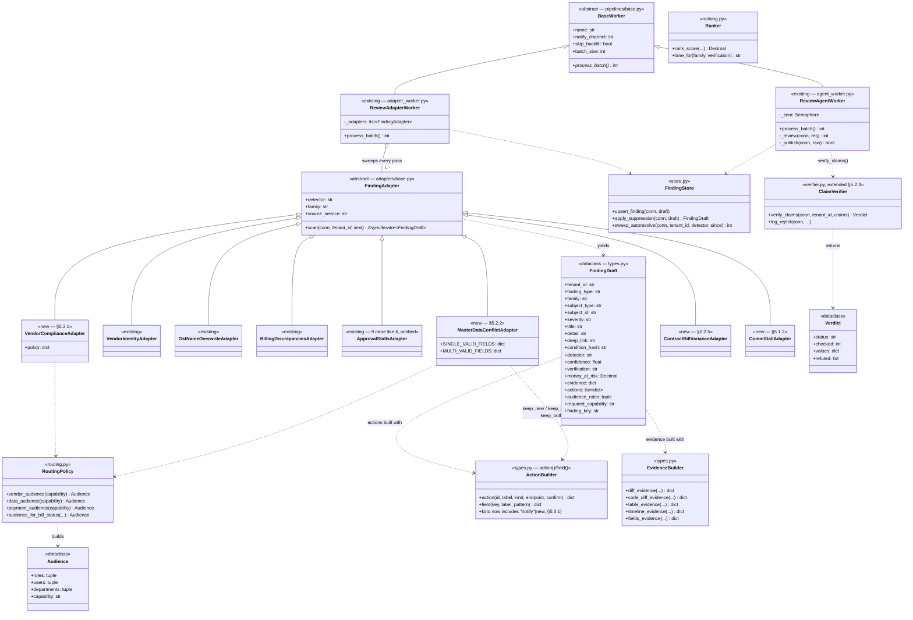

# HLD / LLD — Communication Agent, Compliance Agent & Review Hub Orchestration

| | |
|---|---|
| **Status** | Draft v1.0 — for review before implementation |
| **Owner** | Subhash Bishnoi |
| **Last updated** | 2026-09-17 |
| **Related docs** | [PRD_AGENT_HUB.md](PRD_AGENT_HUB.md), [REVIEW_HUB_DESIGN_BRIEF.md](REVIEW_HUB_DESIGN_BRIEF.md) |
| **Scope source** | Whiteboard spec: Communication Agent, Compliance Agent, Review Hub (Sep 2026) |

---

## 0. How to read this document

This is **not a green-field design**. A pass over the codebase before writing this
turned up that all three systems in the brief already exist in partial or mature
form:

- The **Review Hub** (`pipelines/review/*`, `rh_findings` and seven satellite
  tables, `backend_ocr/app/routers/review_hub.py`) is in production: 12
  deterministic adapters, an LLM review agent with claim verification, ranking,
  routing, clustering, undo, suppression.
- The **Communication Agent** exists as three separate pieces that were never
  named or unified: the mailbox OAuth connector (`email_connection.py`), the
  vendor-bill mailbox watcher (`agent.py`, "Vendor Bill Agent"), and the fact
  extraction pipeline (`domain/fact_graph.py`).
- The **Compliance Agent** exists as a subset of the Review Hub's own adapters
  (`vendor_identity.py`, `gst_name_overwrite.py`, `billing_discrepancies.py`) —
  it was simply never scoped or named as its own thing.

So §2 is the single most important section: it maps every line of the original
brief to what's already shipped, and isolates exactly what's missing. Everything
after that is designed to **extend** the existing substrate — same tables, same
`FindingDraft`/adapter contract, same `BaseWorker` pattern, same autonomy model —
not to stand up a parallel system. This is a direct application of the "reuse
over rebuild" principle already adopted in [PRD_AGENT_HUB.md](PRD_AGENT_HUB.md)
§8.

---

## 1. Executive summary

Close the gap between what the whiteboard asked for and what exists, by:

1. Naming and completing the **Communication Agent**: give email extraction a
   *typed, checkable* output (not free-text "facts") and let Review Hub
   *trigger* outbound communication instead of only humans.
2. Adding three **new Compliance Agent adapters** to the existing adapter mesh:
   vendor completeness scoring, contract-vs-bill line-item variance, and
   master-data conflict detection between communication-extracted facts and the
   vendor record.
3. Extending the **Review Hub** with one new action kind (`notify`) so a
   finding can instruct the Communication Agent to reach the right person,
   and a routing rule that decides *whom* to tag from existing role/priority
   data.

No new orchestrator process, no new message bus, no new UI shell. Three new
adapters, one new background worker, a handful of new columns/tables, and one
new action kind.

---

## 2. Reuse map — brief requirement → existing component → gap → what's new

| Brief requirement | Already exists | Gap | New work |
|---|---|---|---|
| Fetch bill/contract from a vendor via POC | `agent.py` mailbox watcher, per-POC opt-in (`supplier_contacts.agent_enabled`) | Only classifies **bills** (PDF→OCR); no contract path | Contract classification branch + term extraction (§5.1.4) |
| Keep a record of all communication from a POC | `poc_email_messages`, `vendor_outreach_log` (in/outbound, threaded) | No *state* (open/waiting/resolved) or *purpose* per thread | `comm_thread_state` (§5.1.2) |
| Maintain state across an email chain | `thread_id` linkage exists in both tables above | State is implicit (query time), not a first-class row | Same as above |
| Convert unstructured email into structured values | `fact_graph.extract_facts_from_email` | Output is free-text `fact_text`, not a typed, field-addressable claim a machine can diff against `dim_suppliers` | `extract_claims_from_email` — typed claims (§5.1.1) |
| Pass structured values to reconciliation for verification | `pipelines/review/verifier.py` (`verify_claims`) already does exactly this for the AI review agent's claims | Verifier's claim vocabulary only covers bill/reconciliation math, not vendor-master fields (GSTIN, bank, PAN) | Extend the verifier's checkable-claim set (§5.2.3) |
| Send automated emails per Review Hub instruction | `send_contact_email` (user-initiated send over the connected mailbox) | Callable only from a human click, not from a finding's action | `notify` action kind (§5.3.1) |
| Merge new bill/contract detail with existing record | `vendor_merge.repoint_and_retire`, vendor CRUD endpoints | No conflict *detection* step feeding these from comm-derived data | `master_data_conflict` adapter (§5.2.2) |
| If it matches, continue automatically | — | — | Same adapter, "auto-apply" branch |
| If it conflicts, flag for review/approval | `rh_findings` + `actions_jsonb` already renders exactly this UI pattern | No adapter emits this *kind* of finding today | Same adapter, "conflict" branch |
| 3-way choice (keep new / keep existing / keep both) for a multi-valid field (bank account) | `supplier_bank_accounts` already supports multiple rows + `is_primary` | No finding type offers this choice set | `action()` triple on the conflict finding (§5.2.4) |
| 2-way choice for a single-valid field (PAN/GSTIN) | `dim_suppliers.pan`, `supplier_gstins` | No finding type offers this choice set | `action()` pair on the conflict finding |
| Continuously scan bills/vendors for compliance | `ReviewAdapterWorker` already sweeps every tenant, every adapter, on every relevant change | Coverage gap: no single "is this vendor compliant" adapter exists (fields are checked individually and separately) | `vendor_compliance` adapter (§5.2.1) |
| Check GST/PAN/TDS/bank presence + verification | `supplier_gstins.status`, `dim_suppliers.pan`, `supplier_bank_accounts.verified`, `tds_api` settings | Nothing aggregates these into one per-vendor compliance posture | Same adapter |
| Check bill vendor details vs vendor master | `vendor_identity.py`, `gst_name_overwrite.py` adapters | Already done | none |
| Line-item qty/rate vs contract, skip if either missing | `billing_discrepancies.py` (Nova usage vs invoice) | Source of truth is Nova only; no contract-derived rate/qty path; the brief's "skip when either is missing" rule isn't generalized | `contract_bill_variance` adapter (§5.2.5), reusing `triage.py`'s "only compare what's checkable" philosophy |
| Review Hub receives only exceptions | This is the Review Hub's entire design (`REVIEW_HUB_DESIGN_BRIEF.md` §1–2) | none | none |
| Prioritize + decide whom to tag | `ranking.py` (`rank_score`, lanes) + `routing.py` (`Audience`) | Priority exists; "decide whom to tag" for comm-sourced conflicts isn't wired | Audience resolution for the two new families (§5.3.2) |
| Review Hub instructs Communication Agent to notify | — | — | `notify` action (§5.3.1) |

**Bottom line:** ~65% of the requested system is already running in production
under different names. The genuinely new surface is small: one typed-extraction
path, three adapters, one action kind, a couple of tables.

---

## 3. Glossary (additions to PRD_AGENT_HUB.md §3)

| Term | Definition |
|---|---|
| **Claim** | One typed, field-addressable statement extracted from an email or contract — e.g. `{scope: "vendor_bank", field: "account_number", new_value: "...", evidence_quote: "..."}`. Distinct from a `fact_graph` fact, which is free text for the knowledge graph, not a diffable value. |
| **Single-valid field** | A vendor attribute that can only have one correct value at a time (PAN, primary GSTIN). A conflicting claim offers a 2-way choice. |
| **Multi-valid field** | A vendor attribute that can legitimately have several live values (bank accounts, GSTINs across states). A conflicting claim offers a 3-way choice, including "keep both." |
| **Thread purpose** | What a communication thread is *for* — `bill_followup`, `contract_request`, `verification_request`, `general` — set once, used to route replies and pick the extraction prompt. |
| **Conflict finding** | A `rh_findings` row of family `vendor_identity` or `tax` whose evidence is a diff between the existing vendor record and a newly extracted claim, and whose `actions_jsonb` offers the resolution choice set. |

---

## 4. High-Level Design

### 4.1 System context

```
                 ┌────────────────────────────────────────────────────┐
                 │                  Vendor / POC                       │
                 │        (email inbox, contract PDF, phone/portal)     │
                 └───────────────┬──────────────────────────────────────┘
                                 │ email (in/out), attachments
                 ┌───────────────▼──────────────────────────────────────┐
                 │            COMMUNICATION AGENT                       │
                 │  mailbox OAuth · per-POC watch · thread state ·      │
                 │  bill/contract classification · typed extraction ·   │
                 │  outbound send (user- or Review-Hub-triggered)       │
                 └───────────────┬───────────────────┬───────────────────┘
                    structured claims│               │ existing pipeline
                    (comm_extractions)│              │ (OCR→fact_invoices,
                                     │               │  unchanged)
                 ┌───────────────▼───────────────────▼───────────────────┐
                 │              COMPLIANCE AGENT                        │
                 │   (= the existing Review Hub adapter mesh + 3 new)   │
                 │  vendor completeness · bill-vs-master · line-item    │
                 │  vs contract · master-data conflict detection        │
                 └───────────────┬───────────────────────────────────────┘
                        exceptions only (rh_findings)
                 ┌───────────────▼───────────────────────────────────────┐
                 │                 REVIEW HUB                            │
                 │   rank · lane · audience · drawer · actions           │
                 │   NEW: `notify` action → back to Communication Agent  │
                 └───────────────┬───────────────────────────────────────┘
                                 │ notify / approve / apply
                 ┌───────────────▼──────────────────────────────────────┐
                 │        Internal team (controller / accountant)       │
                 └────────────────────────────────────────────────────────┘
```

This is the same loop as the brief's §4 diagram, with the substitution that
"Reconciliation Agent" in the brief is the existing `verifier.py` +
deterministic adapters, and "structured information" is a `comm_extractions`
row rather than a new bus.

### 4.2 Component architecture — what runs where

| Component | Process model | Reuses |
|---|---|---|
| Mailbox OAuth + send | Inline FastAPI routes (`email_connection.py`) | unchanged |
| Vendor Bill watcher | Daemon thread, 10-min poll (`agent.py`) | unchanged |
| **NEW** Claim extraction | `BaseWorker` subclass, LISTEN/NOTIFY, same pool | pattern from `ReviewAgentWorker` |
| **NEW** Contract term extraction | Same worker, different branch | OCR text layer (`ocr_engine.py`), not vision — GSTINs/amounts must be exact (see `ocr-text-layer-first` convention already in this codebase) |
| Deterministic adapters (incl. 3 new Compliance ones) | `ReviewAdapterWorker`, one pass sweeps every tenant | unchanged |
| LLM review agent | `ReviewAgentWorker` | unchanged |
| Review Hub API | `review_hub.py` FastAPI router | unchanged, +1 endpoint |
| Notify execution | Inline, called from the `/api/review/{id}/act` handler | reuses `email_oauth.send_email` / in-app notifications |

**Key architectural decision — no central orchestrator.** PRD_AGENT_HUB.md
leaves "CFO orchestrator: hardcoded plans vs LLM-generated" as an open question
(§22.3) and explicitly defers it to Phase 2. This design does not need it: the
three agents already communicate through **shared state, not messages** —
Communication Agent writes claims, Compliance Agent's adapters read them on
their next sweep, Review Hub reads `rh_findings` on its next request. This is
the same pattern the existing 12 adapters already use (`scan()` reads the
current full truth every pass) and it is what makes the system horizontally
scalable and crash-safe: any worker can die and restart, and the next sweep
reconstructs the correct state from tables, never from an in-flight plan. A CFO
orchestrator can be layered on top later (per PRD Phase 2) to compose
multi-step *goals* ("close vendor X's month") without touching any of this —
it would call the same tools these agents already expose.

### 4.3 End-to-end sequence — the brief's three flows, mapped to real modules

**Flow A — inbound contract/bill email → conflict → resolution**
```
POC email arrives
  → agent.py poller claims message (existing dedup: agent_email_events)
  → PDF attached? classify_email_is_bill()
       bill  → existing OCR → agent_draft_bills (unchanged)
       contract → NEW: classify_email_is_contract() → contract term extraction
  → body always persisted to poc_email_messages (existing)
  → NEW: CommunicationExtractionWorker picks up the message,
         calls extract_claims_from_email() (typed claims, not free text)
         writes comm_extractions (status=PENDING_COMPLIANCE_CHECK)
  → NEXT ReviewAdapterWorker pass:
       master_data_conflict adapter reads PENDING claims
         no existing value for that field  → auto-apply, mark APPLIED
         existing value matches            → mark APPLIED (no-op, no finding)
         existing value conflicts          → rh_findings (family=vendor_identity)
                                              actions = [keep_new, keep_existing, (keep_both)]
                                              mark CONFLICTED
  → Review Hub renders it: diff evidence, three (or two) buttons
  → user clicks one → existing vendor endpoint called (bank-accounts / gstins / PATCH)
                     → comm_extractions claim marked APPLIED or DISCARDED
                     → rh_finding_events ACTION_EXECUTED
```

**Flow B — continuous compliance scan → exception → routed notify**
```
ReviewAdapterWorker pass (existing cadence, CDC-triggered + cooldown poll)
  → vendor_compliance adapter scans all vendors
       missing/unverified GST, PAN, bank, TDS per tenant policy
       → rh_findings (family=vendor_identity or tax, severity by policy)
  → contract_bill_variance adapter scans bills with a linked contract
       rate & qty both available and inconsistent → rh_findings (family=reconciliation)
       either missing → skipped, no finding (never a false compliance signal)
  → Review Hub ranks + lanes these alongside the other 12 adapters' output
  → controller opens finding → "Notify vendor" action (NEW `notify` kind)
       resolves audience: internal (accountant, from routing.Audience)
                            or external (vendor POC, from supplier_contacts)
       renders template → confirm dialog (destination + message preview)
       on confirm → email_oauth.send_email() under connected mailbox
                     (falls back to in-app notification if internal + no send needed)
       → vendor_outreach_log + rh_finding_events(ACTION_EXECUTED)
```

**Flow C — user asks "why hasn't X paid me / where's the bill"**
Out of scope for this phase (Receivable agent, PRD §13.7, `🟡 P2`) — flagged
here only so it's not silently assumed. The brief's flows are AP-side; nothing
above touches AR.

### 4.4 Multi-tenancy, licensing, audit — unchanged, extended

- Every new table carries `tenant_id`; every new adapter follows the existing
  `FindingAdapter` contract (tenant passed into `scan()`).
- New routes get entries in `backend_ocr/app/security/licensing.py`:
  `notify` rides the existing `review_hub` service key (it's an action *on* a
  finding, not a new service); contract extraction rides `email_sending`
  (already the key for the mailbox-agent surface) — no new licence tier needed.
- Audit: LLM-bearing steps (claim extraction) write an `agent_runs` row exactly
  like `ReviewAgentWorker` does today (§12 of PRD_AGENT_HUB.md's WHY/WHAT/WHOM/HOW
  model already fits this without modification). Deterministic adapters do not
  log runs, matching the existing 12.

---

## 5. Low-Level Design

### 5.1 Communication Agent

#### 5.1.1 Typed claim extraction (the core gap)

`fact_graph.extract_facts_from_email` today returns:
```json
{"facts": [{"fact_text": "...", "fact_type": "payment_term", "confidence": 0.8}]}
```
This is fine for the knowledge graph (free text, embedded, searched
semantically) but **cannot be diffed against a column**. New function,
`pipelines/review/comm_extract.py`, sitting next to `dossier.py` /
`prompts.py` because it needs the same claim-then-verify discipline the review
agent already uses:

```python
CLAIM_SCHEMA = {
    "type": "object",
    "properties": {
        "claims": {"type": "array", "items": {
            "type": "object",
            "properties": {
                "scope":  {"enum": ["vendor_bank", "vendor_gstin", "vendor_pan",
                                     "vendor_tds", "bill_line_item", "payment_term"]},
                "field":       {"type": "string"},   # e.g. "account_number", "rate"
                "target_ref":  {"type": ["string", "null"]},  # line-item label, if scoped
                "new_value":   {"type": "string"},
                "unit":        {"type": ["string", "null"]},
                "confidence":  {"type": "number"},
                "evidence_quote": {"type": "string"}   # verbatim sentence, for the diff card
            },
            "required": ["scope", "field", "new_value", "confidence", "evidence_quote"]
        }}
    }
}
```

Mirrors `pipelines/review/prompts.py`'s `RESPONSE_SCHEMA` pattern exactly —
`temperature=0.0`, JSON-schema-constrained, run through `complete_json` in
`backend_ocr/app/ai/llm.py` for the tenant-scoped cost accounting that already
exists there. `evidence_quote` is mandatory so every claim's drawer card can
show the sentence it came from (matches the Review Hub's "never assert what
you can't show" convention in `types.one_line` / `dossier.py`).

Redaction: run through the existing `pipelines/review/redact.py` before the
prompt and `red.restore()` after, exactly as `agent_worker.py` does — vendor
emails are exactly the kind of untrusted, PII-bearing text that module exists
for.

#### 5.1.2 Conversation state

New table, additive (does not replace `poc_email_messages`):

```sql
CREATE TABLE IF NOT EXISTS comm_thread_state (
    tenant_id     uuid NOT NULL REFERENCES dim_tenants(tenant_id) ON DELETE CASCADE,
    thread_id     text NOT NULL,
    supplier_id   uuid,
    contact_id    uuid,
    purpose       text NOT NULL DEFAULT 'general'
                  CHECK (purpose IN ('bill_followup','contract_request',
                                      'verification_request','general')),
    status        text NOT NULL DEFAULT 'open'
                  CHECK (status IN ('open','awaiting_vendor','awaiting_internal','resolved')),
    linked_subject_type text,     -- 'bill' | 'vendor' | 'contract'
    linked_subject_id   uuid,
    last_direction  text,         -- 'inbound' | 'outbound'
    last_message_at timestamptz,
    sla_due_at      timestamptz,  -- e.g. "follow up if no reply in 3 days"
    created_at      timestamptz NOT NULL DEFAULT now(),
    updated_at      timestamptz NOT NULL DEFAULT now(),
    PRIMARY KEY (tenant_id, thread_id)
);
CREATE INDEX IF NOT EXISTS idx_comm_thread_state_open
    ON comm_thread_state (tenant_id, status) WHERE status <> 'resolved';
```

Updated by a small trigger-equivalent in the same code paths that already
write `poc_email_messages` (`agent.py`'s scan loop, `email_api`'s send
endpoint) — `last_direction` flips `status` between `awaiting_vendor` and
`awaiting_internal` automatically; `purpose` is set once, from the bill/
contract classifier, and never overwritten.

`sla_due_at` is what powers a **new, small** adapter (`comm_stall.py`, family
`data_quality`) that raises a Review Hub finding when a thread has been
`awaiting_vendor` past its SLA — this is the direct implementation of the
brief's "maintain state... flag stalled communication," and it costs nothing
beyond one more `scan()` on a table that's already indexed for it.

#### 5.1.3 `comm_extractions` — the claims store

```sql
CREATE TABLE IF NOT EXISTS comm_extractions (
    extraction_id   uuid PRIMARY KEY DEFAULT gen_random_uuid(),
    tenant_id       uuid NOT NULL REFERENCES dim_tenants(tenant_id) ON DELETE CASCADE,
    source_type     text NOT NULL CHECK (source_type IN ('email','contract')),
    source_id       uuid NOT NULL,     -- poc_email_messages.message_id or vendor_documents.id
    supplier_id     uuid,
    contact_id      uuid,
    thread_id       text,
    model           text,
    prompt_version  text,
    agent_run_id    uuid,
    claims          jsonb NOT NULL DEFAULT '[]'::jsonb,
    -- per-claim lifecycle lives in claims[].status so a partially-applied
    -- extraction (3 claims, 1 conflict) doesn't need a child table
    created_at      timestamptz NOT NULL DEFAULT now()
);
CREATE INDEX IF NOT EXISTS idx_comm_extractions_pending
    ON comm_extractions (tenant_id, supplier_id)
    WHERE claims @> '[{"status":"PENDING"}]';   -- see note below
```

(The GIN/containment index above is illustrative; the real predicate the
`master_data_conflict` adapter uses is a `jsonb_array_elements` unnest in the
query, same technique `billing_discrepancies.py` already uses over
`jsonb` reconciliation payloads.)

Each claim object gains a `status` field once written: `PENDING` →
`APPLIED` | `DISCARDED` | `CONFLICTED` (open) → `RESOLVED` (once a Review Hub
action fires). This mirrors `rh_findings.status`'s vocabulary deliberately, so
the two systems read the same way.

#### 5.1.4 Contract term extraction

Reuses the existing PDF pipeline, not a new one:

1. `agent.py`'s classifier gains a third branch:
   `classify_email_document(subject, body)` → `bill | contract | other`
   (same prompt shape as `_CLASSIFY_PROMPT`, one more label).
2. A contract PDF's **text layer** (never vision — this codebase already has a
   hard rule, `OCR_TO_USE=auto`, precisely because vision misreads GSTINs and
   numbers; a contract's rate/payment-term clauses deserve the same treatment)
   is extracted via the existing `ocr_engine.py` text-layer path and handed to
   `extract_claims_from_email`'s sibling, `extract_claims_from_contract`, same
   `CLAIM_SCHEMA`, a contract-tuned system prompt.
3. The PDF itself is stored via the existing `vendor_documents` table
   (already supports arbitrary vendor files); the extraction row points at it
   via `source_type='contract', source_id=vendor_documents.id`.

No new storage path, no new upload endpoint — `vendor_documents` already
accepts arbitrary files per vendor; only the extraction step is new.

#### 5.1.5 Outbound: Review Hub can now trigger a send

`email_api.send_contact_email` already does everything a "Communication Agent
sends a message" action needs (resolve recipient, send over the connected
mailbox, log to `vendor_outreach_log`, mirror to `poc_email_messages`, enqueue
fact-graph enrichment). It is *always* called with a human `username` today —
tied to "whose mailbox sends this." For an agent-triggered send there are two
cases:

- **Internal notify** (tag a colleague): no email needed — write to the
  existing `/api/notifications` surface (already core/unlicensed, powers the
  nav badge) instead of sending mail. No mailbox dependency, works for every
  tenant regardless of OAuth connection state.
- **External notify** (message the vendor POC): needs *someone's* connected
  mailbox to send from. Default to the finding's `status_by` / the tenant's
  designated "AP mailbox" user; if nobody is connected, the action degrades to
  a **draft** shown in the drawer for a human to send with one click — never a
  silent failure. This is the L1 "draft" autonomy level from
  PRD_AGENT_HUB.md §10, applied here without new plumbing.

**Known constraint to design around:** Outlook-connected mailboxes can
currently only be *connected*, not *sent from* — `email_connection.py:104`
raises `501` for any non-Google provider. Any tenant whose AP mailbox is
Outlook falls into the "draft, not auto-send" path until Graph send/read
lands (tracked as an open item, §9).

### 5.2 Compliance Agent — three new adapters in the existing mesh

All three are added to `pipelines/review/adapters/__init__.py`'s
`ALL_ADAPTERS()` list and run by the existing `ReviewAdapterWorker` — no new
worker, no new schedule, no new pool connection. They inherit `FindingAdapter`
exactly like the 12 that exist.

#### 5.2.1 `vendor_compliance.py` — vendor completeness & verification posture

```python
class VendorComplianceAdapter(FindingAdapter):
    detector = "adapter:vendor_compliance"
    family = "vendor_identity"          # reuses the existing compliance lane
    source_service = "kyc_verification"

    async def scan(self, conn, tenant_id, limit):
        # one query joining dim_suppliers + supplier_gstins + supplier_bank_accounts
        # + a per-tenant policy row (see below), yielding one FindingDraft per
        # vendor with >=1 missing/unverified *required* field.
```

Policy is per-tenant, not hardcoded — reuses the existing
`agent_registry.config` jsonb pattern (the `review` agent already stores
`materiality_floor_inr` there) rather than a new table:

```json
// agent_registry.config for name='compliance'
{"requires_gstin": true, "requires_pan": true, "requires_bank": true,
 "requires_tds_section": false, "grace_days_new_vendor": 7}
```

`grace_days_new_vendor` matters: a vendor onboarded this morning should not
immediately produce a CRITICAL finding — mirrors `triage.baseline_is_usable`'s
philosophy of not asserting things the data can't yet support.

Severity: `HIGH` if a *bill is currently payable* against this vendor and a
required field is missing/unverified (money is actually blocked — same logic
`vendor_identity.py` already uses for bank verification); `MEDIUM` otherwise
(a data-quality gap with no immediate payment impact).

#### 5.2.2 `master_data_conflict.py` — comm-extracted claims vs vendor master

```python
class MasterDataConflictAdapter(FindingAdapter):
    detector = "adapter:master_data_conflict"
    family = "vendor_identity"
    source_service = "email_sending"    # gated by the same licence as comm extraction

    async def scan(self, conn, tenant_id, limit):
        # unnest PENDING claims from comm_extractions, scoped vendor_bank /
        # vendor_gstin / vendor_pan / vendor_tds, join current value from
        # dim_suppliers / supplier_gstins / supplier_bank_accounts.
        #
        # no existing value            -> auto-apply (call the SAME function
        #                                  the vendor router uses, never raw
        #                                  SQL — mirrors vendor_merge.py's
        #                                  rule of "one place that writes")
        # existing == new (normalized) -> mark APPLIED, no finding (silent no-op)
        # existing != new              -> yield FindingDraft, mark CONFLICTED
```

Field registry (single-valid vs multi-valid) — a plain constant next to the
adapter, not a table, since it changes only when a new field type is added:

```python
SINGLE_VALID_FIELDS = {"vendor_pan": "pan", "vendor_gstin": "primary_gstin"}
MULTI_VALID_FIELDS  = {"vendor_bank": "bank_account", "vendor_gstin_secondary": "gstin"}
```

Note GSTIN is genuinely both: a vendor's **primary** GSTIN (used for a bill
whose place of supply matches) is single-valid at a time, but a vendor can
legitimately hold GSTINs in multiple states — so a *new* GSTIN claim with no
existing GSTIN for that state is multi-valid (add), while a claim that
contradicts the *primary* GSTIN already used on live bills is single-valid
(replace-or-keep). The adapter branches on whether a GSTIN for that state
code already exists, not on the field name alone.

#### 5.2.3 Verifier extension — reuse, don't rebuild

`pipelines/review/verifier.py`'s `verify_claims` already recomputes a claim
against SQL truth before anything is published, specifically to stop the LLM's
prose from being trusted for money. The same discipline applies here: before a
`master_data_conflict` finding is published, the **new** value itself is
verified where it can be (a GSTIN's checksum/state-code format, an IFSC
pattern via the existing `_IFSC_PATTERN` in `vendor_identity.py`) so a
malformed extraction never reaches the drawer as a same-looking peer to a
verified one — it stays `UNVERIFIABLE` and lands in the Suspected lane per
`ranking.lane_for`, exactly like today's AI-authored findings.

#### 5.2.4 The conflict finding's actions — no new endpoints

Bank account conflict (multi-valid), built with the existing `action()`
builder from `types.py`:

```python
actions=[
    action("keep_new", "Use the new account", kind="safe",
           endpoint=f"/api/vendors/{supplier_id}/bank-accounts", method="POST",
           fields=[...], confirm={...}),
    action("keep_existing", "Keep the current account", kind="safe",
           endpoint=f"/api/vendors/{supplier_id}/gstins-noop", ...),  # marks claim DISCARDED
    action("keep_both", "Keep both accounts", kind="safe",
           endpoint=f"/api/vendors/{supplier_id}/bank-accounts", method="POST",
           body={"is_primary": False}, confirm={...}),
]
```

PAN/primary-GSTIN conflict (single-valid) — only the first two actions.
Every one of these calls an endpoint that **already exists**
(`/api/vendors/{id}/bank-accounts`, `/api/vendors/{id}/bank-accounts/{id}/set-primary`,
`/api/vendors/{id}/gstins`, `PATCH /api/vendors/{id}` for PAN) — the finding
layer supplies the choice, the vendor router still owns the write, exactly the
rule already documented in `vendor_merge.py`'s docstring ("a fix it performs
must call the logic that already owns the operation").

#### 5.2.5 `contract_bill_variance.py` — line items vs contract terms

```python
class ContractBillVarianceAdapter(FindingAdapter):
    detector = "adapter:contract_bill_variance"
    family = "reconciliation"
    source_service = "bills"

    async def scan(self, conn, tenant_id, limit):
        # bills whose vendor has an APPLIED contract-scoped claim for a
        # matching line item (by target_ref / item description match).
        # compare billed_qty vs contract_qty AND billed_rate vs contract_rate
        # ONLY when BOTH are present on BOTH sides — otherwise skip that
        # line entirely (per the brief's explicit rule).
```

This is a deliberate structural echo of `billing_discrepancies.py`, which does
the same comparison against Nova usage instead of a contract; the two can
share a small comparison helper (`pipelines/review/adapters/_variance.py`)
rather than duplicating the tolerance-band math.

### 5.3 Review Hub extension

#### 5.3.1 New action kind: `notify`

`types.py`'s `action()` docstring already documents three kinds (`safe`,
`approve`, `navigate`); this adds a fourth:

```python
def action(..., kind: str = "navigate", ...):
    """
    kind='notify'   Executed by the hub via POST /api/review/{finding_id}/act,
                    same as 'safe', but the *effect* is a message to a person
                    (internal notification or vendor email) rather than a data
                    write. Always requires `confirm` naming the destination and
                    a preview of the message — the confirm dialog already
                    supports this shape (REVIEW_HUB_DESIGN_BRIEF.md §3, "confirm
                    dialog... headline impact row"). Logs an `agent_runs` row
                    (agent_name='communication') for audit, same as any other
                    LLM- or agent-driven step.
    """
```

Handler lives in `review_hub.py` next to the existing `/act` dispatcher — it
is one more `elif action.kind == "notify"` branch, not a new router.

#### 5.3.2 Priority → routing for the two new families

`routing.py` already has `vendor_audience()` and `data_audience()`. The new
adapters use exactly those — no new audience logic needed:

- `vendor_compliance` findings → `vendor_audience(capability="verify")`
  (admin, finance_controller, accountant — the roles that can act on KYB).
- `master_data_conflict` findings → `vendor_audience(capability="edit")`.
- `contract_bill_variance` findings → `data_audience(capability="edit")`.

"Decide whom to tag" for the `notify` action specifically (as opposed to who
*can see* the finding) resolves in this order, reusing data that already
exists:
1. A named assignee on the relevant approval step, if the finding is blocking
   one (`routing.status_name_map` — already computed for bill findings).
2. Else the first role in the finding's `audience_roles` that has an active
   user for the tenant (existing `users.role` lookup).
3. Else `finance_controller` as the tenant-wide fallback (matches
   `vendor_audience()`'s own fallback today).

No new "assignee" concept is introduced — priority (`rank_score`, already
computed) decides *ordering*; this three-step rule decides *whom*, and both
already exist as data, not new modeling.

---

## 6. Multi-agent orchestration plan — scalable by construction

### 6.1 Worker topology

| Worker | Trigger | Cadence | Concurrency | Pool footprint |
|---|---|---|---|---|
| `ReviewAdapterWorker` (existing, +3 adapters) | CDC NOTIFY on `fact_invoices` etc. + cooldown poll | per-tenant, per-adapter, bounded `SCAN_LIMIT=500` | serial across adapters, 1 conn | 1 of 10 |
| `ReviewAgentWorker` (existing) | `ch_review_agent` NOTIFY | triage-gated, not every entity | `MAX_CONCURRENCY=2` | ≤2 of 10 |
| **NEW** `CommExtractionWorker` | `ch_comm_extract` NOTIFY (new channel, fired when a `poc_email_messages`/`vendor_documents` row needs extraction) | per message/doc, `skip_backfill=True` (same reasoning as the review agent: never drain years of email history on first boot) | `MAX_CONCURRENCY=2` | ≤2 of 10 |
| Mailbox watcher (`agent.py`, existing) | daemon-thread poll, 10 min | per tenant per poll | serial | own psycopg2 conn, not the async pool |
| Fact-graph enrichment (existing) | fire-and-forget `ThreadPoolExecutor` | per email/bill write | 4 workers | own psycopg2 conns |

Adding two new adapters and one new worker to a pool already shared by twelve
consumers is exactly the scaling model this codebase already committed to
(`adapter_worker.py`'s own docstring: "shares db.py's asyncpg pool (max_size=10)
with twelve others, so a pass is deliberately a handful of bounded queries").
The new worker follows the same rule: bounded batch size, semaphore-limited
concurrency, `skip_backfill=True` where a cold-start drain would be a cost
bomb.

### 6.2 Why decentralized, not a CFO-style planner, for this phase

PRD_AGENT_HUB.md's own open question (§22.3) is whether to build an LLM
planner now or defer it. This design answers it for this scope: **defer it**.
The three agents here don't need a planner because their contract is
*declarative, not sequential* — Compliance Agent doesn't need to be told "now
go check the vendor Communication Agent just touched"; its next scheduled
sweep already will, because `scan()` reads current full truth every time
(§4.2). This is strictly simpler to reason about, debug, and scale than a
planner issuing explicit "run Recon then Payable" steps, and it's the same
property that already makes the 12 existing adapters safe to run out of order,
in parallel across tenants, and to restart mid-pass.

A CFO orchestrator remains valuable later for genuinely multi-step *goals* a
human states in natural language ("close vendor X's month") — that is
sequencing by intent, a different problem from "keep every table
eventually-consistent," and nothing here blocks building it in PRD Phase 2 on
top of these same tools.

### 6.3 Scaling levers already in the codebase, applied here unchanged

- **Bounded passes**: `SCAN_LIMIT` — a new adapter that ever needs unbounded
  per-row work is a bug, per `adapters/base.py`'s own docstring; both new
  adapters are single joined queries, same shape as the existing 12.
- **Cost caps**: `agent_budgets` (tenant, day, spent_usd, calls) already exists
  and already gates every LLM call tenant-wide; `CommExtractionWorker` checks
  it before calling `complete_json`, exactly as `ReviewAgentWorker` does.
- **Idempotency**: `condition_hash` (rh_findings) and a new
  `idempotency_key = sha256(tenant|message_id|prompt_version|model)` for
  `comm_extractions` (same formula as `triage.idempotency_key`) — a message
  reprocessed after a crash never double-extracts or double-charges.
- **Failure isolation**: one adapter throwing never stops the other eleven
  (existing `try/except` per adapter in `process_batch`); the new adapters
  inherit this for free by being added to the same list.
- **Tenant isolation**: every new table has `tenant_id`; every new query is
  tenant-scoped; nothing changes in the isolation model documented in
  PRD_AGENT_HUB.md §18.

### 6.4 What does NOT get built (explicitly, to bound scope)

- No new message queue / event bus — `LISTEN`/`NOTIFY` + polling is already
  proven at this scale (12 adapters, 1 agent worker) and the new work is the
  same order of magnitude.
- No new "agent runtime SDK" beyond what `BaseWorker` + `agent_runs` already
  provide — PRD_AGENT_HUB.md's `AgentRun` context manager concept is realized
  today by `ReviewAgentWorker`'s manual `INSERT ... agent_runs` /
  `UPDATE ... SET status` pair; `CommExtractionWorker` copies that pattern
  verbatim rather than waiting on a formal SDK.
- No new UI shell — the Review Hub already renders any finding shape
  (`REVIEW_HUB_DESIGN_BRIEF.md` §2's "the interface knows shapes, never issue
  types" is exactly what makes three new finding types free to render).

---

## 7. Rollout plan

### Phase 0 — Foundation (no user-visible change)
- `comm_thread_state`, `comm_extractions` tables (migration script alongside
  the existing `scripts/review_hub_migrate.py` pattern).
- `extract_claims_from_email` + `CLAIM_SCHEMA`, wired to `complete_json` with
  budget checks.
- `CommExtractionWorker` skeleton, `ch_comm_extract` NOTIFY wiring on
  `poc_email_messages` insert.
- **Acceptance:** a real inbound POC email produces a `comm_extractions` row
  with ≥1 claim and an `agent_runs` audit row; nothing is auto-applied yet.

### Phase 1 — Compliance Agent adapters
- `vendor_compliance.py`, `master_data_conflict.py` (auto-apply branch only,
  conflict branch behind a feature flag), added to `ALL_ADAPTERS()`.
- **Acceptance:** a tenant's existing vendor gaps (missing PAN, unverified
  bank) surface as Review Hub findings within one adapter pass; a
  no-existing-value claim auto-applies and is visible on the vendor card.

### Phase 2 — Conflict resolution + notify
- `master_data_conflict` conflict branch (3-way/2-way actions) live.
- `notify` action kind + audience resolution (§5.3.2).
- **Acceptance:** a conflicting bank-account claim produces a finding with
  three working actions, each calling the real vendor endpoint; a controller
  can trigger a POC email from the finding drawer and it appears in
  `vendor_outreach_log` exactly like a manually sent one.

### Phase 3 — Contract path + stall detection
- Contract classification branch in `agent.py`, `extract_claims_from_contract`,
  `contract_bill_variance.py`.
- `comm_stall.py` (SLA-based thread-stall finding).
- **Acceptance:** a vendor contract PDF emailed by a POC produces applied or
  conflicting claims against the vendor master, and a bill whose contract
  terms disagree on rate *and* quantity (both present) raises a finding; a
  bill missing either is silently skipped.

Each phase is independently shippable and reversible (a feature flag per
adapter, matching `agent_registry.enabled` already being per-tenant
toggleable) — none blocks on the next.

---

## 8. Risks & mitigations (additions to PRD_AGENT_HUB.md §21)

| Risk | Impact | Mitigation |
|---|---|---|
| Outlook mailboxes can't send/read yet (`email_connection.py:104`, `501`) | External `notify` silently degrades to draft-only for Outlook-only tenants | Ship Phase 2 with the degrade-to-draft path as the *designed* behavior, not a bug; prioritize Graph send/read only if a paying tenant is Outlook-only |
| Two agents both writing the vendor master could race | A conflict finding resolved just as the same field changes again via bill OCR | `master_data_conflict` re-reads current value inside the same transaction as its auto-apply/finding decision (adapters already run one query per pass, not cached state) — same discipline `sweep_autoresolve` already relies on |
| Claim extraction hallucinates a plausible but false value (e.g. an IFSC that doesn't exist) | A conflict finding built on a fabricated "new" value | New value is verified where checkable (§5.2.3) before publish, same discipline as `verifier.py`; unverifiable claims land in the Suspected lane, never proposed as a one-click fix |
| Compliance adapter over-fires on brand-new vendors | Noise erodes trust in the whole hub (the design brief's central risk) | `grace_days_new_vendor` policy field (§5.2.1), same shape as `triage.baseline_is_usable`'s "don't assert what you can't support yet" |
| `notify` action sends the wrong person an email | Vendor gets an internal-only note, or vice versa | `confirm` is mandatory on every `notify` action and always names the destination address/person before send — matches the existing confirm-dialog contract, no silent sends anywhere in this design |

---

## 9. Class diagram

Two diagrams, split for readability: the detection/review core (mostly
existing, three new adapter classes), and the Communication Agent domain
(mostly new, hanging off existing mailbox/thread plumbing). `<<new>>` marks a
class that does not exist today; everything else is already in the codebase at
the file noted in its docstring-equivalent comment.

### 9.1 Detection & Review Hub core



### 9.2 Communication Agent domain

```mermaid
classDiagram
    direction TB

    class Claim {
        <<value object, new — inside comm_extractions.claims jsonb>>
        +scope: str
        +field: str
        +target_ref: str
        +new_value: str
        +unit: str
        +confidence: float
        +evidence_quote: str
        +status: str
    }

    class CommExtraction {
        <<new table — §5.1.3>>
        +extraction_id: str
        +tenant_id: str
        +source_type: str
        +source_id: str
        +supplier_id: str
        +contact_id: str
        +thread_id: str
        +model: str
        +agent_run_id: str
        +claims: list~Claim~
    }
    CommExtraction "1" *-- "many" Claim

    class CommThreadState {
        <<new table — §5.1.2>>
        +tenant_id: str
        +thread_id: str
        +supplier_id: str
        +contact_id: str
        +purpose: str
        +status: str
        +linked_subject_type: str
        +linked_subject_id: str
        +last_direction: str
        +sla_due_at: datetime
    }

    class ClaimExtractor {
        <<new — comm_extract.py>>
        +extract_claims_from_email(body, subject, vendor) list~Claim~
        +extract_claims_from_contract(text, vendor) list~Claim~
    }
    ClaimExtractor ..> Claim : produces
    ClaimExtractor ..> Redactor : redact/restore

    class Redactor {
        <<existing — redact.py>>
        +redact(text) tuple
        +restore(text) str
    }

    class CommExtractionWorker {
        <<new — BaseWorker subclass>>
        -_sem: Semaphore
        +process_batch() int
        -_extract(conn, req) int
    }
    CommExtractionWorker --|> BaseWorker
    CommExtractionWorker ..> ClaimExtractor : calls
    CommExtractionWorker ..> CommExtraction : writes
    CommExtractionWorker ..> CommThreadState : updates status

    class BaseWorker {
        <<abstract — pipelines/base.py, see 9.1>>
    }

    class PocEmailMessage {
        <<existing — fact_graph.py table>>
        +message_id: str
        +tenant_id: str
        +supplier_id: str
        +contact_id: str
        +direction: str
        +thread_id: str
        +body: str
    }
    CommExtractionWorker ..> PocEmailMessage : reads unextracted rows

    class VendorDocument {
        <<existing — vendor_documents table>>
        +id: str
        +supplier_id: str
        +file_path: str
    }
    CommExtractionWorker ..> VendorDocument : reads contract PDFs

    class MailboxConnection {
        <<existing — user_email_connections table>>
        +tenant_id: str
        +username: str
        +provider: str
        +email: str
        +status: str
    }

    class EmailOAuthClient {
        <<existing — integrations/email_oauth.py>>
        +send_email(access, from, to, subject, body) dict
        +get_thread(access, thread_id) list
        +get_message(access, message_id) dict
        +get_attachment(access, message_id, attachment_id) bytes
        +refresh_access_token(refresh, provider) dict
    }
    MailboxConnection ..> EmailOAuthClient : token used by

    class VendorBillAgent {
        <<existing — agent.py poller>>
        +classify_email_is_bill(subject, body) dict
        +classify_email_document(subject, body) str
        +analyze_duplicate(transcript, new, priors) dict
    }
    VendorBillAgent ..> EmailOAuthClient : polls via
    VendorBillAgent ..> PocEmailMessage : writes
    VendorBillAgent ..> CommThreadState : updates purpose/status

    class InAppNotification {
        <<existing — /api/notifications, powers the nav badge>>
        +user_id: str
        +tenant_id: str
        +body: str
        +deep_link: str
    }

    class NotifyAction {
        <<new — review_hub.py handler, §5.3.1>>
        +execute(finding_id, action_id)
        -resolve_audience(finding) Audience
        -render_template(finding) str
    }
    NotifyAction ..> EmailOAuthClient : external notify
    NotifyAction ..> MailboxConnection : sender's mailbox
    NotifyAction ..> InAppNotification : internal notify

    class MasterDataConflictAdapter {
        <<existing on diagram 9.1, cross-linked here>>
    }
    MasterDataConflictAdapter ..> CommExtraction : reads PENDING claims
    ContractBillVarianceAdapter ..> CommExtraction : reads contract-scoped claims
    class ContractBillVarianceAdapter {
        <<existing on diagram 9.1, cross-linked here>>
    }
    CommStallAdapter ..> CommThreadState : scans sla_due_at
    class CommStallAdapter {
        <<existing on diagram 9.1, cross-linked here>>
    }
```



---

## 10. Open questions

1. Does any current tenant's AP mailbox run on Outlook? If yes, Graph
   send/read moves from "nice to have" to a Phase 2 blocker for external
   `notify`.
2. Should `vendor_compliance` policy (§5.2.1) be tenant-admin-configurable
   from day one, or ship with a single sane default and add the settings UI
   later? (Affects whether Phase 1 needs a UI change or just a registry row.)
3. Contract term extraction accuracy is unproven — worth a manual-review-only
   mode (extract, always create a Review Hub finding, never auto-apply) for
   the first few weeks of Phase 3, the same way the LLM review agent shipped
   at autonomy L0 before anything else did.
4. Is AR/Receivable communication ("vendor asks about a payment status") in
   scope soon enough to shape `comm_thread_state.purpose` now, or is `general`
   sufficient until that's prioritized (PRD §13.7, still P2)?
