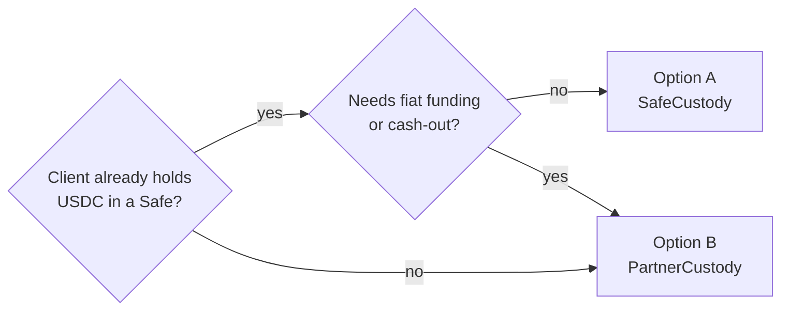
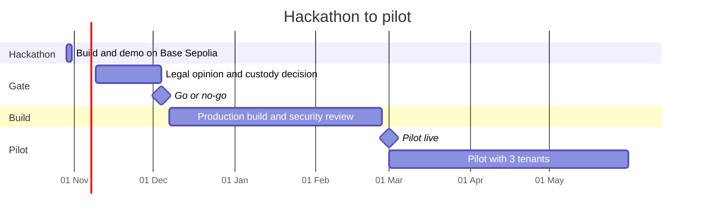

# Onsumm Crypto Rail — Business Document

Status: proposal · as of 29 Oct 2026 · Names and decisions follow [00_DECISIONS.md](00_DECISIONS.md)

Companion documents: [02_TECHNICAL.md](02_TECHNICAL.md) · [README.md](README.md) (hackathon) · [07_IMPLEMENTATION_PLAN.md](07_IMPLEMENTATION_PLAN.md)

Contents

1. [Executive summary](#1-executive-summary)
2. [Problem and opportunity](#2-problem-and-opportunity)
3. [Customers and use cases](#3-customers-and-use-cases)
4. [Product scope: jurisdiction profiles](#4-product-scope-jurisdiction-profiles)
5. [The hackathon demo, in business terms](#5-the-hackathon-demo-in-business-terms)
6. [Regulatory and compliance](#6-regulatory-and-compliance)
7. [Custody model: Safe or partner](#7-custody-model-safe-or-partner)
8. [Business model, pricing and unit economics](#8-business-model-pricing-and-unit-economics)
9. [Go-to-market](#9-go-to-market)
10. [Risks and mitigations](#10-risks-and-mitigations)
11. [Roadmap: hackathon, legal gate, pilot](#11-roadmap-hackathon-legal-gate-pilot)
12. [Open questions](#12-open-questions)

---

## 1. Executive summary

Onsumm will let companies outside India pay their vendors in USDC through the same controlled flow it already runs for INR: capture, verify, reconcile, tax, approve, pay, book and audit. The crypto rail sits beside today's IMPS bank rail; nothing changes for Indian tenants.

**Now (Hacker House Goa, 29–31 Oct 2026):** a working demo on Base Sepolia testnet with USDC only and no real funds. A Singapore client pays a US vendor's invoice. Onsumm catches an overbilled line, collects approvals from the client's own Safe multisig, pays the vendor, matches the payment on-chain, posts the voucher and anchors the audit trail on a public chain. It then shows that the same payment is blocked for an India-resident company.

**Later (production):** a paid pilot with 3 international tenants, targeted for 1 March 2027, gated by a written Indian legal opinion and a custody decision.

The rail has four parts:

1. **USDC payouts**: an approved bill becomes a USDC transfer from the client's treasury wallet to the vendor's verified wallet.
2. **On-chain reconciliation**: every transfer is matched to its bill by transaction hash and posted to the ledger. Inbound USDC from the client's own customers is matched to receivables in production.
3. **Crypto TDS (withholding)**: a rules engine computes withholding in fiat and deducts it in USDC, per the payer's jurisdiction.
4. **On-chain audit anchor**: approvals and payments are hash-chained and a daily Merkle root is written to a public chain, so anyone can verify a record was not altered.

Three principles shape every decision:

- **Onsumm never holds a key that can move client money.** The client's own Safe, or a regulated custody partner, holds and signs.
- **Crypto only for tenants incorporated outside India.** India-resident tenants are blocked until the FEMA position is clear.
- **USDC on one low-fee chain first.** Base, with other chains behind the same interface later.

## 2. Problem and opportunity

Today an international company cannot use Onsumm, because India-specific checks are built into the default path every bill takes. A Singapore or UAE client's bills would fail GSTIN verification, have Indian TDS applied, and need an Indian bank account to pay from.

### What blocks an international client today

| Area | Today's behaviour | Effect on a non-Indian client |
| --- | --- | --- |
| GST verification | Every vendor GSTIN is checked through the Sandbox API | Foreign vendors have no GSTIN, so bills are flagged or stuck |
| TDS | Indian sections and rates are suggested per bill | Wrong tax is withheld or suggested |
| Bank verification | Penny-drop on an Indian account (IFSC) | Foreign IBAN, SWIFT or ACH accounts cannot be verified |
| Payments | IMPS disbursement through Indian banks (ICICI, HDFC, AU) in INR; paying also requires a verified GSTIN | No way to pay a vendor abroad |
| Currency | Bills carry a currency code, but reporting is always INR, FX covers only USD, EUR, GBP and JPY at RBI rates, and payment screens hardcode ₹ | USD, SGD or AED books are misreported |
| ERP | Tally ingest, plus Zoho, QuickBooks and Xero pulled in through Apideck; no paid bill is posted back to any ledger | Payments must be reconciled in the client's ledger by hand |
| Audit | `wf_audit_log` records events but is not tamper-evident | Auditors must trust Onsumm's database |

### Why cross-border vendor payments hurt

International SMEs and digital-first companies pay contractors, agencies and suppliers across many countries. By SWIFT, each payment typically takes 1 to 5 business days, costs a fixed wire fee plus an FX markup, and arrives with little detail for automatic reconciliation. Many of their vendors, especially freelancers and Web3-native firms, already prefer USDC.

### What the crypto rail unlocks

- **Speed**: settlement in seconds to minutes, 24/7, including weekends.
- **Cost**: a network fee of about USD 0.001 per USDC transfer on Base today ([Basescan gas tracker](https://basescan.org/gastracker), 29 Oct 2026), against a wire fee plus FX spread.
- **Exact reconciliation**: the transaction hash is a unique, public, permanent payment reference.
- **Proof**: the same public chain anchors Onsumm's audit log, so approvals are provably unedited.
- **A new revenue line**: payout fees and conversion margin on top of the subscription.

## 3. Customers and use cases

The first customers are companies incorporated outside India that already hold or accept stablecoins and pay many vendors across borders each month.

### Segments, in priority order

| Segment | Example | Why they buy | Payout pattern |
| --- | --- | --- | --- |
| Web3 and crypto-native companies | Protocol foundations, wallets, infrastructure firms in UAE, Singapore, Switzerland | Treasury already in USDC, often in a Safe; vendors want USDC | 20 to 500 payouts a month |
| Global agencies and services firms | Dev shops, design and marketing agencies with offshore contractors | Pay contractors in 10+ countries without wires | Monthly contractor runs |
| Foreign entities of Indian-founder groups | Delaware or Singapore holding company of an Indian startup | Founders already use Onsumm for the Indian entity | INR in India via IMPS, USDC abroad |
| Import and export SMEs in UAE | Trading companies paying suppliers across Asia and Africa | Slow, costly correspondent banking on some corridors | Fewer, larger payments |

The third segment is the cheapest to win, since those founders already trust Onsumm. The first is the fastest to adopt, since many already run a Safe treasury.

### Personas

- **Finance controller (buyer)**: owns month-end close; wants every payment matched and posted without manual work.
- **Approver (founder, CFO)**: approves on mobile with a wallet signature and wants to know exactly what leaves the treasury.
- **AP clerk (daily user)**: forwards bills, fixes OCR misses, prepares payment runs.
- **Vendor (payee)**: registers a wallet once, gets paid fast, receives a remittance advice.
- **External auditor**: needs evidence that approvals and payments were not altered.

### Core use cases

1. A vendor emails (or, as a stretch, WhatsApps) an invoice in USD. Onsumm reads it, checks it against the contract rate, routes it for approval and pays it in USDC to the vendor's verified wallet.
2. A controller releases a weekly batch of contractor payouts; the Safe owners sign once each.
3. A payout is confirmed on-chain and appears as a paid voucher in the client's ledger the same minute.
4. Where the client's jurisdiction requires withholding, the tax is deducted, held, remitted and documented.
5. An invoice shows a wallet address that differs from the vendor's registered wallet. Onsumm raises `WALLET_MISMATCH` and never pays the invoice address.
6. **Inbound receivables (production):** the client's own customers pay in USDC; Onsumm matches each inbound transfer to the open sales invoice.
7. An auditor verifies a sample of approvals against the public anchor without logging in to Onsumm.

## 4. Product scope: jurisdiction profiles

Every tenant gets a **jurisdiction profile** that decides which checks, tax rules, rails and ERP connectors apply. India is today's behaviour as a profile, so nothing changes for existing tenants.

### What a profile controls

| Setting | India profile (today) | International profile |
| --- | --- | --- |
| Residency flag | `is_resident_india = true` | `is_resident_india = false` |
| Functional currency | INR | Chosen at onboarding (USD for the demo tenant) |
| Bill currencies | INR, plus USD/EUR/GBP/JPY via FX | Any ISO 4217 currency, plus USDC |
| Entity onboarding | GSTIN, PAN | Registration number, tax residency, KYB documents, UBOs (25% or more) screened |
| Vendor tax ID check | GSTIN via Sandbox API | Country format check; VAT via VIES for EU |
| Vendor tax documents | PAN | W-8BEN-E for US vendors; TRC, Form 10F and no-PE declaration only when the payer is Indian |
| Withholding | TDS sections (exists today) | Client-jurisdiction rule pack, signed off by the client's adviser |
| Vendor payment details | Indian account + IFSC, penny-drop | Wallet proven by signature (SIWE), screened, with a cooling period |
| Payment rails | IMPS | USDC (crypto rail); bank rails later |
| Travel Rule data | Not needed | Originator and beneficiary name, address and wallet per transfer |
| ERP | Tally ingest, Apideck pull | Tally payment voucher (built for the hackathon); Xero, QuickBooks, Zoho write-back in production |

### Rules for profiles

- A profile is set at tenant creation and changed only by a platform admin, because it changes what is legally checked.
- Each check is a pluggable compliance pack with the same interface. A pack that is off never calls its API, never raises a finding and never shows its screens.
- A group with an Indian entity and a foreign parent is two tenants, each with its own profile.

### Out of scope for now

- Indian tenants paying in crypto (blocked by policy, shown in the demo).
- Fiat cross-border rails (SWIFT, local payouts) and fiat on/off-ramps.
- USDT and other tokens; non-EVM chains.
- Any wallet Onsumm controls that can move client funds.

## 5. The hackathon demo, in business terms

The demo shows one bill going from inbox to on-chain settlement and back into the books, with every control a finance team expects. The cast and amounts are fixed in [00_DECISIONS.md](00_DECISIONS.md) §2.6.

| Step | What the judges see | Why it matters to a buyer |
| --- | --- | --- |
| 1. Onboard the client | Lumen Labs Pte Ltd (Singapore, USD) passes KYB, its UBOs are screened, and its 2-of-3 Safe is connected | Onboarding is compliant and self-serve; Onsumm reads the Safe's owners and threshold from the chain |
| 2. Onboard the vendor | Nova Design LLC signs a message with its wallet; the address is screened; a 2-minute cooling countdown runs | The crypto version of penny-drop: Onsumm only pays proven, screened wallets |
| 3. Invoice arrives | NOVA-1042 for USD 4,200 is captured by email (WhatsApp as a stretch) | No new habit for vendors |
| 4. Overbilling caught | Recon flags USD 600 above the contract rate of USD 3,600 and holds the bill | Money saved before it leaves |
| 5. Approve and pay | The founder approves USD 3,600; two Safe owners sign in their browser; USDC moves on Base Sepolia | Client keys, client rules; Onsumm cannot pay on its own |
| 6. Reconciled | The on-chain watcher matches the transaction hash; the bill shows *Paid and reconciled* | No manual matching at month-end |
| 7. Tax and books | The SG-DEMO pack shows 0% withholding, flagged for adviser sign-off; USD value and an INR reference are stored; a Tally payment voucher is generated with the transaction hash | Correct tax for the payer's country, and books that tie to the chain |
| 8. Audit proof | The day's audit Merkle root is anchored; a proof bundle is verified on a public page | Tamper-evident approvals for auditors |
| 9. Guardrail moment | Switch to Onsumm Demo India Pvt Ltd and try to pay in USDC: blocked with `CRYPTO_DISABLED_RESIDENT_INDIA`; the preview shows Section 195 withholding on the bank rail instead | Onsumm knows where crypto is not allowed and enforces it |

**What the demo does not claim:** no mainnet, no real funds, no ERPNext, no fiat ramps, no live KYB provider or live sanctions API.

## 6. Regulatory and compliance

Onsumm can offer this legally only if it stays a software provider: it must not hold, transfer or exchange crypto on behalf of clients. The client's Safe or a licensed partner does those things. A written opinion from Indian counsel is a hard gate before any mainnet pilot. Facts below were checked against public sources on 29 Oct 2026 and are not legal advice.

### India

| Topic | Position | What it means for Onsumm |
| --- | --- | --- |
| PMLA and FIU-IND | Since 7 March 2023, anyone who, as a business and for others, exchanges, **transfers**, or **safekeeps or administers** VDAs is a reporting entity and must register with FIU-IND. The test is the activity, not presence in India. ([source](https://corporate.cyrilamarchandblogs.com/2024/09/fig-paper-no-39-series-3-recent-learnings-from-the-indian-virtual-digital-assets-regulatory-space/)) | Onsumm must neither move nor hold client USDC. With a Safe, the client's own owners sign; Onsumm builds the transaction and a gas-only relayer submits it. Counsel must confirm that neither building nor relaying counts as "transfer on behalf of". |
| FEMA and RBI | No RBI permission exists for residents to settle cross-border payments in crypto or stablecoins. In June 2026 the Enforcement Directorate searched Bengaluru firms that moved money abroad in BTC and USDT and froze about ₹6 crore. ([source](https://www.outlookmoney.com/news/crypto-firms-under-ed-scanner-in-rs-2500-crore-fema-violation-probe)) RBI's deputy governor called stablecoins "inherently hazardous" in December 2025. ([source](https://www.outlookmoney.com/invest/rbi-highlights-risks-of-stablecoins-says-india-must-prioritise-nation-first-interests)) | Crypto is hard-disabled for India-resident tenants. A foreign entity of an Indian group must fund its treasury from its own non-Indian sources. |
| Income tax | 1% TDS on VDA transfers to residents (Section 194S, s.393(1) of the Income-tax Act, 2025 from 1 April 2026; 20% without PAN) ([source](https://blog.tdsman.com/2026/08/tds-on-virtual-digital-assets-section-3931-194s/)); 30% tax on VDA gains (Section 115BBH) | Covered by `IndiaVdaPack`; applies only to India-resident payers buying a VDA. |
| GST | 18% GST applies to fees for crypto services, not to the value of the crypto. ([source](https://www.cryptact.com/en/blog/gst-on-cryptocurrency-in-india-tax-rates-rules-and-compliance-explained)) | Onsumm's fees invoiced from India carry GST; exports of services may be zero-rated, subject to the usual conditions. |

### Client jurisdictions and the stablecoin

| Regime | Position | Effect |
| --- | --- | --- |
| US GENIUS Act | Signed 18 July 2025: 100% reserves, Bank Secrecy Act duties for issuers, and the ability to freeze tokens. Effective on the earlier of 18 January 2027 or 120 days after final rules. ([source](https://www.whitehouse.gov/fact-sheets/2025/07/fact-sheet-president-donald-j-trump-signs-genius-act-into-law/), [rulemaking tracker](https://www.chapman.com/publication-genius-act-rulemaking-tracker)) | USDC sent to a flagged address can be frozen, so wallets are re-screened before every payout. |
| EU MiCA | Service-provider regime since 30 December 2024; transitional relief ended 1 July 2026. USDC and EURC are MiCA-compliant through Circle's French e-money licence; USDT is no longer offered by EU-licensed providers. ([ESMA](https://www.esma.europa.eu/esmas-activities/digital-finance-and-innovation/markets-crypto-assets-regulation-mica), [news](https://thepaypers.com/crypto-web3-and-cbdc/news/tether-exits-eu-market-as-mica-rules-block-usdt-from-exchanges)) | USDC only. EU clients on the partner model need a MiCA-licensed partner. |
| EU Travel Rule (Regulation 2023/1113) | Applies to crypto transfers by service providers from 30 December 2024. ([EBA](https://www.eba.europa.eu/activities/single-rulebook/regulatory-activities/anti-money-laundering-and-countering-financing-terrorism/guidelines-information-requirements-relation-transfers-funds-and-certain-crypto-assets-transfers)) | Originator and beneficiary data is captured for every transfer from day one. |
| FATF | Revised Recommendation 16 (June 2025) requires verified originator and beneficiary data above USD/EUR 1,000, with compliance by end-2030. ([source](https://www.cgap.org/blog/fatfs-revised-travel-rule-key-changes-for-payment-transparency)) | Same data model serves it. |

### Responsibilities

| Duty | Client | Safe (option A) or partner (option B) | Onsumm |
| --- | --- | --- | --- |
| Hold funds and keys | Owns (Safe owners) | Safe contract holds funds / partner custodies | Never |
| KYB of the client | Provides documents | Partner performs (option B) | Collects and screens (option A) |
| Vendor wallet proof and screening | Approves vendors | Partner may also screen | Verifies signature, screens, records |
| Sign transfers | Owners sign | Safe executes / partner signs | Builds and relays only |
| Travel Rule data | Supplies | Partner transmits (option B) | Captures and stores |
| Withholding tax | Is the deductor | Partner converts to fiat (option B) | Calculates, records, reports |
| Audit trail | | | Hash-chains and anchors |

### Partner options (production, option B)

| Partner | What it offers | Note |
| --- | --- | --- |
| [Circle Mint](https://www.circle.com/circle-mint) | Institutional USDC mint and redeem, multi-chain transfers, API | Eligible regions to be confirmed |
| [Bridge (Stripe)](https://www.bridge.xyz/) | Orchestration API, wallets, issuance; US, EEA (Luxembourg) and rest-of-world entities | Owned by Stripe since February 2025 ([source](https://stripe.com/newsroom/news/stripe-completes-bridge-acquisition)) |
| [BVNK](https://www.bvnk.com/) | Payouts, collection, conversion; 130+ markets, 40+ licences | Minimum about USD 500,000 a month; Mastercard acquisition announced March 2026 |
| [Fireblocks](https://www.fireblocks.com/) | MPC wallets, custody, policy engine, stablecoin orchestration | Strong policy controls; ramps via third parties |
| [Coinbase Developer Platform](https://docs.cdp.coinbase.com/) | Payments, wallets, onramp, mass payouts | Pricing and geography to confirm |
| [Paxos](https://www.paxos.com/) | Issuer, custody, payments; OCC-overseen, MAS licence | Issues its own stablecoins rather than USDC |

None states an India restriction publicly; each must confirm in writing that it will serve a client whose software provider is based in India. Wallet screening can come from [Chainalysis](https://www.chainalysis.com/free-cryptocurrency-sanctions-screening-tools/), [TRM Labs](https://www.trmlabs.com/products/wallet-screening) or [Elliptic](https://www.elliptic.co/platform/lens); the hackathon uses a static sanctions list.

## 7. Custody model: Safe or partner

Both models keep Onsumm away from client keys; they differ in who runs custody and whether fiat is available. Onsumm supports both behind one `CustodyProvider` interface, and the hackathon uses the Safe.

| | Option A: client's Safe (`SafeCustody`) | Option B: custody partner (`PartnerCustody`) |
| --- | --- | --- |
| Who holds keys | The client's Safe owners (their own wallets) | The partner's MPC, under the client's policy |
| Who signs a payout | Client owners, in the Onsumm UI, up to the Safe threshold | Partner, after the client's approval quorum |
| Who submits on-chain | Onsumm's gas-only relayer (cannot move funds) | Partner |
| Cost to Onsumm | Gas only, about USD 0.001 per payout on Base | Partner fees per wallet, transfer or volume tier |
| Speed to market | Days (live on testnet for the hackathon) | Weeks to months (contract, KYB, integration) |
| Fiat on/off-ramp | No; client funds and redeems USDC itself | Yes, through the partner |
| KYB and Travel Rule | Onsumm collects; no regulated party transmits | Partner performs and transmits |
| Regulatory exposure for Onsumm | Low if relaying is not "transfer"; needs counsel confirmation | Lowest; a licensed entity executes |
| Best for | Crypto-native clients that already run a Safe | Clients that start in fiat or need regulated custody |

## 8. Business model, pricing and unit economics

International tenants pay a USD subscription plus usage fees on the crypto rail. The prices are a starting proposal to test in the pilot, not market research.

### Proposed price list

| Plan | Subscription (USD / month) | Included | USDC payout fee | Fiat on/off-ramp (option B only) |
| --- | --- | --- | --- | --- |
| Starter | 299 | 1 entity, 100 bills, 50 payouts, 1 ERP | 1.50 per payout after 50 | Partner rate + 0.25% |
| Growth | 799 | 3 entities, 1,000 bills, 300 payouts, Crypto TDS, audit anchor | 1.00 per payout after 300 | Partner rate + 0.20% |
| Enterprise | From 2,500 | Unlimited entities, custom rule packs, dedicated anchor contract, SLA | Negotiated | Negotiated |

Network gas is absorbed on low-fee chains, where it is a fraction of a cent, and passed through on Ethereum mainnet.

### Revenue lines

1. **Subscription**: priced against AP automation tools, not payment fees.
2. **Payout fee**: flat per payout, so a finance team can predict it.
3. **Conversion margin (option B)**: a disclosed share of the partner's spread when the client funds from fiat or a vendor cashes out.
4. **Compliance add-ons**: extra rule packs, Travel Rule messaging, auditor portal.
5. **Audit anchor for Indian tenants**: sold on its own, since it does not depend on crypto payouts.

### Worked example (assumptions stated)

A Growth client making 400 payouts a month with USD 300,000 of volume, funding half from fiat through a partner:

| Line | Calculation | USD / month |
| --- | --- | --- |
| Subscription | Growth plan | 799 |
| Payout fees | (400 − 300) × 1.00 | 100 |
| Conversion margin | 150,000 × 0.20% | 300 |
| **Revenue** | | **1,199** |
| Partner costs | Unknown until partner pricing is negotiated | open |
| Chain fees absorbed | 400 × about 0.001 on Base | under 1 |
| Anchoring | 30 anchor transactions a month, shared across tenants | under 1 |

On option A (Safe) there is no conversion margin and no partner cost, so the same client yields USD 899 at near-100% gross margin on usage. The partner's pricing decides option B's margin; getting two quotes is the first business task after the hackathon.

### Costs Onsumm takes on

- Partner fees (option B only).
- Wallet screening (per check or annual).
- Legal opinions in India and the first client jurisdictions.
- A security audit of the signing flow, relayer and anchor contract.
- Crime or cyber insurance sized to the payment flow Onsumm can influence.

## 9. Go-to-market

Win 3 paying pilot tenants from warm channels before any paid marketing, starting with the hackathon audience.

### Sequence

1. **Hackathon (31 Oct 2026):** demo to judges and the Web3 founders at Hacker House Goa; collect pilot interest on the spot.
2. **Existing Indian clients with a foreign entity:** offer the international tenant at pilot pricing for 6 months.
3. **Web3 companies in Dubai and Singapore** that already run Safe treasuries; reach them via founder networks and events such as TOKEN2049 and GITEX.
4. **Accounting firms and fractional CFOs** running books for many international SMEs; one firm can bring 10 to 30 entities.
5. **Marketplaces later:** Xero and QuickBooks app stores once write-back is live.

### Positioning

*"Accounts payable that settles in minutes and reconciles itself."* Lead with control, reconciliation and audit proof, not with crypto.

### Pilot terms

- 3 tenants, 90 days, payout fees waived, subscription at 50%.
- Success criteria: at least 95% of payouts reconciled with no manual matching; month-end close for paid bills in under 1 day; no payment released without full approval.

### Collateral

- A 2-page custody explainer: who holds keys, who can move funds, what Onsumm can and cannot do.
- A sample auditor packet: an approval record, its proof bundle and the anchor transaction link.
- A side-by-side of a SWIFT payment and a USDC payout on the same invoice: time, cost, reconciliation steps.

## 10. Risks and mitigations

The largest business risk is regulatory classification in India; the largest hackathon risk is a live dependency failing on stage.

| Risk | Likelihood | Impact | Mitigation | Owner |
| --- | --- | --- | --- | --- |
| Onsumm is classed as a VDA service provider in India | Medium | High | No custody, no fund keys; client signs; legal opinion before mainnet; register if counsel says so | Founders + counsel |
| Gas-only relayer seen as "transferring on behalf" | Medium | Medium | Let the last Safe owner execute from their wallet as an alternative; counsel to rule | Founders + counsel |
| Sanctioned client, vendor or wallet | Low | High | UBO and wallet screening; re-screen before every payout; country blocklist | Compliance lead |
| Vendor wallet fraud (address swapped) | Medium | High | SIWE proof, cooling period, admin approval on change, `WALLET_MISMATCH`, never pay invoice addresses | Product |
| Partner dependency (option B) | Medium | High | `CustodyProvider` interface; Safe option as fallback | Engineering |
| USDC depeg or issuer freeze | Low | High | Pay at approval-time value; no balances held by Onsumm; re-screening | Finance |
| Tax treatment unclear in a client's country | High | Medium | Client-adviser sign-off on every non-India pack (`requires_signoff`) | Product + counsel |
| ERP posting errors (FX, crypto as bank account) | Medium | Medium | Dedicated USDC clearing ledger; FX gain or loss on settlement; pilot with each client's accountant | Engineering |
| Finance teams uneasy about crypto | Medium | Medium | Lead with reconciliation and audit; crypto-native segment first | GTM |
| Production server too small (t2.micro, 1 GB RAM, public port 5432) | High | Medium | Private, right-sized infra before any mainnet pilot | Engineering |
| **Hackathon:** Base Sepolia RPC slow or rate-limited | Medium | High | Two RPC URLs with failover; pre-funded wallets; recorded backup video | Chain engineer |
| **Hackathon:** test USDC or test ETH faucet dry on the day | Medium | High | Fund all wallets on Thursday; keep spare balances in a reserve wallet | Chain engineer |
| **Hackathon:** WhatsApp sandbox or email intake fails live | Medium | Low | Upload the invoice directly; WhatsApp is a stretch goal | Backend |
| **Hackathon:** browser wallet popup issues on the demo laptop | Medium | Medium | Two pre-configured browser profiles; signatures rehearsed twice | Frontend |

## 11. Roadmap: hackathon, legal gate, pilot

The hackathon proves the flow on testnet; nothing touches mainnet until the legal gate passes on 4 December 2026.

| Phase | Start | End | Exit criteria |
| --- | --- | --- | --- |
| Hackathon | 29 Oct 2026 | 31 Oct 2026 | Nine-step demo runs end to end on Base Sepolia |
| Legal opinion and custody decision | 9 Nov 2026 | 4 Dec 2026 (gate) | Signed Indian opinion; Safe-only or partner chosen; entity for foreign contracts decided |
| Production build and security review | 7 Dec 2026 | 26 Feb 2027 | Mainnet payout of 1 USDC; Xero or Tally posting live; pen test with no open high findings |
| Pilot live | 1 Mar 2027 | | 3 tenants onboarded |
| Pilot | 1 Mar 2027 | 31 May 2027 | Success criteria in §9 met |

## 12. Open questions

### Blocking the pilot

- [ ] **Legal opinion (India):** does building Safe transactions and relaying them, or instructing a partner's API, make Onsumm a VDA service provider under PMLA?
- [ ] **Contracting entity:** the Indian company or a new subsidiary (UAE, Singapore or Delaware)?
- [ ] **Custody:** Safe only, partner only, or both at launch? If a partner, which two to quote (Bridge, Fireblocks, Circle, BVNK; BVNK's USD 500,000 monthly minimum may rule it out)?
- [ ] **First mainnet chain:** Base is recommended (about USD 0.001 per transfer, seconds to settle, hard finality about 15 to 19 minutes) ([Circle confirmation table](https://developers.circle.com/cctp/required-block-confirmations)).
- [ ] **Pilot clients:** name the 3 tenants and their jurisdictions, so the first real rule packs are chosen from real needs.

### Can be settled later

- [ ] Confirmation depth before marking a payout paid: fast finality, or hard finality above an amount?
- [ ] Is the 1 USDC test transfer on by default in production?
- [ ] Who pays gas on Ethereum mainnet?
- [ ] OpenTimestamps (Bitcoin) as a second anchor witness for all tenants, or Enterprise only?
- [ ] A second AWS region for EU data-residency clients?
- [ ] What change in RBI policy would bring Indian tenants into scope?
- [ ] Are the Starter and Growth prices right against what pilot clients pay today for AP tools and wires?
