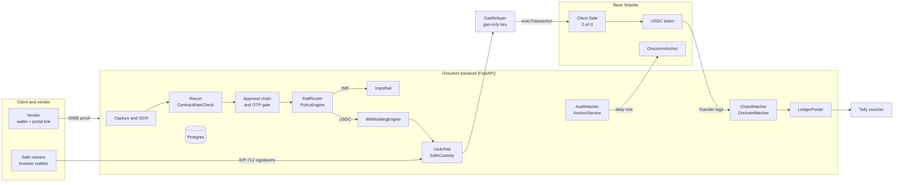

# Onsumm Crypto Rail — Technical Document

Status: proposal · as of 29 Oct 2026 · Names and decisions follow [00_DECISIONS.md](00_DECISIONS.md)

Companion documents: [01_BUSINESS.md](01_BUSINESS.md) · [03_HLD.md](03_HLD.md) · [04_LLD.md](04_LLD.md) · [05_USER_FLOWS.md](05_USER_FLOWS.md) · [06_EDGE_CASES.md](06_EDGE_CASES.md) · [07_IMPLEMENTATION_PLAN.md](07_IMPLEMENTATION_PLAN.md)

Contents

1. [Summary](#1-summary)
2. [What exists today and what is new](#2-what-exists-today-and-what-is-new)
3. [Architecture overview](#3-architecture-overview)
4. [Feature 1: USDC payouts](#4-feature-1-usdc-payouts)
5. [Feature 2: On-chain reconciliation](#5-feature-2-on-chain-reconciliation)
6. [Feature 3: Crypto TDS](#6-feature-3-crypto-tds)
7. [Feature 4: Audit hash chain and on-chain anchor](#7-feature-4-audit-hash-chain-and-on-chain-anchor)
8. [Data model](#8-data-model)
9. [APIs, workers and UI](#9-apis-workers-and-ui)
10. [Security and key management](#10-security-and-key-management)
11. [Safety defaults](#11-safety-defaults)
12. [Infrastructure](#12-infrastructure)
13. [Testing strategy](#13-testing-strategy)

---

## 1. Summary

The crypto rail is built inside the existing FastAPI backend (`backend_ocr/app`) and Postgres database, as a second payment rail beside IMPS. It reuses the disbursement router, OTP release, sweeper, approval chain, licensing and Review Hub. It adds four things: USDC payouts through a `CustodyProvider` (the client's Safe for the hackathon), an on-chain watcher and matcher, a withholding engine with rule packs, and a tamper-evident audit log anchored on Base.

Hackathon target: Base Sepolia (chain ID 84532), Circle test USDC `0x036CbD53842c5426634e7929541eC2318f3dCF7e` (6 decimals), a 2-of-3 Safe owned by the demo client, Python libraries `web3` v7, `eth-account` and `siwe`, contracts in Foundry, and `wagmi` v2 + `viem` in the React app.

## 2. What exists today and what is new

Several things the original hackathon README assumed are not in the code today and must be built (D7).

| Area | Exists today (verified in code) | New for the crypto rail |
| --- | --- | --- |
| Payments | `routers/disbursement.py`: IMPS via Lendix to ICICI, HDFC, AU; states `PENDING_OTP` → `PENDING` → `SUCCESS`/`FAILED`; OTP release; `_resolve_beneficiary` requires verified bank account and GSTIN; `_apply_success` updates the bill | `Rail` interface; `UsdcRail`; profile-aware guardrails; `crypto_disbursement_details` |
| Gateway adapters | `integrations/payments/` with `BankAdapter`, per-bank modules | Wrapped as `ImpsRail`; `CustodyProvider` with `SafeCustody`, `GasRelayer` |
| Sweeper | `domain/payments/sweeper.py`, every 300 s, enquiry only | Also nudges stuck crypto payouts (`PAYOUT_STUCK`) |
| TDS | `utils/tds_engine.py` (Indian sections, thresholds, FY state) | `WithholdingEngine` with rule packs; existing engine becomes `IndiaServicesPack` |
| Non-resident TDS (s.195) | Not modelled | `IndiaNonResidentPack` |
| VDA TDS (s.194S / s.393(1)) | Not modelled | `IndiaVdaPack` |
| Audit | `wf_audit_log`, no hash chaining | `AuditHasher`, `MerkleBuilder`, `AnchorService`, `ProofService`, `OnsummAnchor.sol` |
| Contract-rate check | Not present (only a test-invoice script mentions overbilling) | `ContractRateCheck`, `vendor_contract_rates` |
| ERP posting | Tally builders for sales, receipt and ledger only; Apideck pull-only; no paid bill posted anywhere; no ERPNext | `TallyPaymentVoucherBuilder`, `LedgerPoster`, `ledger_postings` |
| Intake | Email mailbox watcher, upload | WhatsApp via Twilio sandbox is a stretch goal |
| Tenancy | `dim_tenants` with `settings_jsonb`, no country or base currency | Profile columns, `tenant_rail_policy`, `tenant_ubos`, `treasury_wallets` |
| Vendors | `dim_suppliers`, `supplier_bank_accounts`, `supplier_gstins` | `supplier_wallets`, `wallet_screenings`, tax docs |
| Licensing | `security/licensing.py`, `services.py` | Keys `crypto_payouts`, `crypto_tds`, `audit_anchor` |
| Currency display | ₹ hardcoded in 48 frontend files and receipt helpers | Formatter driven by `dim_tenants.base_currency` (crypto screens first) |

## 3. Architecture overview

Onsumm builds and tracks payouts; only the client's Safe owners can authorise them. Detailed component, deployment and sequence diagrams are in [03_HLD.md](03_HLD.md); classes and DDL are in [04_LLD.md](04_LLD.md).

## 4. Feature 1: USDC payouts

A USDC payout reuses the existing disbursement lifecycle and adds a Safe signing step between the OTP release and on-chain settlement.

### 4.1 Lifecycle

1. **Vendor proves a wallet.** The vendor opens a signed portal link, connects a wallet and signs a SIWE (EIP-4361) message. `SiweVerifier` recovers the address. `WalletService` screens it, sets `cooling_until`, and moves the wallet to `COOLING`, then `ACTIVE` after the cooling period (2 minutes in the demo, 24 hours in production). A changed wallet freezes the old one and needs admin approval.
2. **Bill approved** through the existing chain (`PENDING_APPROVER` → `PENDING_ACCOUNTANT` → `PENDING_FC`).
3. **Prepare.** `POST /api/bills/{id}/disbursements` with `rail: "USDC"`. `FxService` writes an `fx_snapshots` row (token USD price, functional rate, INR reference). `WithholdingEngine` computes withholding. The response previews gross, withholding, net USDC, gas estimate, destination and policy result.
4. **Policy checks** (`PolicyEngine`): resident-India block, allowed chain and token, per-transaction and daily limits, wallet `ACTIVE` and past cooling, fresh screening (re-screened now), treasury balance, no payout already in flight for the bill on any rail (`ALREADY_IN_FLIGHT`, `DUPLICATE_ACROSS_RAILS`).
5. **OTP release** (existing gate). `status = PENDING_OTP`, `sub_status = AWAITING_RELEASE`.
6. **Propose.** On OTP success, `SafeCustody.propose()` builds a Safe transaction: `to` = USDC contract, `data` = `transfer(vendor, amount_units)`, `operation = 0`, next Safe nonce. It stores `safe_tx_hash` and `safe_nonce`. `sub_status = PROPOSED`.
7. **Owners sign.** Each owner opens the payout card, fetches the EIP-712 typed data (`GET /api/disbursements/{id}/safe-tx`) and signs in their browser wallet. `POST /signatures` verifies the signer is a current Safe owner and stores the signature. `PARTIALLY_SIGNED` until the threshold, then `READY`.
8. **Execute.** `GasRelayer` packs the signatures in owner-address order and calls `execTransaction` on the Safe. `sub_status = SUBMITTED` with `tx_hash`. The relayer key holds only test ETH; the Safe rejects execution without valid owner signatures.
9. **Confirm.** `ChainWatcher` sees the USDC `Transfer` log; `OnchainMatcher` matches it (§5). After the confirmation target (3 blocks on testnet), `sub_status = CONFIRMED`, `status = SUCCESS`, and the existing `_apply_success` updates the bill.
10. **After success.** `LedgerPoster` queues a Tally payment voucher; a remittance advice with the explorer link is emailed to the vendor; every step has written a hash-chained audit row.

### 4.2 Status model

`fact_disbursements.status` keeps its four values, so current screens, the sweeper and reports work unchanged. The full table is in [00_DECISIONS.md §2.2](00_DECISIONS.md#22-payout-status); the state diagram is in [04_LLD.md](04_LLD.md).

| `status` | `sub_status` values |
| --- | --- |
| `PENDING_OTP` | `AWAITING_RELEASE` |
| `PENDING` | `PROPOSED`, `PARTIALLY_SIGNED`, `READY`, `SUBMITTED`, `CONFIRMING` |
| `SUCCESS` | `CONFIRMED` |
| `FAILED` | `REJECTED`, `EXPIRED`, `REVERTED`, `REPLACED` |

### 4.3 Rules that differ from IMPS

- **No GSTIN requirement** for international tenants; the profile's tax ID check replaces it.
- **Balance** is read from the USDC contract for the Safe address, not from `remitter_accounts.balance`.
- **Idempotency:** `idempotency_key = disbursement_id + ":" + attempt`; the Safe nonce also prevents double execution of the same transaction.
- **One payout per bill in flight**, across both rails.
- **Invoice wallet addresses are never used.** Capture extracts them only for `WALLET_MISMATCH`.
- **Gas** is estimated before release and stored as `gas_fee_native`.

### 4.4 Production custody (option B)

`PartnerCustody` implements the same `CustodyProvider` methods against a partner API (Bridge, Fireblocks, Circle or BVNK). `propose` becomes "create transfer request", signatures become the partner's approval quorum, and `execute` is done by the partner. The rest of the lifecycle is unchanged.

## 5. Feature 2: On-chain reconciliation

The chain, not the custody layer, is the source of truth for what settled. Every USDC movement in or out of a tenant's treasury and tax wallets is stored once, classified and matched.

### 5.1 Three-way match

| Record | Source | Key fields |
| --- | --- | --- |
| What Onsumm asked for | `fact_disbursements` + `crypto_disbursement_details` | bill, amount_units, destination, chain, safe_tx_hash |
| What custody did | Safe execution (relayer receipt) or partner webhook | tx_hash, Safe `ExecutionSuccess` event |
| What the chain shows | `chain_transfers` from `ChainWatcher` | tx_hash, log_index, token_contract, from, to, amount_units |

A payout is `MATCHED` only when tx hash, token contract (official USDC), destination and amount in token units all agree. Any difference is `MISMATCH` with an `AMOUNT_MISMATCH` finding, and the bill stays `PENDING`.

### 5.2 Watcher

- Polls `eth_getLogs` for the USDC `Transfer` event filtered by watched addresses, from `chain_watch_cursors.last_block` (every 4 seconds on Base Sepolia). An Alchemy webhook (`POST /webhooks/chain`) is optional; the poller is always the fallback.
- Stores each log keyed by (`chain`, `tx_hash`, `log_index`); re-reads the last N blocks to detect reorgs and sets `removed = true` with a `REORG_DETECTED` finding if a log disappears.

### 5.3 Classification

| Event | Match rule | Effect |
| --- | --- | --- |
| Outgoing payout | tx_hash matches a disbursement | Bill paid; voucher queued |
| Outgoing tax transfer | tx_hash matches a withholding | Tax payable recorded |
| Incoming funding | From an address the tenant registered as its own | Treasury funded |
| Incoming receivable (production; hackathon nice-to-have) | Amount + payer wallet + time window match an open sales invoice | Receivable settled |
| Incoming, unmatched | No rule fits | `UNMATCHED_INBOUND_TRANSFER` |
| Outgoing, not proposed by Onsumm | No disbursement | **Critical** `UNMATCHED_OUTBOUND_TRANSFER` |
| Safe owners or threshold changed | Safe `AddedOwner`, `RemovedOwner`, `ChangedThreshold` events | `SAFE_CONFIG_CHANGED`; pending proposals re-validated |

### 5.4 Posting to the books

The USDC treasury is a bank-type ledger. For each confirmed payout `TallyPaymentVoucherBuilder` produces a payment voucher:

- Debit the vendor (accounts payable) with the bill amount in the bill currency.
- Credit the `Crypto Assets – USDC` ledger with the USDC amount at the snapshot rate.
- Credit `Withholding Tax Payable` with any withholding.
- Post the difference between booked and settlement rates to FX gain or loss.
- Debit `Crypto Gas Fees` with gas (in USD at the snapshot rate).
- Narration: transaction hash and explorer link.

Each voucher is stored in `ledger_postings` with its status. Xero, QuickBooks and Zoho write-back via Apideck comes after the hackathon.

### 5.5 Daily statement

`GET /api/onchain/statements/{date}` returns opening balance, every in and out with its match, computed closing balance, and the balance read from the chain. A difference raises `UNRECONCILED_DAY`.

## 6. Feature 3: Crypto TDS

Crypto TDS computes withholding in fiat on the underlying payment, deducts it in USDC, holds it, and records it for remittance and certificates. It generalises `utils/tds_engine.py` into rule packs.

### 6.1 Two different taxes

| | Tax on the service (the main case) | Tax on the crypto transfer itself |
| --- | --- | --- |
| What is taxed | The vendor's income | Transfer of a virtual digital asset |
| India rule | Ordinary TDS sections (exist); Section 195 when an Indian payer pays a non-resident | 1% TDS under Section 194S, s.393(1) of the Income-tax Act 2025 from 1 April 2026; 20% without PAN |
| When it applies | The **payer's** jurisdiction requires it | An India-resident payer buys a VDA from a resident, above ₹50,000 a year (specified persons) or ₹10,000 (others) |
| Effect of paying in USDC | None on the rate; computed in fiat, deducted in USDC | Applies to the VDA purchase, not to a services invoice paid in USDC |

A Singapore company paying a US vendor owes no Indian tax. India packs run only for India-resident payers, and those payers cannot use the crypto rail (D2). So in the hackathon the India packs appear only in the guardrail moment, on the bank rail.

### 6.2 Rule packs

| Pack | Code | Applies when | Status |
| --- | --- | --- | --- |
| `IndiaServicesPack` | `IN-SERVICES` | India-resident payer, resident vendor | Exists (`utils/tds_engine.py`) |
| `IndiaNonResidentPack` | `IN-195` | India-resident payer, non-resident vendor; treaty rate with TRC, Form 10F and no-PE declaration | Build |
| `IndiaVdaPack` | `IN-VDA` | India-resident payer buys a VDA from a resident | Build |
| `ConfigurablePack` | `SG-DEMO` (and one per client jurisdiction) | Rates and thresholds entered by the client's adviser | Build; every result has `requires_signoff = true` until signed off |

### 6.3 Computation

1. Pick the pack from the payer's profile, then the rule: vendor override, then vendor category, then pack default.
2. Check thresholds against running totals per vendor per financial year.
3. Fix the base in fiat at the payout's `fx_snapshots` row.
4. Apply the rate; use the higher rate when the vendor's tax ID or required documents are missing (`TAX_DOCS_MISSING`).
5. Convert to `amount_units`, rounding down. Net payout = gross − withholding.

### 6.4 Holding and reporting

- When withholding is above zero, the Safe transaction is a `MultiSend` of two USDC transfers: net to the vendor, withholding to the tenant's `TAX` treasury wallet. Both reconcile on-chain.
- `withholding_remittances` groups a period's withholdings for payment to the authority; certificates and registers are generated from it. Challan and Form 26Q generation (India) are production work.
- In the demo, SG-DEMO returns 0% for Nova Design's category, so the payout is a single transfer and the screen shows *0% – requires adviser sign-off*.

## 7. Feature 4: Audit hash chain and on-chain anchor

Audit rows become tamper-evident by hash-chaining them per tenant and anchoring a daily Merkle root on Base. The hash chain does not exist today and is built first.

### 7.1 Hash chain (`AuditHasher`)

- On every insert into `wf_audit_log`, assign the tenant's next `seq` and compute `row_hash = SHA-256(canonical_row || prev_hash)`.
- Canonical row: fixed field order, UTC ISO timestamps, amounts as strings, JSON with sorted keys.
- All audit writes go through one function, so `BaseWorker.log_audit` and the disbursement `_audit` use it. A row-level lock per tenant keeps `seq` gapless.
- `verify_chain(tenant, from_seq, to_seq)` recomputes and reports the first broken link.

### 7.2 Merkle tree and anchor (`MerkleBuilder`, `AnchorService`)

1. Leaves: `SHA-256(tenant_salt || row_hash)` for every row since the last anchor. The salt is in `tenant_audit_salts`.
2. Per-tenant tree with sorted-pair hashing → `tenant_root`; tenant roots form the top tree → `merkle_root`.
3. `OnsummAnchor.anchor(root, fromSeq, toSeq)` from the anchor key emits `Anchored(id, root, fromSeq, toSeq)`.
4. Rows get `anchor_id`; `audit_anchors` and `audit_anchor_tenant_roots` store the result.
5. Schedule: daily at 00:05 UTC; `POST /api/audit/anchor` runs it on demand for the demo.

### 7.3 Proof and verification (`ProofService`)

- `GET /api/audit/proof/{log_id}` (authenticated) returns a **proof bundle**: canonical row, row hash, salt, leaf, path to tenant root, path to top root, anchor ID, chain, contract, transaction hash.
- The public `/verify` page accepts the bundle as a file or a share link with a signed token. It recomputes hashes in the browser (WebCrypto SHA-256) and reads the root from the contract through a public RPC. It never accepts a raw bill ID.
- Only hashes go on-chain. With the salt, short records cannot be brute-forced from their hash.

## 8. Data model

The rail adds 17 tables and changes 4, all as idempotent functions in `backend_ocr/app/migrations.py`. Column lists are in [00_DECISIONS.md §2.1](00_DECISIONS.md#21-tables); full DDL and an entity-relationship diagram are in [04_LLD.md](04_LLD.md).

| Group | Tables |
| --- | --- |
| Tenant | `dim_tenants` (changed), `tenant_ubos`, `tenant_rail_policy`, `treasury_wallets`, `tenant_audit_salts` |
| Vendor | `dim_suppliers` (changed), `supplier_wallets`, `wallet_screenings`, `vendor_contract_rates` |
| Payout | `fact_disbursements` (changed), `crypto_disbursement_details`, `crypto_payout_signatures`, `fx_snapshots` |
| Chain | `chain_transfers`, `chain_watch_cursors` |
| Tax | `crypto_withholdings`, `withholding_remittances` |
| Audit | `wf_audit_log` (changed), `audit_anchors`, `audit_anchor_tenant_roots` |
| Books | `ledger_postings` |

USDC amounts are `numeric(38,0)` token units; fiat amounts stay `numeric` as today; each payout links both through `fx_snapshot_id`.

## 9. APIs, workers and UI

New code follows existing patterns: routers in `backend_ocr/app/routers/`, domain logic in `domain/crypto/` and `domain/audit/`, adapters in `integrations/`.

### 9.1 Endpoints

| Method | Path | Licence key |
| --- | --- | --- |
| `POST` | `/api/onboarding/kyb`, `/api/onboarding/ubos` | `crypto_payouts` |
| `POST` | `/api/treasury/wallets` | `crypto_payouts` |
| `GET/PUT` | `/api/tenant/rail-policy` | `crypto_payouts` |
| `POST` | `/api/vendors/{id}/wallet-invites` | `crypto_payouts` |
| `GET` | `/api/vendor-portal/{token}/wallet/challenge` | public, token-gated |
| `POST` | `/api/vendor-portal/{token}/wallet/verify` | public, token-gated |
| `POST` | `/api/vendors/{id}/wallets/{wid}/approve` | `crypto_payouts` |
| `POST` | `/api/bills/{id}/disbursements` (existing, `rail: "USDC"`) | `disbursement` + `crypto_payouts` |
| `POST` | `/api/disbursements/{id}/verify-otp` (existing) | same |
| `GET` | `/api/disbursements/{id}/safe-tx` | `crypto_payouts` |
| `POST` | `/api/disbursements/{id}/signatures` | `crypto_payouts` |
| `POST` | `/webhooks/chain` | HMAC |
| `GET` | `/api/onchain/transfers`, `/api/onchain/statements/{date}` | `crypto_payouts` |
| `GET` | `/api/withholding/preview` | `crypto_tds` |
| `POST` | `/api/audit/anchor` | `audit_anchor` (admin) |
| `GET` | `/api/audit/proof/{log_id}` | `audit_anchor` |
| `GET` | `/verify` | public |

Each route is added to `_RULES` in `security/licensing.py`, its key to `security/services.py` and `frontend/src/auth/services.ts`, and the route-map test regenerated, as `docs/LICENSING_AND_ADMIN.md` describes.

### 9.2 Workers

| Worker | Trigger | Job |
| --- | --- | --- |
| `ChainWatcher` | Every 4 s per chain | USDC and Safe event logs into `chain_transfers` |
| `OnchainMatcher` | New `chain_transfers` rows | Three-way match, success, findings |
| Payout executor (part of `PayoutService`) | `READY` payouts | Calls `GasRelayer` |
| Disbursement sweeper (existing) | Every 300 s | Flags `PAYOUT_STUCK`; expires stale proposals |
| Wallet cooling and re-screen | Every minute; daily re-screen | `COOLING` → `ACTIVE`; screening refresh |
| `LedgerPoster` | Confirmed payouts | Vouchers into `ledger_postings` |
| `AnchorService` | 00:05 UTC daily, or on demand | Merkle build and anchor |

The India-only workers (GST verification, bank verification, TDS processing) skip tenants with `is_resident_india = false`; today they filter only by `PIPELINE_TENANT_ID`.

### 9.3 UI (`frontend/src`)

- **Onboarding:** entity profile, KYB upload, UBO list, connect Safe (reads owners and threshold).
- **Settings:** rail policy (chains, tokens, limits, cooling, test transfer).
- **Vendor page:** Wallets card with status, screening result and cooling countdown; invite button.
- **Vendor portal:** connect wallet, sign SIWE message.
- **Payment flow (`pages/payment/`):** rail choice; preview of gross, withholding, net USDC, gas and policy result; Safe signature card showing signers and threshold; live sub-status; explorer link on the receipt.
- **On-chain hub:** transfer ledger, match status, daily statement.
- **Review Hub:** the finding codes in [00_DECISIONS.md §2.3](00_DECISIONS.md#23-finding-codes-review-hub).
- **Verify page:** public `/verify` for proof bundles.
- **Wallet library:** `wagmi` v2 + `viem`, injected connector (MetaMask or Rabby).

## 10. Security and key management

Onsumm holds no key that can move client USDC. A compromised Onsumm server can at most propose a payout or waste relayer gas.

### 10.1 Keys

| Key | Held by | Can do | Cannot do |
| --- | --- | --- | --- |
| Safe owner keys (3) | Client approvers, in their own wallets | Sign Safe transactions | Act alone below the threshold |
| Vendor wallet key | Vendor | Prove ownership; receive USDC | Anything in Onsumm |
| Relayer key (`GasRelayer`) | Onsumm (env for hackathon; KMS in production) | Pay gas to submit a fully signed Safe transaction | Move USDC or change the Safe |
| Anchor key (`ANCHOR_SIGNER_KEY`) | Onsumm (env for hackathon; KMS in production) | Write roots to `OnsummAnchor` | Touch any funds |
| Partner API credential (option B) | Onsumm (Secrets Manager) | Create transfer requests | Approve or sign |
| Vendor portal token | Signed by Onsumm, single vendor, expires in 72 hours | Register one wallet for one vendor | Anything else |

### 10.2 Threats and responses

| Threat | Response |
| --- | --- |
| Vendor wallet swapped (phishing or insider) | SIWE proof; cooling period; admin approval on change; vendor notified at the old contact; Review Hub `WALLET_CHANGED` |
| Invoice carries an attacker's address | Invoice addresses never paid; `WALLET_MISMATCH` finding |
| Address poisoning (look-alike in history) | Pay only registered, verified addresses; never from history; full address shown with checksum |
| Wrong chain or token | Chain and token from policy; EIP-55 checksum; refuse contract addresses unless allowlisted |
| Safe owners or threshold changed outside Onsumm | Watch Safe events; `SAFE_CONFIG_CHANGED`; re-validate pending signatures against new owners |
| Relayer key compromised | Cannot move funds; worst case is gas loss; rotate key; rate-limit submissions |
| Anchor key compromised | Attacker can write junk roots; verifiers trust only roots from Onsumm's known anchor IDs; rotate via contract owner |
| Onsumm server compromised | Safe signatures still required; alerts on unusual proposals |
| Insider edits audit rows | Hash chain breaks; anchored roots disagree |
| Sanctioned or frozen address | Screen at onboarding and before every payout |
| Replay of a signature | EIP-712 includes Safe address, chain ID and nonce |
| Portal link forwarded | Token bound to one vendor, expiry, single use |

### 10.3 Engineering standards

- Secrets in `.env` only for the hackathon testnet; AWS Secrets Manager and KMS in production.
- Postgres not reachable from the public internet in production (today's EC2 exposes port 5432).
- Pen test and a review of the Safe signing, relayer and anchor contract before mainnet.

## 11. Safety defaults

| Control | Production | Demo |
| --- | --- | --- |
| Cooling period on new or changed wallet | 24 hours | 2 minutes, countdown shown |
| Re-screen before every payout | On | On |
| 1 USDC test transfer on first payout | On | Off (policy flag shown) |
| Dual control | Above USD 10,000 | Safe 2-of-3 |
| Alert on outgoing transfer not proposed by Onsumm | On | On |
| Daily statement vs on-chain balance | On | On demand |
| Invoice wallet used for payment | Never | Never |
| Same invoice on two rails | Blocked | Blocked |

## 12. Infrastructure

| | Hackathon | Production |
| --- | --- | --- |
| Chain | Base Sepolia, chain ID 84532 | Base mainnet first |
| RPC | `https://sepolia.base.org` plus one provider URL, with failover | Two paid providers with failover |
| Database | `onsumm-new-db` on the existing EC2 Postgres | Private managed Postgres (RDS) with off-server backups |
| API | Local machine or the dev server | At least 2 GB RAM; watcher as its own process |
| Keys | Relayer and anchor keys in `.env`, test ETH only | AWS KMS |
| Contracts | `OnsummAnchor` deployed with Foundry | Audited, verified on the explorer |
| Monitoring | Logs | Alerts on findings, watcher lag, relayer balance |

## 13. Testing strategy

| Level | What | Tooling |
| --- | --- | --- |
| Unit | Canonical serialisation and hash chain; Merkle proofs; SIWE verification; EIP-712 Safe hash against known vectors; withholding packs; policy codes; amount unit conversion | `pytest` |
| Contract | `OnsummAnchor` access control and events | `forge test` |
| Integration | Full payout on Base Sepolia: propose, two signatures, relayer execute, watcher match, voucher | `pytest` marked `chain`, funded test wallets |
| Edge cases | Every case in [06_EDGE_CASES.md](06_EDGE_CASES.md) with a scripted trigger where possible | `pytest` + manual script |
| Demo dry-runs | The nine-step demo, three full runs on Friday night and one on Saturday morning; a recorded backup | Checklist in [07_IMPLEMENTATION_PLAN.md](07_IMPLEMENTATION_PLAN.md) |

User journeys are in [05_USER_FLOWS.md](05_USER_FLOWS.md); failure handling is in [06_EDGE_CASES.md](06_EDGE_CASES.md); the build plan is in [07_IMPLEMENTATION_PLAN.md](07_IMPLEMENTATION_PLAN.md).
