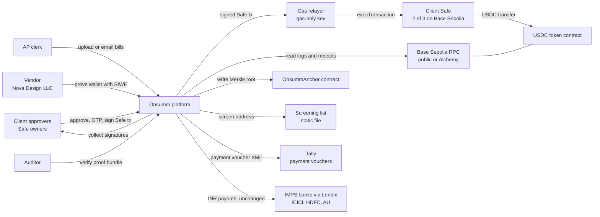
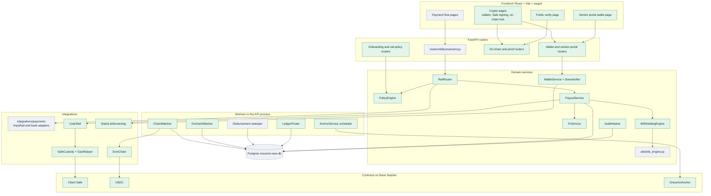
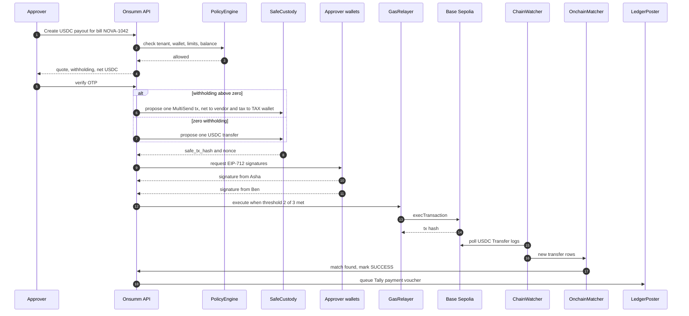
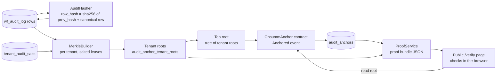
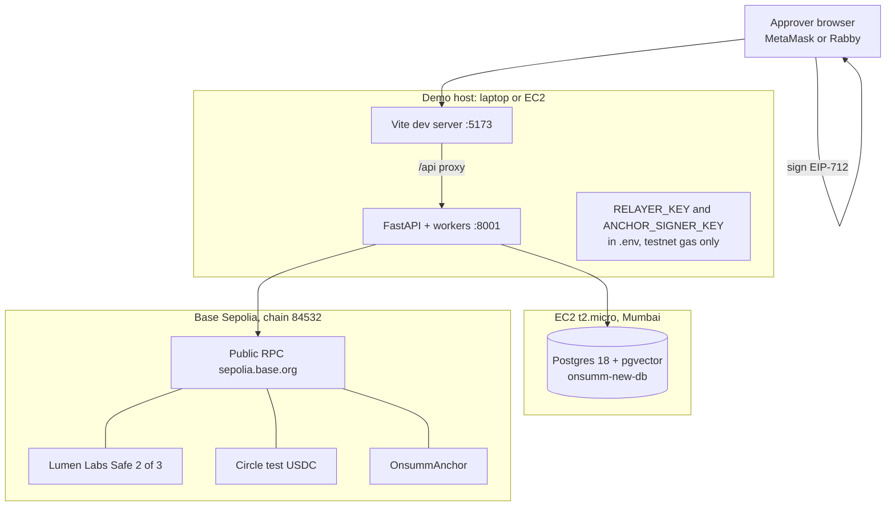
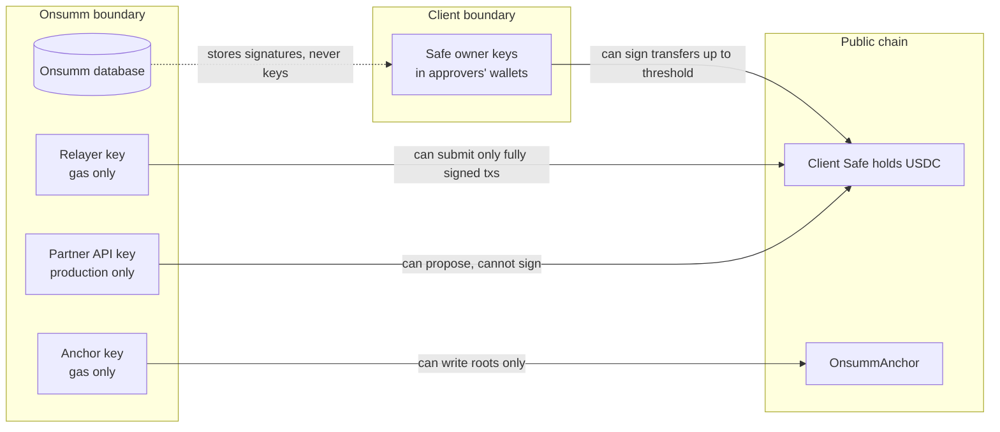

# Crypto Rail — High-Level Design

Status: hackathon design, as of 29 Oct 2026 · Names follow [00_DECISIONS.md](00_DECISIONS.md)

Contents

1. [Design principles](#1-design-principles)
2. [System context](#2-system-context)
3. [Containers and components](#3-containers-and-components)
4. [Bill-to-books pipeline](#4-bill-to-books-pipeline)
5. [Payout sequence](#5-payout-sequence)
6. [Audit anchoring data flow](#6-audit-anchoring-data-flow)
7. [Deployment view](#7-deployment-view)
8. [Trust boundaries and key custody](#8-trust-boundaries-and-key-custody)
9. [Non-functional requirements](#9-non-functional-requirements)
10. [Technology choices](#10-technology-choices)
11. [How it plugs into existing modules](#11-how-it-plugs-into-existing-modules)

---

## 1. Design principles

| # | Principle | Source |
| --- | --- | --- |
| P1 | Onsumm never holds a key that can move client funds. The client's Safe signs; a gas-only relayer submits. | D3 |
| P2 | The crypto rail exists only for tenants incorporated outside India. `PolicyEngine` hard-blocks India-resident tenants. | D2 |
| P3 | Pay only to a wallet in the verified vendor master. An address printed on an invoice is compared, never used. | D9 |
| P4 | The chain is the source of truth for settlement. A payout is `SUCCESS` only after `OnchainMatcher` sees it. | D9 |
| P5 | Every material action is written to `wf_audit_log`, hash-chained, and anchored daily on-chain. | D8 |
| P6 | Proofs are verified from a proof bundle, never by a raw bill ID. Leaves are salted per tenant. | D8 |
| P7 | Crypto is a second rail beside IMPS. Existing statuses, screens and the sweeper keep working. | D6, 2.2 |
| P8 | Safety defaults are policy, not code: cooling period, re-screening, test transfer, limits. | D9 |

---

## 2. System context

Onsumm sits in the middle but never signs a fund transfer. Money moves only from the client's Safe, after the owners sign.

---

## 3. Containers and components

Grey boxes exist today; green boxes are new. Note that the new work hangs off one existing entry point, `routers/disbursement.py`, through `RailRouter`.

---

## 4. Bill-to-books pipeline

```mermaid
flowchart LR
  CAP["Capture<br/>OCR, email intake"]
  VER["Verify<br/>wallet, screening, tax docs"]
  REC["Recon<br/>contract rate, duplicates"]
  TAX["Tax<br/>WithholdingEngine"]
  GATE["Human gate<br/>approval chain + OTP"]
  RR{"RailRouter"}
  IMPS["IMPS rail<br/>unchanged"]
  SAFEP["USDC via client Safe"]
  OREC["On-chain recon<br/>OnchainMatcher"]
  BOOKS["Books<br/>Tally payment voucher"]
  ANC["Audit anchor<br/>daily Merkle root"]

  CAP --> VER --> REC --> TAX --> GATE --> RR
  RR -->|"INR or India-resident tenant"| IMPS
  RR -->|"USDC, foreign tenant"| SAFEP
  SAFEP --> OREC --> BOOKS
  IMPS --> BOOKS
  BOOKS --> ANC

  classDef existing fill:#eef2f7,stroke:#8a96a8,color:#1b2430
  classDef extended fill:#fff4dc,stroke:#c48a12,color:#3a2a05
  classDef new fill:#e3f4ea,stroke:#2f8f5b,color:#10301f
  class CAP,GATE,IMPS existing
  class VER,REC,TAX extended
  class RR,SAFEP,OREC,BOOKS,ANC new
```

| Step | Today | Change |
| --- | --- | --- |
| Capture | OCR, email intake | Read `currency`, compare any invoice wallet (`WALLET_MISMATCH`); WhatsApp is a stretch goal |
| Verify | GSTIN, bank account | Add wallet active, screening clear, tax docs present |
| Recon | Duplicate checks | Add `ContractRateCheck` (`OVERBILLED_VS_CONTRACT`) and `DUPLICATE_ACROSS_RAILS` |
| Tax | India TDS engine | `WithholdingEngine` with rule packs; India engine becomes `IndiaServicesPack` |
| Human gate | Approval chain, OTP | Unchanged, then Safe owner signatures for USDC |
| RailRouter | Does not exist | New; enforces D2 |
| On-chain recon | Does not exist | New; chain is the source of truth |
| Books | No payment posting | New `TallyPaymentVoucherBuilder` |
| Audit anchor | Plain audit log | New hash chain and daily anchor |

Yellow steps exist and are extended. The two new money steps are the Safe payout and the on-chain match.

---

## 5. Payout sequence

The OTP gate is Onsumm's existing release control. The Safe threshold is the client's own control and holds even if Onsumm is compromised. When tax is withheld, the vendor and the tax wallet are paid in the same Safe transaction, so one cannot settle without the other.

---

## 6. Audit anchoring data flow

Only one 32-byte root goes on-chain per run. The proof bundle carries the record, its salt and both Merkle paths, so the auditor needs no Onsumm login.

---

## 7. Deployment view

| Concern | Hackathon | Production target |
| --- | --- | --- |
| Database | Docker Postgres on a t2.micro, port 5432 public | RDS in a private subnet, off-server backups |
| Secrets | `.env` file | AWS Secrets Manager; anchor key in AWS KMS |
| RPC | One public endpoint | Two providers per chain with failover |
| Compute | Single process | API and `ChainWatcher` as separate processes, at least 2 GB RAM |
| Custody | `SafeCustody` | `SafeCustody` or `PartnerCustody` per tenant |

The hackathon setup is not fit for real money. The production column lists the gate items before any mainnet use.

---

## 8. Trust boundaries and key custody

| Key | Held by | Can do | Cannot do |
| --- | --- | --- | --- |
| Safe owner keys | Each approver's wallet | Sign Safe transactions | Move funds alone below the 2-of-3 threshold |
| Relayer key | Onsumm, `.env` (hackathon) | Pay gas for `execTransaction` | Move USDC; a Safe needs owner signatures |
| Anchor key | Onsumm, `.env` then KMS | Call `OnsummAnchor.anchor` | Touch any client wallet |
| Partner API key | Onsumm, Secrets Manager (production) | Create transfer requests, read balances | Approve or sign; change client policy |

The worst case from a full Onsumm breach is a proposed payout that the owners never sign. Owner signatures are the only path to moving money.

---

## 9. Non-functional requirements

| Area | Requirement | How it is met |
| --- | --- | --- |
| Payout latency | Under 30 s from last signature to `CONFIRMED` on the demo | Base Sepolia blocks about 2 s; `CONFIRMATIONS=3`; poll every 4 s |
| Confirmation target | Demo: 3 blocks. Production: by amount, up to Base hard finality (about 15 to 19 minutes) for large payouts | `EvmChain` confirmation policy |
| Idempotency | No double payment on retry or double click | `idempotency_key` unique; `ALREADY_IN_FLIGHT`; one Safe nonce per payout |
| Atomicity | Vendor payment and withheld tax settle together | One Safe transaction via `MultiSendCallOnly` when withholding is above zero |
| Correctness | Every payout matched exactly | `OnchainMatcher` rule: tx hash, token contract, to address, `amount_units` |
| Availability | Watcher survives restarts and RPC gaps | `chain_watch_cursors`; backfill from last block; webhook optional |
| Reorg safety | No `SUCCESS` before confirmation depth | Block hash check; `removed` flag; `REORG_DETECTED` finding |
| Auditability | Every material action provable | Hash chain plus daily anchor |
| Observability | Payout and watcher metrics | Existing `/metrics` endpoint (Prometheus), access log with request IDs |
| Security | No fund keys in Onsumm | D3; relayer and anchor keys gas-only |
| Data privacy | No business data on-chain | Only salted hashes and roots |

---

## 10. Technology choices

| Choice | Picked | Why |
| --- | --- | --- |
| Chain | Base Sepolia | Cheap, fast, EVM; the same code path serves Safe, USDC and the anchor |
| Custody | Client Safe 2-of-3 | No partner contract needed; client owns keys; threshold maps to approval roles |
| Token | USDC | MiCA-compliant; Circle test token on Base Sepolia |
| Backend chain library | `web3` v7, `eth-account`, `siwe` | Backend is Python; no extra service to run |
| Frontend wallet | `wagmi` v2 + `viem`, injected connector | Fits the React app; signs EIP-712 in the browser |
| Contracts | Foundry | Fast compile, test and deploy |
| Batched transfers | Safe `MultiSendCallOnly` | Pays vendor and tax wallet atomically; call-only variant cannot delegate further |
| Hashing | SHA-256 | Available in Python and in browser WebCrypto |
| Screening | Static list file | No vendor account needed for a demo; provider interface ready |
| Scheduling | Workers in the API process | Same pattern as today's disbursement sweeper |

---

## 11. How it plugs into existing modules

| Existing module | How the crypto rail uses it |
| --- | --- |
| `routers/disbursement.py` | `POST /api/bills/{id}/disbursements` accepts `rail: "USDC"`. OTP release, overrides and `_apply_success` are reused. The GSTIN half of `_resolve_beneficiary` is skipped for international tenants. |
| `integrations/payments/` | Today's bank adapters sit behind `ImpsRail`. `UsdcRail` is added beside it under the `Rail` protocol. |
| `domain/payments/sweeper.py` | Also polls `PENDING` USDC payouts and raises `PAYOUT_STUCK` when one stalls. |
| `security/licensing.py` | New keys `crypto_payouts`, `crypto_tds`, `audit_anchor` gate every new route. |
| Review Hub (`backend_ocr/app/review/`) | Receives every finding code in 00_DECISIONS section 2.3. |
| `utils/tds_engine.py` | Becomes `IndiaServicesPack` (code `IN-SERVICES`) inside `WithholdingEngine`, beside `IN-195`, `IN-VDA` and the demo pack `SG-DEMO`. |
| `wf_audit_log` | Gains `seq`, `prev_hash`, `row_hash`, `anchor_id`. |
| `migrations.py` | Hosts all new idempotent DDL. |
