# Crypto Rail — Low-Level Design

Status: hackathon design, as of 29 Oct 2026 · Names follow [00_DECISIONS.md](00_DECISIONS.md) · High-level view: [03_HLD.md](03_HLD.md)

Contents

1. [Module layout](#1-module-layout)
2. [Class diagrams](#2-class-diagrams)
3. [Entity-relationship diagram](#3-entity-relationship-diagram)
4. [State machines](#4-state-machines)
5. [Detailed sequences](#5-detailed-sequences)
6. [Key algorithms](#6-key-algorithms)
7. [DDL](#7-ddl)
8. [API contracts](#8-api-contracts)
9. [OnsummAnchor contract](#9-onsummanchor-contract)
10. [Configuration](#10-configuration)

---

## 1. Module layout

```text
backend_ocr/app/
├── domain/
│   ├── crypto/
│   │   ├── router.py            # RailRouter
│   │   ├── policy.py            # PolicyEngine, refusal codes
│   │   ├── payouts.py           # PayoutService
│   │   ├── wallets.py           # WalletService
│   │   ├── siwe.py              # SiweVerifier
│   │   ├── fx.py                # FxService
│   │   ├── watcher.py           # ChainWatcher
│   │   ├── recon.py             # OnchainMatcher, ContractRateCheck
│   │   ├── ledger.py            # LedgerPoster, TallyPaymentVoucherBuilder
│   │   ├── workers.py           # start/stop hooks, like domain/payments/scheduler.py
│   │   └── withholding/
│   │       ├── engine.py        # WithholdingEngine
│   │       ├── base.py          # RulePack protocol
│   │       ├── configurable.py  # ConfigurablePack (SG-DEMO)
│   │       └── india.py         # IndiaServicesPack, IndiaNonResidentPack, IndiaVdaPack
│   └── audit/
│       ├── hasher.py            # AuditHasher
│       └── anchor.py            # MerkleBuilder, AnchorService, ProofService
├── integrations/
│   ├── payments/
│   │   └── rails.py             # Rail protocol, ImpsRail, UsdcRail
│   ├── custody/
│   │   ├── base.py              # CustodyProvider protocol
│   │   ├── safe.py              # SafeCustody
│   │   ├── relayer.py           # GasRelayer
│   │   └── partner.py           # PartnerCustody (production stub)
│   ├── chains/
│   │   └── evm.py               # EvmChain
│   └── screening/
│       ├── base.py              # ScreeningProvider protocol
│       └── static_list.py       # StaticListScreening
└── routers/
    ├── disbursement.py          # existing; accepts rail USDC
    ├── crypto_onboarding.py     # /api/onboarding/*, /api/tenant/rail-policy, /api/treasury/wallets
    ├── crypto_wallets.py        # /api/vendors/{id}/wallet-invites, /wallets/{wid}/approve
    ├── vendor_portal_wallet.py  # /api/vendor-portal/{token}/wallet/*
    ├── crypto_payouts.py        # /api/disbursements/{id}/safe-tx, /signatures
    ├── onchain.py               # /api/onchain/*, /webhooks/chain
    ├── withholding.py           # /api/withholding/preview
    └── audit_proof.py           # /api/audit/anchor, /api/audit/proof/{log_id}

contracts/
├── foundry.toml
├── src/OnsummAnchor.sol
├── script/Deploy.s.sol
└── test/OnsummAnchor.t.sol

frontend/src/
├── web3/
│   ├── wagmi.ts                 # config: baseSepolia, injected connector
│   ├── safeTypedData.ts         # builds EIP-712 payload from /safe-tx
│   └── merkle.ts                # browser proof verification (WebCrypto SHA-256)
└── pages/crypto/
    ├── OnboardingKyb.tsx
    ├── TreasuryWallets.tsx
    ├── RailPolicy.tsx
    ├── VendorWallets.tsx
    ├── VendorPortalWallet.tsx
    ├── CryptoPayoutCard.tsx     # used inside pages/payment/ReviewStep
    ├── SafeSigningPanel.tsx
    ├── OnchainHub.tsx
    └── VerifyProof.tsx          # public /verify
```

---

## 2. Class diagrams

### 2a. Rails and custody

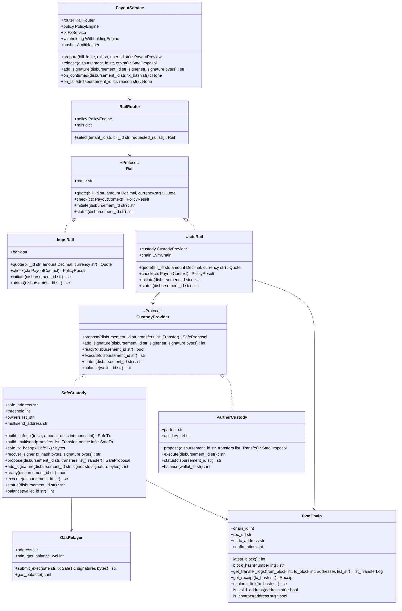

`UsdcRail` never talks to the chain to move money itself. It asks the `CustodyProvider`, so swapping Safe for a partner changes one binding.

`propose` takes a list of transfers. With zero withholding the list has one entry and `build_safe_tx` makes a plain `transfer` (`operation = 0`). With withholding above zero it has two (net to the vendor, tax to the `TAX` treasury wallet) and `build_multisend` makes one Safe transaction through `MultiSendCallOnly` (`operation = 1`).

### 2b. Wallets, policy and screening

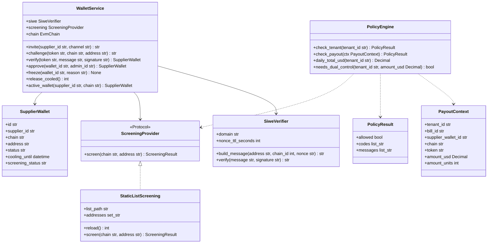

`PolicyEngine` returns all failing codes at once, so the UI can show every blocker. It re-screens the wallet on every payout check.

### 2c. Recon, FX, withholding and ledger

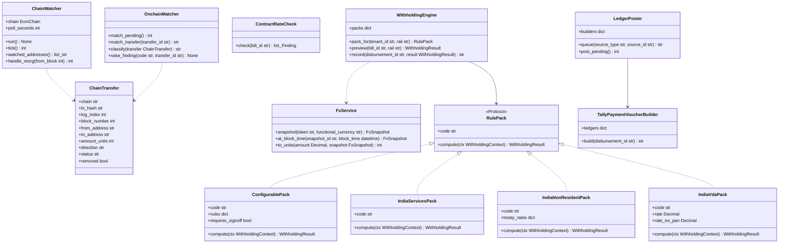

`IndiaServicesPack` wraps today's `utils/tds_engine.py`. The demo tenant uses `ConfigurablePack` with code `SG-DEMO` and `requires_signoff` set.

| Class | `code` stored in `crypto_withholdings.rule_pack` |
| --- | --- |
| `ConfigurablePack` (demo tenant) | `SG-DEMO` |
| `IndiaServicesPack` | `IN-SERVICES` |
| `IndiaNonResidentPack` | `IN-195` |
| `IndiaVdaPack` | `IN-VDA` |

### 2d. Audit hashing and anchoring

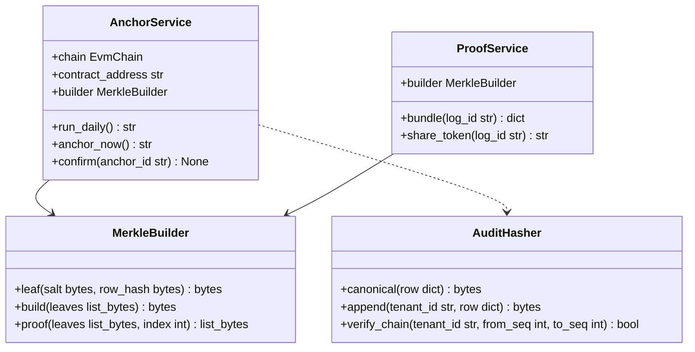

`AuditHasher` runs inside the same transaction as each audit insert. `AnchorService` and `ProofService` only read what it wrote.

---

## 3. Entity-relationship diagram

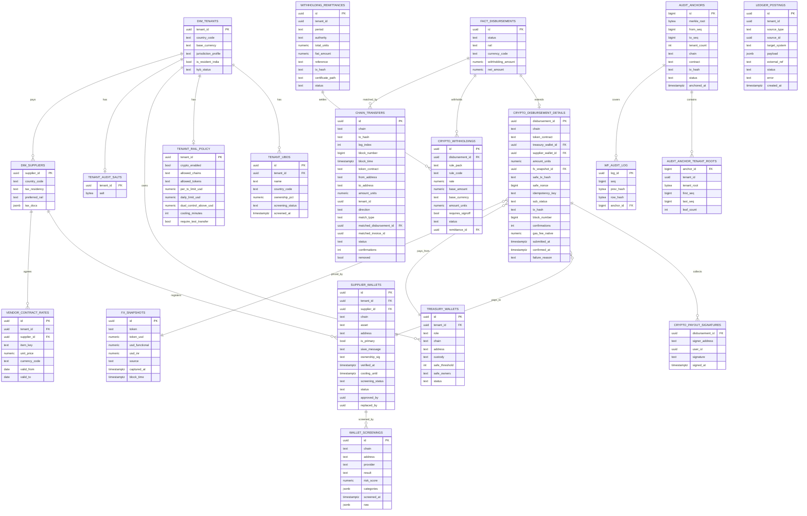

`FACT_DISBURSEMENTS` stays the parent of every payout on every rail. Crypto detail lives in a 1:1 child, so IMPS rows are untouched. `allowed_chains`, `allowed_tokens` and `safe_owners` are `text[]` in SQL; the diagram shows them as `text`.

---

## 4. State machines

### 4a. Payout (`status` / `sub_status`)

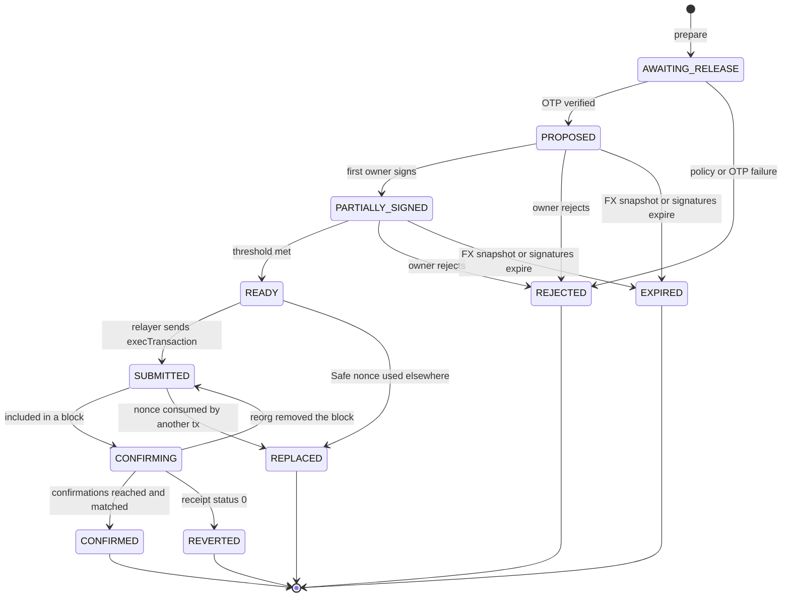

| `sub_status` | `status` |
| --- | --- |
| `AWAITING_RELEASE` | `PENDING_OTP` |
| `PROPOSED`, `PARTIALLY_SIGNED`, `READY`, `SUBMITTED`, `CONFIRMING` | `PENDING` |
| `CONFIRMED` | `SUCCESS` |
| `REJECTED`, `EXPIRED`, `REVERTED`, `REPLACED` | `FAILED` |

A reorg moves a payout back from `CONFIRMING` to `SUBMITTED`, never from `CONFIRMED`. Confirmation depth makes that last step safe.

### 4b. Supplier wallet (`supplier_wallets.status`)

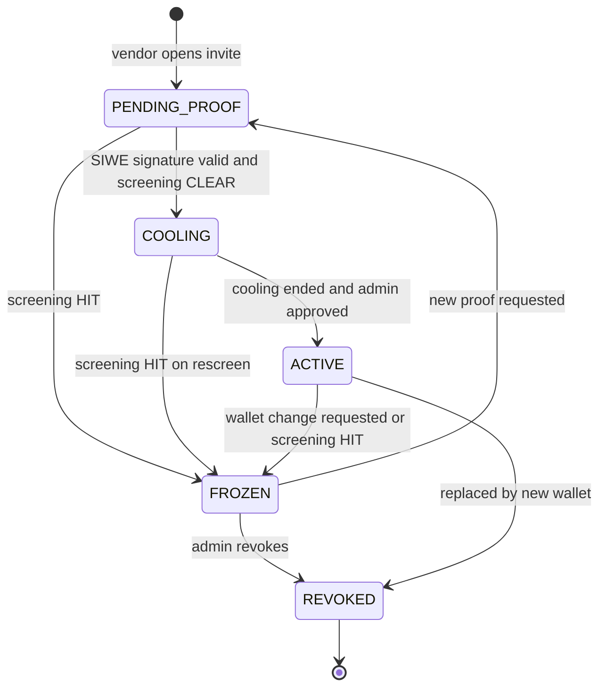

Only `ACTIVE` wallets can be paid. A change request freezes the old wallet first, so there is never a window with an unverified address.

### 4c. Chain transfer (`chain_transfers.status`)

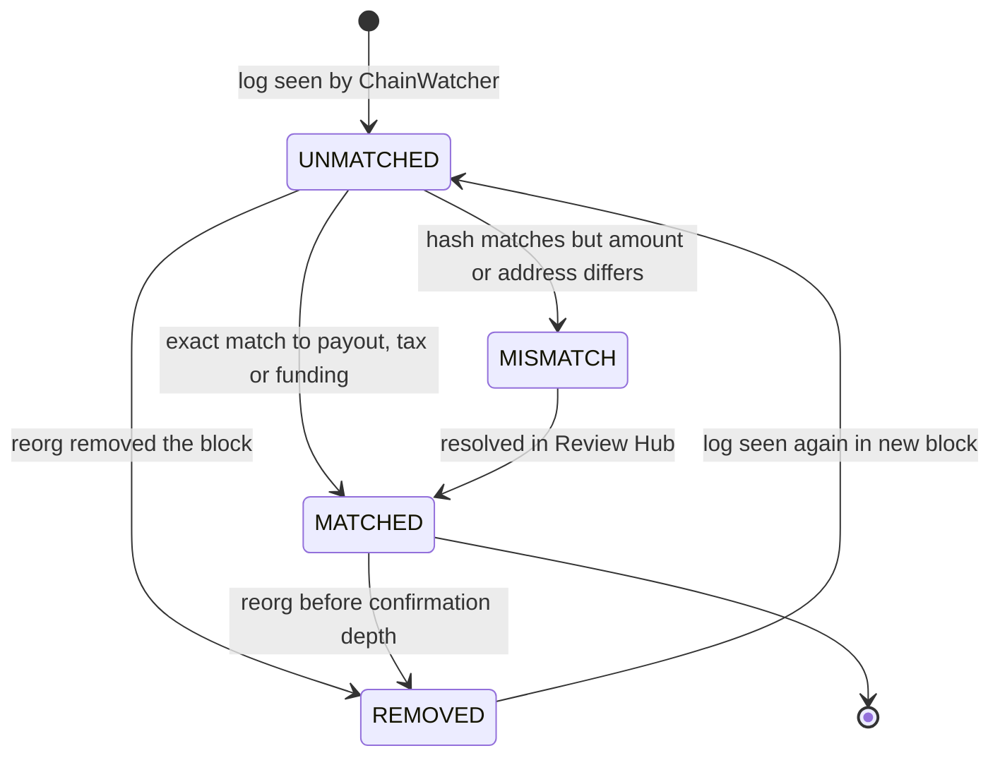

`REMOVED` is stored as `removed = true` on the row. Unmatched outbound transfers raise `UNMATCHED_OUTBOUND_TRANSFER` at once.

---

## 5. Detailed sequences

### 5a. Vendor wallet proof, screening, cooling and approval

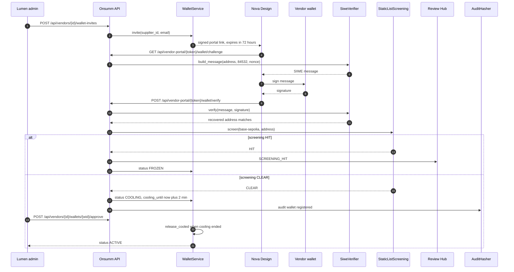

The signature proves control of the address. The cooling period plus admin approval stops a swapped address from being paid the same minute.

### 5b. Payout end to end

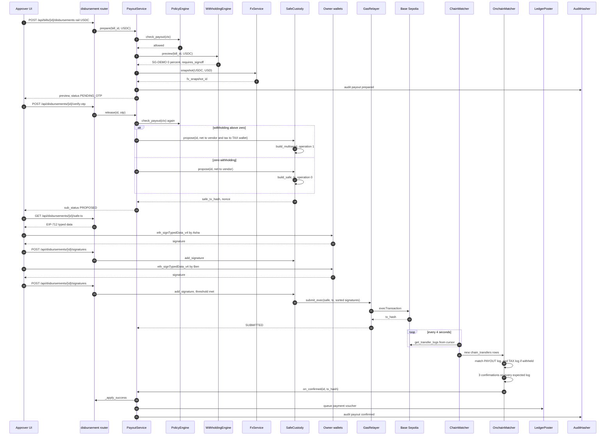

`PolicyEngine` runs twice: at preview and again at release. Balance, limits or screening may change between the two. With withholding above zero, both transfers ride in one Safe transaction, so the vendor and the tax wallet are paid atomically.

### 5c. Daily anchor job

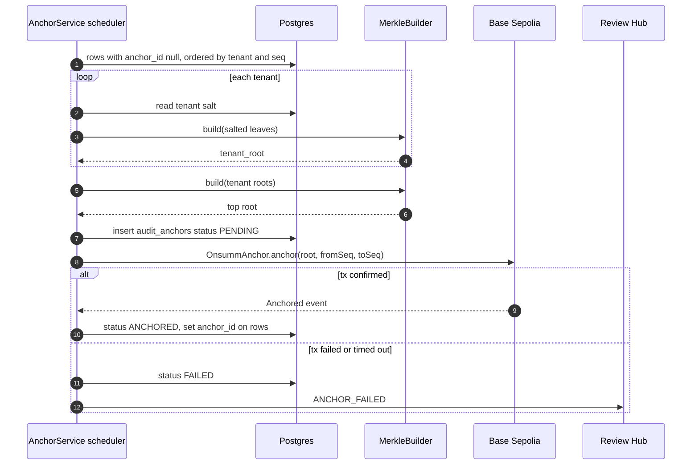

Rows get their `anchor_id` only after the anchor confirms. A failed run leaves them for the next run.

### 5d. Proof verification in the browser

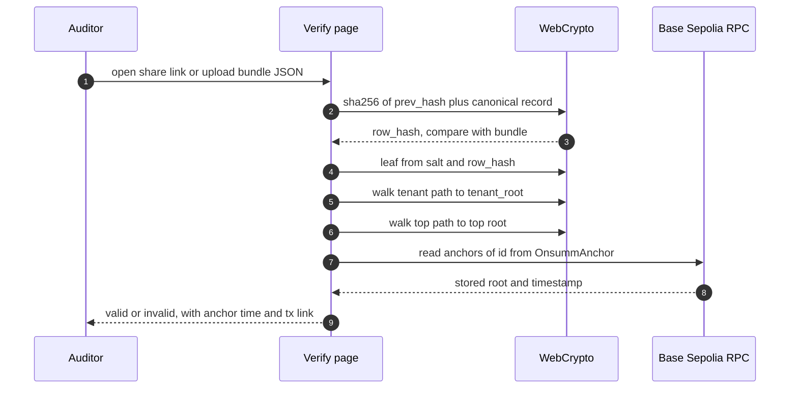

The browser does every hash. The only network call is a read from the public chain.

---

## 6. Key algorithms

### 6a. USDC calldata and Safe transaction hash

```python
TRANSFER_SELECTOR = bytes.fromhex("a9059cbb")  # transfer(address,uint256)

def usdc_transfer_calldata(to: str, amount_units: int) -> bytes:
    return TRANSFER_SELECTOR + abi_encode(["address", "uint256"], [to, amount_units])

def build_safe_tx(usdc: str, to: str, amount_units: int, nonce: int) -> dict:
    return {
        "to": usdc, "value": 0, "data": usdc_transfer_calldata(to, amount_units),
        "operation": 0,            # CALL, never DELEGATECALL
        "safeTxGas": 0, "baseGas": 0, "gasPrice": 0,
        "gasToken": ZERO_ADDRESS, "refundReceiver": ZERO_ADDRESS,
        "nonce": nonce,            # Safe.nonce() read on-chain at propose time
    }

def safe_tx_hash(safe: str, chain_id: int, tx: dict) -> bytes:
    typed = {
        "domain": {"chainId": chain_id, "verifyingContract": safe},
        "primaryType": "SafeTx",
        "types": {"SafeTx": [
            ("to", "address"), ("value", "uint256"), ("data", "bytes"),
            ("operation", "uint8"), ("safeTxGas", "uint256"), ("baseGas", "uint256"),
            ("gasPrice", "uint256"), ("gasToken", "address"),
            ("refundReceiver", "address"), ("nonce", "uint256")]},
        "message": tx,
    }
    return eip712_hash(typed)  # eth_account.messages.encode_typed_data
```

```python
MULTISEND_SELECTOR = bytes.fromhex("8d80ff0a")  # multiSend(bytes)

def build_multisend(usdc: str, transfers: list[tuple[str, int]], nonce: int) -> dict:
    # transfers = [(vendor_address, net_units), (tax_wallet_address, tax_units)]
    packed = b""
    for to, units in transfers:
        data = usdc_transfer_calldata(to, units)
        packed += (
            (0).to_bytes(1, "big")                 # operation CALL for each inner tx
            + bytes.fromhex(usdc[2:])              # to = USDC contract, 20 bytes
            + (0).to_bytes(32, "big")              # value
            + len(data).to_bytes(32, "big")        # data length
            + data
        )
    tx = build_safe_tx(usdc, ZERO_ADDRESS, 0, nonce)
    tx.update({
        "to": MULTISEND_CALL_ONLY_ADDRESS,
        "data": MULTISEND_SELECTOR + abi_encode(["bytes"], [packed]),
        "operation": 1,                            # DELEGATECALL, only to MultiSendCallOnly
    })
    return tx

def build_payout_tx(vendor: str, net_units: int, tax_wallet: str, tax_units: int, nonce: int) -> dict:
    if tax_units == 0:
        return build_safe_tx(USDC_ADDRESS, vendor, net_units, nonce)
    return build_multisend(USDC_ADDRESS, [(vendor, net_units), (tax_wallet, tax_units)], nonce)
```

`gasPrice = 0` means the Safe pays no refund. The relayer pays gas from its own balance. `SafeCustody` refuses any `operation = 1` whose target is not `MULTISEND_CALL_ONLY_ADDRESS`; the call-only variant cannot itself make delegate calls.

### 6b. Signatures, ordering and threshold

```python
def add_signature(d_id: str, signer: str, sig: bytes) -> int:
    tx_hash = load_safe_tx_hash(d_id)
    recovered = recover_typed_data_signer(tx_hash, sig)
    if recovered.lower() != signer.lower():
        raise Refused("SIGNATURE_MISMATCH")
    if recovered.lower() not in safe_owners_on_chain():   # read live, not cached
        raise Refused("NOT_A_SAFE_OWNER")
    upsert_signature(d_id, recovered, sig)                # unique per signer
    return count_signatures(d_id)

def packed_signatures(d_id: str) -> bytes:
    sigs = load_signatures(d_id)                          # list of (address, sig)
    sigs.sort(key=lambda s: int(s.address, 16))           # Safe requires ascending owners
    return b"".join(s.sig for s in sigs)                  # 65 bytes each: r, s, v

def ready(d_id: str) -> bool:
    return count_signatures(d_id) >= safe_threshold_on_chain()
```

Owners and threshold are read from the Safe at signing time. A change made outside Onsumm raises `SAFE_CONFIG_CHANGED`.

### 6c. Idempotency

```python
def idempotency_key(disbursement_id: str, attempt: int) -> str:
    return f"{disbursement_id}:{attempt}"

# crypto_disbursement_details.idempotency_key is UNIQUE.
# A new attempt is allowed only when the previous one is FAILED (REPLACED, EXPIRED, REVERTED).
# _assert_not_already_in_flight checks every rail for the bill, which also gives DUPLICATE_ACROSS_RAILS.
```

### 6d. ChainWatcher loop

```python
async def tick(self) -> int:
    head = chain.latest_block()
    cursor = load_cursor(chain.name)                      # last fully processed block
    # reorg check: does our stored hash for the cursor block still match the chain?
    if stored_block_hash(cursor) != chain.block_hash(cursor):
        rewind = cursor - REORG_WINDOW                    # e.g. 20 blocks
        mark_removed_after(rewind)                        # removed = true; matches reopened
        raise_finding("REORG_DETECTED")
        cursor = rewind
    to_block = min(head, cursor + MAX_RANGE)
    logs = chain.get_transfer_logs(cursor + 1, to_block, watched_addresses())
    for log in logs:
        upsert_chain_transfer(log)                        # unique (chain, tx_hash, log_index)
    update_confirmations(head)                            # confirmations = head - block_number + 1
    save_cursor(chain.name, to_block, chain.block_hash(to_block))
    return len(logs)
```

### 6e. OnchainMatcher exact-match rule

```python
def match_transfer(t: ChainTransfer) -> str:
    if t.direction == "OUT":
        d = find_crypto_payout_by_tx_hash(t.tx_hash)
        if d is None:
            return raise_finding("UNMATCHED_OUTBOUND_TRANSFER", t)   # critical
        if t.token_contract != USDC_ADDRESS:
            return mismatch(t, "AMOUNT_MISMATCH")
        if t.to_address == d.supplier_wallet.address and t.amount_units == d.amount_units:
            set_match(t, "PAYOUT", d.id)                  # amount_units = net to vendor
        elif t.to_address == d.tax_wallet.address and t.amount_units == d.withholding_units:
            set_match(t, "TAX", d.id)                     # crypto_withholdings.amount_units
        else:
            return mismatch(t, "AMOUNT_MISMATCH")
        expected = 2 if d.withholding_units > 0 else 1
        logs = matched_logs(d.id)                         # PAYOUT and TAX rows for this tx
        if len(logs) == expected and all(l.confirmations >= CONFIRMATIONS and not l.removed for l in logs):
            payout_service.on_confirmed(d.id, t.tx_hash)
        return "MATCHED"
    return classify_inbound(t)    # FUNDING, RECEIVABLE, or UNMATCHED_INBOUND_TRANSFER
```

Addresses are compared lower-cased. A payout is `CONFIRMED` only when every expected log (one, or two with withholding) is matched and deep enough.

### 6f. Audit hash chain

> **As built:** the chain is computed by a Postgres `BEFORE INSERT` trigger rather than in Python, so inline writers are covered too, and `canonical` is the Postgres `jsonb` text of the fields below. See [00_DECISIONS.md](00_DECISIONS.md) D8a. The Python below shows the logic; the trigger implements the same steps.

```python
def canonical(row: dict) -> bytes:
    fields = ["tenant_id", "seq", "table_name", "entity_id", "action",
              "user_id", "correlation_id", "old_values_jsonb", "new_values_jsonb", "created_at"]
    out = {}
    for f in fields:
        v = row.get(f)
        if isinstance(v, datetime):
            v = v.astimezone(timezone.utc).isoformat(timespec="microseconds")
        elif isinstance(v, Decimal):
            v = str(v)
        out[f] = v
    return json.dumps(out, sort_keys=True, separators=(",", ":")).encode()

def append(tenant_id: str, row: dict) -> bytes:
    # inside the same DB transaction as the insert; per-tenant advisory lock keeps seq gap-free
    prev = last_row_hash(tenant_id) or bytes(32)
    row["seq"] = next_seq(tenant_id)
    row_hash = sha256(prev + canonical(row))
    store(row, prev_hash=prev, row_hash=row_hash)
    return row_hash
```

### 6g. Merkle tree with salted leaves

```python
def leaf(salt: bytes, row_hash: bytes) -> bytes:
    return sha256(b"\x00" + salt + row_hash)          # 0x00 prefix: leaf

def node(a: bytes, b: bytes) -> bytes:
    lo, hi = sorted([a, b])
    return sha256(b"\x01" + lo + hi)                  # 0x01 prefix: inner node

def build(leaves: list[bytes]) -> bytes:
    level = leaves or [sha256(b"")]
    while len(level) > 1:
        if len(level) % 2:
            level.append(level[-1])                   # duplicate last on odd levels
        level = [node(level[i], level[i + 1]) for i in range(0, len(level), 2)]
    return level[0]

# top root = build([sha256(b"\x02" + tenant_id_bytes + tenant_root) for each tenant])
```

Domain prefixes stop a leaf from being passed off as an inner node. Sorted pairs mean the proof needs no left or right flags.

### 6h. Withholding amount

```python
def compute(ctx) -> WithholdingResult:
    rule = pack.rule_for(ctx.supplier_category)        # override, then mapping, then default
    base_fiat = ctx.bill_amount_functional             # excludes indirect tax if rule says so
    rate = rule.rate_no_tax_id if not ctx.vendor_tax_id else rule.rate
    tax_fiat = (base_fiat * rate).quantize(Decimal("0.01"), ROUND_HALF_UP)
    usd = tax_fiat / ctx.snapshot.usd_functional       # functional currency to USD
    units = int((usd / ctx.snapshot.token_usd * Decimal(1_000_000)).to_integral_value(ROUND_DOWN))
    net_units = ctx.gross_units - units
    return WithholdingResult(rule.code, rate, base_fiat, units, net_units, rule.requires_signoff)
```

The tax is fixed in fiat first, then converted at the same frozen snapshot as the payout. Rounding down never over-withholds.

---

## 7. DDL

```sql
-- changed tables
ALTER TABLE dim_tenants
  ADD COLUMN IF NOT EXISTS country_code char(2) DEFAULT 'IN',
  ADD COLUMN IF NOT EXISTS base_currency char(3) DEFAULT 'INR',
  ADD COLUMN IF NOT EXISTS jurisdiction_profile text DEFAULT 'india',
  ADD COLUMN IF NOT EXISTS is_resident_india boolean DEFAULT true,
  ADD COLUMN IF NOT EXISTS kyb_status text DEFAULT 'NOT_STARTED';

ALTER TABLE dim_suppliers
  ADD COLUMN IF NOT EXISTS country_code char(2),
  ADD COLUMN IF NOT EXISTS tax_residency char(2),
  ADD COLUMN IF NOT EXISTS preferred_rail text DEFAULT 'BANK',
  ADD COLUMN IF NOT EXISTS tax_docs jsonb DEFAULT '{}'::jsonb;

ALTER TABLE fact_disbursements
  ADD COLUMN IF NOT EXISTS rail text DEFAULT 'IMPS',
  ADD COLUMN IF NOT EXISTS currency_code char(3) DEFAULT 'INR',
  ADD COLUMN IF NOT EXISTS withholding_amount numeric DEFAULT 0,
  ADD COLUMN IF NOT EXISTS net_amount numeric;

ALTER TABLE wf_audit_log
  ADD COLUMN IF NOT EXISTS seq bigint,
  ADD COLUMN IF NOT EXISTS prev_hash bytea,
  ADD COLUMN IF NOT EXISTS row_hash bytea,
  ADD COLUMN IF NOT EXISTS anchor_id bigint;
CREATE UNIQUE INDEX IF NOT EXISTS ux_wf_audit_log_tenant_seq ON wf_audit_log (tenant_id, seq);

-- new tables
CREATE TABLE IF NOT EXISTS tenant_ubos (
  id uuid PRIMARY KEY DEFAULT gen_random_uuid(),
  tenant_id uuid NOT NULL,
  name text NOT NULL,
  country_code char(2),
  ownership_pct numeric(5,2),
  screening_status text DEFAULT 'PENDING',
  screened_at timestamptz
);

CREATE TABLE IF NOT EXISTS tenant_rail_policy (
  tenant_id uuid PRIMARY KEY,
  crypto_enabled boolean NOT NULL DEFAULT false,
  allowed_chains text[] NOT NULL DEFAULT ARRAY['base-sepolia'],
  allowed_tokens text[] NOT NULL DEFAULT ARRAY['USDC'],
  per_tx_limit_usd numeric,
  daily_limit_usd numeric,
  dual_control_above_usd numeric DEFAULT 10000,
  cooling_minutes int NOT NULL DEFAULT 1440,
  require_test_transfer boolean NOT NULL DEFAULT true
);

CREATE TABLE IF NOT EXISTS treasury_wallets (
  id uuid PRIMARY KEY DEFAULT gen_random_uuid(),
  tenant_id uuid NOT NULL,
  role text NOT NULL CHECK (role IN ('TREASURY', 'TAX')),
  chain text NOT NULL,
  address text NOT NULL,
  custody text NOT NULL CHECK (custody IN ('SAFE', 'PARTNER')),
  safe_threshold int,
  safe_owners text[],
  status text NOT NULL DEFAULT 'ACTIVE',
  UNIQUE (tenant_id, chain, address)
);

CREATE TABLE IF NOT EXISTS supplier_wallets (
  id uuid PRIMARY KEY DEFAULT gen_random_uuid(),
  tenant_id uuid NOT NULL,
  supplier_id uuid NOT NULL,
  chain text NOT NULL,
  asset text NOT NULL DEFAULT 'USDC',
  address text NOT NULL,
  is_primary boolean NOT NULL DEFAULT true,
  siwe_message text,
  ownership_sig text,
  verified_at timestamptz,
  cooling_until timestamptz,
  screening_status text DEFAULT 'PENDING',
  status text NOT NULL DEFAULT 'PENDING_PROOF'
    CHECK (status IN ('PENDING_PROOF', 'COOLING', 'ACTIVE', 'FROZEN', 'REVOKED')),
  approved_by uuid,
  replaced_by uuid
);
CREATE INDEX IF NOT EXISTS ix_supplier_wallets_supplier ON supplier_wallets (tenant_id, supplier_id);

CREATE TABLE IF NOT EXISTS wallet_screenings (
  id uuid PRIMARY KEY DEFAULT gen_random_uuid(),
  chain text NOT NULL,
  address text NOT NULL,
  provider text NOT NULL,
  result text NOT NULL CHECK (result IN ('CLEAR', 'HIT', 'ERROR')),
  risk_score numeric,
  categories jsonb DEFAULT '[]'::jsonb,
  screened_at timestamptz NOT NULL DEFAULT now(),
  raw jsonb
);

CREATE TABLE IF NOT EXISTS vendor_contract_rates (
  id uuid PRIMARY KEY DEFAULT gen_random_uuid(),
  tenant_id uuid NOT NULL,
  supplier_id uuid NOT NULL,
  item_key text NOT NULL,
  unit_price numeric NOT NULL,
  currency_code char(3) NOT NULL,
  valid_from date,
  valid_to date
);

CREATE TABLE IF NOT EXISTS fx_snapshots (
  id uuid PRIMARY KEY DEFAULT gen_random_uuid(),
  token text NOT NULL,
  token_usd numeric NOT NULL,
  usd_functional numeric NOT NULL,
  usd_inr numeric,
  source text NOT NULL,
  captured_at timestamptz NOT NULL DEFAULT now(),
  block_time timestamptz
);

CREATE TABLE IF NOT EXISTS crypto_disbursement_details (
  disbursement_id uuid PRIMARY KEY,           -- = fact_disbursements id
  chain text NOT NULL,
  token_contract text NOT NULL,
  treasury_wallet_id uuid NOT NULL REFERENCES treasury_wallets(id),
  supplier_wallet_id uuid NOT NULL REFERENCES supplier_wallets(id),
  amount_units numeric(38,0) NOT NULL CHECK (amount_units > 0),  -- net units to the vendor
  fx_snapshot_id uuid REFERENCES fx_snapshots(id),
  safe_tx_hash text,
  safe_nonce bigint,
  idempotency_key text NOT NULL UNIQUE,
  sub_status text NOT NULL DEFAULT 'AWAITING_RELEASE',
  tx_hash text,
  block_number bigint,
  confirmations int DEFAULT 0,
  gas_fee_native numeric,
  submitted_at timestamptz,
  confirmed_at timestamptz,
  failure_reason text
);

CREATE TABLE IF NOT EXISTS crypto_payout_signatures (
  disbursement_id uuid NOT NULL REFERENCES crypto_disbursement_details(disbursement_id),
  signer_address text NOT NULL,
  user_id uuid,
  signature text NOT NULL,
  signed_at timestamptz NOT NULL DEFAULT now(),
  UNIQUE (disbursement_id, signer_address)
);

CREATE TABLE IF NOT EXISTS chain_transfers (
  id uuid PRIMARY KEY DEFAULT gen_random_uuid(),
  chain text NOT NULL,
  tx_hash text NOT NULL,
  log_index int NOT NULL,
  block_number bigint NOT NULL,
  block_time timestamptz,
  token_contract text NOT NULL,
  from_address text NOT NULL,
  to_address text NOT NULL,
  amount_units numeric(38,0) NOT NULL,
  tenant_id uuid,
  direction text NOT NULL CHECK (direction IN ('IN', 'OUT')),
  match_type text DEFAULT 'UNKNOWN'
    CHECK (match_type IN ('PAYOUT', 'TAX', 'FUNDING', 'RECEIVABLE', 'UNKNOWN')),
  matched_disbursement_id uuid,
  matched_invoice_id uuid,
  status text NOT NULL DEFAULT 'UNMATCHED' CHECK (status IN ('MATCHED', 'UNMATCHED', 'MISMATCH')),
  confirmations int DEFAULT 0,
  removed boolean NOT NULL DEFAULT false,
  UNIQUE (chain, tx_hash, log_index)
);

CREATE TABLE IF NOT EXISTS chain_watch_cursors (
  chain text PRIMARY KEY,
  last_block bigint NOT NULL,
  last_block_hash text,
  updated_at timestamptz NOT NULL DEFAULT now()
);

CREATE TABLE IF NOT EXISTS withholding_remittances (
  id uuid PRIMARY KEY DEFAULT gen_random_uuid(),
  tenant_id uuid NOT NULL,
  period text NOT NULL,
  authority text NOT NULL,
  total_units numeric(38,0) NOT NULL DEFAULT 0,
  fiat_amount numeric,
  reference text,
  tx_hash text,
  certificate_path text,
  status text NOT NULL DEFAULT 'DRAFT'
);

CREATE TABLE IF NOT EXISTS crypto_withholdings (
  id uuid PRIMARY KEY DEFAULT gen_random_uuid(),
  disbursement_id uuid NOT NULL,
  rule_pack text NOT NULL,
  rule_code text NOT NULL,
  rate numeric NOT NULL,
  base_amount numeric NOT NULL,
  base_currency char(3) NOT NULL,
  amount_units numeric(38,0) NOT NULL,
  requires_signoff boolean NOT NULL DEFAULT false,
  status text NOT NULL DEFAULT 'CALCULATED',
  remittance_id uuid REFERENCES withholding_remittances(id)
);

CREATE TABLE IF NOT EXISTS tenant_audit_salts (
  tenant_id uuid PRIMARY KEY,
  salt bytea NOT NULL
);

CREATE TABLE IF NOT EXISTS audit_anchors (
  id bigserial PRIMARY KEY,
  merkle_root bytea NOT NULL,
  from_seq bigint NOT NULL,
  to_seq bigint NOT NULL,
  tenant_count int NOT NULL,
  chain text NOT NULL,
  contract text NOT NULL,
  tx_hash text,
  status text NOT NULL DEFAULT 'PENDING',
  anchored_at timestamptz
);

CREATE TABLE IF NOT EXISTS audit_anchor_tenant_roots (
  anchor_id bigint NOT NULL REFERENCES audit_anchors(id),
  tenant_id uuid NOT NULL,
  tenant_root bytea NOT NULL,
  first_seq bigint NOT NULL,
  last_seq bigint NOT NULL,
  leaf_count int NOT NULL,
  PRIMARY KEY (anchor_id, tenant_id)
);

CREATE TABLE IF NOT EXISTS ledger_postings (
  id uuid PRIMARY KEY DEFAULT gen_random_uuid(),
  tenant_id uuid NOT NULL,
  source_type text NOT NULL,
  source_id uuid NOT NULL,
  target_system text NOT NULL,
  payload jsonb NOT NULL,
  external_ref text,
  status text NOT NULL DEFAULT 'PENDING',
  error text,
  created_at timestamptz NOT NULL DEFAULT now()
);
```

`chain_watch_cursors.last_block_hash` is an extra column needed by the reorg check in 6d. Each block above goes into its own `_migrate_crypto_*` function in `migrations.py`.

---

## 8. API contracts

All errors use one shape. `codes` lists every refusal at once.

```json
{
  "error": "POLICY_REFUSED",
  "codes": ["WALLET_COOLING", "OVER_DAILY_LIMIT"],
  "messages": ["Vendor wallet is cooling until 10:42 UTC", "Daily limit USD 10,000 would be exceeded"],
  "request_id": "6f1c0d0e1a5b4d1c"
}
```

### `POST /api/bills/{id}/disbursements` (rail USDC)

Request:

```json
{ "rail": "USDC", "amount": "3600.00", "currency": "USD", "chain": "base-sepolia" }
```

Response `201`:

```json
{
  "disbursement_id": "b3a1e1f2-0c7d-4a4e-9f61-2a9d9c3c1e10",
  "status": "PENDING_OTP",
  "sub_status": "AWAITING_RELEASE",
  "rail": "USDC",
  "bill": { "invoice_id": "NOVA-1042", "billed": "4200.00", "approved": "3600.00", "currency": "USD" },
  "quote": { "fx_snapshot_id": "0d9e...", "token_usd": "1.0000", "usd_inr": "84.12" },
  "withholding": { "rule_pack": "SG-DEMO", "rate": "0", "amount_units": "0", "requires_signoff": true },
  "gross_units": "3600000000",
  "net_units": "3600000000",
  "to": { "supplier": "Nova Design LLC", "address": "0x7a5c...e91b", "chain": "base-sepolia" },
  "from": { "safe": "0x4b1e...0c2d", "threshold": 2, "owners": 3 },
  "estimated_gas_fee": "0.00002 ETH",
  "policy": { "allowed": true, "codes": [] }
}
```

The India-resident tenant gets `403` with `"codes": ["CRYPTO_DISABLED_RESIDENT_INDIA"]`.

### `GET /api/disbursements/{id}/safe-tx`

```json
{
  "safe": "0x4b1e...0c2d",
  "chain_id": 84532,
  "safe_tx_hash": "0x9c2f...71aa",
  "nonce": 7,
  "typed_data": {
    "domain": { "chainId": 84532, "verifyingContract": "0x4b1e...0c2d" },
    "primaryType": "SafeTx",
    "types": { "SafeTx": [ { "name": "to", "type": "address" }, { "name": "value", "type": "uint256" },
      { "name": "data", "type": "bytes" }, { "name": "operation", "type": "uint8" },
      { "name": "safeTxGas", "type": "uint256" }, { "name": "baseGas", "type": "uint256" },
      { "name": "gasPrice", "type": "uint256" }, { "name": "gasToken", "type": "address" },
      { "name": "refundReceiver", "type": "address" }, { "name": "nonce", "type": "uint256" } ] },
    "message": { "to": "0x036CbD53842c5426634e7929541eC2318f3dCF7e", "value": "0", "data": "0xa9059cbb...",
      "operation": 0, "safeTxGas": "0", "baseGas": "0", "gasPrice": "0",
      "gasToken": "0x0000000000000000000000000000000000000000",
      "refundReceiver": "0x0000000000000000000000000000000000000000", "nonce": "7" }
  },
  "signatures": [ { "signer": "0x11aa...asha", "signed_at": "2026-10-31T05:10:02Z" } ],
  "threshold": 2
}
```

### `POST /api/disbursements/{id}/signatures`

Request:

```json
{ "signer": "0x22bb...ben0", "signature": "0x5f3c...1b" }
```

Response `200`:

```json
{ "sub_status": "SUBMITTED", "signatures": 2, "threshold": 2, "tx_hash": "0x8e41...c903",
  "explorer": "https://sepolia.basescan.org/tx/0x8e41...c903" }
```

### `GET /api/vendor-portal/{token}/wallet/challenge?chain=base-sepolia&address=0x7a5c...e91b`

```json
{
  "message": "app.onsumm.ai wants you to sign in with your Ethereum account:\n0x7a5c...e91b\n\nI confirm this wallet receives payments for Nova Design LLC from Lumen Labs Pte Ltd.\n\nURI: https://app.onsumm.ai/vendor-portal\nVersion: 1\nChain ID: 84532\nNonce: 8f2k1q9z\nIssued At: 2026-10-31T04:58:10Z\nExpiration Time: 2026-10-31T05:08:10Z",
  "nonce": "8f2k1q9z",
  "expires_at": "2026-10-31T05:08:10Z"
}
```

### `POST /api/vendor-portal/{token}/wallet/verify`

Request:

```json
{ "message": "app.onsumm.ai wants you to sign in ...", "signature": "0x91d0...4c1c" }
```

Response `200`:

```json
{ "wallet_id": "c4b0...", "status": "COOLING", "screening": "CLEAR",
  "cooling_until": "2026-10-31T05:00:10Z", "needs_admin_approval": true }
```

### `GET /api/audit/proof/{log_id}`

```json
{
  "version": 1,
  "record": { "tenant_id": "lumen...", "seq": 412, "table_name": "fact_disbursements",
    "entity_id": "b3a1e1f2...", "action": "UPDATE", "user_id": "ben...",
    "new_values_jsonb": { "status": "SUCCESS" }, "created_at": "2026-10-31T05:10:31.204118+00:00" },
  "prev_hash": "0x3f9a...", "row_hash": "0x77c1...", "salt": "0x5be0...",
  "tenant_path": ["0x1a2b...", "0x9f0e..."], "tenant_root": "0xd4e5...",
  "top_path": ["0x6c7d..."], "top_root": "0xab12...",
  "anchor": { "id": 3, "chain_id": 84532, "contract": "0xAnch...", "tx_hash": "0xe2f0...",
    "anchored_at": "2026-10-31T05:20:00Z" }
}
```

---

## 9. OnsummAnchor contract

```solidity
// SPDX-License-Identifier: MIT
pragma solidity ^0.8.24;

/// @title OnsummAnchor
/// @notice Stores daily Merkle roots of Onsumm's audit log. Holds no funds.
contract OnsummAnchor {
    struct Anchor {
        bytes32 root;
        uint64 fromSeq;
        uint64 toSeq;
        uint64 timestamp;
    }

    address public owner;
    address public anchorer;
    uint256 public count;
    mapping(uint256 => Anchor) public anchors;

    event Anchored(uint256 indexed id, bytes32 root, uint64 fromSeq, uint64 toSeq, uint64 timestamp);
    event AnchorerChanged(address indexed previous, address indexed next);

    error NotOwner();
    error NotAnchorer();
    error EmptyRoot();
    error BadRange();

    modifier onlyOwner() {
        if (msg.sender != owner) revert NotOwner();
        _;
    }

    modifier onlyAnchorer() {
        if (msg.sender != anchorer) revert NotAnchorer();
        _;
    }

    constructor(address initialAnchorer) {
        owner = msg.sender;
        anchorer = initialAnchorer;
        emit AnchorerChanged(address(0), initialAnchorer);
    }

    function setAnchorer(address next) external onlyOwner {
        emit AnchorerChanged(anchorer, next);
        anchorer = next;
    }

    function anchor(bytes32 root, uint64 fromSeq, uint64 toSeq) external onlyAnchorer returns (uint256 id) {
        if (root == bytes32(0)) revert EmptyRoot();
        if (toSeq < fromSeq) revert BadRange();
        id = ++count;
        uint64 ts = uint64(block.timestamp);
        anchors[id] = Anchor(root, fromSeq, toSeq, ts);
        emit Anchored(id, root, fromSeq, toSeq, ts);
    }
}
```

`fromSeq` and `toSeq` record the range of the run; per-tenant ranges stay in `audit_anchor_tenant_roots`. The anchor key can write roots but cannot overwrite an existing one.

---

## 10. Configuration

| Variable | Demo value | Purpose |
| --- | --- | --- |
| `CHAIN` | `base-sepolia` | Chain name used in tables |
| `CHAIN_ID` | `84532` | EIP-712 domain and SIWE |
| `RPC_URL` | `https://sepolia.base.org` | Primary RPC |
| `RPC_URL_FALLBACK` | Alchemy Base Sepolia URL | Second RPC |
| `USDC_ADDRESS` | `0x036CbD53842c5426634e7929541eC2318f3dCF7e` | Circle test USDC; verify before use |
| `SAFE_ADDRESS` | Lumen Labs Safe address | Demo treasury |
| `RELAYER_KEY` | Testnet key, gas only | Submits `execTransaction` |
| `RELAYER_MIN_GAS_WEI` | `2000000000000000` | Alert below 0.002 ETH |
| `MULTISEND_CALL_ONLY_ADDRESS` | Safe `MultiSendCallOnly` deployment for chain 84532 | Target of the one allowed `DELEGATECALL`; verify against Safe's deployment list |
| `VENDOR_PORTAL_TOKEN_TTL_HOURS` | `72` | Vendor portal invite lifetime |
| `ANCHOR_CONTRACT` | Deployed `OnsummAnchor` address | Anchor target |
| `ANCHOR_SIGNER_KEY` | Testnet key, gas only | Calls `anchor` |
| `CONFIRMATIONS` | `3` | Blocks before `CONFIRMED` |
| `REORG_WINDOW` | `20` | Blocks rewound on a reorg |
| `WATCH_POLL_SECONDS` | `4` | `ChainWatcher` interval |
| `WATCH_MAX_RANGE` | `2000` | Max blocks per `eth_getLogs` call |
| `SCREENING_LIST_PATH` | `backend_ocr/app/integrations/screening/sanctioned_addresses.json` | Static list |
| `SIWE_DOMAIN` | `localhost:5173` for the demo | Must match the page origin |
| `SIWE_NONCE_TTL_SECONDS` | `600` | Challenge lifetime |
| `FX_SOURCE` | `fixed` | Demo: fixed rate, logged in `fx_snapshots.source` |
| `FX_USD_INR_FIXED` | `84.12` | Demo INR reference rate |
| `FX_SNAPSHOT_TTL_SECONDS` | `900` | After this, payout `EXPIRED` |
| `ANCHOR_CRON_UTC` | `00:05` | Daily anchor time |
| `PROOF_SHARE_TOKEN_SECRET` | Random 32 bytes | Signs proof share links |
| `LICENSE_ENFORCEMENT` | `log` | Existing licensing switch |

Keys in this table are testnet-only. In production they move to AWS Secrets Manager, with `ANCHOR_SIGNER_KEY` in KMS.
