# Crypto Rail — User Flows

Status: hackathon baseline, as of 29 Oct 2026 · Names follow [00_DECISIONS.md](00_DECISIONS.md)

This document shows every user-facing flow of the crypto rail, one section per flow. Each flow has a step diagram, a hand-off diagram where people or systems change, and the screens it touches.

Contents

1. [Foreign client onboarding](#1-foreign-client-onboarding)
2. [Vendor wallet onboarding](#2-vendor-wallet-onboarding)
3. [Wallet change](#3-wallet-change)
4. [Bill capture to approval](#4-bill-capture-to-approval)
5. [Payout by approvers](#5-payout-by-approvers)
6. [On-chain reconciliation and books](#6-on-chain-reconciliation-and-books)
7. [Withholding (Crypto TDS)](#7-withholding-crypto-tds)
8. [Auditor verification](#8-auditor-verification)
9. [Demo run-of-show](#9-demo-run-of-show)

Route notes: new pages live under `frontend/src/pages/crypto/`. Existing pages (`PaymentPage.tsx`, `PaymentHubPage.tsx`, `SettingsPage.tsx`, vendor pages) gain new cards or tabs. Routes are added to `frontend/src/routes/paths.ts` and wrapped in `RequireService` with the licence keys `crypto_payouts`, `crypto_tds` or `audit_anchor`.

---

## 1. Foreign client onboarding

Actor: Asha, founder of Lumen Labs Pte Ltd (Singapore). Goal: crypto rail enabled for the tenant.

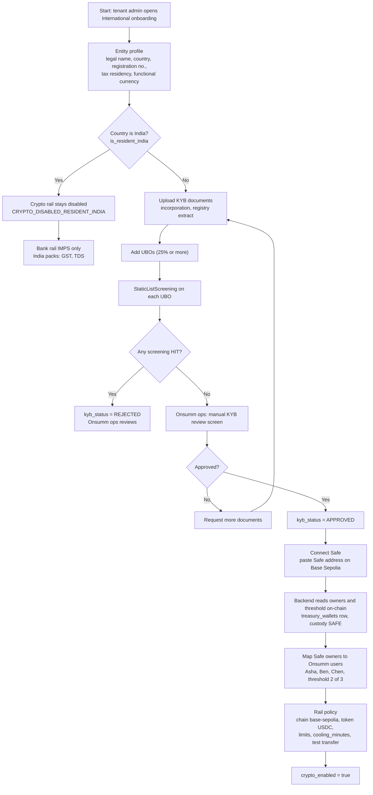

The India branch ends early by design: `PolicyEngine` will refuse crypto for resident tenants however the policy is set. Owners and threshold are read from the chain, never typed in, so Onsumm's view cannot drift from the Safe.

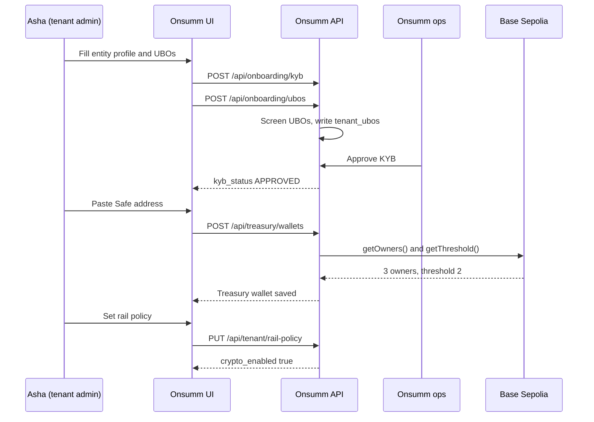

KYB is a manual review screen for the hackathon; a KYB provider replaces it later. The Safe read is the only chain call in this flow.

| Screen | Route (`frontend/src`) | Key elements |
| --- | --- | --- |
| Entity profile | `pages/crypto/onboarding/EntityProfile.tsx` at `/onboarding/international` | Country, registration no., tax residency, functional currency, India-resident warning |
| KYB documents | `pages/crypto/onboarding/KybDocuments.tsx` | Upload list, status chip `kyb_status` |
| UBOs | `pages/crypto/onboarding/Ubos.tsx` | Name, country, ownership %, screening result per row |
| Ops KYB review | `admin/KybReview.tsx` at `/admin/kyb` | Documents viewer, approve or request more |
| Connect Safe | `pages/crypto/onboarding/ConnectSafe.tsx` | Safe address input, owners and threshold read back, owner-to-user mapping |
| Rail policy | `SettingsPage.tsx`, tab *Rail policy* | Chains, tokens, per-tx and daily limits, `cooling_minutes`, `require_test_transfer` |

---

## 2. Vendor wallet onboarding

Actors: Ben (finance controller at Lumen), Nova Design LLC (vendor). Goal: a vendor wallet in status `ACTIVE`.

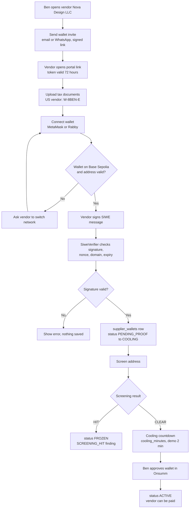

The vendor proves control by signing, not by sending funds. Approval is only allowed after cooling ends, so a stolen invite link alone cannot route a payment.

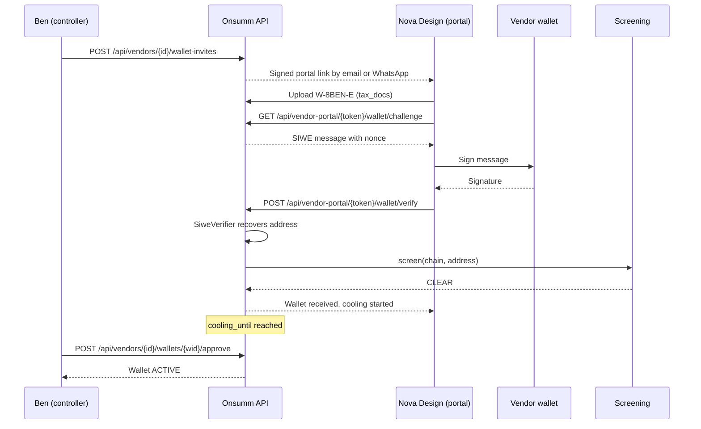

The portal link carries a signed token that expires after 72 hours; an expired or forwarded link is handled in [06_EDGE_CASES.md](06_EDGE_CASES.md) (EC-52). Tax documents depend on the payer. A US vendor gives a W-8BEN-E to a foreign payer; TRC and Form 10F matter only when the payer is Indian.

| Screen | Route | Key elements |
| --- | --- | --- |
| Vendor wallets card | Vendor detail page, card *Wallets* | Address with checksum, chain, status chip, cooling countdown, Approve button |
| Send invite | Modal on the vendor page | Channel (email or WhatsApp), contact picker |
| Vendor portal: tax docs | `pages/crypto/vendor-portal/TaxDocs.tsx` at `/vendor-portal/:token` | Upload W-8BEN-E, or TRC and 10F where relevant |
| Vendor portal: connect wallet | `pages/crypto/vendor-portal/ConnectWallet.tsx` | Connect button (wagmi injected), network check, Sign button |
| Vendor portal: done | same | "Wallet received, under review" with cooling time |

---

## 3. Wallet change

Actors: Nova Design (vendor), Ben (approver). Goal: replace a wallet safely. This is the flow attackers target most.

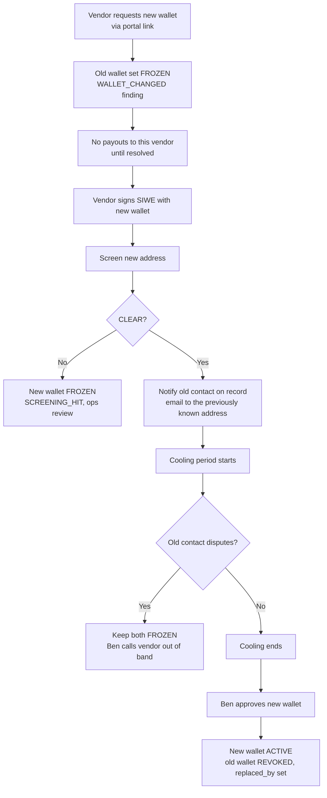

The old wallet freezes the moment a change is requested. The notice goes to the contact Onsumm already had, never to one supplied in the change request.

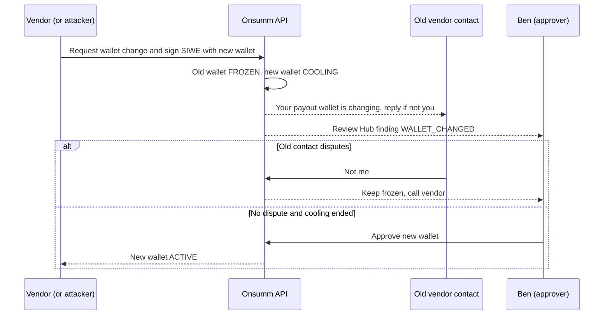

| Screen | Route | Key elements |
| --- | --- | --- |
| Vendor portal: change wallet | `pages/crypto/vendor-portal/ChangeWallet.tsx` | Reason, connect new wallet, sign |
| Review Hub finding | existing Review Hub page | `WALLET_CHANGED`, old and new address side by side |
| Vendor wallets card | Vendor detail page | Old (FROZEN) and new (COOLING) rows, Approve, Revoke |

---

## 4. Bill capture to approval

Actors: AP clerk, approvers. Demo invoice NOVA-1042: USD 4,200 billed against a contract rate of USD 3,600.

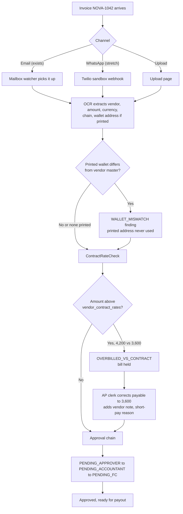

A wallet printed on an invoice is only compared, never paid. The overbilling hold happens before approval, so approvers see the corrected amount.

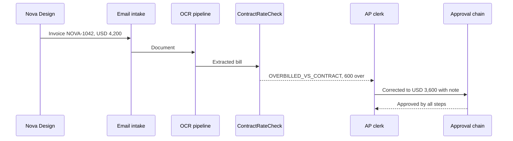

| Screen | Route | Key elements |
| --- | --- | --- |
| Bill detail | existing bills page | Currency USD, findings banner, corrected payable |
| Review Hub | existing | `OVERBILLED_VS_CONTRACT`, `WALLET_MISMATCH` |
| Contract rates | Vendor detail page, card *Contract rates* | Item, unit price, currency, validity |

---

## 5. Payout by approvers

Actors: Ben (prepares and releases), Asha and Ben (Safe owners). Goal: USD 3,600 paid in USDC.

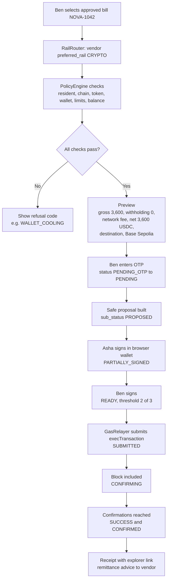

Two gates protect the money: Onsumm's OTP and the Safe threshold. The relayer only pays gas; it cannot move USDC without the owners' signatures.

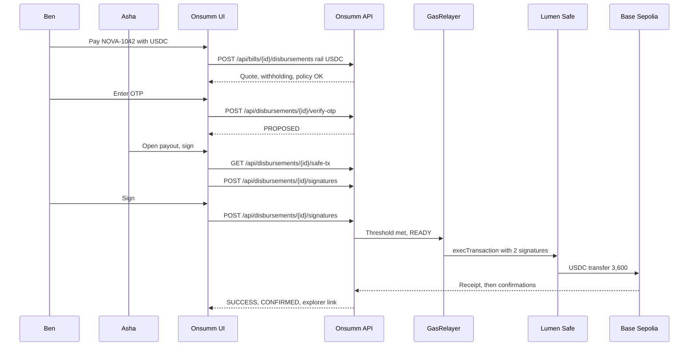

| Screen | Route | Key elements |
| --- | --- | --- |
| Bill select | `pages/payment/BillSelectStep` | Rail choice IMPS or USDC, disabled with reason when refused |
| Beneficiary | `pages/payment/BeneficiaryCard` | Wallet address with checksum, chain, status ACTIVE |
| Review | `pages/payment/ReviewStep` | Gross, withholding, network fee, net USDC, FX snapshot time |
| OTP | `pages/payment/OtpStep` | Existing OTP step |
| Safe signing | `pages/crypto/payout/CryptoPayoutCard.tsx` | Signers list with ticks, Sign button, threshold progress |
| Processing | `pages/payment/PaymentProcessing` | Live `sub_status`, confirmations count |
| Receipt | `pages/payment/ReceiptStep` | Tx hash, explorer link, download remittance |

---

## 6. On-chain reconciliation and books

Actors: system workers, Ben (controller). Goal: bill marked *Paid and Reconciled* and posted to the ledger.

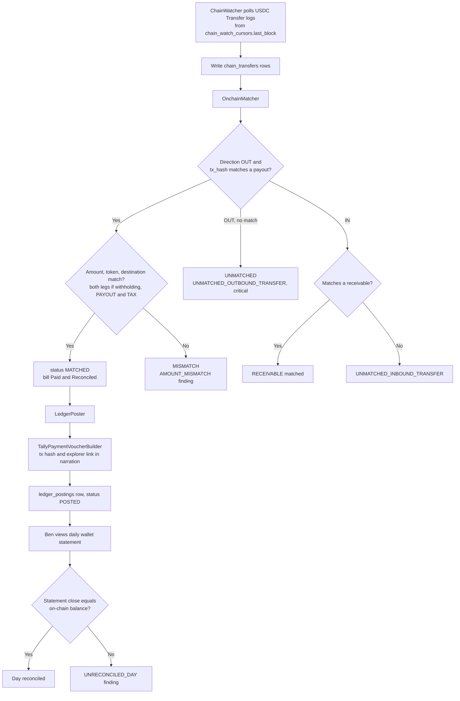

The chain is the source of truth for settlement. Anything leaving the treasury that Onsumm did not propose is a critical alert.

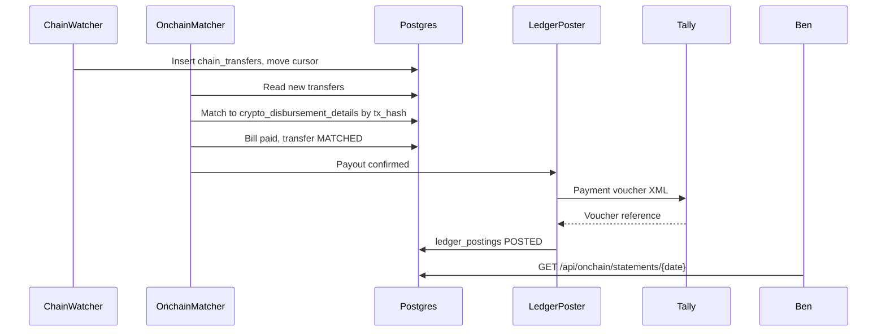

| Screen | Route | Key elements |
| --- | --- | --- |
| On-chain tab | `PaymentHubPage.tsx`, tab *On-chain* | Transfers list, direction, match status, explorer link |
| Daily statement | `pages/crypto/onchain/Statement.tsx` | Opening, ins, outs, closing, on-chain balance, reconciled flag |
| Ledger postings | Bill detail, *Books* panel | Voucher reference, status, retry button |

---

## 7. Withholding (Crypto TDS)

Two cases: the demo tenant (Singapore, `SG-DEMO` pack at 0%) and the guardrail case (India-resident tenant).

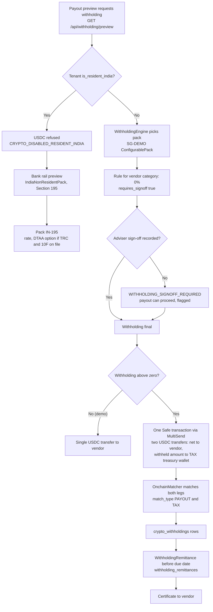

Indian sections appear only for an Indian payer, and then only on the bank rail. For the Singapore demo the engine records a 0% rule that a tax adviser must sign off.

Rule pack codes: `SG-DEMO` (demo client pack), `IN-SERVICES` (today's TDS engine), `IN-195` (non-resident payments), `IN-VDA` (Section 194S / s.393(1)). When withholding is above zero the payout is still **one** Safe transaction: a MultiSend with two USDC transfers, so the vendor and the tax leg settle together or not at all.

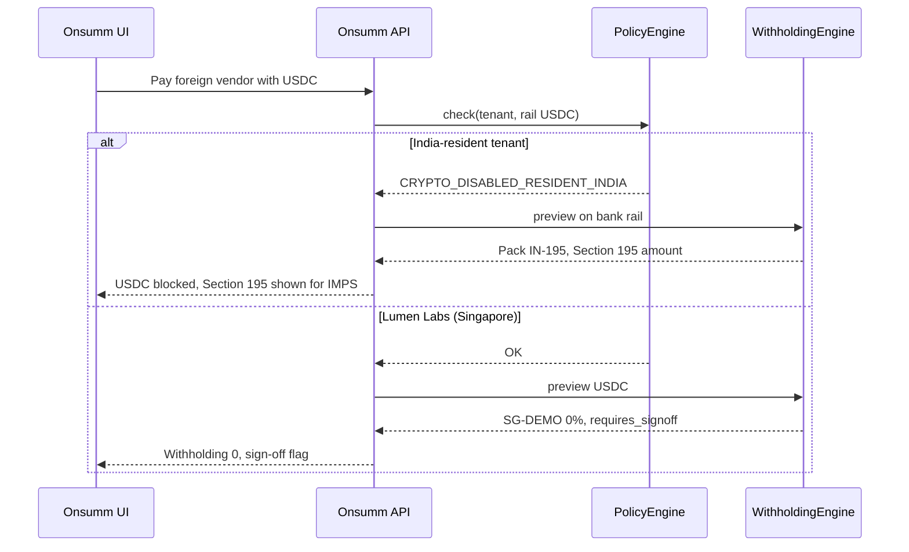

| Screen | Route | Key elements |
| --- | --- | --- |
| Withholding rules | `SettingsPage.tsx`, tab *Withholding rules* | Pack, rule per vendor category, rate, adviser sign-off |
| Payout review | `pages/payment/ReviewStep` | Withholding line with pack and rule code |
| Remittances | `pages/crypto/withholding/Remittances.tsx` | Period, total, reference, certificate download |

---

## 8. Auditor verification

Actors: Ben (controller), external auditor. Goal: prove an approval record existed, unchanged, at anchor time.

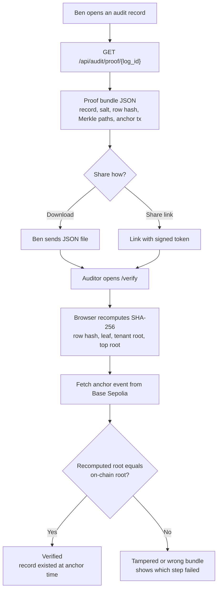

Verification needs no Onsumm login and runs in the auditor's browser. Bundles are shared deliberately; nobody can look records up by bill ID.

| Screen | Route | Key elements |
| --- | --- | --- |
| Audit record | Bill detail, *Audit* panel | Download proof, copy share link |
| Public verify | `pages/crypto/VerifyProof.tsx` at `/verify` | Drop bundle or open link, step-by-step check, explorer link |

---

## 9. Demo run-of-show

Nine steps for Saturday 31 Oct. Each box names the screen used.

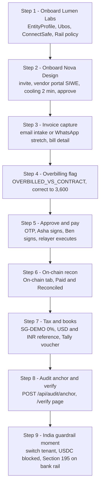

Step 2 runs the 2-minute cooling countdown while steps 3 and 4 are shown, so no time is lost. Step 9 closes the pitch with compliance, not a feature.

| Step | Screen | What the judges see |
| --- | --- | --- |
| 1 | Onboarding pages | Safe owners and threshold read live from Base Sepolia |
| 2 | Vendor portal | Wallet signature instead of a penny drop |
| 3 | Bill detail | USD invoice parsed |
| 4 | Review Hub | USD 600 overbilling caught before approval |
| 5 | CryptoPayoutCard | Two signatures, then settlement in seconds |
| 6 | On-chain tab | Tx hash matched to bill automatically |
| 7 | Books panel | Voucher with tx hash; INR reference value stored |
| 8 | `/verify` | Green check against the on-chain root |
| 9 | Payment page (India tenant) | Refusal code and Section 195 preview |
