# Crypto Rail — Edge Cases and Failure Handling

Status: hackathon baseline, as of 29 Oct 2026 · Names follow [00_DECISIONS.md](00_DECISIONS.md)

This document lists what can go wrong on the crypto rail, how Onsumm detects it, and what it does. The rule throughout: when in doubt, **fail closed** (refuse or hold the payout) and raise a Review Hub finding. No edge case may move funds that the client's Safe owners did not sign for.

Contents

1. [Master table](#1-master-table)
2. [Detailed handling with diagrams](#2-detailed-handling-with-diagrams)
    1. [Payout failure paths](#21-payout-failure-paths)
    2. [Double click and retries](#22-double-click-and-retries)
    3. [Stuck Safe nonce](#23-stuck-safe-nonce)
    4. [Chain reorg](#24-chain-reorg)
    5. [Wallet change attack](#25-wallet-change-attack)
    6. [Unmatched outbound transfer](#26-unmatched-outbound-transfer)
    7. [RPC outage and backfill](#27-rpc-outage-and-backfill)
    8. [Tamper detection on verify](#28-tamper-detection-on-verify)
    9. [PolicyEngine check order](#29-policyengine-check-order)
    10. [Duplicate across rails](#210-duplicate-across-rails)
    11. [Screening at payout time](#211-screening-at-payout-time)
    12. [Relayer out of gas and dropped transactions](#212-relayer-out-of-gas-and-dropped-transactions)
3. [Codes added for edge cases](#3-codes-added-for-edge-cases)
4. [Test checklist](#4-test-checklist)

---

## 1. Master table

*Demo* means the case is handled (and may be shown) in the hackathon build. *Production* means it is designed here and built after the hackathon.

| ID | Category | Scenario | Detection | System handling | User sees | Code | Scope |
| --- | --- | --- | --- | --- | --- | --- | --- |
| EC-01 | Wallet | Vendor gives an address for another chain or a malformed address | `EvmChain` address and checksum validation; SIWE message `chainId` must be 84532 | Wallet not saved | "Switch your wallet to Base Sepolia" | `CHAIN_NOT_ALLOWED` | Demo |
| EC-02 | Wallet | Vendor address is a smart contract, not a normal account | `eth_getCode` returns code | Wallet held in `PENDING_PROOF` until ops approves (vendor Safes are allowed after review) | "Contract wallet needs manual approval" | `WALLET_NOT_ACTIVE` | Production |
| EC-03 | Wallet | Address poisoning: a look-alike address appears in history | Payouts only accept a `supplier_wallets.id`, never a typed or copied address | Look-alikes cannot be selected | Full checksum address, first and last 6 characters highlighted | — | Demo |
| EC-04 | Wallet | Invoice prints a wallet that differs from the vendor master | OCR extracts printed address; compared with `ACTIVE` wallet | Printed address ignored for payment; bill flagged | Banner on bill | `WALLET_MISMATCH` | Demo |
| EC-05 | Wallet | Attacker requests a wallet change (phishing or insider) | Any change request | Old wallet `FROZEN`, notice to old contact, cooling, admin approval | Vendor cannot be paid until resolved | `WALLET_CHANGED` | Demo |
| EC-06 | Wallet | Vendor loses keys to its wallet | Vendor reports it | Wallet change flow; unsigned payouts to old wallet cancelled | Pending payouts show `REJECTED` | `WALLET_CHANGED` | Production |
| EC-07 | Wallet | Screening hit when the vendor registers | `StaticListScreening` returns `HIT` | Wallet `FROZEN`; ops review | "Wallet could not be approved" | `SCREENING_HIT` | Demo |
| EC-08 | Wallet | Screening hit at payout (address listed after onboarding) | Re-screen before every payout | Payout `REJECTED`; wallet `FROZEN` | Refusal on review step | `SCREENING_HIT` | Demo |
| EC-09 | Wallet | Screening provider unavailable | Provider error or timeout; `wallet_screenings.result = ERROR` | Fail closed: payout refused, retry offered | "Screening unavailable, try again" | `SCREENING_UNAVAILABLE` | Production |
| EC-10 | Policy | India-resident tenant tries to pay in USDC | `dim_tenants.is_resident_india = true` | USDC refused; bank rail offered with Section 195 preview | Refusal and IMPS preview | `CRYPTO_DISABLED_RESIDENT_INDIA` | Demo |
| EC-11 | Policy | Crypto rail not enabled for the tenant | `tenant_rail_policy.crypto_enabled = false` | USDC option hidden; API refuses | Rail option disabled with reason | `CRYPTO_NOT_ENABLED` | Demo |
| EC-12 | Policy | Token not allowed (for example USDT) | `allowed_tokens` | Refused | Refusal reason | `TOKEN_NOT_ALLOWED` | Demo |
| EC-13 | Policy | Chain not allowed | `allowed_chains` | Refused | Refusal reason | `CHAIN_NOT_ALLOWED` | Demo |
| EC-14 | Policy | Payout above per-transaction limit | `per_tx_limit_usd` | Refused; split or raise limit | Refusal with the limit | `OVER_PER_TX_LIMIT` | Demo |
| EC-15 | Policy | Day's payouts above daily limit | Sum of today's non-failed payouts plus this one vs `daily_limit_usd` | Refused | Remaining allowance shown | `OVER_DAILY_LIMIT` | Demo |
| EC-16 | Policy | Treasury Safe has too little USDC | `balanceOf(Safe)` at preview and again before relay | Refused at preview; held at `READY` if balance drops later | "Fund the treasury" with amount short | `INSUFFICIENT_TREASURY_BALANCE` | Demo |
| EC-17 | Policy | Vendor wallet still cooling | `cooling_until > now` | Refused | Countdown | `WALLET_COOLING` | Demo |
| EC-18 | Execution | Double click, browser retry or API timeout retry | `idempotency_key` unique per bill and attempt | Second request returns the first payout, no new row | Same payout screen | `ALREADY_IN_FLIGHT` for a different attempt | Demo |
| EC-19 | Execution | Same invoice paid on IMPS and USDC | In-flight and paid check is rail-agnostic on the invoice | Second rail refused | Link to the existing payment | `DUPLICATE_ACROSS_RAILS` | Demo |
| EC-20 | Execution | Partial payment (short-pay) | Amount below `outstanding_amount` | Allowed; bill `payment_status = partial`; outstanding reduced | Remaining balance on bill | — | Demo |
| EC-21 | Execution | A Safe transaction is stuck and blocks later nonces | Payout in `PROPOSED` or `PARTIALLY_SIGNED` past TTL while a later nonce waits | Cancel transaction with the same nonce; stuck payout `REPLACED` | Finding with "Cancel and re-propose" | `PAYOUT_STUCK` | Production |
| EC-22 | Execution | Signature from an address that is not a Safe owner | Recovered signer not in `safe_owners` | Signature rejected; state unchanged | "This wallet is not an owner of the treasury Safe" | — | Demo |
| EC-23 | Execution | Safe owners or threshold changed outside Onsumm | Re-read `getOwners`/`getThreshold` at each proposal and hourly | Payouts paused until admin re-syncs | Banner on treasury page | `SAFE_CONFIG_CHANGED` | Demo |
| EC-24 | Execution | An owner rejects the payout | Reject button in signing card | `REJECTED`; bill stays approved and unpaid | Rejection reason on payout | — | Demo |
| EC-25 | Execution | Signatures not complete before the signing deadline | Signature TTL (24 hours, configurable) | `EXPIRED`; nonce freed by cancel transaction if needed | "Expired, prepare again" | — | Production |
| EC-26 | Execution | FX snapshot expired for a non-USD bill | `fx_snapshots` age above quote TTL | Re-quote before OTP; `EXPIRED` if already proposed | New amount shown for confirmation | — | Production |
| EC-27 | Execution | Relayer has no gas | Relayer balance check before submit | Payout stays `READY`; alert ops; any owner may execute directly | "Waiting for relayer" | `PAYOUT_STUCK` | Demo |
| EC-28 | Execution | Transaction reverted on-chain | Receipt `status = 0` | `REVERTED` with reason; bill unchanged; may re-propose | Failure reason, explorer link | — | Demo |
| EC-29 | Execution | Transaction dropped from the mempool | No receipt after timeout and nonce unused | Resubmit same signed transaction with higher fee | "Resubmitting" | `PAYOUT_STUCK` | Production |
| EC-30 | Execution | Gas price spike | Fee estimate above relayer cap | Wait and retry; preview shows refreshed fee | "Network busy" | — | Production |
| EC-31 | Chain | Reorg removes a transfer already seen | Log returned with `removed = true`, or block hash changed | `chain_transfers.removed = true`; payout back to `CONFIRMING`; re-match | Status steps back, then forward | `REORG_DETECTED` | Production |
| EC-32 | Chain | RPC provider down or slow | Request errors, timeouts, stale head | Fail over to second RPC; backfill from cursor | Nothing, or "Chain data delayed" | — | Demo |
| EC-33 | Chain | Webhook event missed | Poller sees a log with no webhook row | Poller is the source of truth; unique key dedupes | Nothing | — | Demo |
| EC-34 | Recon | USDC left the treasury without an Onsumm proposal | `OUT` transfer with no matching `tx_hash` | Critical finding; payouts paused for review | Red alert on payment hub | `UNMATCHED_OUTBOUND_TRANSFER` | Demo |
| EC-35 | Recon | USDC arrived and matches nothing | `IN` transfer with no receivable match | Finding for manual match | Item in On-chain tab | `UNMATCHED_INBOUND_TRANSFER` | Production |
| EC-36 | Recon | On-chain amount, token or destination differs from the payout | Three-way match | `MISMATCH`; bill held in `PENDING` | Finding with both values | `AMOUNT_MISMATCH` | Demo |
| EC-37 | Recon | Issuer has frozen the vendor address | Transfer reverts; or screening flags it | `REVERTED`; wallet `FROZEN` | Failure reason | `SCREENING_HIT` | Production |
| EC-38 | Recon | USDC trades away from 1 USD (depeg) | `fx_snapshots.token_usd` deviates more than 1% | Payouts paused with warning until admin confirms | Warning on preview | `TOKEN_DEPEG` | Production |
| EC-39 | Recon | Day's statement does not match the on-chain balance | Daily statement close vs `balanceOf` | Day flagged | Statement shows difference | `UNRECONCILED_DAY` | Demo |
| EC-40 | Tax | Vendor tax documents missing | Pack requires document (W-8BEN-E, TRC, PAN) | Pack's higher default rate applied; flagged | Withholding line shows reason | `TAX_DOCS_MISSING` | Demo |
| EC-41 | Tax | Withholding rule needs adviser sign-off | `requires_signoff = true` and no sign-off | Payout allowed, flagged | Flag on review step | `WITHHOLDING_SIGNOFF_REQUIRED` | Demo |
| EC-42 | Tax | Rounding to 6 decimals | Withholding computed in units | Withholding rounded half up to 1 unit; net = gross units minus withholding units, so totals always add up | Exact amounts | — | Demo |
| EC-43 | Books | ERP posting fails | Tally or Apideck error | `ledger_postings.status = FAILED`; retry with backoff; manual retry | Retry button on Books panel | — | Demo |
| EC-44 | Books | FX gain or loss between booking and settlement | Booking rate vs settlement snapshot | Difference posted to FX gain or loss | Line on voucher | — | Production |
| EC-45 | Audit | Anchor transaction fails | Receipt failure or timeout | `audit_anchors.status = FAILED`; next run covers the range | Finding for ops | `ANCHOR_FAILED` | Demo |
| EC-46 | Audit | Audit row edited or deleted after it was written | Nightly chain re-hash; `/verify` mismatch | Tamper flagged; earliest broken `seq` reported | Red result on `/verify` | `AUDIT_CHAIN_BROKEN` | Demo |
| EC-47 | Audit | Tenant audit salt leaks | Incident report | Rotate salt for new leaves; past proofs still valid | Ops notice | — | Production |
| EC-48 | Audit | Bundle belongs to another tenant or record | Tenant root not in anchor's tenant roots | Verification fails at that step | "Bundle does not match this anchor" | — | Demo |
| EC-49 | Execution | Two payouts proposed at once from the same Safe | Nonce allocation | One payout per Safe in flight for the hackathon; later ones queue with the next nonce | "Queued behind payout X" | — | Demo |
| EC-50 | Demo | Base Sepolia slow during the live demo | Watch confirmations on stage | Switch to recorded backup video | Backup recording | — | Demo |
| EC-51 | Recon | Withholding payout: one MultiSend leg matches, the other is missing or differs | `OnchainMatcher` expects two legs (`match_type` `PAYOUT` and `TAX`) for the same `tx_hash` | Bill stays `PENDING`; payout not marked `SUCCESS`; both legs shown | Finding with expected and actual legs | `AMOUNT_MISMATCH` | Demo |
| EC-52 | Wallet | Vendor portal link expired (older than 72 hours) or forwarded to someone else | Token expiry; token bound to supplier and contact; SIWE nonce single-use | Expired: refused, Ben re-sends invite. Forwarded: any wallet registered still needs cooling, old-contact notice and admin approval | "Link expired, ask for a new one" | — | Demo |

---

## 2. Detailed handling with diagrams

### 2.1 Payout failure paths

Every failure ends in a terminal state; none of them changes the bill's paid amount. A payout with withholding is one MultiSend Safe transaction, so its vendor and tax legs share every state below.

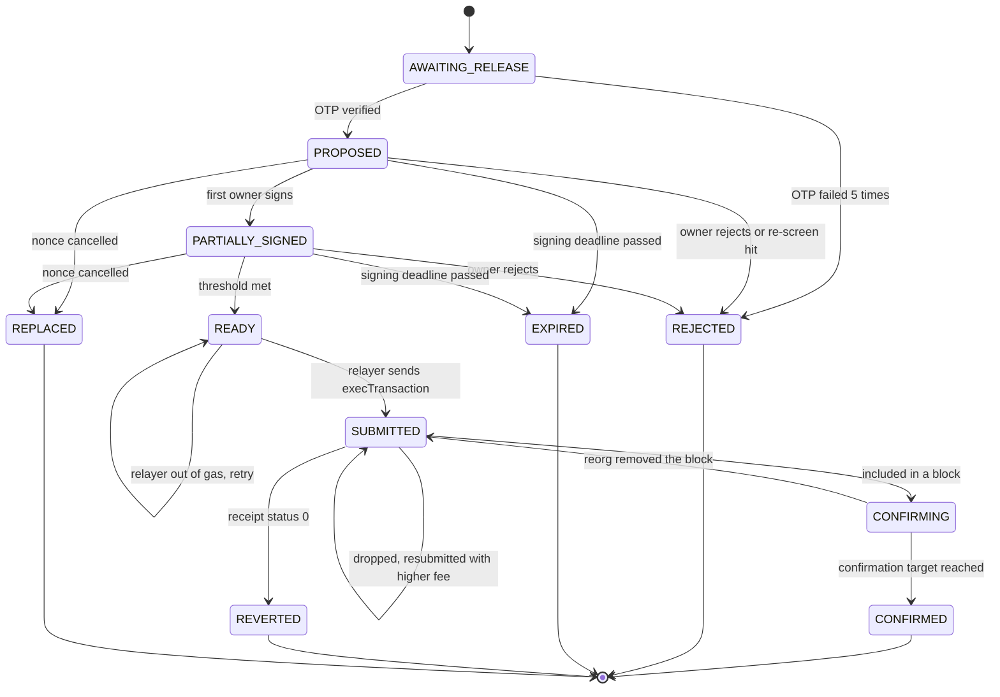

`AWAITING_RELEASE` maps to `status = PENDING_OTP`, `CONFIRMED` to `SUCCESS`, and the five failure states to `FAILED`. A reorg steps a payout back rather than failing it.

### 2.2 Double click and retries

The idempotency key is built from the bill and the attempt number, and has a unique index.

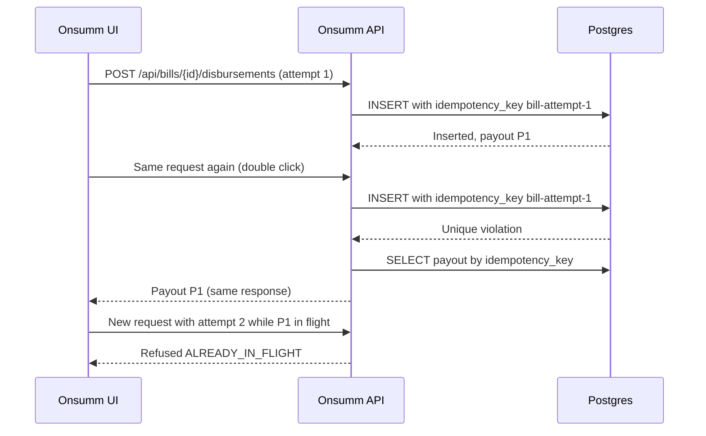

A repeat of the same request is answered with the original payout. A genuinely new attempt is refused while another payout for the bill is still in flight.

### 2.3 Stuck Safe nonce

A Safe executes transactions strictly in nonce order. One unsigned payout blocks every later one.

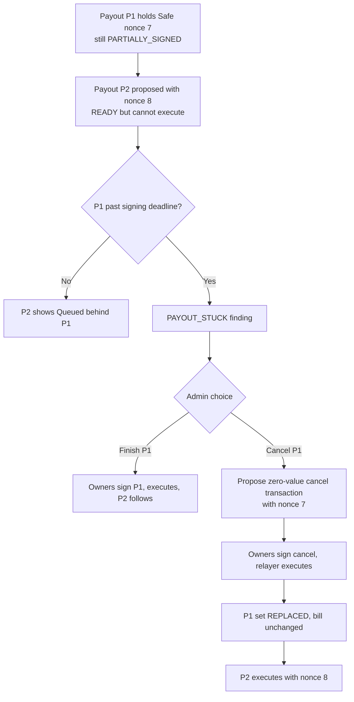

Cancelling means executing a harmless transaction with the same nonce, which makes the old one impossible forever. For the hackathon, one payout per Safe in flight avoids this entirely.

### 2.4 Chain reorg

On Base Sepolia reorgs are rare, but the watcher must handle a log disappearing.

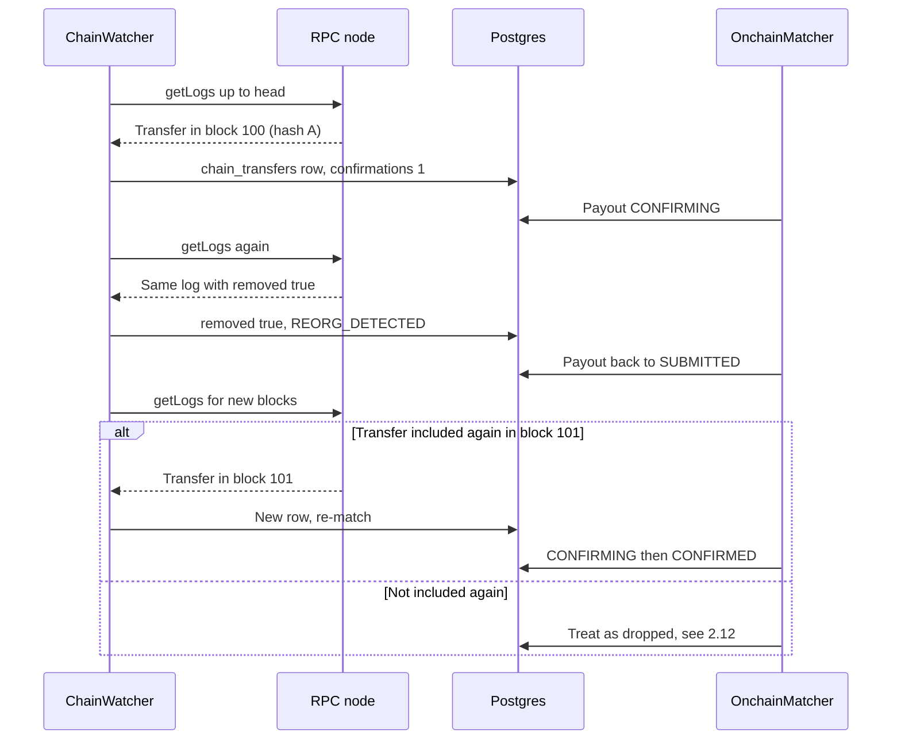

Nothing is marked paid until the confirmation target is reached, so a reorg never undoes a posted voucher.

### 2.5 Wallet change attack

The most common crypto accounts-payable fraud is a changed payout address.

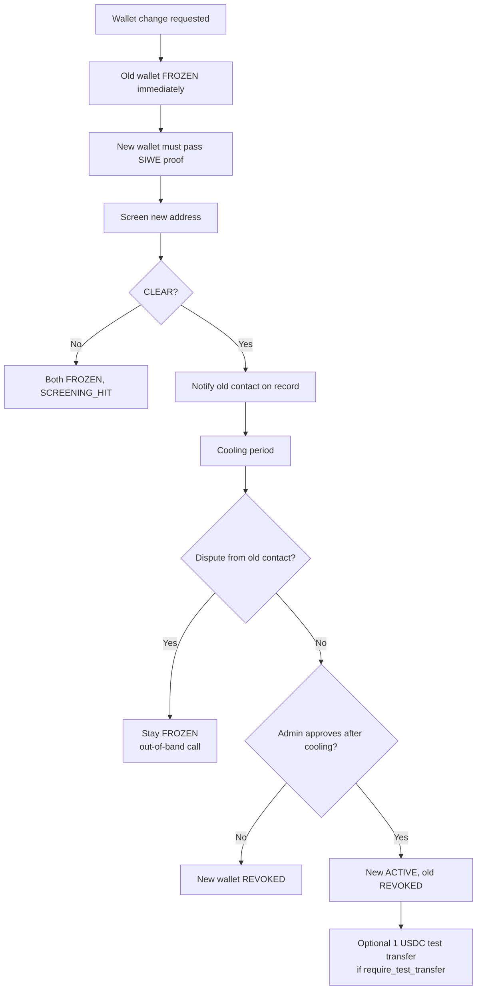

An attacker would need the vendor's portal link, a clean wallet, silence from the real vendor and an approver's sign-off. Each step is logged and anchored.

### 2.6 Unmatched outbound transfer

Someone moved USDC out of the treasury without Onsumm, for example by signing directly in the Safe app.

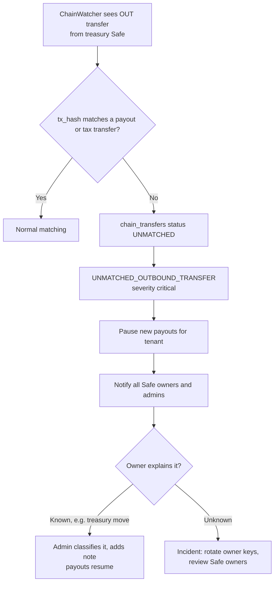

Onsumm cannot stop owners signing outside it, but it guarantees they find out within one polling interval.

### 2.7 RPC outage and backfill

The watcher reads from a cursor, so an outage only delays data and never loses it.

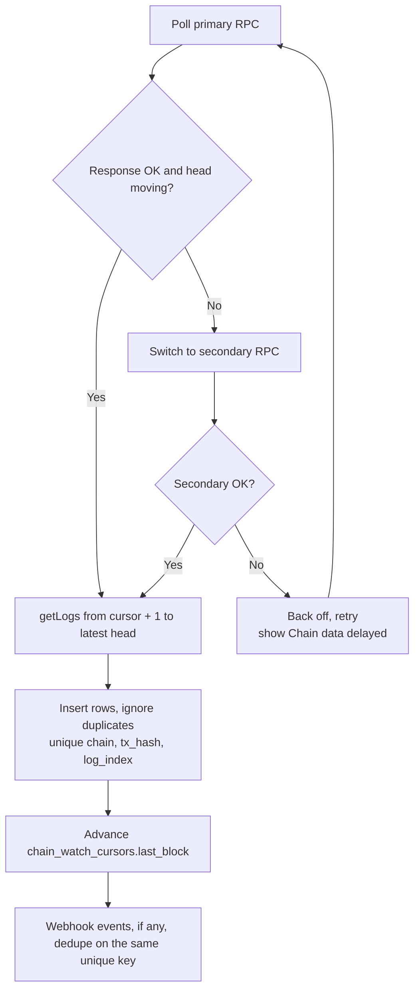

The cursor only moves after rows are written, so a crash mid-batch replays safely. Webhooks speed things up but are never required.

### 2.8 Tamper detection on verify

The verifier recomputes each step and stops at the first mismatch.

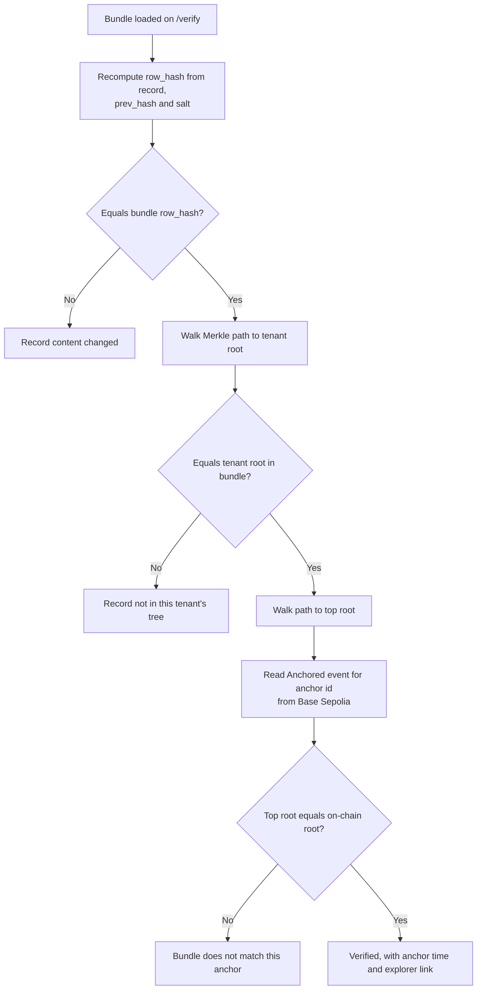

Each red result names the failing step, which tells the auditor whether the record, the tenant tree or the anchor is wrong.

### 2.9 PolicyEngine check order

Checks run in this order and stop at the first refusal, so the user sees the most fundamental problem first.

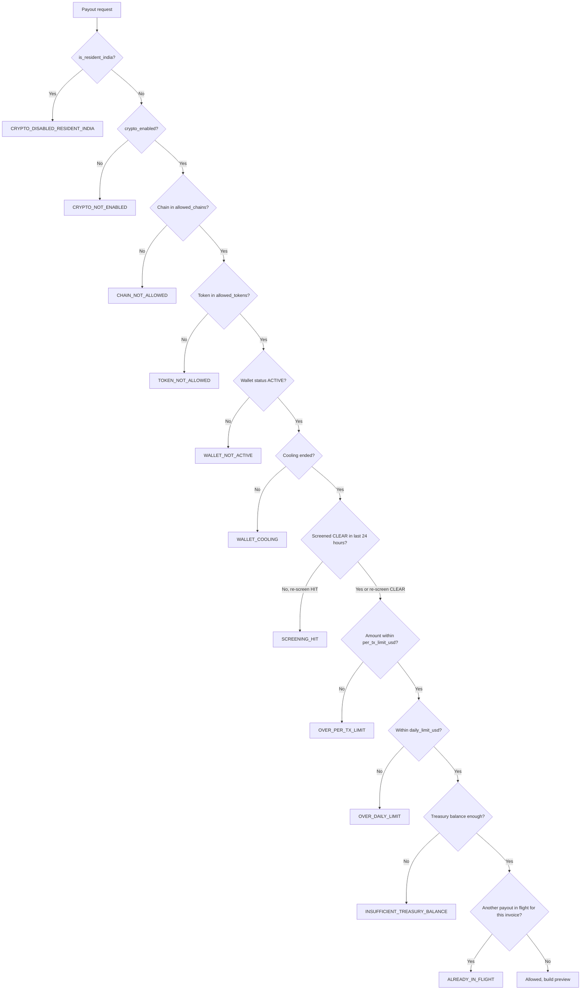

The same checks run twice: at preview and again just before the relayer submits. Balance and screening can change in between.

### 2.10 Duplicate across rails

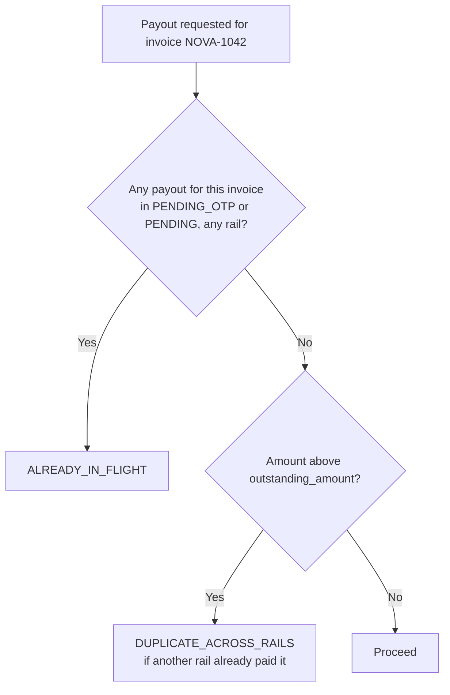

The in-flight check ignores the rail, and the outstanding balance is shared by both rails. Paying the same invoice by IMPS and USDC is therefore impossible.

### 2.11 Screening at payout time

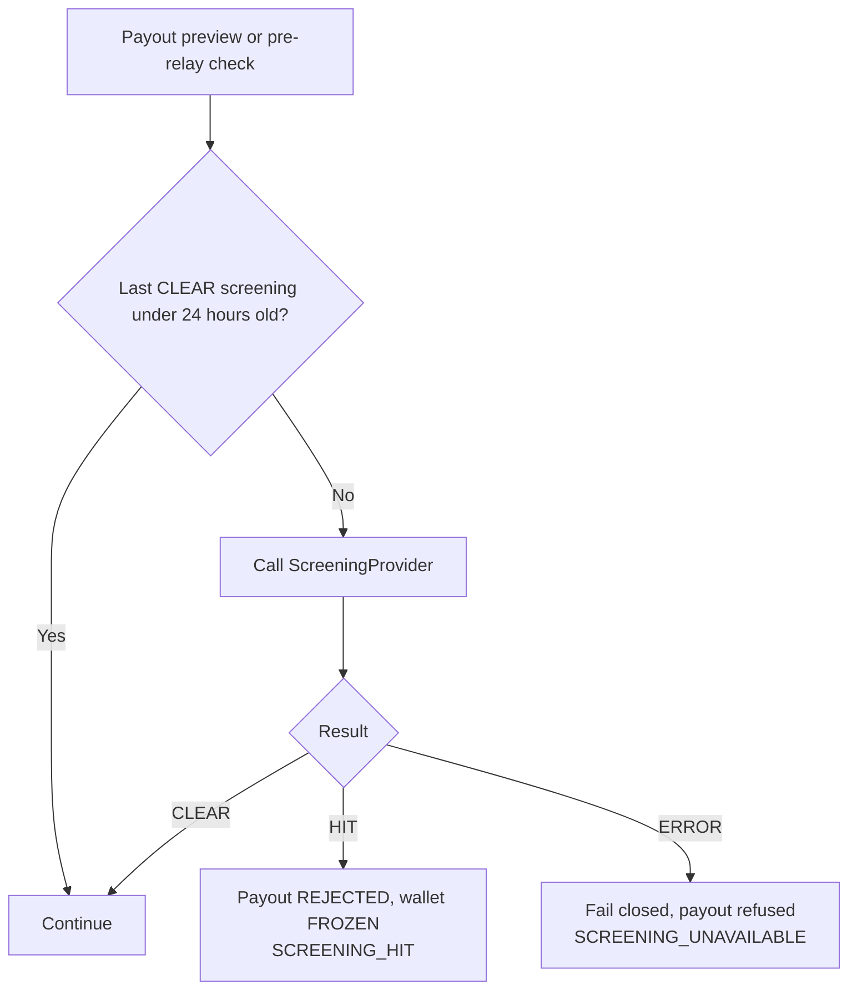

A provider outage blocks payouts rather than letting them through unchecked. Every result, including errors, is kept in `wallet_screenings`.

### 2.12 Relayer out of gas and dropped transactions

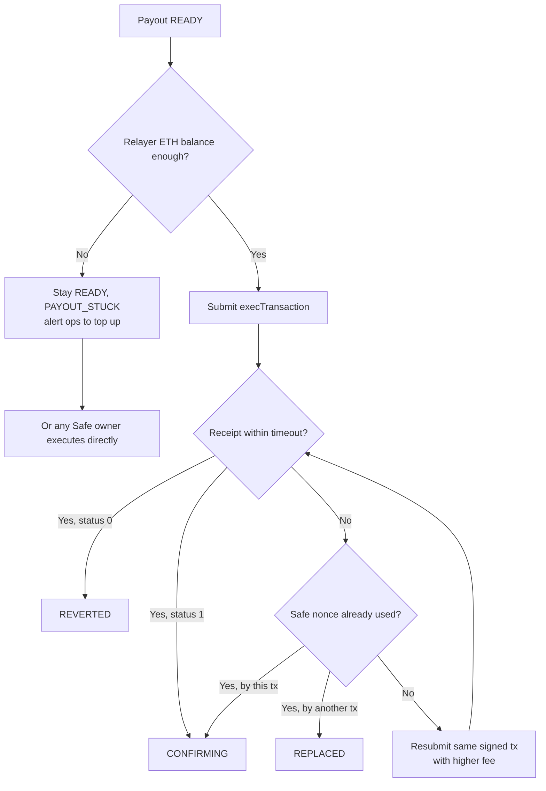

The owners' signatures stay valid for the same nonce, so the relayer can resubmit without asking anyone to sign again. The relayer can never change the amount or destination.

---

## 3. Codes added for edge cases

These codes were introduced by the edge cases and are now part of [00_DECISIONS.md](00_DECISIONS.md) §2.3.

| Code | Kind | Used by |
| --- | --- | --- |
| `CRYPTO_NOT_ENABLED` | Policy refusal | EC-11, check order 2.9 |
| `SCREENING_UNAVAILABLE` | Policy refusal | EC-09, 2.11 |
| `TOKEN_DEPEG` | Finding | EC-38 |
| `AUDIT_CHAIN_BROKEN` | Finding | EC-46 |

---

## 4. Test checklist

**Demo-critical** tests must pass before Saturday's run-through.

- [ ] EC-01 SIWE with wrong `chainId` is refused (unit)
- [ ] EC-02 contract address held for manual approval (unit, production)
- [ ] EC-03 payout API rejects a raw address and accepts only a wallet ID (API)
- [ ] EC-04 invoice with a different printed wallet raises `WALLET_MISMATCH` (pipeline) **demo-critical**
- [ ] EC-05 wallet change freezes the old wallet and notifies the old contact (API) **demo-critical**
- [ ] EC-06 lost-key change cancels unsigned payouts (API, production)
- [ ] EC-07 listed address at onboarding ends `FROZEN` (unit) **demo-critical**
- [ ] EC-08 address added to the list after onboarding blocks the payout (API)
- [ ] EC-09 screening error refuses the payout (unit, production)
- [ ] EC-10 India-resident tenant gets `CRYPTO_DISABLED_RESIDENT_INDIA` and a Section 195 preview (API) **demo-critical**
- [ ] EC-11 crypto disabled tenant cannot choose USDC (UI and API)
- [ ] EC-12 USDT refused (unit)
- [ ] EC-13 non-allowed chain refused (unit)
- [ ] EC-14 per-transaction limit enforced (unit)
- [ ] EC-15 daily limit counts only non-failed payouts (unit)
- [ ] EC-16 low treasury balance refused at preview and held before relay (integration)
- [ ] EC-17 cooling wallet refused, allowed after `cooling_until` (unit) **demo-critical**
- [ ] EC-18 duplicate POST returns the same payout (API) **demo-critical**
- [ ] EC-19 IMPS then USDC on the same invoice refused (API) **demo-critical**
- [ ] EC-20 short-pay leaves `payment_status = partial` (API) **demo-critical**
- [ ] EC-21 cancel transaction marks the stuck payout `REPLACED` (testnet, production)
- [ ] EC-22 non-owner signature rejected (unit) **demo-critical**
- [ ] EC-23 changed threshold on the Safe pauses payouts (testnet)
- [ ] EC-24 owner rejection ends in `REJECTED`, bill unpaid (API)
- [ ] EC-25 expired signatures end in `EXPIRED` (unit, production)
- [ ] EC-26 stale FX snapshot forces a re-quote (unit, production)
- [ ] EC-27 relayer without gas keeps the payout `READY` (testnet)
- [ ] EC-28 reverted transaction ends in `REVERTED` (testnet)
- [ ] EC-29 dropped transaction is resubmitted (testnet, production)
- [ ] EC-30 fee above cap waits (unit, production)
- [ ] EC-31 removed log steps the payout back and re-matches (unit with recorded logs, production)
- [ ] EC-32 primary RPC failure switches to secondary (integration)
- [ ] EC-33 poller fills a missed webhook without duplicates (integration)
- [ ] EC-34 outbound transfer signed outside Onsumm raises a critical finding (testnet) **demo-critical**
- [ ] EC-35 unknown inbound transfer raises a finding (testnet, production)
- [ ] EC-36 amount mismatch holds the bill (unit) **demo-critical**
- [ ] EC-37 frozen address revert freezes the wallet (unit, production)
- [ ] EC-38 depeg above 1% pauses payouts (unit, production)
- [ ] EC-39 statement difference raises `UNRECONCILED_DAY` (unit)
- [ ] EC-40 missing W-8BEN-E raises `TAX_DOCS_MISSING` (unit)
- [ ] EC-41 0% `SG-DEMO` rule shows the sign-off flag (UI) **demo-critical**
- [ ] EC-42 gross units equal net units plus withholding units (property test) **demo-critical**
- [ ] EC-43 failed Tally posting retries and can be retried by hand (integration)
- [ ] EC-44 FX gain or loss line posted (unit, production)
- [ ] EC-45 failed anchor raises `ANCHOR_FAILED`; next run covers the range (testnet)
- [ ] EC-46 editing a `wf_audit_log` row makes `/verify` fail at the record step (integration) **demo-critical**
- [ ] EC-47 salt rotation keeps old proofs valid (unit, production)
- [ ] EC-48 bundle from another tenant fails at the tenant-root step (unit)
- [ ] EC-49 second payout from the same Safe queues behind the first (API)
- [ ] EC-50 backup demo recording made Friday night **demo-critical**
- [ ] EC-51 MultiSend payout with only the vendor leg matched stays `PENDING` with `AMOUNT_MISMATCH` (unit with recorded logs)
- [ ] EC-52 portal token older than 72 hours is refused; reused SIWE nonce is refused (API) **demo-critical**
