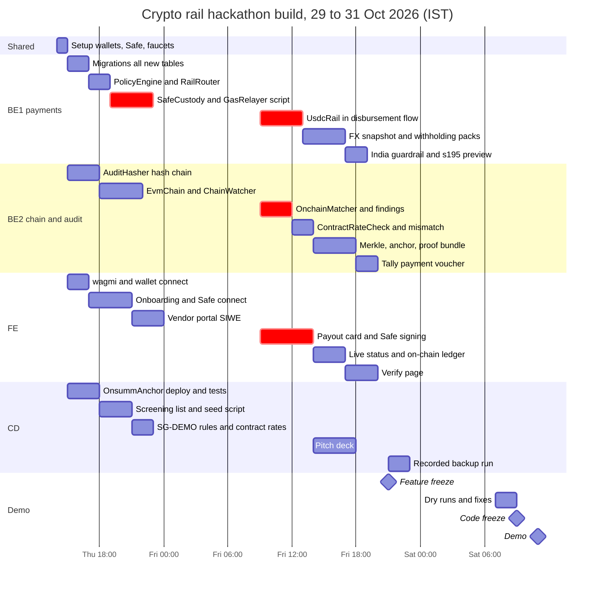
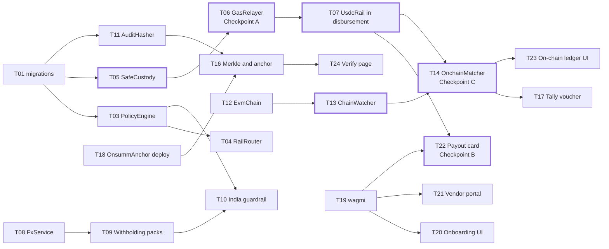
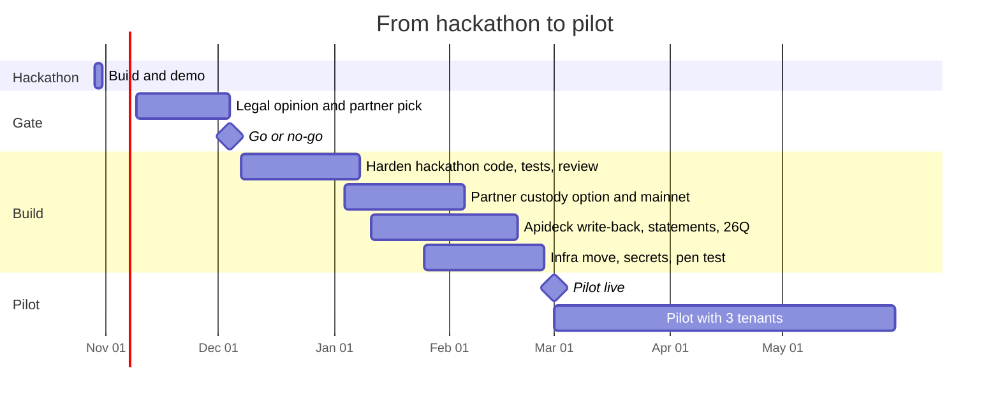

# Crypto Rail — Implementation Plan

Status: proposal · as of 29 Oct 2026 · names follow [00_DECISIONS.md](00_DECISIONS.md)

The demo is ready by **Friday 30 Oct, 21:00**, with Saturday morning kept for dry runs only. The critical path is: migrations → Safe payout from a script → payout from the UI → chain watcher match. Everything else hangs off that path and can be cut without breaking the demo.

Contents

1. [Team and ownership](#1-team-and-ownership)
2. [Before writing code (Thursday, first hour)](#2-before-writing-code-thursday-first-hour)
3. [Timeline](#3-timeline)
4. [Task list](#4-task-list)
5. [Dependencies](#5-dependencies)
6. [Checkpoints](#6-checkpoints)
7. [Cut lines](#7-cut-lines)
8. [Demo readiness checklist](#8-demo-readiness-checklist)
9. [Hackathon risks](#9-hackathon-risks)
10. [After the hackathon](#10-after-the-hackathon)

---

## 1. Team and ownership

| Role | Code | Owns |
| --- | --- | --- |
| Backend: payments and policy | **BE1** | Migrations, `PolicyEngine`, `RailRouter`, `UsdcRail`, `SafeCustody`, `GasRelayer`, `FxService`, `WithholdingEngine` and rule packs |
| Backend: chain, recon and audit | **BE2** | `EvmChain`, `ChainWatcher`, `OnchainMatcher`, `ContractRateCheck`, wallet-mismatch check, `AuditHasher`, `MerkleBuilder`, `AnchorService`, `ProofService`, `TallyPaymentVoucherBuilder` |
| Frontend and web3 | **FE** | wagmi setup, onboarding screens, vendor portal, payout card with Safe signing, on-chain ledger, `/verify` page |
| Contracts, data and demo | **CD** | `OnsummAnchor.sol`, Safe setup and funding, screening list, `seed_crypto_demo.py`, SG-DEMO rule config, pitch deck, recorded backup |

One person can hold two roles if the team is three. In that case CD's work is shared out on Thursday and the pitch is written Friday evening.

## 2. Before writing code (Thursday, first hour)

All four people do this together; it removes the most common hackathon blockers.

- [ ] Create 5 test wallets: Asha, Ben, Chen (Safe owners), Nova (vendor), relayer. Add the anchor wallet as a 6th.
- [ ] Fund each with Base Sepolia ETH from a faucet. Fund Lumen's Safe with test USDC from Circle's faucet.
- [ ] Create Lumen's Safe on Base Sepolia: owners Asha, Ben, Chen; threshold 2.
- [ ] Confirm the test USDC contract address and decimals on the Base Sepolia explorer.
- [ ] Get two RPC URLs (public `sepolia.base.org` plus one provider key).
- [ ] Create a branch `crypto-rail-hackathon`. Agree folder layout from the README §7.
- [ ] Point `.env` at `onsumm-new-db` (already done) and run the backend and frontend once.

## 3. Timeline

Times are IST. Proposed working blocks: Thursday 14:00–24:00, Friday 09:00–24:00, Saturday 07:00–10:30.

| Block | BE1 | BE2 | FE | CD |
| --- | --- | --- | --- | --- |
| Thu 14:00–15:00 | Shared setup | Shared setup | Shared setup | Shared setup |
| Thu 15:00–19:00 | Migrations; `PolicyEngine`; `RailRouter` | `AuditHasher` hash chain; backfill existing rows | wagmi; onboarding screens start | `OnsummAnchor` written, tested, deployed |
| Thu 19:00–24:00 | `SafeCustody` + `GasRelayer`: first USDC transfer from a script | `EvmChain`; `ChainWatcher` with cursor and reorg check | Onboarding and Safe connect; vendor portal SIWE | Screening list; seed script |
| Fri 09:00–14:00 | `UsdcRail` wired into `routers/disbursement.py` | `OnchainMatcher`; findings; contract-rate and wallet-mismatch checks | Payout card, Safe signing with two owners | SG-DEMO rules; contract rates; demo data |
| Fri 14:00–19:00 | `FxService`; `WithholdingEngine`; packs | Merkle tree; anchor job; proof bundle | Live status; on-chain ledger | Pitch deck |
| Fri 19:00–21:00 | India guardrail; Section 195 preview | Tally payment voucher; `ledger_postings` | `/verify` page | End-to-end run with everyone |
| Fri 21:00–24:00 | Bug fixes | Bug fixes | Bug fixes | Recorded backup run |
| Sat 07:00–09:00 | Dry runs | Dry runs | Dry runs | Dry runs; pitch rehearsal |

## 4. Task list

| ID | Task | Owner | Hours | Depends on | Done when |
| --- | --- | --- | --- | --- | --- |
| T01 | Migrations for every new and changed table in [00_DECISIONS.md](00_DECISIONS.md) §2.1, as idempotent functions run by `scripts/run_api_migrations.py` | BE1 | 2 | — | Running migrations twice on `onsumm-new-db` makes no further change |
| T02 | Licence keys `crypto_payouts`, `crypto_tds`, `audit_anchor` in `security/services.py`, `_RULES`, `frontend/src/auth/services.ts`; regenerate route map test | BE1 | 1 | T01 | Route map test passes |
| T03 | `PolicyEngine` with all refusal codes, in the order of the decision tree in [06_EDGE_CASES.md](06_EDGE_CASES.md) | BE1 | 2 | T01 | Unit test per refusal code |
| T04 | `RailRouter`; rail-agnostic in-flight check (`DUPLICATE_ACROSS_RAILS`) | BE1 | 1 | T03 | INR bill still pays through IMPS unchanged |
| T05 | `SafeCustody`: build SafeTx for a USDC `transfer`, or a `MultiSend` of two transfers when withholding is above zero; EIP-712 hash, signature recovery, owner and threshold check, nonce read | BE1 | 3 | T01 | Hash matches the Safe UI for the same transaction |
| T06 | `GasRelayer`: submit `execTransaction` with sorted signatures | BE1 | 1 | T05 | **Checkpoint A:** USDC moves from the Safe to Nova from a script |
| T07 | `UsdcRail` inside `routers/disbursement.py`: preview, OTP, proposal, signatures endpoint, `crypto_disbursement_details` sub-status | BE1 | 4 | T06 | Payout created and signed from the API |
| T08 | `FxService` (fixed, logged rate for demo; `usd_inr` reference) | BE1 | 1 | T01 | Snapshot stored with every payout |
| T09 | `WithholdingEngine`, `ConfigurablePack` (SG-DEMO), `IndiaNonResidentPack` (Section 195), `IndiaVdaPack` | BE1 | 3 | T08 | Preview returns rate, base, amount and sign-off flag |
| T10 | India guardrail: India tenant + crypto → `CRYPTO_DISABLED_RESIDENT_INDIA`; bank-rail preview shows Section 195 | BE1 | 2 | T03, T09 | Step 9 of the demo works |
| T11 | `AuditHasher`: `seq`, `prev_hash`, `row_hash`; canonical serialisation; write path for new rows; backfill script for existing rows | BE2 | 3 | T01 | Editing any row breaks verification of every later row |
| T12 | `EvmChain`: RPC with fallback, `get_logs`, receipts, confirmations, block hash | BE2 | 2 | — | Reads USDC transfers on Base Sepolia |
| T13 | `ChainWatcher`: cursor, 4-second poll, 3 confirmations, reorg detection, `chain_transfers` | BE2 | 2 | T12, T01 | Transfer from T06 appears once, with confirmations |
| T14 | `OnchainMatcher`: exact match; `_apply_success`; findings for unmatched or mismatched transfers | BE2 | 3 | T13, T07 | **Checkpoint C:** bill shows Paid and Reconciled |
| T15 | `ContractRateCheck` (`OVERBILLED_VS_CONTRACT`) and invoice wallet comparison (`WALLET_MISMATCH`) as Review Hub findings | BE2 | 2 | T01 | NOVA-1042 raises both findings |
| T16 | `MerkleBuilder` with salted leaves; `AnchorService`; `ProofService` bundle | BE2 | 4 | T11, T18 | Anchor transaction on Base Sepolia; bundle downloads |
| T17 | `TallyPaymentVoucherBuilder`; `ledger_postings` with retry | BE2 | 2 | T14 | Voucher XML generated with tx hash in narration |
| T18 | `OnsummAnchor.sol`, Foundry tests, deploy script, deploy to Base Sepolia | CD | 3 | — | Contract verified on the explorer |
| T19 | wagmi + viem setup, injected connector, chain switch to 84532 | FE | 2 | — | Wallet connects in the app |
| T20 | Foreign onboarding screens: profile, KYB upload and review, UBOs, Safe connect, rail policy | FE | 4 | T19, T01 | Lumen onboarded from the UI |
| T21 | Vendor portal: invite link, connect wallet, sign SIWE, cooling countdown; admin approve | FE + BE1 | 3 | T19 | Nova wallet goes to `ACTIVE` |
| T22 | Payout card: preview, OTP, Safe signing by two owners, live sub-status | FE | 5 | T07 | **Checkpoint B:** payout from the UI |
| T23 | On-chain ledger tab and receipt with explorer link | FE | 3 | T14 | Matched transfer visible with status |
| T24 | `/verify` page: load bundle, recompute SHA-256 in the browser, read root from contract, show *verified* or *tampered* | FE | 3 | T16 | Tampering one field shows *tampered* |
| T25 | Screening list JSON (OFAC digital-currency addresses plus one demo "bad" address) and `StaticListScreening` | CD | 1 | — | Bad address is refused |
| T26 | `seed_crypto_demo.py`: Lumen, India tenant, Nova, contract rate, Safe, policy (cooling 2 min, test transfer off) | CD | 2 | T01 | One command resets the demo |
| T27 | SG-DEMO rule config with *requires adviser sign-off* flag | CD | 1 | T09 | Shown in the preview |
| T28 | Pitch deck: problem, demo, safety, compliance, business | CD | 4 | — | 5-minute run-through done |
| T29 | Recorded backup run | CD | 2 | M1 | Video saved locally and in the cloud |
| T30 | Stretch: WhatsApp intake through Twilio sandbox into existing OCR | BE2 | 3 | — | Invoice arrives by WhatsApp |
| T31 | Stretch: inbound receivables match (`match_type = RECEIVABLE`) | BE2 | 2 | T14 | Inbound USDC marks a sales invoice paid |

## 5. Dependencies

The thick boxes are the critical path. A delay there delays the demo; a delay anywhere else only shrinks the demo.

## 6. Checkpoints

| Checkpoint | Target | Test | If missed |
| --- | --- | --- | --- |
| A: Safe payout from a script | Thu 23:00 | 1 USDC moves from Lumen's Safe to Nova with two owner signatures | BE2 pairs with BE1 on Friday morning; on-chain ledger UI moves to stretch |
| B: Payout from the UI | Fri 14:00 | Asha and Ben sign in the browser; relayer executes | Use the API from a prepared script and show the Safe transaction on the explorer |
| C: Paid and Reconciled | Fri 15:00 | Bill status changes without a manual step | Trigger the matcher manually from an admin button |
| M1: Feature freeze | Fri 21:00 | Full 9-step run with no code change in between | Cut items in §7 order |
| M2: Code freeze | Sat 09:00 | Two clean dry runs in a row | Use the recorded backup for the broken step |

## 7. Cut lines

If the team falls behind, cut in this order. Items above the line are never cut.

| Never cut (the demo needs them) |
| --- |
| Vendor wallet proof and screening · `PolicyEngine` · Safe payout with two signatures · `ChainWatcher` + `OnchainMatcher` · Overbilling finding · India guardrail |

| Cut order | Item | What the demo shows instead |
| --- | --- | --- |
| 1 | WhatsApp intake (T30) | Invoice by email, which already works |
| 2 | Inbound receivables (T31) | Mentioned on the roadmap slide |
| 3 | KYB document review screen polish | Pre-seeded KYB status "Approved" |
| 4 | Daily wallet statement | On-chain ledger tab only |
| 5 | Tally voucher (T17) | Voucher JSON payload in `ledger_postings` |
| 6 | Public `/verify` page (T24) | Proof checked with a script and the explorer |
| 7 | Audit anchor (T16) | Hash chain tamper detection only (T11 stays) |

## 8. Demo readiness checklist

- [ ] `seed_crypto_demo.py` resets the database to the demo starting point in one command.
- [ ] All wallets have test ETH; the Safe has at least 20,000 test USDC; the relayer and anchor wallets have gas for 50 transactions.
- [ ] Two browser profiles with MetaMask: Asha and Ben. A third profile for Nova (vendor).
- [ ] RPC fallback tested by blocking the primary URL.
- [ ] A second bill pre-signed by one owner, as the signing fallback.
- [ ] Explorer tabs open: Safe, Nova's wallet, `OnsummAnchor`.
- [ ] Recorded backup run saved in two places.
- [ ] Every step under 40 seconds; full demo under 5 minutes.
- [ ] Pitch slide on safety: who holds which key.
- [ ] Pitch slide on compliance: why step 9 blocks.

## 9. Hackathon risks

| Risk | Likelihood | Mitigation |
| --- | --- | --- |
| Faucets rate-limit on the day | High | Fund everything on Thursday |
| Public RPC slow during the event | Medium | Second provider; watcher fails over |
| Safe signature format mistakes (v value, ordering) | Medium | Test against the Safe UI's hash on Thursday night (T05) |
| Hash chain backfill on existing rows takes long | Low | Backfill only `onsumm-new-db` demo tenants; others later |
| Small EC2 database (1 GB RAM) slows under load | Medium | Demo runs against a local Postgres copy if needed; keep the copy script ready |
| Too much scope for 3 people | Medium | Cut lines in §7, decided at each checkpoint |

## 10. After the hackathon

The production path follows the business roadmap in [01_BUSINESS.md](01_BUSINESS.md): a legal gate, then a build, then a 3-tenant pilot from 1 March 2027.

| Workstream | Start | End |
| --- | --- | --- |
| Hackathon build and demo | 29 Oct 2026 | 31 Oct 2026 |
| Legal opinion and partner pick | 9 Nov 2026 | 4 Dec 2026 (go or no-go) |
| Harden hackathon code | 7 Dec 2026 | 8 Jan 2027 |
| Partner custody option and mainnet | 4 Jan 2027 | 5 Feb 2027 |
| Apideck write-back, statements, Indian returns | 11 Jan 2027 | 19 Feb 2027 |
| Infrastructure move, secrets, pen test | 25 Jan 2027 | 26 Feb 2027 |
| **Pilot live** | **1 Mar 2027** | |
| Pilot with 3 tenants | 1 Mar 2027 | 31 May 2027 |

### What hardening means

| Area | Hackathon shortcut | Production fix |
| --- | --- | --- |
| Custody | Safe only | `PartnerCustody` added behind `CustodyProvider` |
| Network | Base Sepolia | Base mainnet; confirmation depth by amount |
| Screening | Static list | TRM, Chainalysis or Elliptic API with daily re-screen |
| KYB | Manual review | KYB provider or the custody partner's KYB |
| FX | Fixed, logged rate | Partner or market quote with expiry |
| Cooling | 2 minutes | 24 hours |
| Test transfer | Off | On |
| Secrets | `.env` | AWS Secrets Manager; anchor key in KMS |
| Database | Docker Postgres on a t2.micro, port 5432 public | Private RDS with off-server backups |
| Books | Tally voucher only | Xero, QuickBooks, Zoho via Apideck write calls |
| Indian returns | Withholding records only | Challans, Form 26Q, certificates |
| Tests | Unit tests and demo runs | Integration suite on testnet, pen test, signing-flow review |
