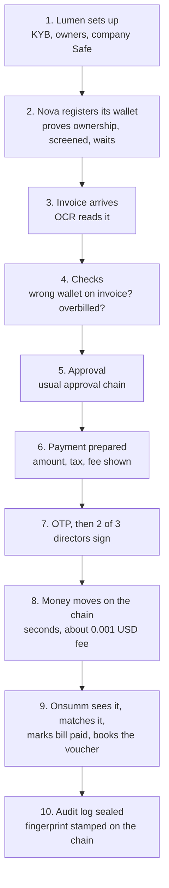
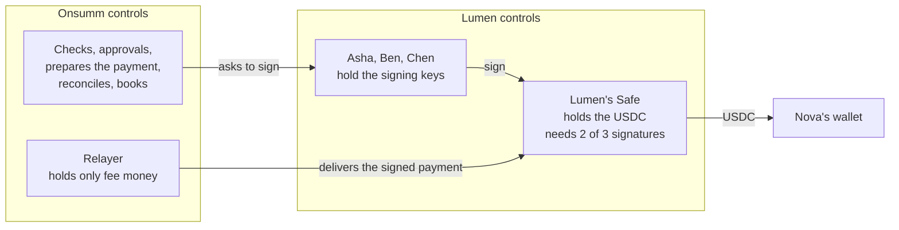

# The Crypto Rail, Explained in Bank Terms

Plain-language walkthrough · as of 29 Oct 2026

If you understand how a company pays a vendor through net banking, you already understand 90% of this. A USDC payment is a bank transfer with a different set of pipes. This page maps every crypto idea to the banking idea you already know, then walks through the whole flow once, start to finish.

Contents

1. [The one-minute version](#1-the-one-minute-version)
2. [Dictionary: crypto word to bank word](#2-dictionary-crypto-word-to-bank-word)
3. [Who is who in the demo](#3-who-is-who-in-the-demo)
4. [The full flow, step by step](#4-the-full-flow-step-by-step)
5. [Where the money actually sits](#5-where-the-money-actually-sits)
6. [What can go wrong, and what stops it](#6-what-can-go-wrong-and-what-stops-it)
7. [Tax (TDS) on a crypto payment](#7-tax-tds-on-a-crypto-payment)
8. [The audit proof, and your proof file explained](#8-the-audit-proof-and-your-proof-file-explained)
9. [Why India-registered companies are blocked](#9-why-india-registered-companies-are-blocked)
10. [What is real and what is test money](#10-what-is-real-and-what-is-test-money)

---

## 1. The one-minute version

A Singapore company, Lumen Labs, owes a US designer, Nova Design, USD 3,600. Instead of a SWIFT wire, Lumen pays in **USDC**, a digital dollar where 1 USDC is always worth 1 US dollar.

- Lumen keeps its USDC in a **company account that needs two of three directors to sign** (a "Safe").
- Nova gives Onsumm its **account number** (a "wallet address") and proves it owns it.
- Onsumm runs the usual checks (right vendor, right amount, approvals, tax), then asks two directors to sign.
- The money arrives in **seconds**, costs **under one cent**, and comes with a **reference number** (the "transaction hash") that anyone can look up.
- Onsumm sees the payment on the public ledger, marks the bill paid, and creates the accounting entry.

Onsumm never holds the money and can never move it on its own. It prepares the payment; Lumen's directors sign it.

## 2. Dictionary: crypto word to bank word

| Crypto word | What it means | Closest bank equivalent |
| --- | --- | --- |
| **USDC** | A digital US dollar issued by Circle. 1 USDC is redeemable for 1 USD, backed by cash and short-term US government bonds | A US dollar balance, held in a different kind of account |
| **Blockchain** (here, **Base**) | A shared public ledger that records every transfer, run by many computers instead of one bank | The interbank settlement system (like RTGS), but anyone can read it |
| **Wallet / address** | A string like `0x7a5c…e91b` that can receive and hold USDC | A bank account number. It needs no IFSC: the address alone is enough |
| **Private key** | The secret that authorises payments from a wallet | Your net-banking password plus OTP device, combined. Whoever has it controls the money |
| **Safe (multisig)** | A company wallet that only pays out when, say, 2 of 3 named people sign | A current account with **dual authorisation**: maker plus checker, or 2 of 3 directors |
| **Signing** | Approving a specific payment with your private key | Entering your transaction password or OTP for one payment |
| **Transaction hash** | The unique ID of a transfer, for example `0x8e41…c903` | The **UTR / RRN** of a bank transfer |
| **Block explorer** (Basescan) | A public website showing every transfer and balance | A bank statement that anyone in the world can view |
| **Confirmation** | Each new block added after your transfer makes it harder to reverse | Settlement moving from "processing" to "final" |
| **Gas / network fee** | The fee for processing a transfer, paid in the chain's own coin (ETH) | Bank transfer charges. On Base it is about USD 0.001 |
| **Relayer** | A small helper account that pays the gas and submits an already-signed payment | A courier who pays the postage to deliver a cheque already signed by your directors. The courier cannot change the cheque |
| **Testnet** (Base Sepolia) | A practice version of the chain with free play money | A bank's UAT or sandbox environment |
| **Sign-in message (SIWE)** | The vendor signs a short message to prove they control the wallet | A **penny-drop** account verification |
| **Screening** | Checking an address against sanctions and criminal-activity lists | Sanctions screening of a beneficiary (OFAC, UN lists) |
| **Merkle root** | One short fingerprint that stands for thousands of records | A seal on a box of documents: break any document and the seal no longer matches |
| **Anchor** | Writing that fingerprint onto the public chain | Getting a document notarised, with the date stamped by a public authority |

## 3. Who is who in the demo

| Person or company | Role | Bank-world equivalent |
| --- | --- | --- |
| **Lumen Labs Pte Ltd** (Singapore) | The payer. Keeps its books in USD | The remitter / corporate customer |
| **Asha, Ben, Chen** | Lumen's three signatories; any two must sign | Authorised signatories on the current account |
| **Nova Design LLC** (US) | The vendor being paid | The beneficiary |
| **Lumen's Safe** | Lumen's USDC company account | The remitter's current account |
| **Onsumm** | Reads the invoice, runs checks and approvals, prepares the payment, reconciles, posts to the books | The AP system plus the bank's payment-initiation screen, but without access to the money |
| **Base Sepolia** | The test ledger the money moves on | The bank's UAT settlement system |

## 4. The full flow, step by step

### Step 1: Lumen opens its account with Onsumm

*Bank equivalent: opening a corporate current account.*

- Lumen enters its company details: name, Singapore registration number, country, and that it keeps books in USD.
- It uploads incorporation documents. An Onsumm admin reviews and approves them (**KYB**, "know your business").
- It lists its owners with 25% or more (**UBOs**). Each owner is checked against sanctions lists.
- It connects its **Safe**, the company USDC account. Onsumm does not ask who the signatories are. It **reads them from the chain**, the way a bank reads a board resolution rather than trusting what is typed into a form. Here it reads: 3 signatories, any 2 can approve.
- It sets its **rail policy**, like transaction limits on net banking: USDC only, at most USD 10,000 per payment and USD 25,000 per day, and how long a new beneficiary must wait before first use.

### Step 2: Nova registers its wallet (adding a beneficiary)

*Bank equivalent: adding a new beneficiary, with penny-drop verification and a cooling period.*

1. Lumen's admin sends Nova an **invite link**, valid for 72 hours.
2. Nova opens the link, connects its wallet (for example MetaMask) and gives its wallet address.
3. Onsumm shows Nova a short message: *"I confirm this wallet receives payments for Nova Design LLC from Lumen Labs Pte Ltd."* Nova **signs** it with the wallet.
4. Onsumm checks the signature really came from that address. This is the **penny-drop**: it proves Nova controls the account, without moving any money.
5. The address is **screened** against sanctions lists.
6. A **cooling period** starts: 24 hours in real use, 2 minutes in the demo. Your bank does the same when you add a new payee.
7. After cooling, a Lumen admin **approves** the wallet. Only now is it `ACTIVE` and payable.

If Nova ever changes its wallet, the old one is frozen at once and all of steps 3 to 7 repeat. This is exactly how banks handle a change of beneficiary account, because **changed bank details are the most common payment fraud**, in crypto too.

### Step 3: The invoice arrives

*Bank equivalent: nothing changes; this is Onsumm's normal invoice capture.*

Nova emails invoice **NOVA-1042** for **USD 4,200**. Onsumm reads it with OCR, as it does for Indian invoices today.

### Step 4: Onsumm checks the invoice

Two new checks run, on top of the usual ones:

- **Wrong wallet on the invoice.** The PDF says "pay to wallet `0x5eE7…e3A5`", which is **not** Nova's verified wallet. Onsumm raises `WALLET_MISMATCH`. Onsumm **never pays the address printed on an invoice**, only the one verified in step 2. This is the crypto version of "the vendor's letterhead shows a new account number, please pay there", a classic fraud.
- **Overbilling.** Nova's contract says USD 3,600 a month. The invoice says USD 4,200. Onsumm raises `OVERBILLED_VS_CONTRACT` and holds the bill.

Both appear in the Review Hub, like any other finding. The AP team decides to pay the contracted USD 3,600 and query the extra USD 600 with Nova.

### Step 5: Approval

*Bank equivalent: your internal approval workflow before releasing a payment.*

The bill goes through Onsumm's existing approval chain (approver, accountant, finance controller). Nothing new here.

### Step 6: The payment is prepared

The admin chooses **pay by USDC** instead of IMPS. Onsumm shows a preview before anything is signed:

| Line | Example |
| --- | --- |
| Bill amount | USD 3,600.00 |
| Withholding tax | 0 (Singapore rule, "needs tax adviser sign-off") |
| Network fee | about 0.00002 ETH, roughly USD 0.001, paid by the relayer |
| Nova receives | **3,600 USDC** |
| To | Nova's verified wallet, on Base |
| From | Lumen's Safe, 2 of 3 signatures needed |

Before this preview appears, Onsumm runs its **policy check**, the same idea as your bank's limits and sanctions checks:

1. Is the company allowed to use crypto at all? (Not if it is India-registered; see §9.)
2. Is crypto switched on for this company?
3. Right network? Right token (USDC)?
4. Is the vendor wallet `ACTIVE`, and past its cooling period?
5. Was it screened clean in the last 24 hours? If the screening service is down, the answer is **no** (it fails closed).
6. Within the per-payment limit? Within the daily limit?
7. Does the Safe have enough USDC?
8. Is this bill already being paid, on **either** rail? (This stops paying once by IMPS and again by USDC.)

Any "no" stops the payment with a clear reason code.

### Step 7: OTP, then the directors sign

*Bank equivalent: maker enters OTP, then two checkers authorise on their own devices.*

1. The admin enters an **OTP**, the same step as today's IMPS payments. Onsumm then prepares the exact payment instruction for the Safe.
2. **Asha** opens the payment in Onsumm and clicks **Sign with wallet**. Her wallet (MetaMask) shows her the payment and she approves it. This is like a director entering her transaction password.
3. **Ben** does the same on his own device.
4. With 2 of 3 signatures collected, the payment is ready.

Each signature is checked: it must come from one of the Safe's real signatories, read live from the chain. A signature from anyone else is refused.

### Step 8: The money moves

*Bank equivalent: the payment is sent to the settlement system and gets a UTR.*

- The **relayer** takes the fully signed instruction and submits it to the chain, paying the tiny fee. It is only a courier: it cannot change the amount or the recipient, because the directors' signatures would no longer match and the Safe would refuse.
- Within seconds the transfer is in a block and gets its **transaction hash**: the UTR.
- Onsumm waits for **3 confirmations** (a few more seconds on Base) before calling it final. Bigger amounts on the real network would wait longer, like waiting for RTGS settlement before releasing goods.

The status moves through: *prepared → partly signed → ready → sent → confirming → confirmed*.

### Step 9: Onsumm reconciles and books it

*Bank equivalent: matching the bank statement to your payables, then posting the payment voucher.*

- Onsumm watches Lumen's Safe on the public ledger every 4 seconds. It sees the transfer.
- It matches it **exactly**: same transaction hash, same token (official USDC), same destination, same amount to the last cent. No fuzzy matching on narration, as happens with bank statements.
- The bill becomes **Paid**. Onsumm creates a **Tally payment voucher**: debit Nova, credit "USDC Wallet", with the transaction hash and a link to Basescan in the narration.
- If Onsumm ever sees money **leave the Safe that it did not prepare**, it raises a **critical** alert. That is like your bank statement showing a debit you never authorised.
- Each day Onsumm can produce a **wallet statement** (opening balance, ins, outs, closing) and compare it with the balance the chain itself shows.

### Step 10: The audit log is sealed

Every action above (approvals, payment, overrides, wallet changes) is written to Onsumm's audit log. Each entry is **chained** to the one before, and the day's log is sealed with one fingerprint that is stamped on the public chain. §8 explains this with your own file.

## 5. Where the money actually sits

The money never passes through Onsumm. Compare it with today:

| | IMPS today | USDC rail |
| --- | --- | --- |
| Where the money sits | Client's bank account | Client's Safe |
| Who authorises | Client's users with OTP, then the bank | Client's users with OTP, then 2 of 3 signatories with their own keys |
| Who moves it | The bank, through the payment gateway | The public chain, after the Safe checks the signatures |
| Reference | UTR / RRN | Transaction hash |
| Statement | Bank statement (private) | Basescan (public) |
| Settlement time | Seconds (IMPS) to days (SWIFT abroad) | Seconds |
| Cost abroad | Wire fee plus FX markup | About USD 0.001 network fee |
| Can Onsumm move money alone? | No | No |

## 6. What can go wrong, and what stops it

| Risk | What it looks like | What Onsumm does | Bank equivalent |
| --- | --- | --- | --- |
| Fake account on the invoice | Invoice shows a different wallet | Never pays it; raises `WALLET_MISMATCH` | "Changed bank details" email fraud |
| Fraudster changes the vendor's wallet | Request to update the wallet | Old wallet frozen, new one re-proved, old contact notified, cooling period, admin approval | Beneficiary change verification |
| Paying a sanctioned person | Wallet is on a sanctions list | Screening at registration and before every payment; blocks on a hit | OFAC screening |
| Paying twice | Double click, or IMPS plus USDC for one bill | One payment per bill in flight across both rails; retries reuse the same reference | Duplicate payment check |
| Wrong network or wrong token | Address valid on one chain, sent on another | Fixed network and fixed USDC contract; addresses checked | Wrong IFSC |
| Look-alike address | An address that looks like Nova's in history | Pays only the registered address; never copies from history | Similar-looking account number |
| Payment stuck | Only one director signs | Shown as "partly signed"; can be cancelled before it is sent | Pending checker approval |
| Network hiccup (reorg) | A just-confirmed payment briefly disappears | Waits for confirmations; re-checks; reopens the match if needed | A settled transaction reversed by the clearing house |
| Money leaves without Onsumm | A transfer Onsumm did not prepare | Critical alert | Unauthorised debit on the statement |
| Issuer freezes an address | Circle blocks a wallet, as the law requires | Screening first; failure flagged | Account frozen by the bank |

## 7. Tax (TDS) on a crypto payment

Paying in USDC does **not** change which tax applies to the service. Tax follows **who is paying whom, from which country**, exactly as with a bank payment.

- **Lumen (Singapore) paying Nova (US):** Indian TDS does not apply, because neither party is Indian. Lumen's own country's rules apply. Onsumm uses a rule set Lumen's tax adviser enters. In the demo it is 0%, clearly marked *needs adviser sign-off*.
- **If an Indian company paid a foreign vendor:** Section 195 TDS would apply, but on the **bank rail**, because crypto is blocked for Indian companies (§9). The demo shows this calculation in step 9.
- **India's 1% "crypto TDS"** (Section 194S, now s.393(1) of the Income-tax Act 2025) is a different tax. It applies when an Indian resident **buys crypto itself** from another resident, not when a service invoice is paid in USDC.

When tax is withheld, Onsumm sends it in the **same** signed payment: the vendor's net amount to Nova and the tax amount to Lumen's separate **tax wallet**. Both legs succeed together or neither does, so you never pay the vendor and forget the tax. Think of it as one instruction that credits both the vendor and the TDS account at once.

## 8. The audit proof, and your proof file explained

### The idea, in bank terms

Imagine every page of your payment register is numbered, and each page carries a stamp computed from its own contents **and** the stamp on the previous page. Change one word on page 5,039 and its stamp changes, which breaks the stamps on every page after it. That is the **hash chain**.

Once a day, Onsumm takes all the stamps and reduces them to **one** fingerprint (the **Merkle root**), then publishes that fingerprint on the public chain. That is the **anchor**: a public, dated notarisation. Nobody, including Onsumm, can later change a record without the fingerprint no longer matching what was published that day.

A **proof file** lets an auditor check one record against that published fingerprint, **without logging in to Onsumm and without seeing anyone else's records**.

### Your file: `onsumm-proof-5039.json`

The file you downloaded is a proof for one real record in the database:

| Field in the file | What it is | In bank terms |
| --- | --- | --- |
| `record.seq` = **5039** | This is entry number 5,039 in this company's audit register | Page number in the register |
| `record.table_name` = `fact_disbursements`, `action` = `UPDATE` | The record is about a payment being updated | A payment register entry |
| `record.old_values_jsonb` | The payment **before**: ₹2,832 to *One Tap Loan*, account `54320200000159`, IFSC `BARB0BUPGBX`, ICICI, status `PENDING_OTP` | The payment as it stood before authorisation |
| `record.new_values_jsonb` | The payment **after**: status `SUCCESS`, bank RRN `957396633361`, `event: otp_verified`, by user `vibhanshu` | The authorisation and the bank's confirmation |
| `canonical` | The exact text of the record that was stamped | The page as photocopied for the notary |
| `prev_hash` | The stamp on entry 5,038 | The previous page's stamp |
| `row_hash` | This entry's own stamp: made from its text **and** the previous stamp | This page's stamp |
| `salt` | A secret random value for this company, mixed in so outsiders cannot guess records from their stamps | A private seal pattern |
| `leaf`, `tenant_path`, `tenant_root` | The route from this entry's stamp up to the company's daily fingerprint. 13 steps, because the company had 10,348 entries | The chain of seals from one page to the seal on the company's box |
| `top_leaf`, `top_path`, `top_root` | The route from the company's fingerprint to the single fingerprint for **all** 5 companies that day | The seal on the whole shipment |
| `anchor` | Where that final fingerprint was published | The notary stamp |
| `share_url` | A link that opens this proof on the public `/verify` page | Sending the auditor a sealed copy |

Two things to notice in your file:

1. **The proof is about an IMPS payment, not crypto.** The audit seal covers every audit record, including today's bank payments. It is useful for Indian clients too, without any crypto payment involved.
2. **`anchor.status` is `BUILT` and `tx_hash` is empty.** The fingerprint was **calculated** but not yet **published** on the chain, because `ANCHOR_SIGNER_KEY` is not set in `.env`. Anchor `3` covers entries 1 to 10,348 across 5 companies. So `/verify` can confirm the record matches the fingerprint, but cannot yet show the public notary stamp. Once you add a test wallet key with a little test ETH and press **Anchor now**, the next anchor gets a transaction hash you can open on Basescan.

The record also says `"statusMessage": "Transaction Successful (forced — Lendix API unavailable, demo mode)"`: this IMPS payment was a forced-success demo, not a real bank transfer. The proof faithfully seals what was recorded, including that it was a demo.

### What the verify page does with it

1. Re-stamps the `canonical` text with `prev_hash` and checks it equals `row_hash`.
2. Follows `tenant_path` and `top_path` and checks it ends at `top_root`.
3. Fetches the anchor transaction from the public chain and checks it carries the same `top_root`.

If anyone had edited the payment (say, changed ₹2,832 to ₹28,320), step 1 fails and the page shows **TAMPERED**. The demo has a "tamper one field" switch that shows exactly this.

## 9. Why India-registered companies are blocked

Indian residents have **no RBI permission** to settle cross-border payments in crypto or stablecoins, and the Enforcement Directorate has acted against firms that moved money abroad in USDT and BTC. So Onsumm switches the crypto rail **off, permanently**, for any company marked India-resident. It cannot be turned on in settings.

In the demo this is shown on purpose: logging in as the Indian test company and trying to pay Nova in USDC gives `CRYPTO_DISABLED_RESIDENT_INDIA`, and Onsumm shows the Section 195 TDS that the bank payment would carry instead. Indian clients keep using IMPS as today.

## 10. What is real and what is test money

| Item | Hackathon (now) | Real use (later) |
| --- | --- | --- |
| Network | Base Sepolia **testnet** | Base mainnet |
| Money | Free test USDC from Circle's faucet: **worth nothing** | Real USDC |
| Fees | Free test ETH from a faucet | Real ETH, about USD 0.001 per payment |
| Company account | A test Safe you create | Client's real Safe, or a regulated custody partner |
| Before going live | — | Indian legal opinion, partner contract, security review |

Like a bank's UAT, the testnet behaves like the real thing in every respect, except the money is not real.

### What you need to try a real test payment

1. Install MetaMask and create 5 test wallets: Asha, Ben, Chen (signatories), Nova (vendor) and one for the relayer.
2. Get free test ETH (for fees) and test USDC (Circle's faucet) on Base Sepolia.
3. Create Lumen's Safe at app.safe.global on Base Sepolia, with Asha, Ben and Chen as owners and threshold 2. Send it some test USDC.
4. Put the Safe address and the relayer key in `.env` (`SAFE_ADDRESS`, `RELAYER_KEY`), re-run `python3.12 scripts/seed_crypto_demo.py`, and restart the backend.
5. Follow §4: invite Nova, register its wallet, run checks on NOVA-1042, pay USD 3,600, sign as Asha and Ben, and watch it land on Basescan.
