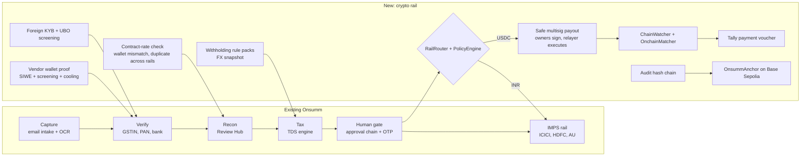

# Onsumm Crypto Rail · Hacker House Goa 2026

> **One AI finance layer for every rupee and every token.**

Onsumm already takes a vendor bill from inbox to approval to IMPS payout for Indian companies. This build adds a **USDC rail** so a company outside India can run the same flow and settle on-chain: **Capture → Verify → Recon → Tax → Human gate → Payout → Books → Audit**.

The crypto rail sits **beside** the INR flow. The IMPS path is untouched, and Onsumm **never holds a key that can move client funds**: the client's own Safe multisig signs every payout.

| | |
| --- | --- |
| Network | Base Sepolia testnet (chain ID 84532), test USDC only, no real funds |
| Demo | Saturday 31 Oct 2026, about 5 minutes |
| Decisions and names | [00_DECISIONS.md](00_DECISIONS.md) is the source of truth |
| Build plan | [07_IMPLEMENTATION_PLAN.md](07_IMPLEMENTATION_PLAN.md) |

---

## 1. Why this matters

A Singapore or Dubai company paying contractors abroad waits 1 to 5 days per SWIFT wire, pays a wire fee plus an FX markup, and then matches payments to bills by hand. Paying in USDC settles in seconds for a fraction of a cent, and the transaction hash is a payment reference that never lies.

What is missing is **control**: approvals, vendor verification, overbilling checks, tax and books. Crypto wallets have none of that. Onsumm has all of it already. This build connects the two.

## 2. The demo (Saturday)

| # | Step | What the judges see | Built on |
| --- | --- | --- | --- |
| 1 | Onboard **Lumen Labs Pte Ltd** (Singapore, books in USD) | Entity profile, KYB documents, two UBOs screened, the company's Safe connected: owners and 2-of-3 threshold read from the chain | New |
| 2 | Onboard vendor **Nova Design LLC** (US) | Vendor opens an invite link, connects a wallet, signs a SIWE message. Screening passes. A 2-minute cooling countdown runs, then an admin approves the wallet | New |
| 3 | Vendor sends invoice **NOVA-1042** for USD 4,200 | Invoice arrives by email (existing intake) or WhatsApp (stretch). OCR reads it. The wallet printed on the invoice differs from the verified one: `WALLET_MISMATCH` flag | Existing OCR + new check |
| 4 | **Overbilling caught** | The contract rate is USD 3,600. Recon raises `OVERBILLED_VS_CONTRACT` and holds the bill | New check, existing Review Hub |
| 5 | **Approve USD 3,600 and pay** | Preview: gross, withholding, network fee, net USDC, destination. OTP release. Asha and Ben each sign the Safe transaction in their browser wallets. The relayer executes. USDC moves on Base Sepolia | Existing approvals + OTP; new rail |
| 6 | **On-chain reconciliation** | The chain watcher sees the `Transfer`, matches tx hash, token, address and amount, and marks the bill *Paid and Reconciled* | New |
| 7 | **Tax and books** | Withholding from Lumen's Singapore rule pack (demo config, marked *needs adviser sign-off*). USD value plus an INR reference value stored. A Tally payment voucher is generated with the tx hash and explorer link | New |
| 8 | **Audit proof** | The day's audit log is Merkle-rooted and anchored to `OnsummAnchor`. The auditor drops the proof bundle on `/verify`; the browser recomputes it and checks the root on-chain. Edit one field and it shows *tampered* | New |
| 9 | **Guardrail moment** | Switch to *Onsumm Demo India Pvt Ltd* (India-resident) and try to pay a foreign vendor in USDC. Blocked: `CRYPTO_DISABLED_RESIDENT_INDIA`. The engine shows the Section 195 withholding an Indian payer would apply on the bank rail instead | New policy, India tax packs |

Step 9 is deliberate: it shows the product knows where crypto is allowed and where it is not.

### Fallbacks, so the demo never dies

| If this fails | We do this |
| --- | --- |
| Base Sepolia RPC slow or down | Second RPC URL configured; watcher fails over automatically |
| Faucet empty on the day | Wallets funded with test ETH and test USDC on Thursday |
| Live signing goes wrong | A second bill is pre-signed to 1-of-2 and needs only one click |
| WhatsApp sandbox down | Same invoice sent by email, which uses the existing intake |
| Anything else | Full recorded run from Friday night |

## 3. Architecture: what exists and what is new



Detailed diagrams: [03_HLD.md](03_HLD.md) (system, components, sequence, deployment, trust boundaries) and [04_LLD.md](04_LLD.md) (classes, tables, states, algorithms).

### Rules we never break

1. **Pay only verified wallets.** The payout address is read from `supplier_wallets` with status `ACTIVE`. An address printed on an invoice is never used; it is only compared.
2. **No keys that move money.** Approvers sign with their own wallets. The relayer key only pays gas and cannot move USDC. The anchor key only writes hashes.
3. **One bill, one payment.** A bill being paid on one rail cannot be paid on another (`DUPLICATE_ACROSS_RAILS`). Retries reuse the same idempotency key.
4. **Policy before signatures.** `PolicyEngine` checks residency, chain, token, wallet status, cooling, fresh screening, limits, balance and in-flight payouts before anything is signed.
5. **Honest about the code.** Everything marked *new* is built this weekend. We do not claim features that do not exist (see the table in [00_DECISIONS.md](00_DECISIONS.md), D7).

## 4. What we build, module by module

### 4.1 Foreign client onboarding (new)

| Step | Built this weekend | Later |
| --- | --- | --- |
| Entity profile | Legal name, country, registration number, tax residency, functional currency. Sets `dim_tenants.is_resident_india`, `jurisdiction_profile`, `base_currency` | — |
| KYB | Document upload and a manual review screen (`kyb_status`) | KYB provider API |
| UBO screening | `tenant_ubos`, checked against a local sanctions list | ComplyAdvantage, TRM or Chainalysis |
| Treasury Safe | Connect an existing Safe; owners and threshold are **read from the chain**, not typed in. Each owner is mapped to an Onsumm approver | Create Safe from the UI |
| Rail policy | `tenant_rail_policy`: chains, tokens (USDC only), per-transaction and daily limits, cooling minutes, test-transfer flag | — |

### 4.2 Vendor wallet onboarding (extends the vendor master)

- **Proof of ownership:** the vendor signs a SIWE (EIP-4361) message; the server recovers the signer and checks it equals the address. It is a penny-drop test for wallets.
- **Screening** at registration and again before every payout. A hit freezes the wallet and raises `SCREENING_HIT`.
- **Cooling period** before first use (24 hours in production, 2 minutes in the demo), then admin approval.
- **Wallet change = full re-verification:** the old wallet is frozen, the vendor re-proves, the previous contact is notified, cooling restarts, an admin approves. This blocks the most common crypto AP fraud.
- **Tax documents:** W-8BEN-E for US vendors. TRC, Form 10F and a no-PE declaration matter only when the payer is Indian.
- **Travel Rule fields:** originator and beneficiary name, address and wallet are stored for every transfer.

### 4.3 Capture and recon (extends existing agents)

- OCR reads currency (USD, USDC, INR), chain and any wallet address on the invoice. A differing address raises `WALLET_MISMATCH` and the bill is held.
- **`ContractRateCheck`** compares invoice lines with `vendor_contract_rates` and raises `OVERBILLED_VS_CONTRACT`.
- **Duplicate across rails:** the in-flight check is rail-agnostic, so the same invoice cannot be paid in INR and again in USDC.

### 4.4 Payout (new rail)

- `RailRouter` sends INR to the existing IMPS flow and USDC to `UsdcRail`, after `PolicyEngine` passes.
- `SafeCustody` builds a Safe transaction and returns EIP-712 typed data. With no withholding it is one USDC `transfer`; with withholding it is one `MultiSend` of two transfers (net to the vendor, tax to the client's `TAX` wallet), so both legs settle or neither does. Each approver signs in the Onsumm UI with their wallet. When the threshold is met, `GasRelayer` submits `execTransaction`.
- Status follows the model in [00_DECISIONS.md](00_DECISIONS.md) §2.2: `PROPOSED` → `PARTIALLY_SIGNED` → `READY` → `SUBMITTED` → `CONFIRMING` → `CONFIRMED`.
- The bill is locked while a payout is in flight. Idempotency key: `{disbursement_id}:{attempt}`.

### 4.5 On-chain reconciliation (new)

- `ChainWatcher` polls USDC `Transfer` logs for all watched wallets every 4 seconds from a saved cursor, and handles reorgs by re-checking block hashes.
- `OnchainMatcher` confirms a payout only when tx hash, token contract, destination and amount (in 6-decimal units) all match. Anything else raises a finding.
- **Any outgoing transfer Onsumm did not propose** raises `UNMATCHED_OUTBOUND_TRANSFER`: money left the treasury outside the approval flow.
- Inbound USDC from customers is matched to receivables (stretch goal).

### 4.6 Tax (extends the TDS engine)

| Case | Treatment | Status this weekend |
| --- | --- | --- |
| Lumen (Singapore) pays Nova (US) for services | Client-jurisdiction rule pack `SG-DEMO`, configured by the client's adviser; demo value 0%, flagged `WITHHOLDING_SIGNOFF_REQUIRED` | Built |
| Value for books | USD at block time, plus an INR reference value for an Indian parent's consolidation (`fx_snapshots`) | Built |
| Indian payer pays a foreign vendor | Section 195 at the treaty rate if TRC and Form 10F are on file; **bank rail only**, crypto blocked | Built (shown in step 9) |
| Indian resident buys USDC from a resident | 1% VDA TDS (Section 194S, now s.393(1) of the Income-tax Act 2025), 20% without PAN | Rule pack built, not demoed |

The engine **suggests**; the client's tax adviser or CA signs off, as today.

### 4.7 Books (new outbound posting)

- `TallyPaymentVoucherBuilder` creates a payment voucher: debit the vendor, credit the `USDC Wallet` ledger, credit withholding payable, post network fee to `Crypto Network Fees` and any FX difference to `FX Gain/Loss`. The narration carries the tx hash and explorer link.
- Every posting is recorded in `ledger_postings` with retry. Xero, QuickBooks and Zoho through Apideck come after the hackathon.

### 4.8 Audit anchor (new)

- **Build the hash chain first:** `wf_audit_log` gets `seq`, `prev_hash` and `row_hash`; `row_hash = SHA-256(prev_hash ‖ canonical row)`.
- `MerkleBuilder` builds a tree per tenant from salted leaves, then one top root; `AnchorService` calls `OnsummAnchor.anchor(root, fromSeq, toSeq)`.
- `/verify` takes a **proof bundle** (file or share link), recomputes everything in the browser and reads the root from the contract. Bill IDs are never typed in, so they cannot be enumerated.

## 5. Data model

New tables: `tenant_ubos`, `tenant_rail_policy`, `treasury_wallets`, `supplier_wallets`, `wallet_screenings`, `vendor_contract_rates`, `crypto_disbursement_details`, `crypto_payout_signatures`, `fx_snapshots`, `chain_transfers`, `chain_watch_cursors`, `crypto_withholdings`, `withholding_remittances`, `tenant_audit_salts`, `audit_anchors`, `audit_anchor_tenant_roots`, `ledger_postings`.

Changed tables: `dim_tenants`, `dim_suppliers`, `fact_disbursements` (adds `rail`), `wf_audit_log` (adds the hash chain).

Columns: [00_DECISIONS.md](00_DECISIONS.md) §2.1. DDL and ER diagram: [04_LLD.md](04_LLD.md).

## 6. API surface

| Method | Endpoint | Purpose |
| --- | --- | --- |
| `POST` | `/api/onboarding/kyb` | Entity profile and KYB documents |
| `POST` | `/api/onboarding/ubos` | UBOs, screened on save |
| `POST` | `/api/treasury/wallets` | Connect a Safe |
| `GET/PUT` | `/api/tenant/rail-policy` | Chains, tokens, limits |
| `POST` | `/api/vendors/{id}/wallet-invites` | Send the vendor a portal link |
| `GET` | `/api/vendor-portal/{token}/wallet/challenge` | SIWE message |
| `POST` | `/api/vendor-portal/{token}/wallet/verify` | Signature, screening, cooling |
| `POST` | `/api/vendors/{id}/wallets/{wid}/approve` | Admin approval |
| `POST` | `/api/bills/{id}/disbursements` | Existing; now takes `rail: "USDC"` |
| `POST` | `/api/disbursements/{id}/verify-otp` | Existing; creates the Safe proposal |
| `GET` | `/api/disbursements/{id}/safe-tx` | Typed data to sign |
| `POST` | `/api/disbursements/{id}/signatures` | Add an owner signature |
| `GET` | `/api/onchain/transfers` | On-chain ledger with match status |
| `GET` | `/api/withholding/preview` | Withholding for a bill and rail |
| `POST` | `/api/audit/anchor` | Anchor now |
| `GET` | `/api/audit/proof/{log_id}` | Proof bundle |
| `GET` | `/verify` | Public verification page |

Request and response examples: [04_LLD.md](04_LLD.md).

## 7. Repo layout (inside the existing codebase)

```
backend_ocr/app/
  domain/crypto/        router.py  policy.py  payouts.py  wallets.py  siwe.py  fx.py
                        watcher.py  recon.py  ledger.py  withholding/
  domain/audit/         hasher.py  anchor.py
  integrations/payments/rails.py          # Rail, ImpsRail, UsdcRail
  integrations/custody/ base.py  safe.py  relayer.py  partner.py
  integrations/chains/  evm.py
  integrations/screening/ static_list.py
  routers/              crypto_onboarding.py  crypto_wallets.py  crypto_payouts.py
                        onchain.py  audit_proof.py  vendor_portal_wallet.py
contracts/              src/OnsummAnchor.sol  script/Deploy.s.sol  test/OnsummAnchor.t.sol
frontend/src/
  web3/wagmi.ts
  pages/crypto/         ForeignKyb.tsx  TreasurySafe.tsx  RailPolicy.tsx  OnchainLedger.tsx
  pages/vendor-portal/  ConnectWallet.tsx
  pages/payment/        CryptoPayoutCard.tsx  SafeSignStep.tsx   # beside the existing steps
  pages/VerifyProof.tsx                                          # public /verify
scripts/seed_crypto_demo.py
```

Libraries: backend `web3`, `eth-account`, `siwe`; frontend `wagmi`, `viem`; contracts Foundry.

## 8. Run it

```bash
# 1. Contracts (Base Sepolia)
cd contracts && forge build && forge test
forge script script/Deploy.s.sol --rpc-url $RPC_URL --private-key $ANCHOR_SIGNER_KEY --broadcast

# 2. Backend (from repo root; uses DB_URL in .env -> onsumm-new-db)
python3.12 -m pip install -r backend_ocr/requirements.txt web3 eth-account siwe
python3.12 scripts/run_api_migrations.py
python3.12 scripts/seed_crypto_demo.py          # Lumen, Nova, Safe, contract rate, India tenant
cd backend_ocr && python3.12 -m uvicorn app.main:app --reload --port 8001

# 3. Frontend
cd frontend && npm install wagmi viem @tanstack/react-query && npm run dev
```

### Environment

```bash
CHAIN_ID=84532
RPC_URL=https://sepolia.base.org
RPC_URL_FALLBACK=...                      # second provider
USDC_ADDRESS=0x036CbD53842c5426634e7929541eC2318f3dCF7e   # Circle test USDC; verify before use
SAFE_ADDRESS=0x...                        # Lumen's treasury Safe, 2-of-3
RELAYER_KEY=...                           # gas only; cannot move USDC
ANCHOR_CONTRACT=0x...
ANCHOR_SIGNER_KEY=...                     # gas only; writes roots
CONFIRMATIONS=3
WATCH_POLL_SECONDS=4
SCREENING_LIST_PATH=backend_ocr/app/integrations/screening/sanctioned_addresses.json
FX_SOURCE=fixed                           # demo: fixed, logged rate
```

## 9. Why this should win

| Criterion | Our answer |
| --- | --- |
| Real problem | Cross-border AP is slow, costly and reconciled by hand |
| Working product | Built on a running AP platform with real OCR, approvals and Review Hub, not a mock |
| Technical depth | Safe multisig signing, SIWE proofs, reorg-safe chain watcher, three-way on-chain match, hash-chained audit log anchored with Merkle proofs |
| Safety | No custody, policy before signatures, verified-only wallets, cooling periods, screening, unmatched-transfer alarms |
| Compliance awareness | Crypto blocked for Indian residents (FEMA); correct tax per jurisdiction; Travel Rule data captured |
| Business | Subscription plus per-payout fee; pilot plan with 3 tenants ([01_BUSINESS.md](01_BUSINESS.md)) |

## 10. Compliance notes

These are design guardrails, not legal advice. Counsel and a CA confirm them before mainnet.

- **Testnet only.** No real funds and no custody. The client's Safe holds the funds and its owners sign.
- **India-resident tenants:** the crypto rail is off and cannot be turned on; the INR bank rail is the only rail.
- **Foreign tenants** use the crypto rail. Onsumm orchestrates and records; it does not exchange, hold or transfer crypto for anyone.
- **FIU-IND / PMLA:** before production, a legal opinion confirms that orchestrating a client's own Safe does not make Onsumm a VDA service provider. Any future fiat on/off-ramp goes through a licensed partner.
- **Tax:** the engine flags and computes; the client's adviser signs off.
- **Travel Rule:** originator and beneficiary data captured for every transfer from day one.

## 11. Out of scope this weekend

Mainnet, fiat on/off-ramp, USDT, non-EVM chains, automated KYB, live screening APIs, Xero/QuickBooks/Zoho write-back, multi-entity consolidation, an AI co-pilot.

## 12. Documents

[00 Decisions](00_DECISIONS.md) · [01 Business](01_BUSINESS.md) · [02 Technical](02_TECHNICAL.md) · [03 HLD](03_HLD.md) · [04 LLD](04_LLD.md) · [05 User flows](05_USER_FLOWS.md) · [06 Edge cases](06_EDGE_CASES.md) · [07 Implementation plan](07_IMPLEMENTATION_PLAN.md) · [09 Explained simply](09_EXPLAINED_SIMPLY.md)
