# Onsumm Platform — High-Level Design (HLD)

| | |
|---|---|
| **Document** | 01 — High-Level Design |
| **Platform** | Onsumm.ai — AP automation with INR (IMPS) and international USDC rails |
| **As of** | 2026-10-31 (commit `6e1278f`, branch `main`) |
| **Companion docs** | [02 LLD](02_LLD.md) · [03 User Flows](03_USER_FLOWS.md) · [04 Data Model](04_DATA_MODEL.md) · [05 API Reference](05_API_REFERENCE.md) · [06 Deployment & Ops](06_DEPLOYMENT_OPERATIONS.md) · [07 Security](07_SECURITY.md) · [08 Integrations](08_INTEGRATIONS.md) · [09 Glossary & Status](09_GLOSSARY_AND_STATUS.md) |

---

## Table of contents

1. [Purpose and scope](#1-purpose-and-scope)
2. [Actors and personas](#2-actors-and-personas)
3. [System context](#3-system-context)
4. [Architecture overview (containers)](#4-architecture-overview-containers)
5. [Logical architecture — the bill lifecycle](#5-logical-architecture--the-bill-lifecycle)
6. [Functional modules](#6-functional-modules)
7. [Payment rails](#7-payment-rails)
8. [Event-driven automation core](#8-event-driven-automation-core)
9. [Background workers inside the API process](#9-background-workers-inside-the-api-process)
10. [Data architecture](#10-data-architecture)
11. [Integration architecture](#11-integration-architecture)
12. [Security architecture](#12-security-architecture)
13. [Multi-tenancy, licensing and jurisdiction](#13-multi-tenancy-licensing-and-jurisdiction)
14. [Deployment architecture](#14-deployment-architecture)
15. [Non-functional requirements](#15-non-functional-requirements)
16. [Key design decisions](#16-key-design-decisions)
17. [Risks, constraints and known gaps](#17-risks-constraints-and-known-gaps)

---

## 1. Purpose and scope

Onsumm.ai is a multi-tenant **accounts-payable (AP) automation platform**. It turns vendor bills into verified, approved and paid payables with as little manual work as possible, and keeps a tamper-evident audit trail of every step.

Every bill follows one pipeline:

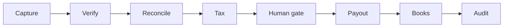

Two payment rails sit behind the human gate:

| Rail | For whom | How money moves |
|---|---|---|
| **IMPS (INR)** | India-resident tenants paying Indian vendors | Lendix gateway → ICICI Bank (primary) / AU Bank (secondary), RSA-encrypted REST |
| **USDC (international)** | Non-India tenants paying foreign vendors | Client-owned **Safe multisig** on **Base** (Base Sepolia testnet today); Onsumm never holds keys |

### 1.1 Problems the platform solves

| Problem | Platform answer |
|---|---|
| Bills arrive as PDFs, scans, email attachments and chat messages | OCR capture (GPT-4o vision, Sarvam AI fallback), bulk upload, mailbox agent |
| Fake or wrong vendor details lead to fraud | KYB: GSTIN, PAN, penny-less bank checks (Sandbox.co.in); SIWE wallet proof + sanctions screening for crypto |
| Duplicate or over-billed invoices | Deduplication worker, contract-rate variance checks, Nova 3-way usage reconciliation |
| Indian tax rules | TDS engine (section + rate), GST breakdown, April–March fiscal periods |
| Cross-border tax | Withholding rule packs: s.195 / DTAA, VDA (s.194S), configurable foreign packs |
| Approvals scattered across email and chat | Configurable approval chain, email-link approvals, nudges and escalations |
| Payment mistakes and weak audit | OTP-gated payouts, verified-only beneficiaries, logged overrides, hash-chained audit log anchored on-chain |
| Books out of sync | Tally Prime (pull or desktop-agent push), ERP intake (Zoho, QBO, Xero, Sage, Wave via Apideck) |
| Too many issues to watch | Review Hub: 17 detection adapters + LLM review agent produce ranked, routed findings |

### 1.2 In scope / out of scope

| In scope | Out of scope (today) |
|---|---|
| Bill capture, vendor master, KYB | Fiat on/off-ramp |
| Review Hub findings and actions | Mainnet crypto payouts |
| Approval workflow (in-app + email) | Non-EVM chains |
| TDS, GST breakdown, FX | Automated foreign KYB provider |
| INR (IMPS) and USDC payouts | Live sanctions APIs (static list today) |
| Tally / ERP sync, Nova reconciliation | Multi-entity consolidation |
| Agent Hub, Fact Graph, mailbox agent | |
| Licensing, platform admin, impersonation | |
| On-chain audit anchoring + public proofs | |

---

## 2. Actors and personas

| Actor | Role key(s) | Main goals | Capabilities |
|---|---|---|---|
| **Tenant admin** | `admin` | Configure org, users, chain, integrations; release payments | view, edit, approve, verify, pay, admin |
| **Finance controller** | `finance_controller` | Final approval, release payments | view, edit, approve, verify, pay |
| **Accountant / AP clerk** | `accountant` | Upload bills, fix OCR, code bills, manage vendors | view, edit, verify |
| **Approver** | `approver` | Approve or reject bills (app or email link) | view, approve |
| **Member** | `member` | Read-only participation | view |
| **Auditor** | `auditor` | Inspect records and the audit chain | view |
| **Platform admin** | `readonly` < `support` < `admin` < `owner` (platform roles) | Manage tenants, licences, packages; impersonate (read-only) | platform scope only |
| **Vendor** | — (portal link token) | Send invoices; prove wallet ownership; upload tax docs | vendor portal only |
| **Safe owner** | — (wallet signer) | Co-sign USDC payouts | EIP-712 signature |
| **Public verifier** | — | Verify an audit proof from a share link | public read |

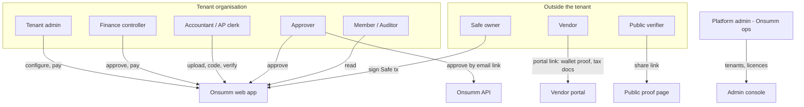

---

## 3. System context

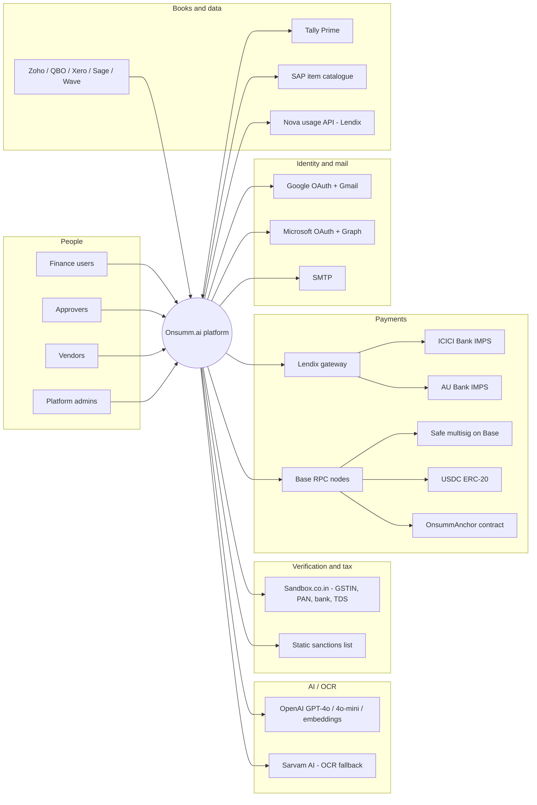

| External system | Direction | Used for | Called by |
|---|---|---|---|
| OpenAI | out | OCR (GPT-4o vision), classification, enrichment, review agent, embeddings | Pipeline, API, review workers |
| Sarvam AI | out | OCR fallback when GPT-4o confidence < 0.6 | Pipeline (`UploadOcrWorker`) |
| Sandbox.co.in | out | GSTIN, PAN, bank account verification; TDS calculator | Pipeline + API |
| Lendix → ICICI / AU | out | IMPS vendor payouts and status | API (`routers/disbursement.py`) + sweeper |
| Base RPC / Safe / USDC | out + read | Safe tx build, relay, transfer logs, balances | API crypto services + crypto scheduler |
| OnsummAnchor contract | out | Anchor daily Merkle root of the audit log | Crypto scheduler (anchor loop) |
| Google / Microsoft | out | SSO login, mailbox read/send | API |
| SMTP | out | OTPs, approval links, receipts, notices | API + pipeline |
| Tally Prime | both | Ledgers/vouchers in; payment vouchers out | Desktop agent (push) or pipeline (pull, disabled) |
| Apideck ERPs | in | Bills/invoices payloads | Pipeline (`ApiSyncWorker`) |
| Nova (Lendix) | out | Monthly usage per vendor for 3-way recon | Nova reconciliation service |

---

## 4. Architecture overview (containers)

Three independently deployed processes and one standalone microservice share **one PostgreSQL database** and coordinate through it. Postgres `LISTEN/NOTIFY` is the event bus.

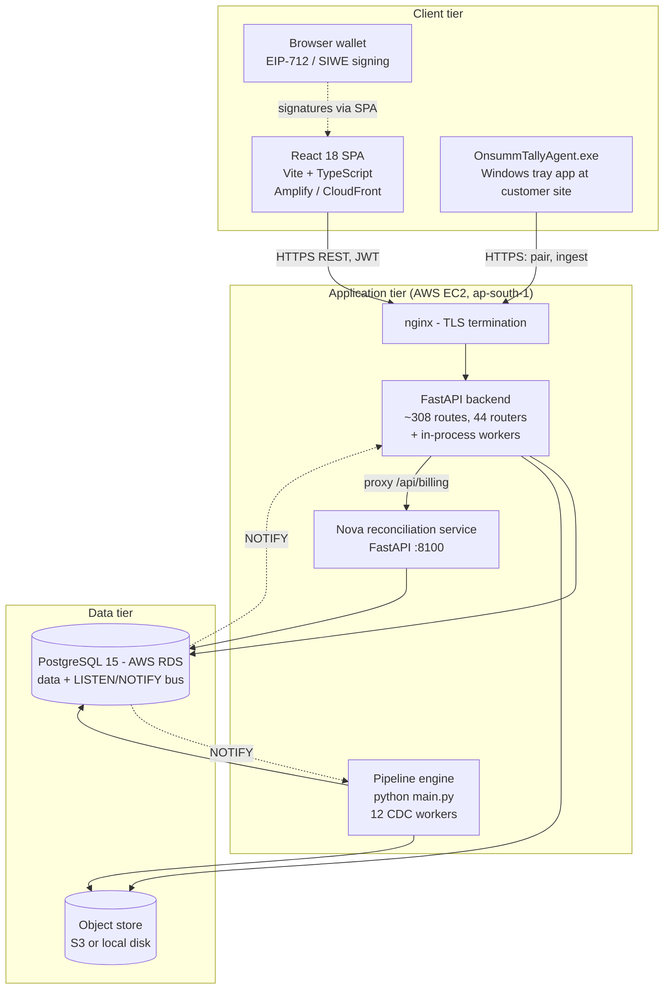

| Container | Technology | Responsibility | Scaling note |
|---|---|---|---|
| **Frontend SPA** | React 18, Vite 6, TypeScript 5.6, react-router v7, axios, react-pdf, react-dropzone, xlsx, native EIP-1193 wallet helpers (`web3/eip1193.ts`) | All user UI, marketing pages (prerendered), vendor portal, public proof page | Static; CDN |
| **Backend API** | Python 3.11, FastAPI 0.115, Uvicorn, Pydantic 2, psycopg2 pool | REST API, auth, licensing, payments, crypto, review hub, in-process schedulers | Single replica today (per-process caches, advisory locks) |
| **Pipeline engine** | Python asyncio, asyncpg (pool 2–10) | CDC workers: OCR, promotion, dedup, KYB, TDS, FX, approvals | Single instance enforced by advisory lock `875_291_004_417` |
| **Nova recon service** | FastAPI :8100 | 3-way vendor-usage reconciliation, orchestrator loop | Independent deploy |
| **Database** | PostgreSQL 15 on RDS | System of record + event bus | Vertical |
| **Object store** | S3 or local disk (`core/object_store.py`) | Uploaded bills, attachments, vendor docs, logos | — |
| **Tally agent** | PyInstaller exe, Tkinter, pystray | Pull Tally XML on the customer LAN; push to cloud | One per customer site |
| **Smart contract** | Solidity ^0.8.24 (Foundry) | `OnsummAnchor.anchor(root, fromSeq, toSeq)` | On-chain |

---

## 5. Logical architecture — the bill lifecycle

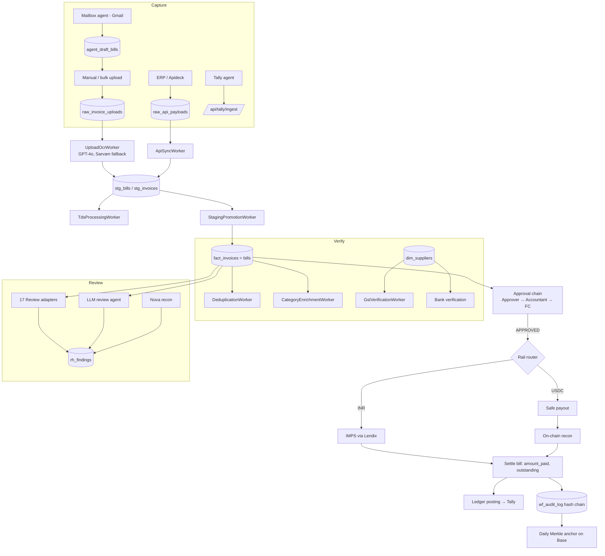

---

## 6. Functional modules

| # | Module | Purpose | Main code | Licence key |
|---|---|---|---|---|
| 1 | **Auth & identity** | Password login, Google/Microsoft SSO, refresh tokens, OTP reset | `routers/auth.py`, `routers/sso.py`, `core/tokens.py` | core |
| 2 | **Bills & invoices** | List, detail, edit, attachments, PDF export, soft status | `routers/bills.py`, `bill_attachments.py`, `bill_export.py` | `bills` |
| 3 | **Upload & OCR** | Single/bulk upload, OCR, enrichment, ingest | `routers/invoices.py`, `domain/ingest.py`, `pipelines/upload_ocr.py` | `upload_ocr` |
| 4 | **Vendor master** | Vendors, GSTINs, bank accounts, contacts, documents, logos, merge, activity | `routers/vendors.py` + 9 vendor routers | `vendors` |
| 5 | **KYB / verification** | GSTIN, PAN, bank checks | `integrations/sandbox_kyb.py`, `pipelines/gst_verification.py` | `kyc_verification`, `gst_tax_verification` |
| 6 | **Approval workflow** | Configurable chain, in-app and email actions, bulk, nudges | `routers/bill_approvals.py`, `core/approval_chain.py`, `pipelines/approval.py` | `approvals` |
| 7 | **TDS engine** | Sections, categories, mapping rules, overrides, FY state, preview | `routers/tds.py`, `utils/tds_engine.py`, `pipelines/tds_processing.py` | `tds` |
| 8 | **FX** | Rates, exposure, alerts, FX payments, AI briefings | `routers/fx.py`, `pipelines/fx_rate.py`, `fx_agent.py` | `fx` |
| 9 | **Ledger & COA** | Categories, charges, COA rules, ledger suggestion, SAP item mapping | `routers/ledgers.py`, `categories.py`, `item_mapping.py` | `ledger`, `sap_matching` |
| 10 | **INR disbursement** | Payment profile, OTP, bulk, override, refresh status, receipts, sweeper | `routers/disbursement.py`, `integrations/imps_client.py`, `domain/payments/*` | `disbursement` |
| 11 | **Crypto onboarding** | Tenant KYB, UBOs, treasury wallets, rail policy | `routers/crypto_onboarding.py` | `crypto_payouts` |
| 12 | **Vendor wallets & portal** | Invite, SIWE proof, screening, cooling, approve/freeze, tax docs | `routers/crypto_wallets.py`, `vendor_portal.py`, `domain/crypto/wallets.py` | `crypto_payouts` |
| 13 | **USDC payouts** | Prepare, OTP release, Safe propose/sign/relay, withholding | `routers/crypto_payouts.py`, `domain/crypto/payouts.py` | `crypto_payouts`, `crypto_tds` |
| 14 | **On-chain recon** | Chain watcher, matcher, statements, ledger postings | `routers/onchain.py`, `domain/crypto/watcher.py`, `recon.py`, `ledger.py` | `crypto_payouts` |
| 15 | **Audit & anchoring** | Hash-chained audit log, Merkle anchor, proofs, public share | `routers/audit_proof.py`, `domain/audit/*`, `contracts/` | `audit_anchor` |
| 16 | **Review Hub** | Findings, ranking, routing, actions, LLM review agent, comm extraction | `routers/review_hub.py`, `review/*` | `review_hub` |
| 17 | **Agent Hub & Fact Graph** | Fact graph, search, neighbors, SSE stream, payment context | `routers/agent_hub.py`, `domain/fact_graph.py` | `agent_hub`, `fact_graph` |
| 18 | **Vendor Bill Agent** | Mailbox watcher, bill classification, drafts | `routers/agent.py` | `agent_hub` |
| 19 | **Email connection** | Gmail/Microsoft OAuth, vendor inbox, threads, send, summarise | `routers/email_connection.py`, `integrations/email_oauth.py`, `email_graph.py` | `email_sending` |
| 20 | **Nova billing** | Per-tenant Nova keys, reconciliation proxy | `routers/nova_credentials.py`, `billing.py`, `services/nova_reconciliation` | `nova_billing` |
| 21 | **Tally connector** | Pairing, ingest, agent download/version | `routers/tally_agent.py`, `tally_agent/`, `tally2database/` | `tally_connector` |
| 22 | **Org & settings** | Brands, cost centres, departments, priority labels, features, jurisdiction | `routers/org.py`, `settings.py`, `jurisdiction.py` | `settings`, `brands` |
| 23 | **Users** | Team members and roles | `routers/users.py` | `users` |
| 24 | **Reports** | Activity, expense XLSX/CSV | `routers/reports.py` | `reports` |
| 25 | **Platform admin** | Tenants, services, packages, onboarding, impersonation, platform users, audit | `routers/admin.py` | exempt (platform JWT) |

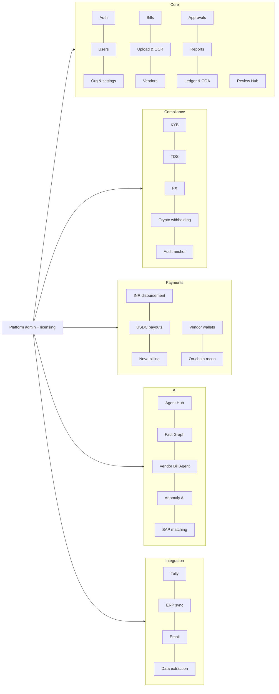

---

## 7. Payment rails

### 7.1 Rail selection

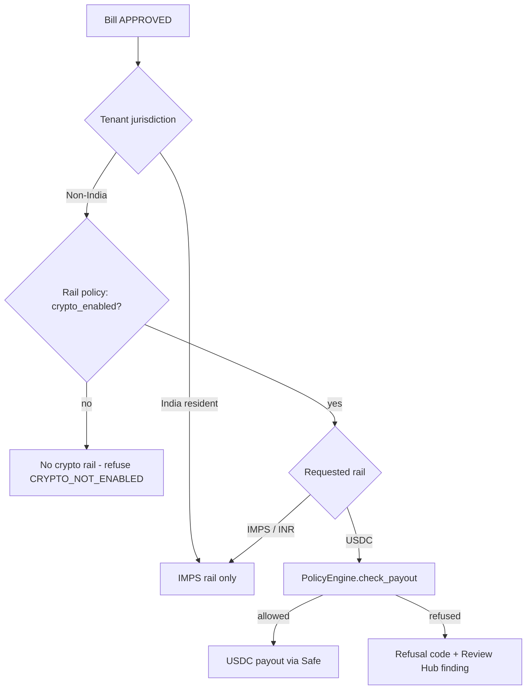

An India-resident tenant never gets the USDC rail. This is enforced in three places: `UsdcRail.available_for`, `PolicyEngine.check_tenant` and `RailRouter.select`.

### 7.2 INR (IMPS) rail — high level

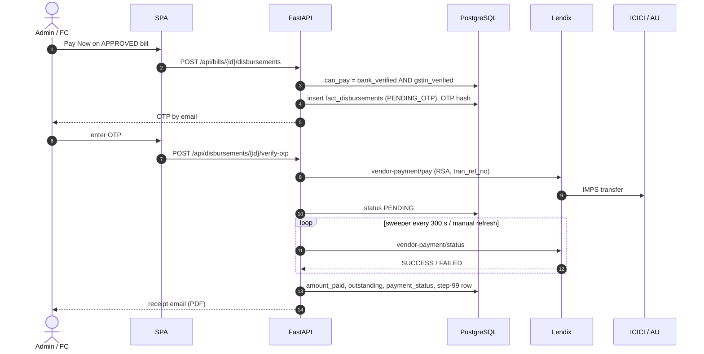

### 7.3 USDC rail — high level

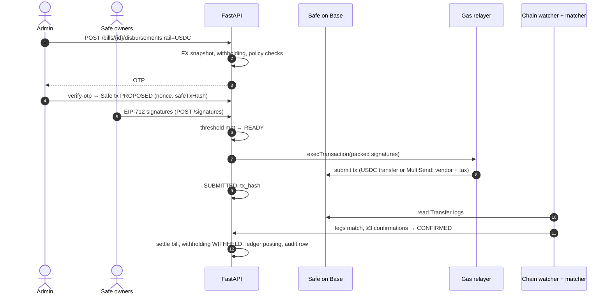

---

## 8. Event-driven automation core

The pipeline engine (`main.py` at the repo root) runs workers as asyncio tasks. Each worker inherits `pipelines/base.py:BaseWorker` and has two phases:

1. **Backfill** — drain everything outstanding at startup (skipped where `skip_backfill = True`).
2. **Incremental** — wake on a Postgres `NOTIFY` channel (with a safety poll) or poll with exponential idle backoff.

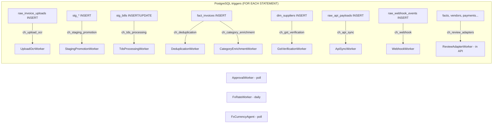

| Worker | Trigger | Status |
|---|---|---|
| ApiSyncWorker | `ch_api_sync` | running |
| WebhookWorker | `ch_webhook` | running |
| UploadOcrWorker | `ch_upload_ocr` | running |
| StagingPromotionWorker | `ch_staging_promotion` | running |
| ApprovalWorker | poll | running |
| DeduplicationWorker | `ch_deduplication` | running |
| GstVerificationWorker | `ch_gst_verification` | running |
| CategoryEnrichmentWorker | `ch_category_enrichment` | running |
| TdsProcessingWorker | `ch_tds_processing` | running |
| FxRateWorker | daily | running |
| FxCurrencyAgent | poll | running |
| BankVerificationWorker | `ch_bank_verification` | **disabled** (NOT NULL write bug) |
| TallyReadWorker / TallySyncWorker | poll | **disabled** (Tally not running server-side) |

---

## 9. Background workers inside the API process

The FastAPI process starts four schedulers at boot. Each takes a Postgres advisory lock so only one API replica runs it.

| Scheduler | Lock key | Loops |
|---|---|---|
| Mailbox agent poller | — | Gmail poll every `AGENT_POLL_INTERVAL` (600 s) |
| Review workers | `875_291_004_418` | `ReviewAdapterWorker`, `ReviewAgentWorker`, `CommExtractionWorker` |
| Disbursement sweeper | `875_291_004_419` | IMPS status sweep every 300 s |
| Crypto workers | `875_291_004_420` | chain (4 s), relay (30 s), ledger (30 s), anchor (daily 00:05 UTC) |
| Anchor builder | `875_291_004_421` | transaction lock during `anchor_now` |

---

## 10. Data architecture

Table prefixes encode the stage of the data:

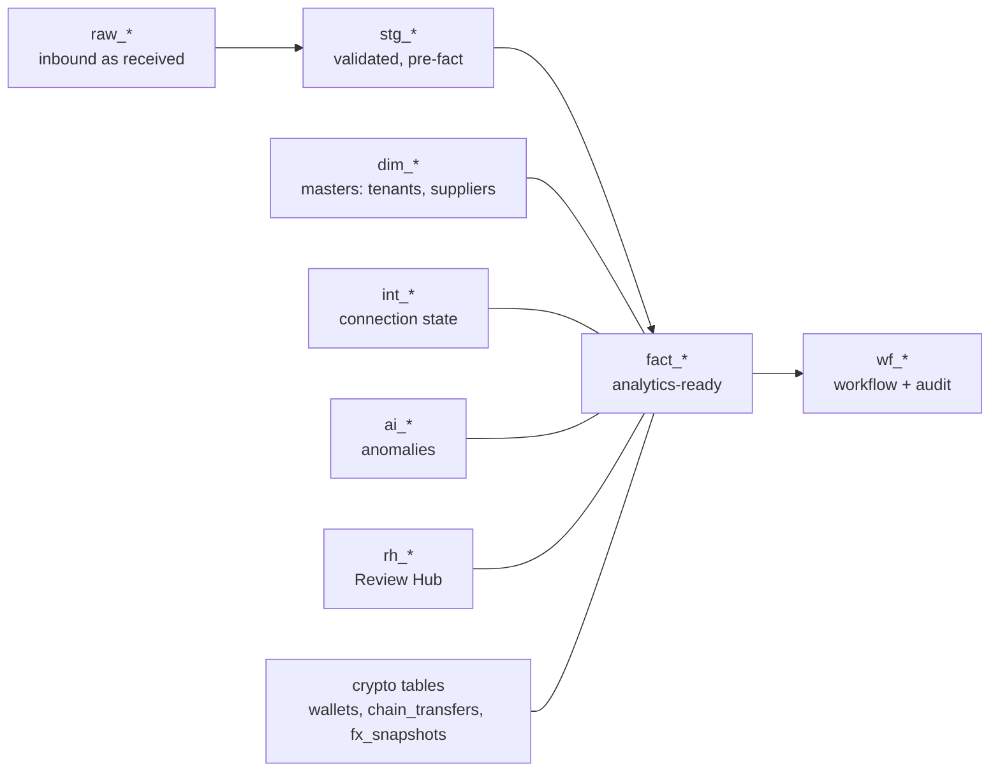

| Prefix / group | Examples | Role |
|---|---|---|
| `raw_` | `raw_invoice_uploads`, `raw_api_payloads`, `raw_webhook_events`, `raw_ingestion_errors` | As received |
| `stg_` | `stg_bills`, `stg_invoices`, `stg_payments`, `stg_bill_line_items` | Validated, before promotion |
| `fact_` | `fact_invoices` (bills), `fact_disbursements` | System of record for AP |
| `dim_` | `dim_tenants`, `dim_suppliers`, `dim_end_customers` | Master data |
| `wf_` | `wf_audit_log`, `wf_tasks` | Workflow and hash-chained audit |
| `rh_` | `rh_findings`, `rh_audit_log` + satellites | Review Hub |
| `int_` | `int_nova_credentials` | External connection state (encrypted) |
| Crypto | `supplier_wallets`, `treasury_wallets`, `crypto_disbursement_details`, `chain_transfers`, `fx_snapshots`, `ledger_postings`, `audit_anchors` | International rail |
| Licensing | `service_catalog`, `tenant_service`, `service_package` | Entitlements |

Every tenant-owned row carries `tenant_id`. Fiscal period (April–March for India, configurable via jurisdiction) is computed once by `utils/fiscal.py` and stored on each fact row. See [04 Data Model](04_DATA_MODEL.md) for the ER diagrams.

---

## 11. Integration architecture

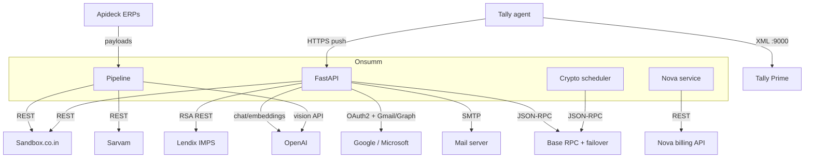

Integration patterns:

| Pattern | Where |
|---|---|
| **Idempotent outbound with reference reuse** | Lendix `tran_ref_no`; Safe nonce; anchor seq range |
| **Polling instead of webhooks** | Lendix status (sweeper + manual refresh); chain logs |
| **Primary + fallback provider** | OCR (GPT-4o → Sarvam); RPC URL failover; TDS API → local rate table |
| **Encrypted credentials at rest** | Fernet for OAuth and Nova keys |
| **Protocol-based adapters** | `BankAdapter`, `CustodyProvider`, `ScreeningProvider`, `Rail`, `RulePack` |

Details in [08 Integrations](08_INTEGRATIONS.md).

---

## 12. Security architecture

```mermaid
flowchart LR
    REQ[HTTP request] --> OBS[observability: request id, metrics]
    OBS --> AC[auth_context: verify JWT → tenant, user, role]
    AC --> LG[license_gate: route → service → entitled?]
    LG --> IG[impersonation_gate: read-only sessions]
    IG --> RT[Router handler]
    RT --> CAP[require_capability: view/edit/approve/verify/pay/admin]
    CAP --> OWN[tenancy.assert_owned → 404 if not tenant's]
    OWN --> JUR[jurisdiction_guard: pack enabled?]
    JUR --> DB[(DB, tenant_id predicate)]
```

| Layer | Control |
|---|---|
| Identity | HS256 JWT (60 min) + opaque refresh token (30 d, SHA-256 at rest); SSO never auto-creates users; SSO codes single-use, 120 s |
| Authorisation | Role → capability map; platform roles separate (`PLATFORM_JWT_SECRET`) |
| Tenancy | Every route classified scoped/public/exempt by test; ownership failures return 404 |
| Entitlement | Licence gate per route template (`LICENSE_ENFORCEMENT` off/log/enforce) |
| Payments | OTP (SHA-256, 5 attempts, 120 s), verified-only beneficiaries, override logging, maker-checker via Safe threshold, dual control above $10,000 |
| Crypto | SIWE proof, sanctions screening, 24 h cooling, wallet change = freeze, invoice wallet never used |
| Audit | `wf_audit_log` hash chain via DB trigger; daily Merkle root on-chain; public verifiable proofs |
| Secrets | Env files; Fernet-encrypted tokens; relayer key holds gas only; anchor key holds no funds |
| Observability | 5xx bodies scrubbed; `/metrics` token-gated |

Details in [07 Security](07_SECURITY.md).

---

## 13. Multi-tenancy, licensing and jurisdiction

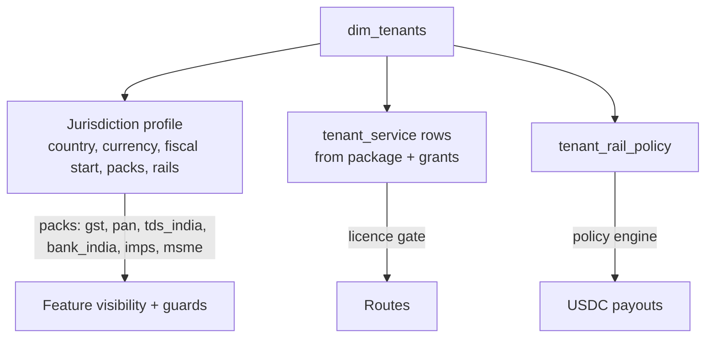

- **Jurisdiction:** `core/jurisdiction.py` defines `INDIA` with packs `gst`, `pan`, `tds_india`, `bank_india`, `imps`, `msme`. A non-India tenant turns packs off, so (for example) Add Vendor asks for **country** instead of GSTIN.
- **Licensing:** 26 services in 5 categories; packages `starter`, `growth`, `enterprise` copy rows into `tenant_service`. Crypto, Nova, demo payments, SAP matching and GST tax-type verification are granted per tenant.

---

## 14. Deployment architecture

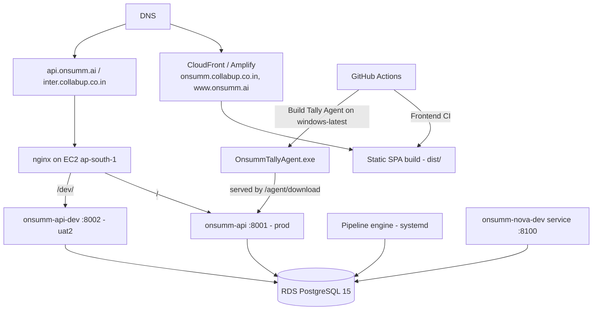

Details in [06 Deployment & Operations](06_DEPLOYMENT_OPERATIONS.md).

---

## 15. Non-functional requirements

| Area | Target / mechanism |
|---|---|
| **Availability** | systemd `Restart=always`; each in-process scheduler wrapped so one failure does not stop the app |
| **Consistency** | Single DB; advisory locks for singleton loops; idempotency keys on payouts; nonce queue for Safe |
| **Scalability** | Stateless SPA; API single replica today (per-process caches block a second replica); pipeline single instance by design |
| **Performance** | Batch sizes: backfill 200, incremental 50; poll 5 s, idle 60 s; DB pool 2–10 (asyncpg) |
| **Observability** | JSON logs with request id; Prometheus counters/histograms labelled by route template; `db_pool_connections_in_use` gauge; optional Sentry |
| **Upload limits** | 50 MB multipart parts |
| **Cost control (AI)** | `LLM_KILL_SWITCH`, `AGENT_DAILY_CAP_USD` (5), usage recorded per call |
| **Data residency** | AWS ap-south-1 (Mumbai) |
| **Auditability** | Tamper-evident chain, on-chain anchoring, per-finding audit (`rh_audit_log`) |

---

## 16. Key design decisions

| Decision | Why |
|---|---|
| Postgres `LISTEN/NOTIFY` as the event bus | One fewer moving part; triggers fire in the same transaction as the write |
| Medallion tables (`raw_` → `stg_` → `fact_`) | Every value can be traced back to the source document |
| Routers never import routers; shared helpers live in `core/` | Keeps the 44 routers independent |
| 404 (not 403) on foreign rows | No existence oracle across tenants |
| Client-owned Safe, Onsumm holds no keys | Not a custodian; threshold signatures give maker-checker |
| Payout wallet read only from the verified vendor master | Blocks invoice-phishing wallet swaps |
| FX snapshot frozen at prepare time | Withholding, books and INR reference all use one rate |
| Protocol (structural) interfaces for rails, custody, screening, rule packs | New providers plug in without touching callers |
| Review Hub shapes are fixed (diff, table, timeline, field-list, prose) | New adapters need no bespoke UI |
| Nova service duplicates its credential resolver | Deploy and scale independently of the API |

---

## 17. Risks, constraints and known gaps

| # | Item | Impact | Status |
|---|---|---|---|
| 1 | `BankVerificationWorker` disabled (NOT NULL write fails → re-queries, ~60 paid calls per poll) | Bank checks run only on demand | Open |
| 2 | Tally pipeline workers disabled | Tally sync depends on desktop agent | By design for now |
| 3 | Per-process caches + in-process DDL migrations | Blocks a second API replica | Open |
| 4 | ~85 DB connection acquisitions without `finally` | Pool exhaustion; watch `db_pool_connections_in_use` | Open |
| 5 | `LICENSE_ENFORCEMENT` defaults to `log` | Unlicensed calls logged, not blocked | Config decision |
| 6 | Only `FX_SOURCE=fixed` implemented | Live FX for crypto unavailable | Open |
| 7 | Static sanctions list | Not production-grade screening | Planned: Chainalysis/TRM |
| 8 | `PartnerCustody` stub | Only Safe custody works | Planned |
| 9 | Bank-side caps (UAT ₹10 / staging ₹1,000 / prod ₹1,50,000) not mirrored in app | Bank rejects instead of app | Open |
| 10 | `disbursement_api.py` legacy module unmounted | Dead code | Clean-up |
| 11 | Testnet only (Base Sepolia) | No real-value crypto | By design |
| 12 | India-resident FEMA / VDA rules | Crypto off for residents | By design |
| 13 | CORS `*` with credentials | Broad origin policy | Review |
| 14 | `withholding_remittances` table has no code path | Remittance not tracked | Open |
| 15 | Approval actions trust `actor_role` / `actor_name` from the request body, not the JWT | A user could act as another role on bill approvals | **Open — high** |
| 16 | No server-side role check on settings, chain, categories, COA, vendor writes, soft-status | Admin-only rules enforced only in the UI | **Open — high** |
| 17 | No Postgres Row-Level Security | Tenant isolation relies on code and tests | Accepted, tested |
| 18 | Password-reset OTP stored in process memory | Fails with more than one worker; lost on restart | Open |
| 19 | `PUSH_TALLY` bridge joins on AR staging id | AP bills may not reach the Tally push queue | Open |
