# Onsumm Platform — Low-Level Design (LLD)

| | |
|---|---|
| **Document** | 02 — Low-Level Design |
| **As of** | 2026-10-31 (commit `6e1278f`) |
| **Scope** | Backend API (`backend_ocr/app`), pipeline engine (`pipelines/`, `main.py`), Nova service (`services/nova_reconciliation`), Tally agent (`tally_agent/`, `tally2database/`), smart contract (`contracts/`), frontend (`frontend/src`) |
| **Related** | [01 HLD](01_HLD.md) · [03 User Flows](03_USER_FLOWS.md) · [04 Data Model](04_DATA_MODEL.md) · [05 API Reference](05_API_REFERENCE.md) |

---

## Table of contents

1. [Code layout](#1-code-layout)
2. [Backend layering and dependency rules](#2-backend-layering-and-dependency-rules)
3. [Request processing pipeline](#3-request-processing-pipeline)
4. [Security module classes](#4-security-module-classes)
5. [Core module classes](#5-core-module-classes)
6. [Pipeline engine (CDC workers)](#6-pipeline-engine-cdc-workers)
7. [Review Hub](#7-review-hub)
8. [INR disbursement module](#8-inr-disbursement-module)
9. [Crypto rail — class model](#9-crypto-rail--class-model)
10. [Crypto rail — internal sequences](#10-crypto-rail--internal-sequences)
11. [Audit chain and anchoring](#11-audit-chain-and-anchoring)
12. [Smart contract: OnsummAnchor](#12-smart-contract-onsummanchor)
13. [AI / LLM layer and Fact Graph](#13-ai--llm-layer-and-fact-graph)
14. [Ingest and OCR](#14-ingest-and-ocr)
15. [Approval chain engine](#15-approval-chain-engine)
16. [Nova reconciliation service](#16-nova-reconciliation-service)
17. [Tally agent and connector](#17-tally-agent-and-connector)
18. [Frontend LLD](#18-frontend-lld)
19. [Concurrency, idempotency and locking](#19-concurrency-idempotency-and-locking)
20. [Configuration reference](#20-configuration-reference)
21. [Error handling and observability](#21-error-handling-and-observability)
22. [Testing strategy](#22-testing-strategy)

---

## 1. Code layout

```
onsumm/
├── main.py                     pipeline runner (12 asyncio workers, advisory lock …417)
├── config.py / db.py           pipeline config (PIPELINE_CFG) and asyncpg pool
├── pipelines/                  BaseWorker + 14 worker modules, cdc.py (NOTIFY triggers)
├── utils/                      ocr_engine.py, tds_engine.py, tds_catchup.py, fiscal.py
├── models/enums.py             Python enums (partly stale vs DB)
├── backend_ocr/app/            FastAPI application
│   ├── main.py                 composition root: middleware, gates, 44 routers, startup tasks
│   ├── config.py               env + psycopg2 pool (lowest layer)
│   ├── migrations.py           31 startup DDL steps
│   ├── crypto_migrations.py    crypto DDL
│   ├── audit_migrations.py     hash-chain DDL + trigger
│   ├── security/               auth, capabilities, licensing, services, tenancy
│   ├── core/                   approval_chain, tokens, jurisdiction, object_store, observability, …
│   ├── integrations/           imps_client, sandbox_kyb, email_oauth, email_graph, ocr,
│   │   ├── payments/           rails.py, bank adapters (icici, hdfc, au_bank)
│   │   ├── custody/            base.py, safe.py, relayer.py, partner.py
│   │   ├── chains/             evm.py
│   │   └── screening/          static list screening
│   ├── domain/                 business logic with no HTTP surface
│   │   ├── crypto/             payouts, policy, rail_router, siwe, wallets, fx, recon,
│   │   │                       watcher, ledger, findings, scheduler, treasury_book, withholding/
│   │   ├── payments/           receipt, notify, sweeper, scheduler, demo
│   │   ├── audit/              hasher, anchor
│   │   ├── review/             bill_actions, notify_actions, previews, visibility
│   │   └── ingest, fact_graph, tenant_defaults, vendor_*.py
│   ├── review/                 detection side: workers, adapters/, store, ranking, routing, …
│   ├── ai/llm.py               complete_json, budgets, usage
│   └── routers/                44 HTTP modules (308 route decorators)
├── services/nova_reconciliation/   standalone FastAPI :8100
├── tally_agent/                Windows tray app (PyInstaller)
├── tally2database/             Tally XML client, parser, builder
├── contracts/                  Foundry: OnsummAnchor.sol, tests, deploy script
├── frontend/                   React 18 SPA (Vite)
├── scripts/                    migrations, backfills, seeds, test harnesses
├── jobs/tds_fy_reset.py        fiscal-year TDS reset
└── tests/                      ~70 pytest modules (+ tests/crypto)
```

---

## 2. Backend layering and dependency rules

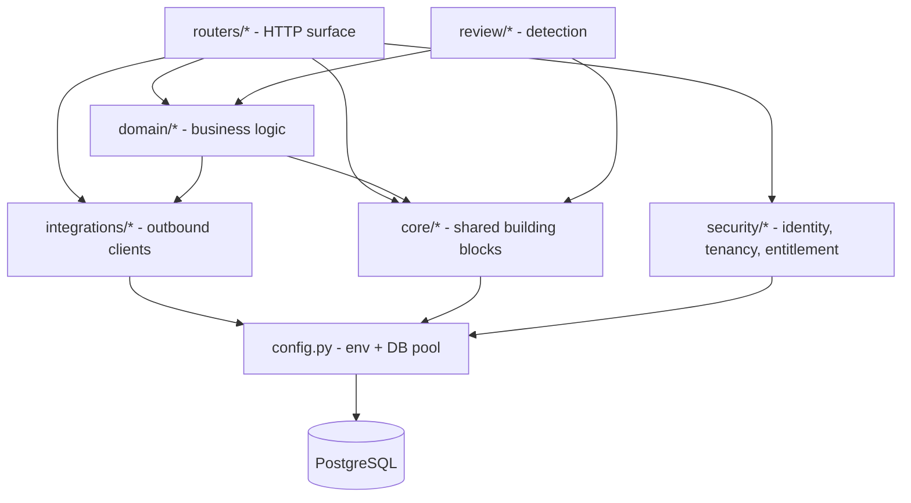

| Rule | Enforcement |
|---|---|
| A router never imports another router; shared helpers move to `core/` | convention + review |
| `config.py` is the lowest layer, importable by scripts outside the package | convention |
| Every route reaches the authenticated tenant (scoped / public / exempt) | `tests/test_tenant_route_map.py` snapshot |
| Every route maps to a licensed service | `tests/test_license_route_map.py` |
| Ownership failures answer 404, never 403 | `tests/test_tenancy.py` |
| Metrics labelled by route template; `/metrics` token-gated | `tests/test_observability.py` |
| Python 3.11 syntax compatibility | `tests/test_python311_syntax.py` |
| All imports resolve | `tests/test_imports_resolve.py` |

---

## 3. Request processing pipeline

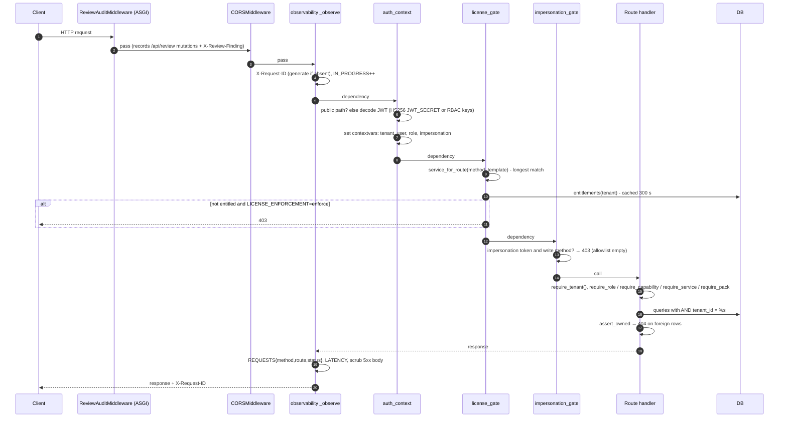

Startup (`main.py`): mount routers → `migrations.register(app)` → start `agent_poller`, `review_workers`, `disbursement_sweeper`, `crypto_workers` (each in its own try/except). Shutdown stops review workers, sweeper and crypto workers. Multipart part limit: 50 MB.

---

## 4. Security module classes

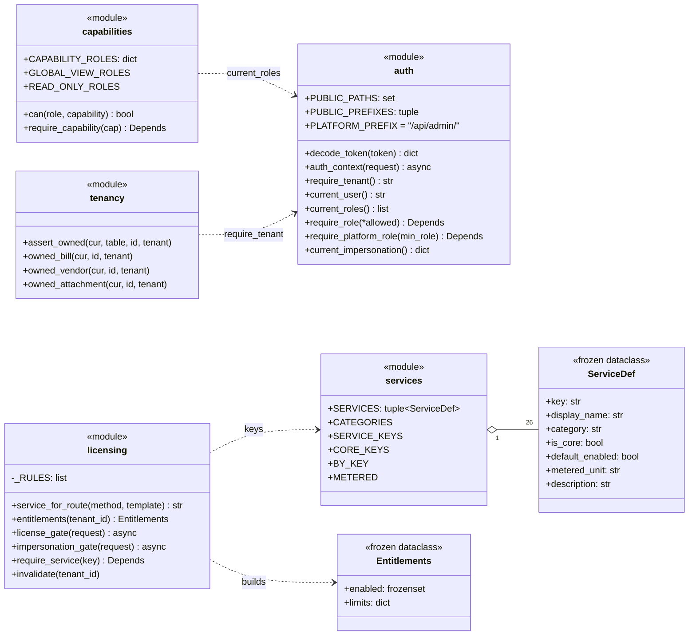

Platform role rank: `readonly` < `support` < `admin` < `owner`. Platform tokens are signed with `PLATFORM_JWT_SECRET`, `typ=platform`, no tenant claim, so they cannot satisfy `require_tenant()`.

---

## 5. Core module classes

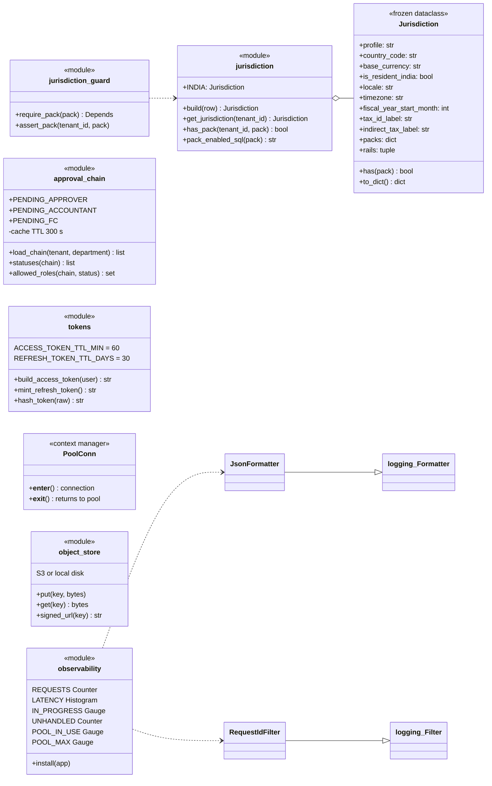

India jurisdiction packs: `gst`, `pan`, `tds_india`, `bank_india`, `imps`, `msme`; rails `IMPS` (+ `USDC` only for non-residents).

Other core modules: `storage.py` (single `BACKEND_ROOT` anchor for `UPLOADS_DIR`, `ATTACH_DIR`, `VENDOR_DOCS_DIR`, `BRAND_LOGOS_DIR`), `money.py`, `notifications.py` (badge cache), `tenant_settings.py`, `vendor_identity.py` (PAN from GSTIN), `vendor_activity_log.py`.

---

## 6. Pipeline engine (CDC workers)

### 6.1 Class hierarchy

```mermaid
classDiagram
    class BaseWorker {
        <<abstract>>
        +name: str = "base"
        +notify_channel: str or None
        +skip_backfill: bool = False
        #_cfg: dict
        #_current_batch_size: int
        +batch_size: int
        +run() async
        #_run_backfill() async
        #_run_incremental() async
        #_run_listen_notify() async
        #_run_poll() async
        +process_batch()* int
        +log_error(table, id, err)
        +log_audit(conn, ...)$
        #_safe(coro)
    }
    class ApiSyncWorker {
        name = api_sync
        ch_api_sync
    }
    class WebhookWorker {
        name = webhook
        ch_webhook
    }
    class UploadOcrWorker {
        name = upload_ocr / ch_upload_ocr
        -_advance_received()
        -_advance_ocr_primary()
        -_advance_ocr_fallback()
        -_advance_validating()
    }
    class StagingPromotionWorker {
        name = staging_promotion
        -_promote_invoices()
        -_promote_bills()
        -_promote_payments()
    }
    class ApprovalWorker {
        name = approval
        poll
        skip_backfill
    }
    class DeduplicationWorker {
        name = deduplication
    }
    class GstVerificationWorker {
        name = gst_verification
        -_get_token()
        -_verify_gstin()
        -_decide()
        -_process_table()
    }
    class BankVerificationWorker {
        name = bank_verification
        DISABLED
    }
    class CategoryEnrichmentWorker {
        name = category_enrichment
    }
    class TdsProcessingWorker {
        name = tds_processing
        -_process_one()
        -_settle_not_applicable()
        -_write()
    }
    class FxRateWorker {
        name = fx_rate
        overrides run()
    }
    class FxCurrencyAgent {
        name = fx_agent
        GPT-4o-mini notes
    }
    class TallyReadWorker {
        name = tally_read
        DISABLED
    }
    class TallySyncWorker {
        name = tally_sync
        DISABLED
    }

    BaseWorker <|-- ApiSyncWorker
    BaseWorker <|-- WebhookWorker
    BaseWorker <|-- UploadOcrWorker
    BaseWorker <|-- StagingPromotionWorker
    BaseWorker <|-- ApprovalWorker
    BaseWorker <|-- DeduplicationWorker
    BaseWorker <|-- GstVerificationWorker
    BaseWorker <|-- BankVerificationWorker
    BaseWorker <|-- CategoryEnrichmentWorker
    BaseWorker <|-- TdsProcessingWorker
    BaseWorker <|-- FxRateWorker
    BaseWorker <|-- FxCurrencyAgent
    BaseWorker <|-- TallyReadWorker
    BaseWorker <|-- TallySyncWorker
```

### 6.2 Worker lifecycle

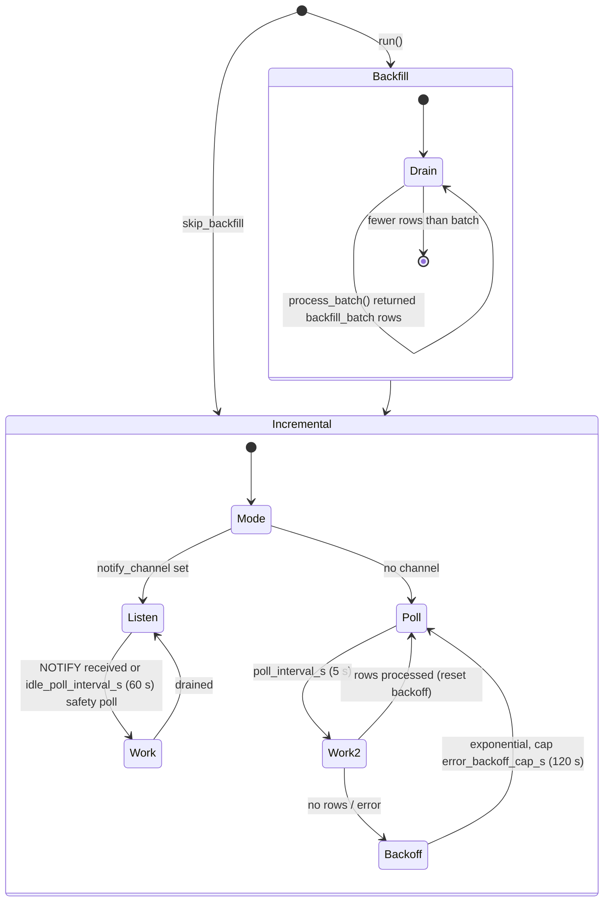

| Config key | Default |
|---|---|
| `backfill_batch` | 200 |
| `incremental_batch` | 50 |
| `poll_interval_s` | 5 |
| `idle_poll_interval_s` | 60 |
| `error_backoff_s` | 5 |
| `error_backoff_cap_s` | 120 |

### 6.3 Runner

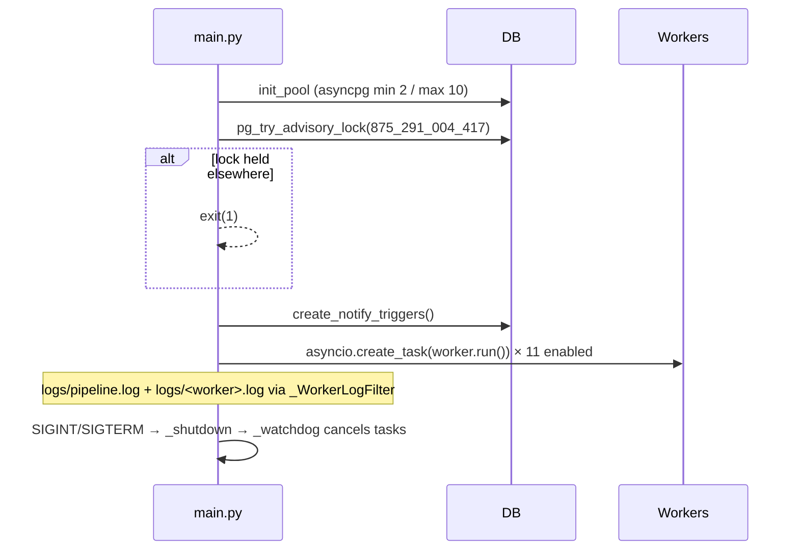

Tenant scope: `PIPELINE_TENANT_ID` (comma-separated; empty = all tenants).

### 6.4 OCR merge rule (UploadOcrWorker)

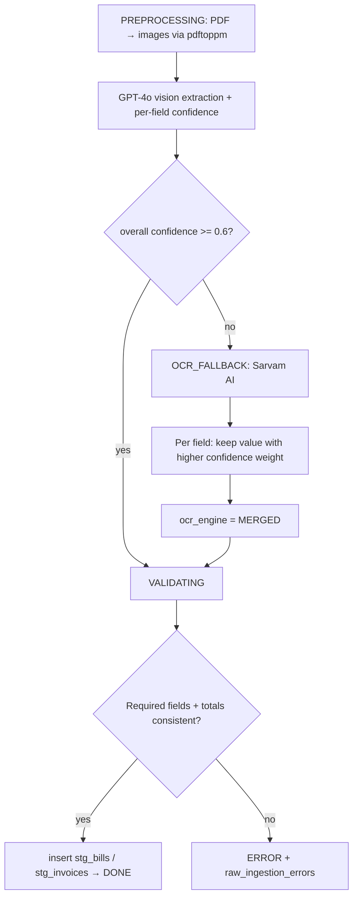

---

## 7. Review Hub

### 7.1 Detection-side classes

```mermaid
classDiagram
    class BaseWorker_review {
        <<abstract>>
        copy of pipelines/base.py
    }
    class ReviewAdapterWorker {
        name = review_adapters
        notify_channel = ch_review_adapters
        SCAN_LIMIT = 500
        +process_batch() int
    }
    class ReviewAgentWorker {
        name = review_agent
        notify_channel = ch_review_agent
        skip_backfill = True
    }
    class CommExtractionWorker {
        name = comm_extraction
        notify_channel = ch_comm_extract
        skip_backfill = True
    }
    BaseWorker_review <|-- ReviewAdapterWorker
    BaseWorker_review <|-- ReviewAgentWorker
    BaseWorker_review <|-- CommExtractionWorker

    class FindingAdapter {
        <<abstract>>
        +detector: str
        +family: str
        +source_service: str = "bills"
        +scan(conn, tenant_id, limit)* AsyncIterator~FindingDraft~
    }
    class AnomaliesAdapter
    class ApprovalStallsAdapter
    class BillCodingAdapter
    class BillingDiscrepanciesAdapter
    class CommStallAdapter
    class ContractBillVarianceAdapter
    class FxAlertsAdapter
    class GstNameOverwriteAdapter
    class IngestionErrorsAdapter
    class MappingQueueAdapter
    class MasterDataConflictAdapter
    class OcrQualityAdapter
    class PaymentFailuresAdapter
    class StagingValidationAdapter
    class VendorComplianceAdapter
    class VendorDuplicatesAdapter
    class VendorIdentityAdapter
    FindingAdapter <|-- AnomaliesAdapter
    FindingAdapter <|-- ApprovalStallsAdapter
    FindingAdapter <|-- BillCodingAdapter
    FindingAdapter <|-- BillingDiscrepanciesAdapter
    FindingAdapter <|-- CommStallAdapter
    FindingAdapter <|-- ContractBillVarianceAdapter
    FindingAdapter <|-- FxAlertsAdapter
    FindingAdapter <|-- GstNameOverwriteAdapter
    FindingAdapter <|-- IngestionErrorsAdapter
    FindingAdapter <|-- MappingQueueAdapter
    FindingAdapter <|-- MasterDataConflictAdapter
    FindingAdapter <|-- OcrQualityAdapter
    FindingAdapter <|-- PaymentFailuresAdapter
    FindingAdapter <|-- StagingValidationAdapter
    FindingAdapter <|-- VendorComplianceAdapter
    FindingAdapter <|-- VendorDuplicatesAdapter
    FindingAdapter <|-- VendorIdentityAdapter
    ReviewAdapterWorker o-- "17" FindingAdapter : ALL_ADAPTERS
```

| Adapter | family | source_service (licence) |
|---|---|---|
| AnomaliesAdapter | duplication | anomaly_ai |
| ApprovalStallsAdapter | approval | approvals |
| BillCodingAdapter | data_quality | bills |
| BillingDiscrepanciesAdapter | reconciliation | nova_billing |
| CommStallAdapter | data_quality | email_sending |
| ContractBillVarianceAdapter | reconciliation | bills |
| FxAlertsAdapter | fx | fx |
| GstNameOverwriteAdapter | vendor_identity | gst_tax_verification |
| IngestionErrorsAdapter | data_quality | upload_ocr |
| MappingQueueAdapter | data_quality | sap_matching |
| MasterDataConflictAdapter | vendor_identity | email_sending |
| OcrQualityAdapter | data_quality | upload_ocr |
| PaymentFailuresAdapter | payment | disbursement |
| StagingValidationAdapter | data_quality | upload_ocr |
| VendorComplianceAdapter | vendor_identity | kyc_verification |
| VendorDuplicatesAdapter | vendor_identity | kyc_verification |
| VendorIdentityAdapter | vendor_identity | kyc_verification |

### 7.2 Finding model and helpers

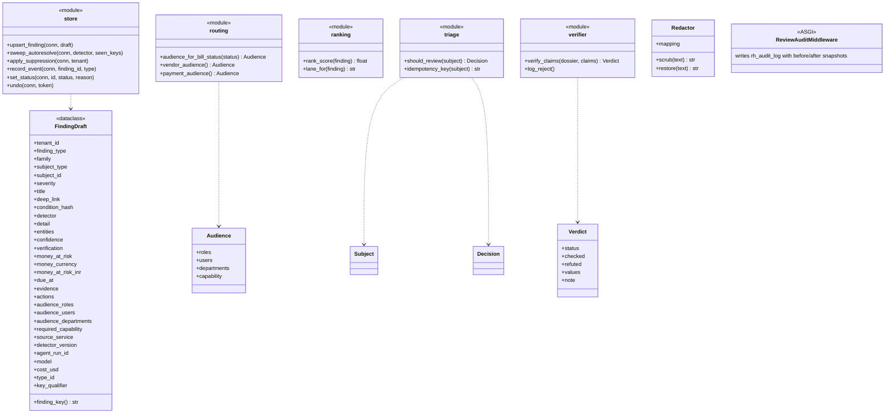

### 7.3 Adapter worker cycle

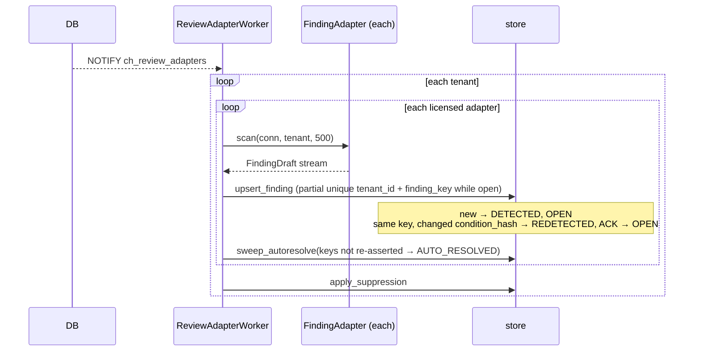

### 7.4 LLM review agent

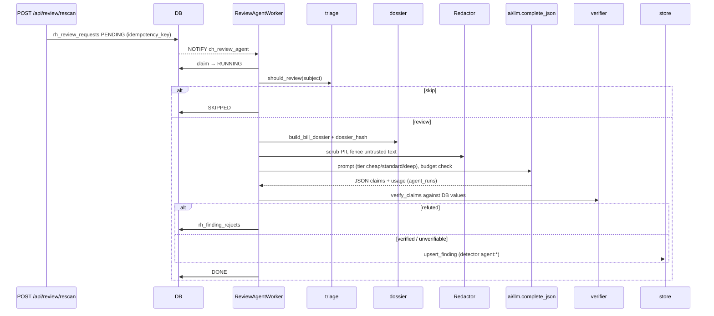

Domain-side helpers (`domain/review/`): `bill_actions.can_approve/approve_action`, `notify_actions.resolve_destination/execute_notify` (vendor_contact, role, user), `previews.previews_for`, `visibility.visibility_sql/actionable_sql`.

---

## 8. INR disbursement module

### 8.1 Classes

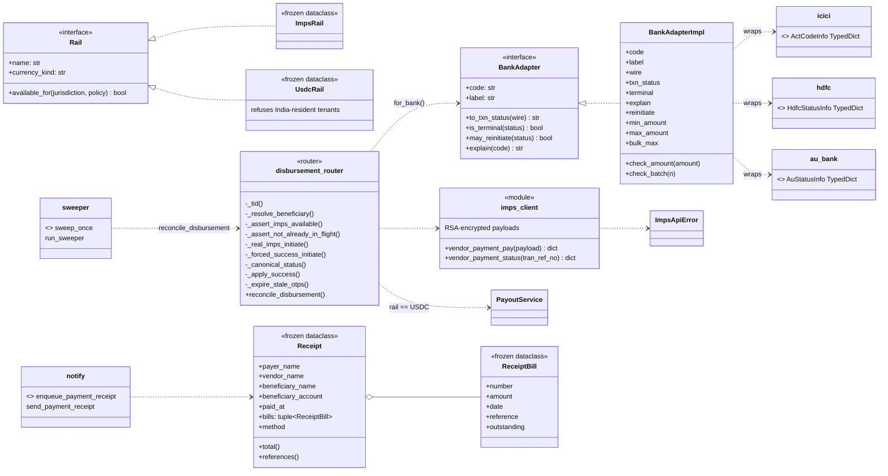

`DEFAULT_BANK = "ICICI"`. `for_bank()`, `normalise()`, `supported_banks()` select the adapter.

### 8.2 Verify-OTP internals

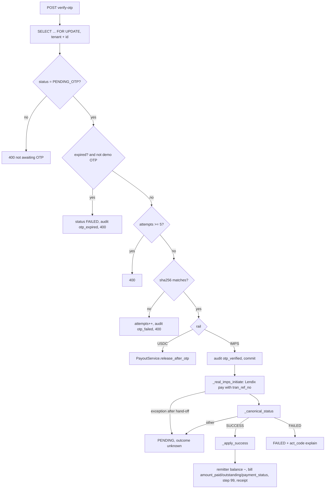

---

## 9. Crypto rail — class model

### 9.1 Payout composition

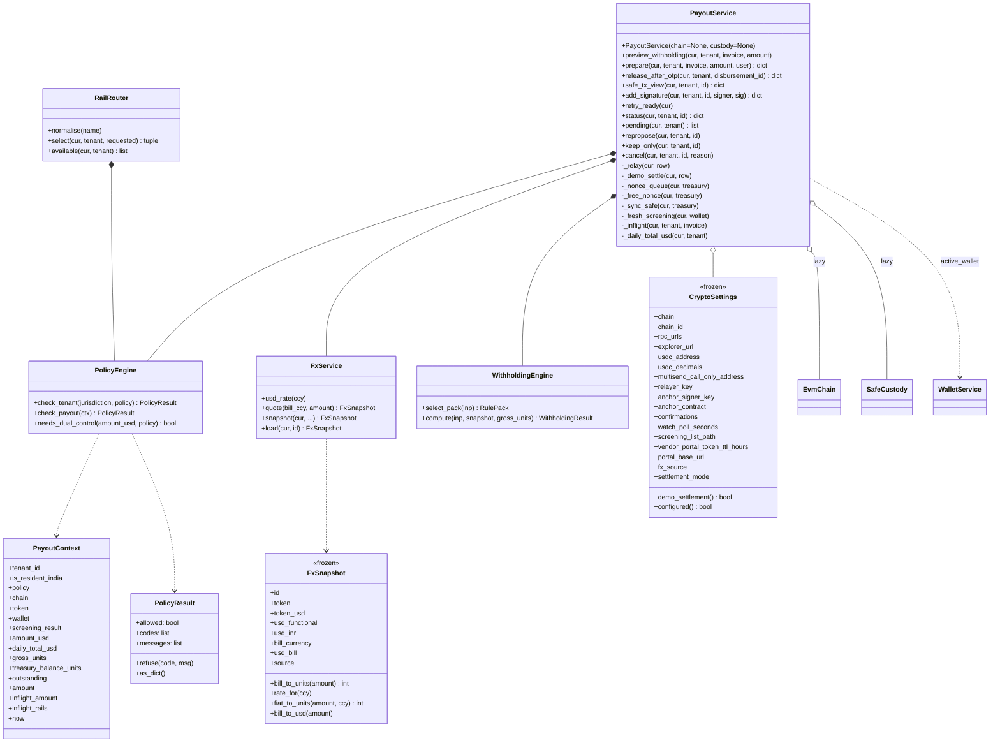

### 9.2 Custody, chain, screening and wallets

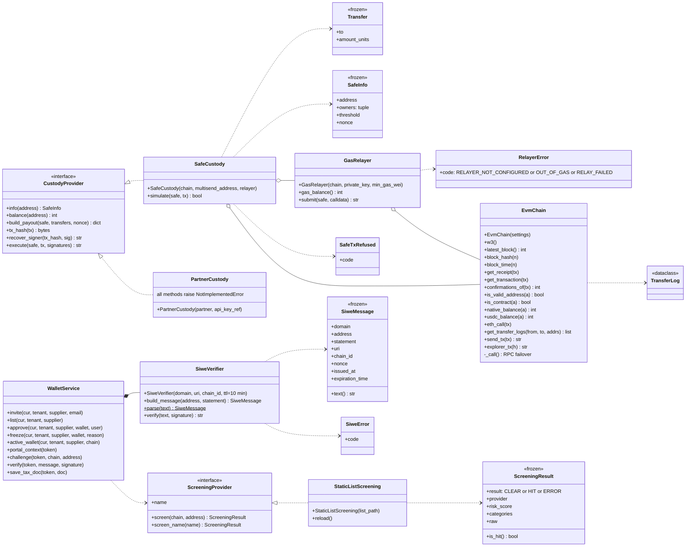

### 9.3 Withholding rule packs

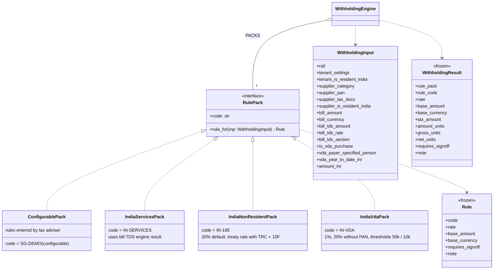

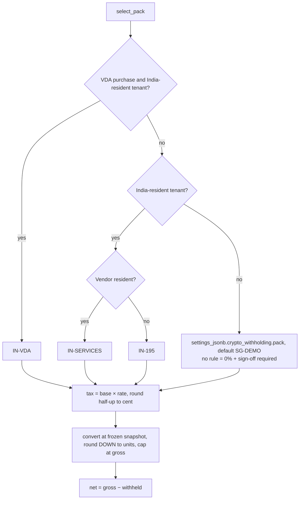

### 9.4 Recon, watcher, ledger, findings

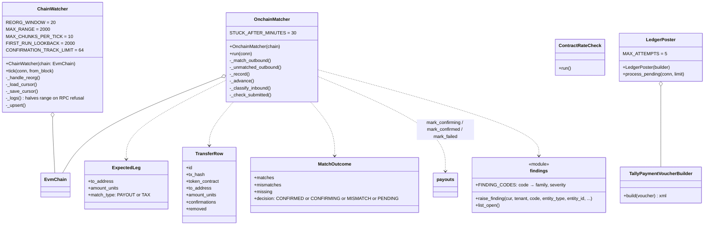

Crypto finding codes: `WALLET_MISMATCH`, `WALLET_CHANGED`, `SCREENING_HIT`, `OVERBILLED_VS_CONTRACT`, `DUPLICATE_ACROSS_RAILS`, `UNMATCHED_OUTBOUND_TRANSFER`, `UNMATCHED_INBOUND_TRANSFER`, `AMOUNT_MISMATCH`, `PAYOUT_STUCK`, `REORG_DETECTED`, `UNRECONCILED_DAY`, `TAX_DOCS_MISSING`, `WITHHOLDING_SIGNOFF_REQUIRED`, `ANCHOR_FAILED`, `SAFE_CONFIG_CHANGED`, `TOKEN_DEPEG`, `AUDIT_CHAIN_BROKEN`. Key: `<code>:<entity_type>:<entity_id>`.

Policy refusal codes: `CRYPTO_DISABLED_RESIDENT_INDIA`, `CRYPTO_NOT_ENABLED`, `CHAIN_NOT_ALLOWED`, `TOKEN_NOT_ALLOWED`, `WALLET_NOT_ACTIVE`, `WALLET_COOLING`, `SCREENING_HIT`, `SCREENING_UNAVAILABLE`, `OVER_PER_TX_LIMIT`, `OVER_DAILY_LIMIT`, `INSUFFICIENT_TREASURY_BALANCE`, `ALREADY_IN_FLIGHT`, `DUPLICATE_ACROSS_RAILS`.

`DEFAULT_POLICY`: `crypto_enabled=False`, `allowed_chains=["base-sepolia"]`, `allowed_tokens=["USDC"]`, `per_tx_limit_usd=None`, `daily_limit_usd=None`, `dual_control_above_usd=10000`, `cooling_minutes=1440`, `require_test_transfer=True`.

### 9.5 Crypto scheduler

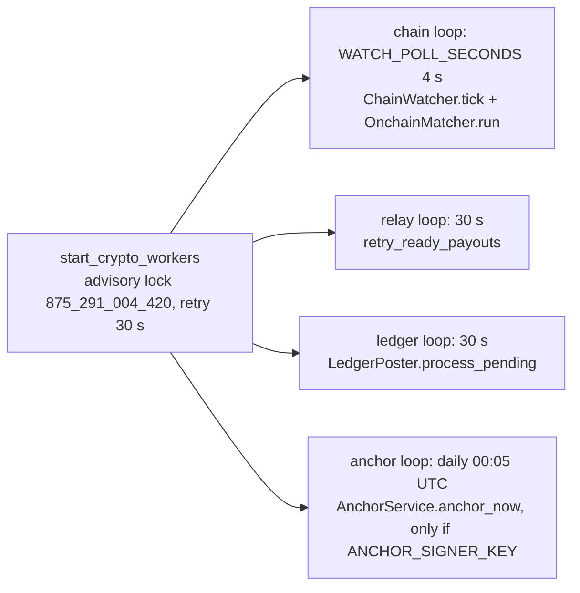

---

## 10. Crypto rail — internal sequences

### 10.1 `PayoutService.prepare`

```mermaid
sequenceDiagram
    autonumber
    participant R as disbursement router
    participant P as PayoutService
    participant PE as PolicyEngine
    participant WS as WalletService
    participant FX as FxService
    participant WE as WithholdingEngine
    participant SC as SafeCustody
    participant DB

    R->>P: prepare(cur, tenant, invoice, amount, user)
    P->>PE: check_tenant (residency, enabled)
    P->>P: validate amount <= outstanding
    P->>WS: active_wallet(supplier, chain)
    P->>DB: TREASURY + TAX treasury_wallets
    P->>FX: snapshot(cur) → fx_snapshots
    P->>P: gross_units = bill_to_units(amount) rounded down
    P->>WE: compute(inp, snapshot, gross_units)
    alt tax > 0 and no TAX wallet
        P-->>R: refuse NO_TAX_WALLET
    end
    P->>SC: balance(treasury)
    P->>P: available = balance − units held by nonce-holding payouts
    P->>P: _fresh_screening(wallet) within 24 h
    P->>PE: check_payout(PayoutContext)
    alt refused
        P->>DB: finding if DUPLICATE_ACROSS_RAILS
        P-->>R: PolicyResult codes
    end
    P->>P: _sync_safe(treasury): owners, threshold
    P->>DB: fact_disbursements (rail USDC, PENDING_OTP, OTP hash)
    P->>DB: crypto_disbursement_details (AWAITING_RELEASE, idempotency_key)
    P->>DB: crypto_withholdings (CALCULATED)
    opt requires_signoff
        P->>DB: WITHHOLDING_SIGNOFF_REQUIRED finding
    end
    P->>DB: wf_audit_log
    P-->>R: {disbursement_id, otp_sent_to, preview}
```

### 10.2 `release_after_otp` and nonce selection

```mermaid
flowchart TD
    A[OTP verified] --> B{settlement_mode demo?}
    B -->|yes| N1[nonce = Safe current nonce]
    B -->|no| N2[nonce = max of Safe nonce, highest nonce held by this treasury + 1]
    N1 & N2 --> C{withholding legs?}
    C -->|no| T1[single USDC transfer call to vendor]
    C -->|yes| T2[DELEGATECALL MultiSendCallOnly: vendor net + TAX wallet leg]
    T1 & T2 --> D[assert_safe_operation, build_safe_tx]
    D --> E[safe_tx_hash = EIP-712 hash]
    E --> F[store safe_tx_hash, safe_nonce → PENDING / PROPOSED]
```

### 10.3 `add_signature` and `_relay`

```mermaid
sequenceDiagram
    autonumber
    participant API
    participant P as PayoutService
    participant SC as SafeCustody
    participant Rel as GasRelayer
    participant DB
    API->>P: add_signature(id, signer, sig)
    P->>DB: load row (must be SIGNABLE)
    P->>P: recompute safe_tx_hash, must equal stored
    P->>SC: recover_signer(hash, sig) == signer
    P->>SC: info(safe) live owners, threshold, nonce
    alt signer not owner
        P-->>API: 403 NOT_A_SAFE_OWNER
    else Safe nonce > safe_nonce
        P->>DB: FAILED / REPLACED
    else
        P->>DB: upsert crypto_payout_signatures
        alt count < threshold
            P->>DB: PARTIALLY_SIGNED
        else threshold met
            P->>DB: READY
            P->>P: _relay
            alt earlier nonce still queued or balance short
                P->>DB: stay READY with hold reason
            else demo
                P->>SC: simulate (eth_call)
                P->>DB: simulated chain_transfers + run matcher
            else chain
                P->>SC: execute: pack_signatures ascending owner → exec_transaction_calldata
                SC->>Rel: submit(safe, calldata) gasPrice 0, refundReceiver 0
                Rel-->>P: tx_hash
                P->>DB: SUBMITTED, tx_hash
            end
        end
    end
```

### 10.4 `mark_confirmed`

```mermaid
flowchart LR
    A[OnchainMatcher decision CONFIRMED] --> B[fact_invoices: amount_paid +, outstanding −, payment_status paid/partial]
    B --> C[bill_approval_chain step 99]
    C --> D[fact_disbursements SUCCESS, sub_status CONFIRMED]
    D --> E[crypto_withholdings WITHHELD]
    E --> F[wf_audit_log row]
    F --> G[savepoint: enqueue_payout_posting → ledger_postings PENDING]
```

### 10.5 Chain watcher tick with reorg handling

```mermaid
flowchart TD
    A[tick] --> B[load cursor block + hash]
    B --> C{block_hash at cursor still the same?}
    C -->|no| D[rewind REORG_WINDOW 20 blocks, mark rows above as removed, REORG_DETECTED finding]
    C -->|yes| E[range = cursor+1 .. min latest, +MAX_RANGE]
    D --> E
    E --> F[get_transfer_logs USDC contract, from/to watched wallets]
    F -->|RPC refuses range| G[halve range, retry]
    F --> H[upsert chain_transfers by chain, tx_hash, log_index, direction]
    H --> I[refresh confirmations for latest 64 tracked]
    I --> J[save cursor with block hash]
    J --> K{chunks < MAX_CHUNKS_PER_TICK 10 and behind?}
    K -->|yes| E
    K -->|no| L[done]
```

---

## 11. Audit chain and anchoring

### 11.1 Classes

```mermaid
classDiagram
    class hasher {
        <<module>>
        +ZERO_HASH
        +canonical_text(row) str
        +row_hash(prev, canonical) str
        +verify_rows(rows) result
        +verify_chain(conn, tenant) first_broken_seq
    }
    class MerkleBuilder {
        +MerkleBuilder(leaves)
        +root() bytes
        +proof(i) list
    }
    class anchor {
        <<module>>
        +leaf(salt, row_hash) bytes
        +node(a, b) bytes  sorted pair
        +top_leaf(tenant, root) bytes
        +verify_proof(leaf, proof, root) bool
        +encode_anchor_calldata(root, from, to) bytes
        +decode_anchor_calldata(data)
        +encode_contract_call(root, from, to) bytes
        +make_share_token(log_id) str
        +read_share_token(token) log_id
    }
    class AnchorResult {
        +anchor
        +rows
    }
    class AnchorService {
        +anchor_now(conn) AnchorResult
        -_submit(anchor)
        +refresh_status(conn)
    }
    class ProofService {
        +bundle(conn, tenant, log_id) dict
    }
    class ProofError {
        +status
        +message
    }
    AnchorService ..> MerkleBuilder
    AnchorService ..> EvmChain
    AnchorService ..> AnchorResult
    ProofService ..> MerkleBuilder
    ProofService ..> ProofError
```

### 11.2 Merkle construction

```mermaid
flowchart BT
    subgraph TenantA["Tenant A tree"]
        A1["leaf = sha256(0x00 ‖ saltA ‖ row_hash 1)"]
        A2["leaf = sha256(0x00 ‖ saltA ‖ row_hash 2)"]
        A3["leaf ... row n"]
        AN["node = sha256(0x01 ‖ min ‖ max)"]
        ARoot["tenant root A"]
        A1 --> AN
        A2 --> AN
        AN --> ARoot
        A3 --> ARoot
    end
    subgraph TenantB["Tenant B tree"]
        BRoot["tenant root B"]
    end
    TA["top leaf = sha256(0x02 ‖ tenant A uuid ‖ root A)"]
    TB["top leaf = sha256(0x02 ‖ tenant B uuid ‖ root B)"]
    ARoot --> TA
    BRoot --> TB
    TOP["global Merkle root → anchored on Base"]
    TA --> TOP
    TB --> TOP
```

Calldata mode payload: `"ONSM" ‖ 0x01 ‖ root (32 B) ‖ from_seq (u64) ‖ to_seq (u64)` sent as a 0-value self-transfer. Contract mode: `OnsummAnchor.anchor(root, fromSeq, toSeq)`.

---

## 12. Smart contract: OnsummAnchor

```mermaid
classDiagram
    class OnsummAnchor {
        <<contract>>
        +address owner
        +address anchorer
        +uint256 count
        +mapping uint256 to Anchor anchors
        +constructor(address initialAnchorer)
        +setAnchorer(address a) onlyOwner
        +anchor(bytes32 root, uint64 fromSeq, uint64 toSeq) returns uint256 onlyAnchorer
    }
    class Anchor {
        <<struct>>
        +bytes32 root
        +uint64 fromSeq
        +uint64 toSeq
        +uint64 timestamp
    }
    class Events {
        <<events>>
        Anchored(uint256 indexed id, bytes32 root, uint64 fromSeq, uint64 toSeq, uint64 timestamp)
        AnchorerChanged(address)
    }
    class Errors {
        <<errors>>
        NotOwner
        NotAnchorer
        EmptyRoot
        BadRange
    }
    OnsummAnchor *-- Anchor
    OnsummAnchor ..> Events
    OnsummAnchor ..> Errors
```

Tooling: Foundry (`contracts/foundry.toml`), tests `contracts/test/OnsummAnchor.t.sol`, deploy `contracts/script/Deploy.s.sol`, ABI under `contracts/abi`. The contract holds no funds.

---

## 13. AI / LLM layer and Fact Graph

```mermaid
classDiagram
    class llm {
        <<module>>
        +complete_json(prompt, schema, model, tier) async LLMResult
        +price(model, in, out) float
        +check_budget(tenant) 
        +record_usage(tenant, result)
        +validate(json, schema)
        LLM_TIMEOUT_S = 60
        LLM_MAX_ATTEMPTS = 3
        LLM_KILL_SWITCH
        AGENT_DAILY_CAP_USD = 5
    }
    class LLMResult {
        +content
        +model
        +input_tokens
        +output_tokens
        +cost_usd
        +latency_ms
        +attempts
        +raw_text
        +steps
    }
    class LLMError
    class LLMRefused
    llm ..> LLMResult
    llm ..> LLMError
    llm ..> LLMRefused
    class fact_graph {
        <<module>>
        node types: tenant, vendor, bill, contact, fact
        relations: owns, has_bill, poc_of, constrains, about
        +upsert_node()
        +upsert_edge()
        +enrich_*()
        +search_facts(query) embeddings text-embedding-3-small 1536
        +neighbors(node)
        +fetch_graph(tenant)
        +assemble_payment_context(bill)
    }
```

Model usage:

| Use | Model |
|---|---|
| OCR primary | GPT-4o vision |
| OCR fallback | Sarvam AI |
| Bill vs conversation classification (mail agent) | `AGENT_CLASSIFY_MODEL` (default `gpt-4o-mini`) |
| Enrichment, ledger/category suggestion, AP notes | `gpt-4o-mini` |
| FX notes and briefings | `gpt-4o-mini` |
| Fact graph embeddings | `text-embedding-3-small` (1536-d) |
| Review agent | tiered via `complete_json` |

---

## 14. Ingest and OCR

### 14.1 `domain/ingest.ingest_invoice` transaction

```mermaid
sequenceDiagram
    autonumber
    participant R as POST /api/invoices/ingest
    participant I as ingest_invoice
    participant DB
    participant OS as object_store
    R->>I: payload, tenant, user
    I->>DB: BEGIN
    I->>DB: _ensure_tenant
    I->>DB: _upsert_supplier (dim_suppliers + supplier_gstns, new = UNVERIFIED)
    I->>DB: _upsert_upload (raw_invoice_uploads DONE, file bytes)
    I->>OS: put PDF (S3 if enabled)
    I->>DB: _insert_ocr_result (raw_ocr_results)
    I->>DB: _upsert_bill (stg_bills DRAFT, OK, PENDING)
    I->>DB: _upsert_fact_invoice (AP, DRAFT, UPLOAD, FX conversion)
    alt invoice number exists
        I->>DB: update existing, is_duplicate = true
    end
    I->>DB: stg_bill_line_items (SAP auto-map), ledger_mapping_log
    I->>DB: COMMIT
    I-->>R: invoice_id, is_duplicate
    R->>DB: stamp brand_id, cost_center_id
    R-)R: background fact-graph enrichment
```

### 14.2 Synchronous OCR endpoint

```mermaid
flowchart TD
    A[POST /api/invoices/ocr] --> B[set jurisdiction prompt GST or VAT]
    B --> C[image → PDF, enforce page limit]
    C --> D[save to UPLOADS_DIR]
    D --> E{integrations/invoice_gate.check_is_invoice}
    E -->|NotAnInvoice| F[return _not_invoice]
    E -->|ok| G[utils/ocr_engine.process_pdf_async]
    G --> H[return payload + _source_file]
```

---

## 15. Approval chain engine

```mermaid
flowchart TD
    A[load_chain tenant, department] --> B{department-specific rows?}
    B -->|yes| C[use them]
    B -->|no| D{tenant default rows department NULL?}
    D -->|yes| C
    D -->|no| E[DEFAULT_APPROVAL_CHAIN]
    C & E --> F[non-locked steps in order → PENDING_APPROVER, PENDING_ACCOUNTANT, PENDING_FC, PENDING_STEP_n]
    F --> G[allowed_roles = step.role + admin, assignees filter by name except admin]
```

```mermaid
flowchart TD
    S[bill_action] --> T{action}
    T -->|submit| U{status DRAFT or NEEDS_REVISION?}
    U -->|yes| U1[statuses 0 or APPROVED if empty chain]
    T -->|approve| V{actor_role allowed and name ok?}
    V -->|yes| V1{returned via multi-step send-back?}
    V1 -->|yes| V2[jump to step that sent it back]
    V1 -->|no| V3[next status or APPROVED]
    T -->|send_back| W[target_status earlier step or NEEDS_REVISION, else previous]
    T -->|priority_change| X[audit only]
    U1 & V2 & V3 & W & X --> Y[UPDATE fact_invoices, INSERT bill_approval_chain, clear notification cache]
    Y --> Z[thread: _send_approval_email with signed links]
```

---

## 16. Nova reconciliation service

```mermaid
classDiagram
    class NovaModule {
        +module
        +apiCallCount
        +billableOperations
        +costPerOperationRupees
        +totalCostRupees
    }
    class NovaApiData {
        +vendor
        +month
        +modules: list~NovaModule~
        +totals
    }
    class NovaApiResponse {
        +success
        +data: NovaApiData
        +timestamp
        +referenceId
    }
    class InvoiceLine {
        +line_item_id
        +description
        +quantity
        +rate
        +amount
        +allowed_variance
    }
    class ReconcileRequest {
        +bill_id
        +tenant_id
        +brand_or_cost_centre
        +vendor
        +month YYYY-MM
        +nova_response
        +invoice_lines: list~InvoiceLine~
        +extended_nova_response
    }
    class RunSummary {
        +run_id
        +rollup_status
        +counts
        +totals
        +variance
    }
    class LineResult {
        +certification_status
        +match_status
        +rate_status
        +qty_status
        +cost_status
        +rate_variance_pct
        +qty_variance_pct
        +cost_variance_pct
        +cost_centre_attribution
        +combined_brand_check
    }
    class ReconcileResult {
        +run: RunSummary
        +lines: list~LineResult~
    }
    NovaApiResponse *-- NovaApiData
    NovaApiData *-- NovaModule
    ReconcileRequest *-- InvoiceLine
    ReconcileResult *-- RunSummary
    ReconcileResult *-- LineResult
    class algorithm {
        <<module>>
        +reconcile(req) ReconcileResult
        +certified_pairs()
        +rate_check()
        +qty_cost_check()
        +nova_self_consistency()
        +find_owning_re()
    }
    class orchestrator {
        <<module>>
        +discover_eligible_bills()
        +resolve_brand_or_cost_centre()
        +reconcile_combined()
        +apply_cost_centre_attribution()
        +process_one()
        +run_sweep()
        +run_forever() every 120 s
    }
    class nova_client {
        +fetch_billing_monthly(base, key, vendor, month)
    }
    class credentials {
        +resolve_tenant_nova_key(tenant) Fernet
    }
    class aliases {
        +resolve() MIN_SCORE 0.45
    }
    class mapping {
        +load() hot-reload nova_vendor_mapping.json
    }
    orchestrator ..> algorithm
    orchestrator ..> nova_client
    orchestrator ..> credentials
    algorithm ..> aliases
    algorithm ..> mapping
    algorithm ..> ReconcileRequest
    algorithm ..> ReconcileResult
```

Routes (`/v1`): `POST /reconcile`, `GET /reconciliation`, `GET /reconciliation/combined`, `GET /nova/options`, `GET /nova/raw`, `GET /dashboard/summary`, `POST /orchestrator/run-once`, `GET /orchestrator/status`, plus `GET /health`. Flow A = recurring-vendor tenant (RE); Flow B = non-RE tenant with an extended second Nova pull.

---

## 17. Tally agent and connector

```mermaid
classDiagram
    class AgentError {
        +headline
        +details
    }
    class CloudError {
        +status
        +server_detail
    }
    class TallyError
    AgentError <|-- CloudError
    AgentError <|-- TallyError
    class AgentState {
        +lock: RLock
        +cloud
        +tally
        +sync
        +next_sync_at
        +vouchers
        +ledgers
        +fetched_at
        +last_error
        +row_errors
        +history
        +consecutive_failures
        +add_history()
        +set_error()
        +tray_line()
        +healthy() bool
    }
    class Dashboard {
        <<Tkinter>>
        tabs: overview, vouchers, ledgers, history, errors, log
        +show()
        +hide()
        +quit()
        +run()
    }
    class QueueLogHandler
    QueueLogHandler --|> logging_Handler
    class agent {
        <<module>>
        +fetch_ledgers() / fetch_vouchers() Tally :9000
        +pair_with_token(token) POST /api/tally/pair
        +push_to_cloud() POST /api/tally/ingest
        +check_and_apply_update() GET /agent/version
        +run_sync_cycle()
        +run_background_loop() POLL_INTERVAL 900 s
        +run_setup_ui()
        +start_tray()
        +install_windows_service()
    }
    agent ..> AgentState : STATE singleton
    agent ..> Dashboard
    class tally2database {
        <<package>>
        tally_client: post_xml, fetch_ledgers, fetch_vouchers, import_xml
        tally_parser: parse_ledgers, parse_vouchers
        tally_builder: build_sales_voucher, build_receipt_voucher, build_ledger_master
        sync_audit_logger: write_sync_event
    }
```

---

## 18. Frontend LLD

### 18.1 Module structure

```mermaid
flowchart TB
    subgraph Entry
        MAIN[main.tsx] --> APP[App.tsx - AppRoutes]
    end
    subgraph Auth["auth/"]
        AC[AuthContext - session, tokens, refresh, SSO]
        EC[EntitlementsContext - services + jurisdiction]
        G[guards.tsx - RequireRole, RequireService]
        PERM[permissions.ts - ROLE_PERMISSIONS]
        SVC[services.ts - mirrors backend catalogue]
        JUR[jurisdiction.ts - packs, rails]
    end
    subgraph Routes["routes/"]
        PATHS[paths.ts, adminPaths.ts, payPath]
    end
    subgraph Pages["pages/"]
        BILLS[BillsPage]
        UP[UploadPage → ReviewPage → DonePage]
        VEN[VendorsPage]
        PAY[PaymentPage + payment/*]
        HUB[PaymentHubPage]
        RV[review/* ReviewHubPage]
        CRY[crypto/* Onboarding, Onchain, Audit, VendorPortal, Verify]
        SET[SettingsPage]
        OTH[Dashboard, Reports, DataExtraction, Integrations, Nova, AgentHub, Login]
    end
    subgraph Admin["admin/"]
        AAPP[AdminApp + pages, impersonation.ts]
    end
    subgraph Shared
        COMP[components/* records, vendor, factgraph, crypto, settings]
        UI[ui/* DataTable, Modal, Toast, Field, Button...]
        HOOKS[hooks/* useBills, useUnsavedGuard...]
        W3[web3/* eip1193, merkle, units]
    end
    subgraph API["api/*.ts - axios"]
        APIM[invoices, review, crypto, audit, admin, agent, billing, factGraph, entitlements, jurisdiction, vendorCard, novaReconciliation, authedFiles]
    end
    APP --> Auth
    APP --> Routes
    APP --> Pages
    APP --> Admin
    Pages --> Shared
    Pages --> API
    Admin --> API
    CRY --> W3
    PAY --> W3
```

### 18.2 Key frontend components (classes)

```mermaid
classDiagram
    class AuthContext {
        +user
        +token
        +refreshToken
        +login(username, password)
        +loginWithSso(code)
        +logout()
        -scheduleRefresh() 60 s before expiry
        storage: sessionStorage onsum_auth
    }
    class EntitlementsContext {
        +services: Set
        +jurisdiction
        +has(service) bool
        +hasPack(pack) bool
    }
    class RequireRole {
        +roles: list
        renders Admin access only
    }
    class RequireService {
        +service: str
        renders not part of your plan
    }
    class usePaymentFlow {
        +step: select, review, verify, receipt
        +initiate()
        +verifyOtp()
        +resend()
        +settle() polls refresh-status with backoff
    }
    class CryptoPayFlow {
        +step: select, verify, sign, receipt
        +preflight()
        +signWithWallet() eth_signTypedData_v4
        +pollStatus() every 3 s
    }
    class useReviewStore {
        +findings
        +counts
        +view: queue, snoozed, resolved, activity
        +setStatus()
        +undo()
        +bulk()
    }
    class eip1193 {
        <<module>>
        +requestAccounts()
        +switchChain(84532)
        +personalSign()
        +signTypedDataV4()
    }
    class merkle {
        <<module>>
        +verifyProof() browser-side recompute
    }
    AuthContext <.. RequireRole
    EntitlementsContext <.. RequireService
    CryptoPayFlow ..> eip1193
    VendorPortalPage ..> eip1193
    VerifyPage ..> merkle
```

### 18.3 Client-side caching and state

| Data | Where | Lifetime |
|---|---|---|
| Session tokens | `sessionStorage.onsum_auth` | tab session |
| OCR results | `localStorage` keyed by file hash | until cleared |
| Upload queue | in-memory (React state) | until navigation |
| Bills list | stale-while-revalidate cache in `useBills` | page session |
| Remembered route | router `state.from` | one redirect |

### 18.4 Build

`npm run build` = `tsc -b && vite build && npm run prerender` (SSR build of marketing pages → `dist/product/index.html`, etc. for crawlers). CI: typecheck, ESLint (warning ceiling 249), Stylelint, Prettier check, Vitest.

---

## 19. Concurrency, idempotency and locking

| Mechanism | Where | Purpose |
|---|---|---|
| `pg_try_advisory_lock(875_291_004_417)` | pipeline runner | single pipeline instance |
| advisory lock `…418` | review workers | one replica runs detection |
| advisory lock `…419` | disbursement sweeper | one sweeper |
| advisory lock `…420` | crypto scheduler | one chain watcher / relayer |
| `pg_advisory_xact_lock` `…421` | `AnchorService.anchor_now` | one anchor build at a time |
| `pg_advisory_xact_lock` in audit trigger | `trg_wf_audit_hash_chain` | gap-free per-tenant `seq` |
| `FOR UPDATE SKIP LOCKED` | `UploadOcrWorker` and other workers | parallel-safe claiming |
| Conditional update `WHERE status='PENDING'` | IMPS reconcile | first caller wins |
| `UNIQUE (tenant_id, tran_ref_no)` | IMPS | retries reuse the reference |
| `idempotency_key` UNIQUE (`bill_id + attempt`) | crypto payouts | no double send |
| Safe nonce queue | crypto relay | strict ordering, REPLACED detection |
| `UNIQUE (chain, tx_hash, log_index)` | chain_transfers | idempotent log ingest |
| Partial UNIQUE `(tenant_id, finding_key) WHERE resolved_at IS NULL` | rh_findings | one open finding per condition |
| `idempotency_key` partial UNIQUE | rh_review_requests | no duplicate agent runs |
| Atomic claim `receipt_email_status = SENDING` | receipts | one email per payment |
| `agent_email_events` UNIQUE `(tenant_id, message_gmail_id)` | mailbox agent | one draft per email |
| In-flight guard | IMPS + USDC | one open payment per bill |

---

## 20. Configuration reference

| Group | Variables |
|---|---|
| Database | `DB_HOST`, `DB_PORT`, `DB_NAME`, `DB_USER`, `DB_PASSWORD`, `DB_SSL`, `DB_URL` |
| OCR / AI | `OPENAI_API_KEY`, `OCR_TO_USE`, `OPENAI_OCR_MODEL`, `OCR_TEXT_MIN_CHARS_PER_PAGE`, `OCR_TEXT_MIN_CHARS_ANY_PAGE`, `SARVAM_API_KEY`, `POPPLER_PATH`, `AGENT_CLASSIFY_MODEL`, `LLM_TIMEOUT_S`, `LLM_MAX_ATTEMPTS`, `LLM_KILL_SWITCH`, `AGENT_DAILY_CAP_USD` |
| KYB / TDS | `SANDBOX_API_KEY`, `SANDBOX_API_SECRET`, `SANDBOX_BASE_URL` |
| Email | `SMTP_HOST`, `SMTP_PORT`, `SMTP_USER`, `SMTP_PASSWORD`, `SMTP_ADMIN_EMAIL`, `IMAP_HOST` |
| Auth | `JWT_SECRET`, `ACCESS_TOKEN_TTL_MIN`, `REFRESH_TOKEN_TTL_DAYS`, `APPROVAL_SECRET`, `PLATFORM_JWT_SECRET`, `RBAC_PROD_URL`, `GOOGLE_CLIENT_ID/SECRET`, `MS_CLIENT_ID/SECRET`, `SSO_REQUEST_MAILBOX_SCOPES`, `APP_RETURN_URL`, `IMPERSONATION_MAX_TTL_MIN` |
| Licensing | `LICENSE_ENFORCEMENT` (off/log/enforce), `LICENSE_CACHE_TTL` |
| Pipeline | `API_SYNC_BATCH`, `WEBHOOK_BATCH`, `UPLOAD_BATCH`, `PROMOTION_BATCH`, `APPROVAL_BATCH`, `POLL_INTERVAL_S`, `AUTO_APPROVE_THRESHOLD`, `PIPELINE_TENANT_ID` |
| Tenant defaults | `TENANT_ID`, `BACKEND_TENANT_ID`, `TENANT_NAME`, `TENANT_GSTN` |
| Tally | `TALLY_HOST`, `TALLY_PORT`, `TALLY_COMPANY_NAME`, `SYNC_INTERVAL_MINUTES`, `TALLY_PULL_DAYS`, `TALLY_THREAD_POOL`, `DEFAULT_SALES_LEDGER`, `DEFAULT_TAX_LEDGER`, `DEFAULT_BANK_LEDGER`, `AGENT_LATEST_VERSION`, `AGENT_DOWNLOAD_URL`, `AGENT_DOWNLOAD_SHA256`, `AGENT_EXE_PATH` |
| Disbursement | `DISBURSEMENT_DEMO_OTP`, `DISBURSEMENT_SWEEP_INTERVAL_S` (300), `DISBURSEMENT_SWEEP_MIN_AGE_S` (60), `DISBURSEMENT_SWEEP_GIVE_UP_DAYS` (7), `DISBURSEMENT_SWEEP_BATCH` (25) |
| Crypto | `CHAIN` (base-sepolia), `CHAIN_ID` (84532), `RPC_URL`, `RPC_URL_FALLBACK`, `EXPLORER_URL`, `USDC_ADDRESS`, `MULTISEND_CALL_ONLY_ADDRESS`, `CONFIRMATIONS` (3), `WATCH_POLL_SECONDS` (4), `RELAYER_KEY`, `RELAYER_MIN_GAS_WEI`, `ANCHOR_SIGNER_KEY`, `ANCHOR_CONTRACT`, `SCREENING_LIST_PATH`, `VENDOR_PORTAL_TOKEN_TTL_HOURS` (72), `APP_URL`, `FX_SOURCE` (fixed), `FX_TOKEN_USD`, `FX_USD_INR` (84.10), `FX_USD_<CCY>`, `CRYPTO_SETTLEMENT` (chain/demo) |
| Nova | `NOVA_RECONCILIATION_URL`, `NOVA_RECONCILIATION_DB_URL`, `NOVA_BILLING_BASE_URL`, `NOVA_KEY_ENCRYPTION_KEY`, `NOVA_ORCHESTRATOR_POLL_SECONDS` (120), `NOVA_ORCHESTRATOR_ENABLED`, `NOVA_ORCHESTRATOR_MIN_INVOICE_DATE`, `NOVA_VENDOR_MAPPING_PATH`, `NOVA_RECONCILIATION_CORS_ORIGINS` |
| Mail agent | `AGENT_POLL_INTERVAL` (600) |
| Observability | `LOG_LEVEL`, `LOG_FORMAT`, `METRICS_TOKEN`, `SENTRY_DSN`, `SENTRY_ENVIRONMENT`, `SENTRY_TRACES_SAMPLE_RATE` |
| Frontend | `VITE_API_URL`, `VITE_NOVA_RECONCILIATION_API_URL` |

---

## 21. Error handling and observability

```mermaid
flowchart LR
    E[Exception in handler] --> T{type}
    T -->|HTTPException 4xx| K[detail kept]
    T -->|5xx / unhandled| S[generic body, UNHANDLED counter, logged with request id]
    T -->|domain refusal - PolicyResult, SiweError, SafeTxRefused, RelayerError| D[mapped to 4xx with code]
    T -->|ChainNotConfigured| C[503 CHAIN_NOT_CONFIGURED]
    W[Worker exception] --> L[log_error → raw_ingestion_errors + backoff]
    W2[Scheduler loop exception] --> L2[log, continue next tick]
```

| Signal | Source |
|---|---|
| Structured logs | `LOG_FORMAT=json` → `JsonFormatter`, every line has `request_id` |
| Per-worker logs | `logs/<worker>.log` + `logs/pipeline.log` |
| Metrics | `/metrics` (token-gated): `REQUESTS`, `LATENCY`, `IN_PROGRESS`, `UNHANDLED`, `db_pool_connections_in_use`, `db_pool_connections_max` |
| Tracing / errors | optional Sentry |
| Business audit | `wf_audit_log` (hash-chained), `bill_approval_chain`, `rh_audit_log`, `admin_audit_log`, `disbursement_gateway_calls`, `vendor_activity_log` |

---

## 22. Testing strategy

| Layer | Tooling | Examples |
|---|---|---|
| Backend unit + contract | pytest, pytest-asyncio | `test_approval.py`, `test_fx.py`, `test_jurisdiction.py`, `test_review_*` (15 modules), `test_disbursement_*` |
| Architecture rules | snapshot tests | `test_tenant_route_map.py`, `test_license_route_map.py`, `test_tenancy.py`, `test_observability.py` |
| Bank status mapping | table tests | `test_hdfc_status_codes.py`, `test_au_bank_status_codes.py` |
| Crypto | pytest | `tests/crypto/test_payments_safe.py`, `_policy.py`, `_withholding.py`, `_siwe_tokens.py`, `test_chain_recon.py`, `test_audit_anchor.py` |
| Pipelines | pytest | `test_base_worker.py`, `test_upload_ocr.py`, `test_staging_promotion.py`, `test_deduplication.py`, `test_webhook.py` |
| Smart contract | Foundry | `contracts/test/OnsummAnchor.t.sol` |
| Frontend | Vitest + Testing Library + Storybook | `permissions.test.ts`, `paths.test.ts`, `paymentFlow.test.ts`, `receiptPdf.test.ts`, `merkle.test.ts`, `OtpStep.test.tsx` |
| CI | GitHub Actions | Frontend CI (typecheck, lint, css, format, test, build); Tally agent build on windows-latest |
