# Onsumm Platform — End-to-End User Flows

| | |
|---|---|
| **Document** | 03 — User Flows |
| **As of** | 2026-10-31 (commit `6e1278f`) |
| **Conventions** | FE = `frontend/src`, BE = `backend_ocr/app`. Every endpoint is tenant-scoped from the JWT unless marked **public**. |
| **Related** | [01 HLD](01_HLD.md) · [02 LLD](02_LLD.md) · [04 Data Model](04_DATA_MODEL.md) · [05 API Reference](05_API_REFERENCE.md) |

---

## Table of contents

1. [Navigation map and route table](#1-navigation-map-and-route-table)
2. [Roles, permissions and what each persona sees](#2-roles-permissions-and-what-each-persona-sees)
3. [Journey overview](#3-journey-overview)
4. [Flow 1 — Sign in (password, SSO, forgot password, refresh)](#4-flow-1--sign-in)
5. [Flow 2 — Platform onboarding of a new tenant](#5-flow-2--platform-onboarding-of-a-new-tenant)
6. [Flow 3 — Tenant admin first-time setup](#6-flow-3--tenant-admin-first-time-setup)
7. [Flow 4 — Add a vendor (India vs international)](#7-flow-4--add-a-vendor-india-vs-international)
8. [Flow 5 — Vendor KYB: GSTIN, PAN and bank verification](#8-flow-5--vendor-kyb-gstin-pan-and-bank-verification)
9. [Flow 6 — Upload a bill → OCR → review → submit](#9-flow-6--upload-a-bill--ocr--review--submit)
10. [Flow 7 — Mailbox agent: email → draft bill](#10-flow-7--mailbox-agent-email--draft-bill)
11. [Flow 8 — Bill approval chain (in app, by email, in bulk)](#11-flow-8--bill-approval-chain)
12. [Flow 9 — Pay a bill over IMPS (single, bulk, override)](#12-flow-9--pay-a-bill-over-imps)
13. [Flow 10 — Payment Hub operations](#13-flow-10--payment-hub-operations)
14. [Flow 11 — Crypto onboarding (KYB, UBOs, treasury Safe, rail policy)](#14-flow-11--crypto-onboarding)
15. [Flow 12 — Vendor wallet proof (SIWE) and approval](#15-flow-12--vendor-wallet-proof-siwe-and-approval)
16. [Flow 13 — Wallet change (fraud guard)](#16-flow-13--wallet-change-fraud-guard)
17. [Flow 14 — USDC payout via Safe multisig](#17-flow-14--usdc-payout-via-safe-multisig)
18. [Flow 15 — On-chain reconciliation and books](#18-flow-15--on-chain-reconciliation-and-books)
19. [Flow 16 — Audit anchoring and public proof verification](#19-flow-16--audit-anchoring-and-public-proof-verification)
20. [Flow 17 — Review Hub triage](#20-flow-17--review-hub-triage)
21. [Flow 18 — TDS on a bill](#21-flow-18--tds-on-a-bill)
22. [Flow 19 — FX payment and alerts](#22-flow-19--fx-payment-and-alerts)
23. [Flow 20 — Nova 3-way reconciliation](#23-flow-20--nova-3-way-reconciliation)
24. [Flow 21 — Tally connection and sync](#24-flow-21--tally-connection-and-sync)
25. [Flow 22 — Vendor card: documents, claims, conversations](#25-flow-22--vendor-card-documents-claims-conversations)
26. [Flow 23 — Agent Hub and Fact Graph](#26-flow-23--agent-hub-and-fact-graph)
27. [Flow 24 — Reports and data extraction](#27-flow-24--reports-and-data-extraction)
28. [Flow 25 — Platform support: licensing and impersonation](#28-flow-25--platform-support-licensing-and-impersonation)
29. [Error and edge-case catalogue](#29-error-and-edge-case-catalogue)
30. [Known gaps that affect flows](#30-known-gaps-that-affect-flows)

---

## 1. Navigation map and route table

### 1.1 How the SPA decides what to render

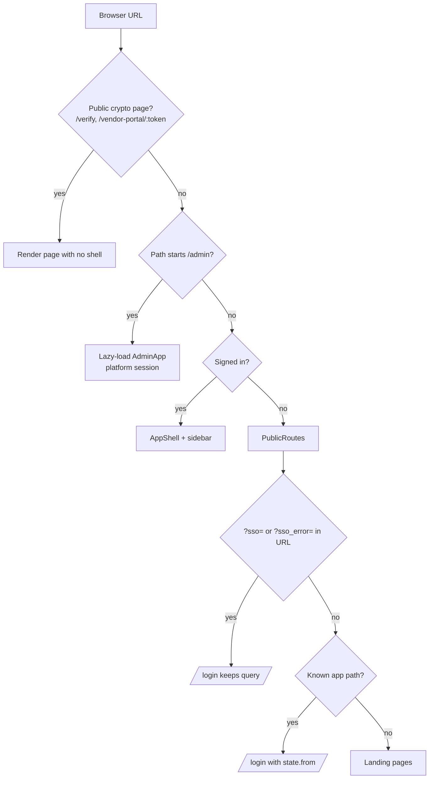

### 1.2 Sitemap

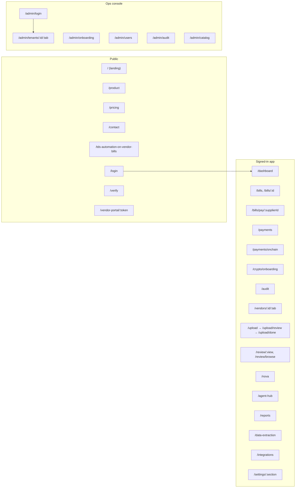

### 1.3 Route table (signed-in shell)

| Path | Page | Route guard | Sidebar shows when |
|---|---|---|---|
| `/dashboard` | `DashboardPage` | — | `payables.view` |
| `/bills`, `/bills/:invoiceId` | `BillsPage` | — | `payables.view` or `payables.approve` |
| `/bills/pay/:supplierId?bill=&amount=&via=&payout=` | `PaymentPage` | `RequireService disbursement` | — |
| `/payments` | `PaymentHubPage` | `RequireService disbursement` | view/approve + disbursement |
| `/payments/onchain` | `crypto/OnchainPage` | `RequireService crypto_payouts` | view/approve + crypto_payouts |
| `/crypto/onboarding` | `crypto/CryptoOnboardingPage` | `RequireService crypto_payouts` | `team.edit_permissions` + crypto_payouts |
| `/audit` | `crypto/AuditPage` | `RequireService audit_anchor` | `payables.view` + audit_anchor |
| `/vendors`, `/vendors/:id`, `/vendors/:id/:tab` | `VendorsPage` | — | `payables.view` |
| `/reports` | `ReportsPage` | — | `payables.view` |
| `/data-extraction` | `DataExtractionPage` | `RequireService data_extraction` | `payables.view` + data_extraction |
| `/integrations` | `IntegrationsPage` | `RequireRole admin` | `team.edit_permissions` |
| `/review`, `/review/:view` | `ReviewHubPage` | `RequireService review_hub` | `payables.view` + review_hub |
| `/review/browse` | `BrowseView` | `RequireService review_hub` | — |
| `/nova` | `NovaPage` | `RequireService nova_billing` | `payables.view` + nova_billing |
| `/agent-hub` | `AgentHubPage` | `RequireService agent_hub` | `payables.view` + agent_hub |
| `/settings`, `/settings/:section` | `SettingsPage` | `RequireRole admin` | `team.edit_permissions` |
| `/upload` | `UploadPage` | — | `payables.initiate` |
| `/upload/review` | `ReviewPage` (OCR editor) | redirects to `/upload` if queue empty | — |
| `/upload/done` | `DonePage` | redirects to `/upload` if no result | — |
| `*` | remembered `from` or `defaultPath(role)` | | |

Parameter values:

| Parameter | Values |
|---|---|
| `defaultPath(role)` | `/bills` if `payables.view`, else `/upload` (so approvers land on `/upload`) |
| Review `:view` | `queue` (default), `snoozed`, `resolved`, `activity` |
| Settings `:section` | `approval-chain` (default), `roles`, `team`, `charges`, `categories`, `coa`, `tds`, `brands`, `cost-centers`, `fx`, `demo-payments`, `country` |
| Vendor `:tab` | `details` (default), `spend`, `documents`, `conversations`, `activity`, `compliance` (aliases: `contacts`, `bank`, `gstins`, `tds`, `statements`) |
| Overlay cards | `?open=bill:<id>`, `?open=vendor:<id>[:<tab>]` |
| Review drawer | `?f=<findingId>`; deep-link focus `?focus=…&from=review:<id>` |

---

## 2. Roles, permissions and what each persona sees

### 2.1 Frontend permission matrix (`auth/permissions.ts`)

| Permission | admin | finance_controller | accountant | approver | member | auditor |
|---|:-:|:-:|:-:|:-:|:-:|:-:|
| payment.view | ✓ | ✓ | | | | ✓ |
| payment.create | ✓ | ✓ | | | | |
| payment.authorize | ✓ | | | | | |
| payment.edit_threshold | ✓ | | | | | |
| banking.read | ✓ | ✓ | ✓ | | | ✓ |
| banking.manage | ✓ | | | | | |
| team.manage_members | ✓ | | | | | |
| team.edit_permissions | ✓ | | | | | |
| team.edit_company_profile | ✓ | | | | | |
| accounting.view | ✓ | ✓ | ✓ | | | ✓ |
| accounting.edit | ✓ | ✓ | ✓ | | | |
| payables.view | ✓ | ✓ | ✓ | | ✓ | ✓ |
| payables.initiate | ✓ | ✓ | ✓ | ✓ | ✓ | |
| payables.approve | ✓ | | | ✓ | | |
| payables.accounting_approval | ✓ | ✓ | ✓ | | | |

### 2.2 Backend capabilities (Review Hub and guarded actions)

| Capability | Roles |
|---|---|
| view | all six roles |
| edit | admin, finance_controller, accountant |
| approve | admin, finance_controller, approver |
| verify | admin, finance_controller, accountant |
| pay | admin, finance_controller |
| admin | admin |

Admin-only on the server (`require_role("admin")`): user CRUD, jurisdiction update, audit anchor, on-chain rescan, every disbursement initiate/OTP call, demo settings, wallet invite/approve/freeze, contract rates, crypto payout keep-only/repropose/cancel, crypto onboarding writes.

### 2.3 What each persona does

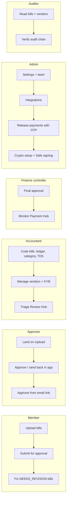

---

## 3. Journey overview

The full lifecycle of one bill, across personas and systems:

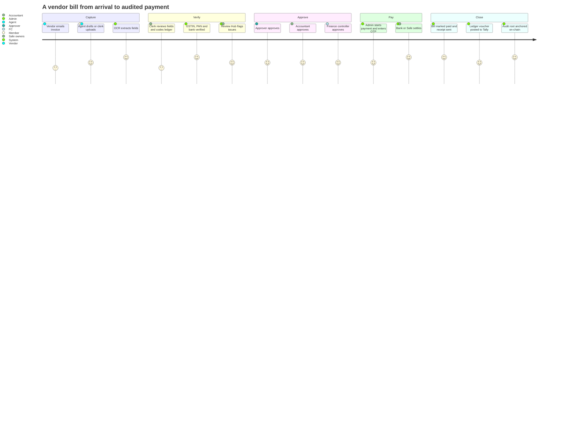

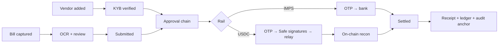

---

## 4. Flow 1 — Sign in

### 4.1 Password login

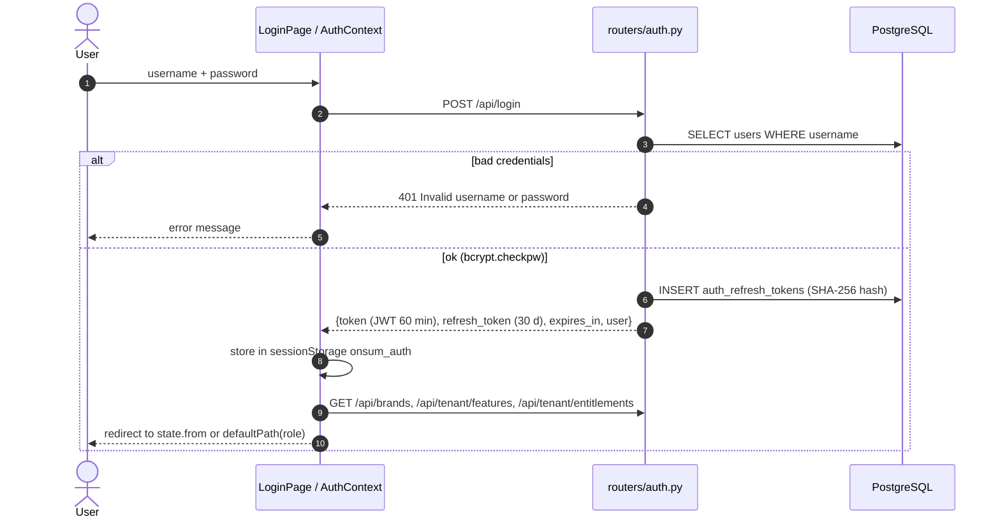

### 4.2 SSO (Google / Microsoft)

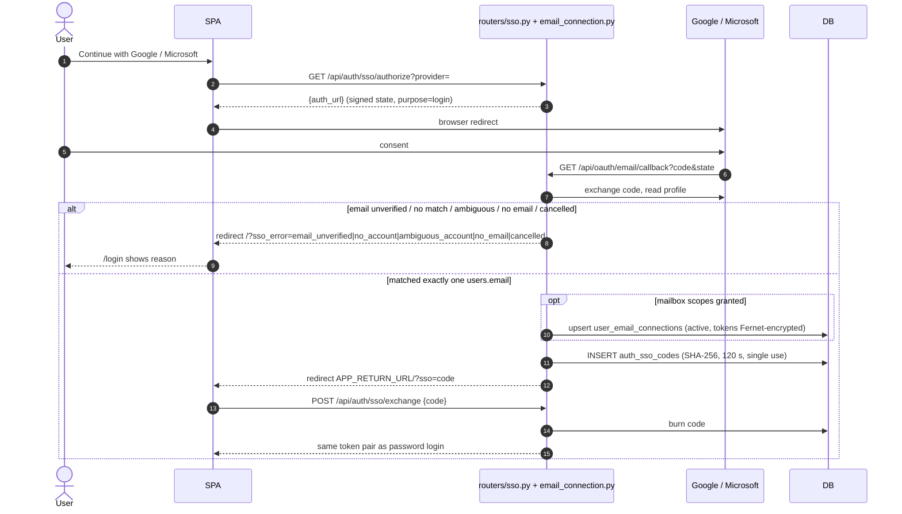

SSO **never creates** an account; the provider email must match an existing `users.email`.

### 4.3 Forgot password (OTP)

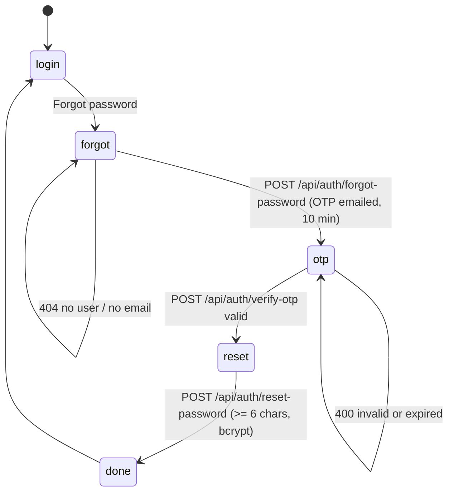

### 4.4 Session upkeep

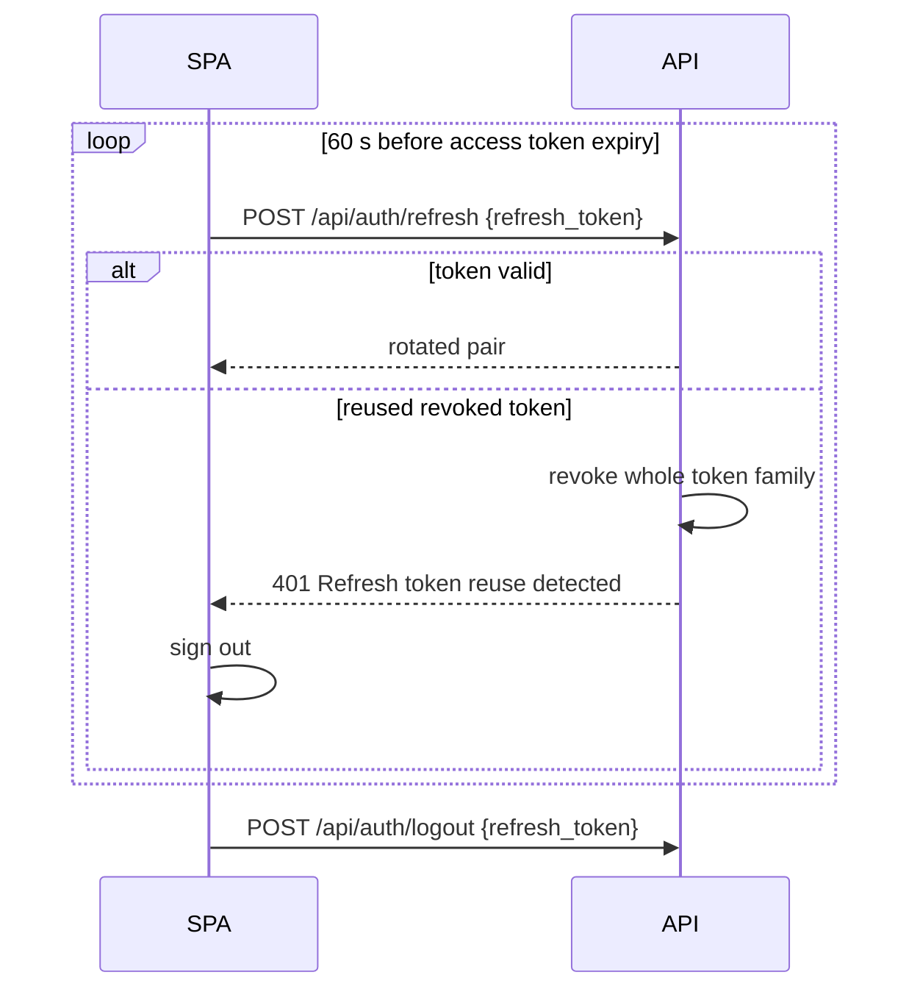

---

## 5. Flow 2 — Platform onboarding of a new tenant

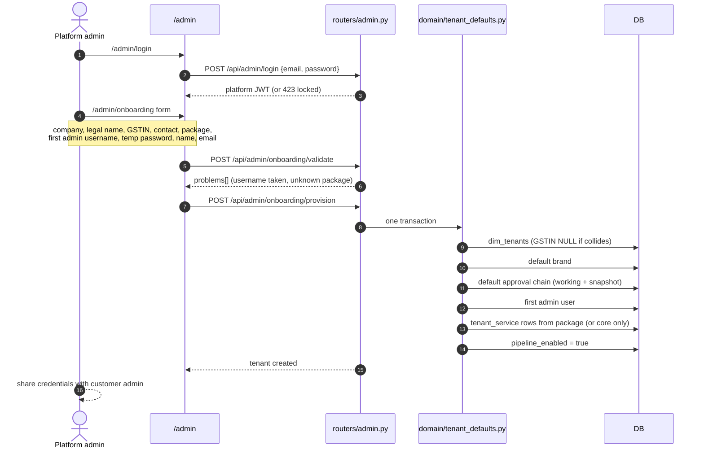

---

## 6. Flow 3 — Tenant admin first-time setup

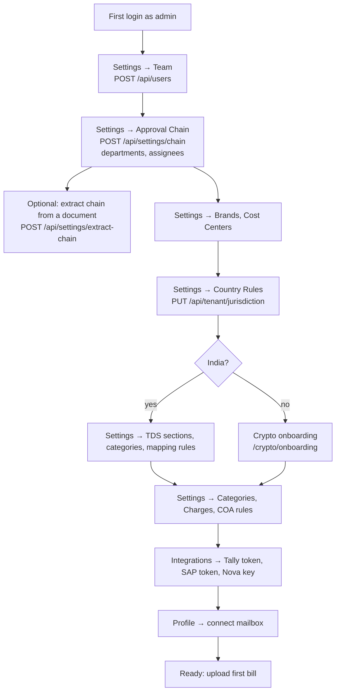

| Settings section | Endpoints |
|---|---|
| Approval Chain | `GET/POST /api/settings/chain`, `GET /chain/default`, `POST /chain/save-default`, `POST /api/settings/extract-chain`, departments CRUD, `GET /user-departments` |
| Country Rules | `GET/PUT /api/tenant/jurisdiction` |
| Roles | read-only matrix |
| Team | `GET/POST/PUT/DELETE /api/users` |
| Brands | `/api/brands` CRUD + logo |
| Cost Centers | `/api/cost-centers` CRUD |
| Charges | `/api/charges` CRUD |
| Categories | `/api/categories` CRUD, `GET/PUT /api/category-exp-heads` |
| COA | `/api/coa-rules` CRUD |
| TDS | `/api/settings/tds/sections`, `vendor-categories`, `mapping-rules` (+ reorder), `preferences`, `fy-state`, `preview` |
| FX | `GET/PUT /api/fx/settings` |
| Demo Payments | `GET/PUT /api/disbursements/demo-settings` |
| Priority labels | `GET/PUT /api/settings/priority-labels` |

### 6.1 Configuring the approval chain

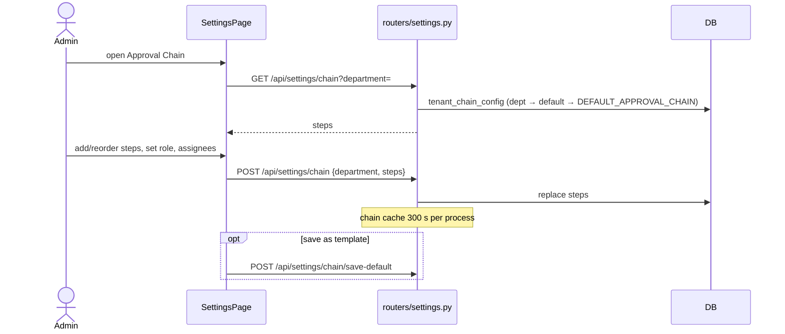

---

## 7. Flow 4 — Add a vendor (India vs international)

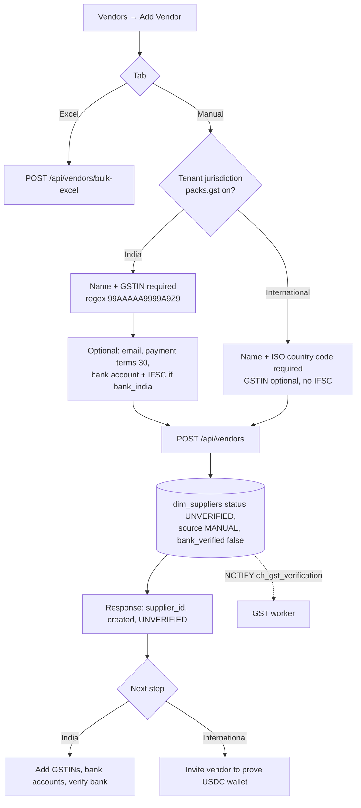

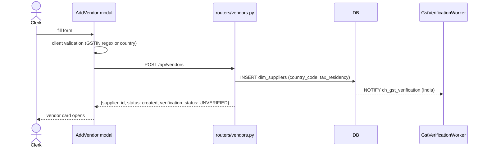

---

## 8. Flow 5 — Vendor KYB: GSTIN, PAN and bank verification

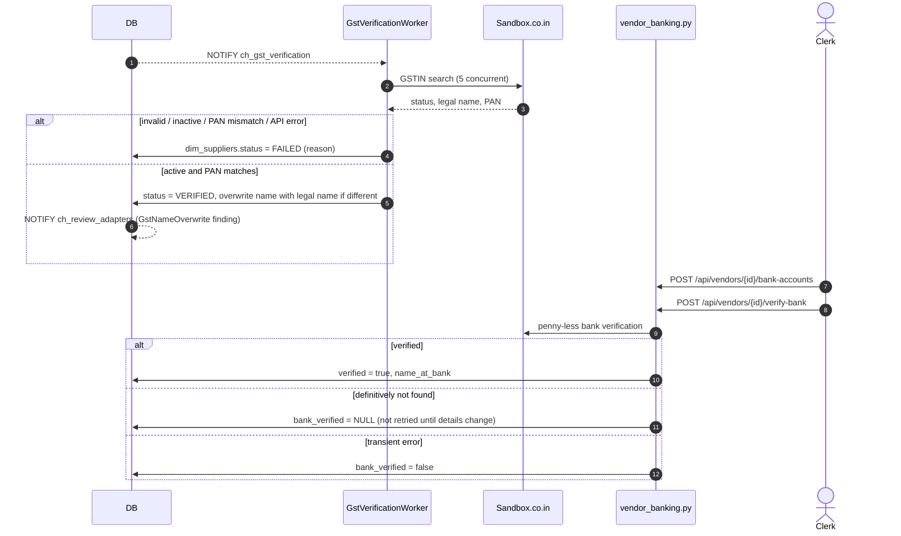

Payment eligibility uses the result:

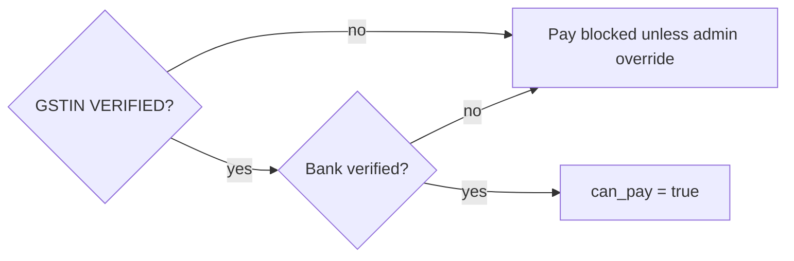

Re-verification: `POST /api/vendors/{id}/gstins/{gid}/reverify`, `/gstins/primary/reverify`, `/reverify-bank`. Changing `gstn` or bank details resets the flags via triggers.

---

## 9. Flow 6 — Upload a bill → OCR → review → submit

### 9.1 End-to-end

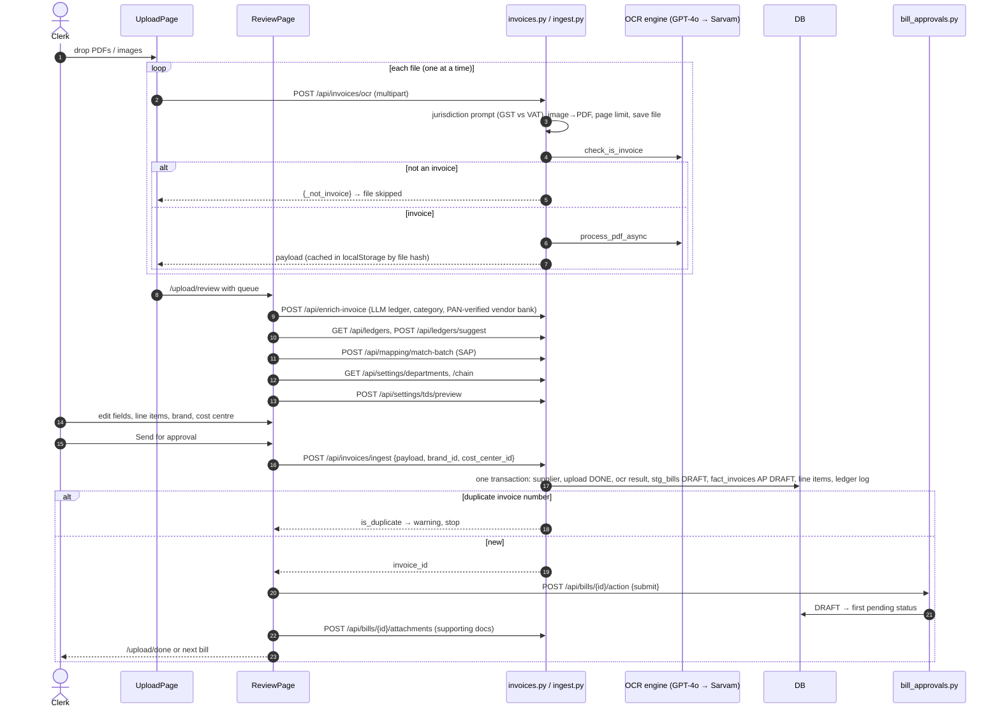

### 9.2 Upload page file states

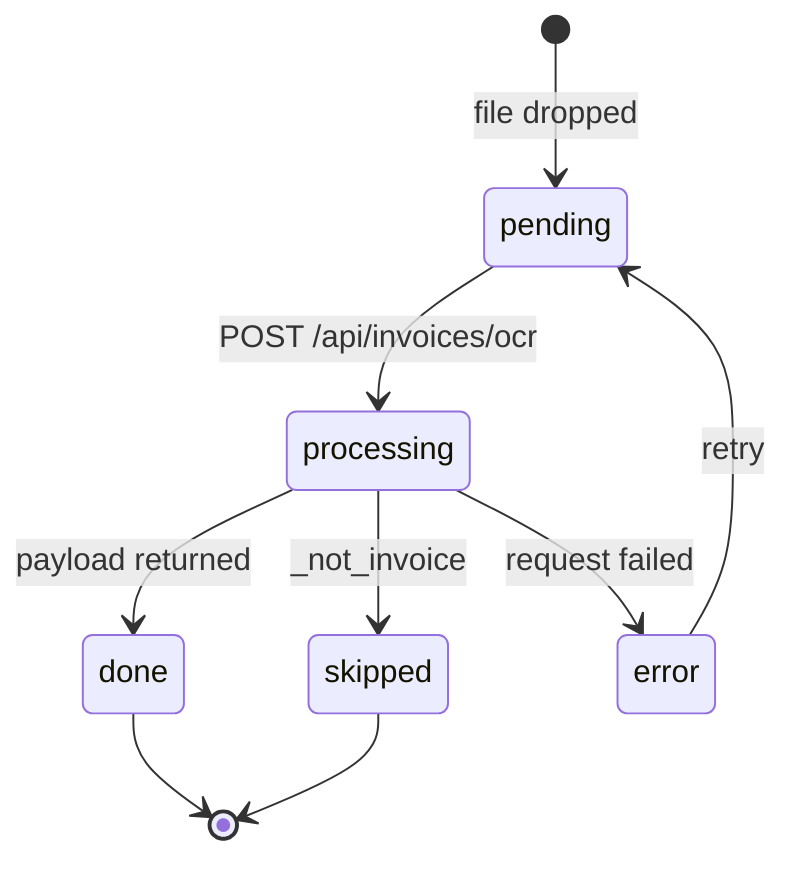

### 9.3 Background work triggered by ingest

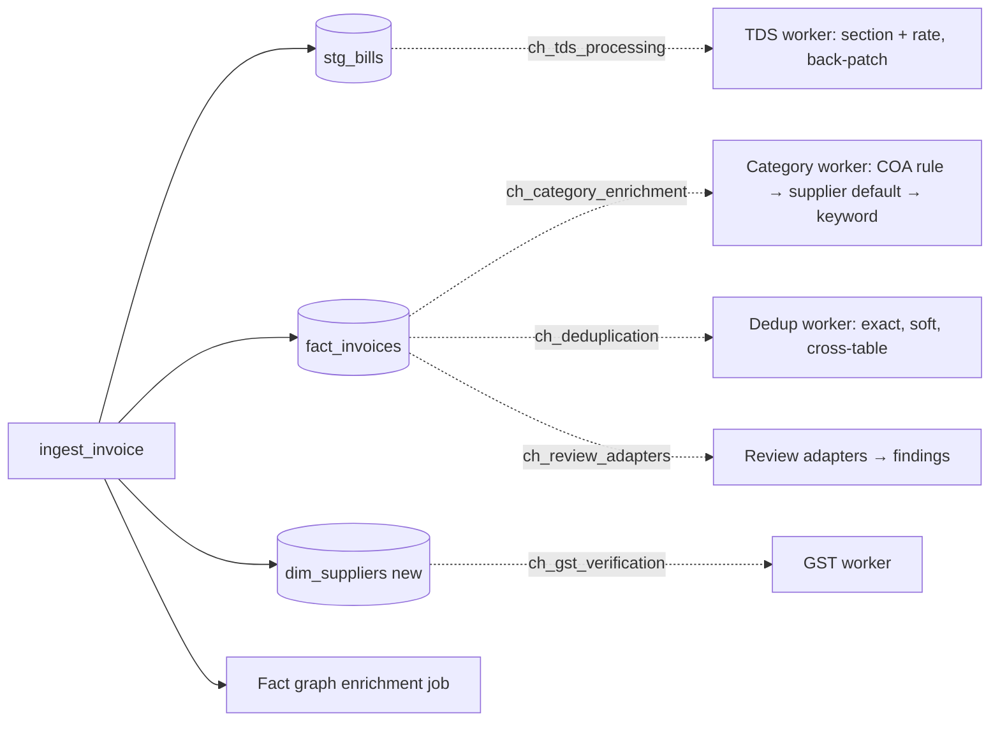

The pipeline path (files dropped in `raw_invoice_uploads` by other channels) goes through `UploadOcrWorker`: `RECEIVED → PREPROCESSING → (OCR_FALLBACK) → VALIDATING → DONE`.

---

## 10. Flow 7 — Mailbox agent: email → draft bill

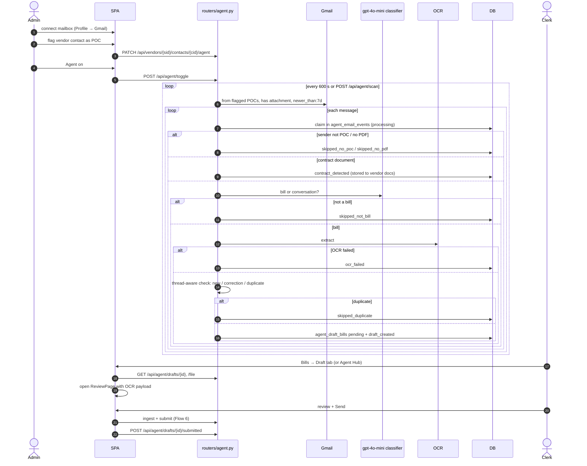

The agent **never auto-submits** a bill; a human always reviews the draft.

---

## 11. Flow 8 — Bill approval chain

### 11.1 Default chain

```mermaid
flowchart LR
    S0["Step 0<br/>Submitted<br/>member, locked"] --> S1["Step 1<br/>Approver<br/>PENDING_APPROVER"]
    S1 --> S2["Step 2<br/>Accountant<br/>PENDING_ACCOUNTANT"]
    S2 --> S3["Step 3<br/>Finance Controller<br/>PENDING_FC"]
    S3 --> AP["APPROVED"]
    S1 -.send back.-> NR["NEEDS_REVISION"]
    S2 -.send back.-> S1
    S3 -.send back.-> S2
    NR -.resubmit.-> S1
```

Chains are configured per department; extra steps become `PENDING_STEP_n`. The allowed actors at a step are its `role` plus `admin`, filtered by named `assignees` when set.

### 11.2 In-app approval

```mermaid
sequenceDiagram
    autonumber
    actor Ap as Approver
    participant SPA as BillsPage / bill detail
    participant API as bill_approvals.py
    participant CH as core/approval_chain.py
    participant DB
    participant Mail as SMTP

    Ap->>SPA: My approvals tab
    SPA->>API: GET /api/bills?role=&username=
    API-->>SPA: bills pending this role/assignee
    Ap->>SPA: open bill
    SPA->>API: GET /api/bills/{id} (chain, allowed_roles, allowed_usernames)
    SPA->>API: GET /api/docs/{upload_id} (PDF blob)
    alt approve
        SPA->>API: POST /api/bills/{id}/action {approve, actor_role, actor_name, comment}
        API->>CH: next status for this chain
        API->>DB: UPDATE fact_invoices.status
    else send back
        SPA->>API: POST /api/bills/{id}/action {send_back, target_status}
        API->>DB: status = earlier step or NEEDS_REVISION
    end
    API->>DB: INSERT bill_approval_chain row
    API->>API: clear notification cache
    API-)Mail: background: email next approver(s) or submitter
    API-->>SPA: new status
```

### 11.3 Email-link approval

```mermaid
sequenceDiagram
    autonumber
    participant API
    participant Mail as SMTP
    actor Ap as Approver (inbox)
    participant AL as GET /api/bills/approve-link (public)
    participant DB

    API->>Mail: email with Approve / Send back links
    Note over API,Mail: token = itsdangerous(APPROVAL_SECRET)<br/>{invoice_id, action, role}, valid 7 days
    Mail-->>Ap: email
    Ap->>AL: click link
    AL->>DB: bill status still in chain? role allowed?
    alt no longer valid
        AL-->>Ap: HTML 403 page
    else valid
        AL->>DB: update status, chain row "Via email link"
        AL->>Mail: notify next step
        AL-->>Ap: HTML confirmation page
    end
```

Recipients: on `APPROVED` or `NEEDS_REVISION` the submitter; otherwise the step's assignees, falling back to all users with the step's role in the department.

### 11.4 Bulk actions

```mermaid
flowchart TD
    A[Select bills, max BULK_LIMIT] --> B{Action}
    B -->|APPROVE| C[Per bill: chain role check → next status]
    B -->|PUSH_TALLY admin| D[APPROVED bills → tally_push_pending = true]
    B -->|MARK_PAID admin| E[payment_status = paid, step-99 row]
    C & D & E --> F[POST /api/bills/bulk-action → per-bill results]
```

### 11.5 Other approval paths

| Path | Endpoint | Note |
|---|---|---|
| Review Hub | `POST /api/review/act/approve-bill` | needs `approve` capability; actor from token |
| Nova reconcile decision | `POST /api/bills/{id}/reconcile-action` | `approve` = audit only; `reject` advances to next chain status |

---

## 12. Flow 9 — Pay a bill over IMPS

### 12.1 Wizard steps

```mermaid
stateDiagram-v2
    [*] --> select: open payment wizard
    select --> review: bills + amounts chosen
    [*] --> review: bill pinned in URL
    review --> verify: initiate (OTP emailed)
    verify --> verify: wrong OTP / resend
    verify --> settling: OTP accepted
    settling --> receipt: SUCCESS
    settling --> receipt: FAILED (shown with reason)
    settling --> pending: budget exceeded, still PENDING
    receipt --> [*]
```

### 12.2 Sequence

```mermaid
sequenceDiagram
    autonumber
    actor Admin
    participant SPA as PaymentPage / usePaymentFlow
    participant API as routers/disbursement.py
    participant DB
    participant Mail as SMTP
    participant LDX as Lendix
    participant Bank as ICICI / AU

    Admin->>SPA: Pay (bill APPROVED, unpaid)
    SPA->>API: GET /api/vendors/{sid}/payment-profile
    SPA->>API: GET /api/disbursements/stats, /banks
    Admin->>SPA: choose bills, amounts (<= outstanding)
    SPA->>API: POST /api/bills/{id}/disbursements {amount, bank_provider, override?}
    API->>API: role from token = admin
    API->>DB: _resolve_beneficiary: bank verified AND GSTIN VERIFIED?
    alt not verified and no override
        API-->>SPA: 400 admin override with reason required
    else override
        API->>DB: disbursement_overrides + wf_audit_log
    end
    API->>API: IMPS available, not already in flight, bank amount bounds
    API->>DB: fact_disbursements PENDING_OTP, OTP hash, expires 120 s
    API->>Mail: OTP to remitter notify_email
    API-->>SPA: {disbursement_id, otp_sent_to, otp_expires_at}
    Admin->>SPA: enter 6-digit OTP
    SPA->>API: POST /api/disbursements/{id}/verify-otp {otp}
    alt expired
        API->>DB: FAILED
        API-->>SPA: 400 OTP expired
    else >= 5 attempts
        API-->>SPA: 400 too many attempts
    else wrong
        API->>DB: otp_attempts++
        API-->>SPA: 400 Incorrect OTP
    else correct
        API->>LDX: vendor-payment/pay (RSA, tran_ref_no)
        LDX->>Bank: IMPS
        LDX-->>API: response
        API->>API: _canonical_status → SUCCESS / PENDING / FAILED
        API->>DB: disbursement_gateway_calls log
        opt SUCCESS
            API->>DB: _apply_success: remitter balance, amount_paid, outstanding, payment_status, step 99
            API-)Mail: receipt (PDF) to vendor contact
        end
        API-->>SPA: status
    end
    loop settle(): backoff within time budget
        SPA->>API: POST /api/disbursements/{id}/refresh-status
        API->>LDX: vendor-payment/status
        API->>DB: conditional update WHERE status = PENDING
    end
    SPA-->>Admin: receipt screen (client PDF)
```

### 12.3 Bulk payment (one vendor, one OTP)

```mermaid
sequenceDiagram
    actor Admin
    participant API
    participant DB
    Admin->>API: POST /api/vendors/{sid}/disbursements/bulk {bills: [{invoice_id, amount}]}
    API->>DB: one PENDING_OTP row per bill, shared OTP hash
    API-->>Admin: OTP sent
    Admin->>API: POST /api/disbursements/batch-verify-otp {disbursement_ids, otp}
    API->>API: one bank call per bill
    API-->>Admin: per-bill outcomes
```

### 12.4 Background sweeper

```mermaid
flowchart LR
    T[Every 300 s, advisory lock 875_291_004_419] --> Q[PENDING rows older than 60 s, batch 25]
    Q --> S[vendor-payment/status]
    S -->|SUCCESS| A[_apply_success + receipt]
    S -->|FAILED| F[FAILED + finding via payment_failures adapter]
    S -->|still pending| P{older than 7 days?}
    P -->|yes| G[give up, leave PENDING]
    P -->|no| T
```

The sweeper never re-initiates a payment. A retry reuses `tran_ref_no`.

---

## 13. Flow 10 — Payment Hub operations

```mermaid
flowchart TD
    H["/payments"] --> L[GET /api/disbursements/queue, /stats, /recent, /banks]
    L --> R{Row action}
    R -->|Pay with OTP| P[open payment wizard]
    R -->|Override| O[POST /vendors/:sid/disbursements/bulk with override fields]
    R -->|Enter code| V[POST /disbursements/:id/verify-otp or batch-verify-otp]
    R -->|Resend| RS[POST /disbursements/:id/resend-otp]
    R -->|Check status| CS[POST /disbursements/:id/refresh-status]
    R -->|Retry| P
    R -->|Export queue| CSV[CSV in browser]
```

---

## 14. Flow 11 — Crypto onboarding

```mermaid
sequenceDiagram
    autonumber
    actor Admin as Tenant admin (non-India)
    participant SPA as /crypto/onboarding
    participant API as crypto_onboarding.py
    participant Chain as Base RPC / Safe
    participant DB

    Admin->>SPA: open Crypto Setup
    SPA->>API: GET /api/onboarding/profile
    Admin->>SPA: entity: legal name, country, registration no., tax residency, currency
    SPA->>API: POST /api/onboarding/kyb
    API->>DB: dim_tenants.kyb_status = SUBMITTED
    loop each beneficial owner >= 25%
        SPA->>API: POST /api/onboarding/ubos
        API->>DB: tenant_ubos (screening PENDING)
    end
    SPA->>API: POST /api/onboarding/kyb/decision {APPROVED | REJECTED}
    API->>DB: kyb_status
    Admin->>SPA: connect treasury Safe (and optional TAX wallet)
    SPA->>API: POST /api/treasury/wallets {chain, address, role, custody}
    API->>Chain: read owners, threshold, nonce
    API->>DB: treasury_wallets
    Admin->>SPA: set rail policy
    SPA->>API: PUT /api/tenant/rail-policy
    Note over API,DB: crypto_enabled, allowed chains/tokens,<br/>per-tx and daily USD limits, dual control above,<br/>cooling minutes, require test transfer
    API->>DB: tenant_rail_policy
```

```mermaid
flowchart LR
    A[KYB submitted] --> B[UBOs added] --> C[KYB approved] --> D[Treasury Safe connected] --> E[Rail policy: crypto_enabled] --> F[USDC rail available]
    X[India-resident tenant] -.->|refused everywhere| F
```

---

## 15. Flow 12 — Vendor wallet proof (SIWE) and approval

```mermaid
sequenceDiagram
    autonumber
    actor Admin
    participant API as crypto_wallets.py
    participant Mail as SMTP
    actor Vendor
    participant Portal as /vendor-portal/:token (public)
    participant PAPI as vendor_portal.py
    participant Wallet as Vendor's wallet
    participant SCR as Screening (static list)
    participant DB

    Admin->>API: POST /api/vendors/{sid}/wallet-invites {email?}
    API->>API: HMAC token {tenant, supplier, expiry 72 h}
    opt admin typed an email
        API->>Mail: invite link
    end
    API-->>Admin: invite_url
    Vendor->>Portal: open link
    Portal->>PAPI: GET /api/vendor-portal/{token}
    PAPI-->>Portal: payer, payee, chain context
    Vendor->>Wallet: connect (EIP-1193), switch to Base Sepolia 84532
    Portal->>PAPI: GET /wallet/challenge?chain&address
    PAPI->>DB: vendor_portal_nonces (single use, 10 min)
    PAPI-->>Portal: EIP-4361 message
    Wallet->>Wallet: personal_sign
    Portal->>PAPI: POST /wallet/verify {message, signature}
    PAPI->>PAPI: exact round-trip, domain, URI, chain, expiry, recover signer, nonce unused
    PAPI->>SCR: screen address
    SCR-->>PAPI: CLEAR / HIT / ERROR
    PAPI->>DB: wallet_screenings + supplier_wallets
    alt HIT
        PAPI->>DB: FROZEN + SCREENING_HIT finding (critical)
    else ERROR
        PAPI->>DB: PENDING_PROOF
    else CLEAR
        PAPI->>DB: COOLING until now + cooling_minutes (1440)
    end
    PAPI-->>Portal: {wallet_id, status, screening, cooling_until, needs_admin_approval}
    opt tax documents
        Vendor->>PAPI: POST /tax-docs (TRC, 10F, W-8BEN-E)
    end
    Admin->>API: POST /api/vendors/{sid}/wallets/{wid}/approve (after cooling)
    API->>DB: ACTIVE - older wallet REVOKED
```

---

## 16. Flow 13 — Wallet change (fraud guard)

```mermaid
flowchart TD
    A[Vendor proves a NEW address<br/>while a wallet is ACTIVE] --> B[Old wallet → FROZEN<br/>reason WALLET_CHANGED]
    B --> C[High-severity WALLET_CHANGED finding]
    B --> D[Email previous vendor contact]
    A --> E[New wallet → COOLING 24 h]
    E --> F{Admin checks out-of-band}
    F -->|legitimate| G[Approve → new ACTIVE, old REVOKED]
    F -->|fraud| H[Freeze new wallet]
    I[Invoice shows a different wallet] --> J[WALLET_MISMATCH finding<br/>invoice wallet never used for payout]
```

---

## 17. Flow 14 — USDC payout via Safe multisig

### 17.1 Wizard steps

```mermaid
stateDiagram-v2
    [*] --> select: rail USDC chosen
    select --> verify: prepare() ok, OTP emailed
    select --> select: policy refusal shown
    verify --> sign: OTP ok → Safe tx PROPOSED
    sign --> sign: owner signs (PARTIALLY_SIGNED)
    sign --> watching: threshold met → READY → SUBMITTED
    watching --> receipt: CONFIRMED
    watching --> failed: REVERTED / REPLACED
    failed --> sign: repropose
    receipt --> [*]
```

### 17.2 Pre-flight and prepare

```mermaid
flowchart TD
    A[GET /api/withholding/preview?invoice_id&amount&rail=USDC] --> B[Show gross, withholding, net, FX, checks]
    B --> C[POST /api/bills/:id/disbursements rail=USDC]
    C --> D{PolicyEngine.check_payout - in order}
    D --> D1[Residency: not India-resident]
    D1 --> D2[crypto_enabled]
    D2 --> D3[Chain allowed]
    D3 --> D4[Token allowed]
    D4 --> D5[Vendor wallet ACTIVE]
    D5 --> D6[Cooling over]
    D6 --> D7[Screening CLEAR within 24 h]
    D7 --> D8[Per-tx limit]
    D8 --> D9[Daily limit]
    D9 --> D10[Treasury balance minus in-flight]
    D10 --> D11[Nothing else in flight / no duplicate across rails]
    D11 -->|pass| E[FX snapshot frozen, withholding computed, Safe owners synced]
    E --> F[PENDING_OTP / AWAITING_RELEASE + OTP email]
    D -->|any fail| R[Refusal code, e.g. OVER_DAILY_LIMIT - finding if relevant]
```

### 17.3 Release, sign, relay, confirm

```mermaid
sequenceDiagram
    autonumber
    actor Admin
    actor O1 as Safe owner 1
    actor O2 as Safe owner 2
    participant SPA as CryptoPayFlow
    participant API as crypto_payouts.py / PayoutService
    participant Safe as Safe (Base)
    participant Rel as GasRelayer
    participant W as Chain watcher + matcher
    participant DB

    Admin->>SPA: enter OTP
    SPA->>API: POST /api/disbursements/{id}/verify-otp
    API->>Safe: read nonce
    API->>API: nonce = max(Safe nonce, highest held + 1)
    API->>API: build tx: USDC transfer, or MultiSend (vendor net + tax leg)
    API->>DB: safe_tx_hash, safe_nonce, PROPOSED
    O1->>SPA: Sign
    SPA->>API: GET /api/disbursements/{id}/safe-tx (EIP-712 typed data)
    O1->>O1: eth_signTypedData_v4
    SPA->>API: POST /api/disbursements/{id}/signatures {signer, signature}
    API->>Safe: owners, threshold, nonce (live)
    alt not an owner
        API-->>SPA: 403 NOT_A_SAFE_OWNER
    else nonce already used
        API->>DB: FAILED / REPLACED
    else below threshold
        API->>DB: PARTIALLY_SIGNED
    end
    O2->>SPA: Sign (same steps)
    API->>DB: READY
    API->>Rel: execTransaction(packed signatures sorted by owner)
    alt queued behind earlier nonce or low balance
        API->>DB: stay READY with reason (relay loop retries every 30 s)
    else
        Rel->>Safe: submit
        API->>DB: SUBMITTED, tx_hash
    end
    loop every 3 s
        SPA->>API: GET /api/disbursements/{id}/crypto-status
    end
    W->>Safe: Transfer logs
    W->>DB: legs match, >= 3 confirmations → CONFIRMED
    W->>DB: bill paid, withholding WITHHELD, ledger posting, audit row
    SPA-->>Admin: receipt with explorer link
```

### 17.4 Recovery actions (admin)

| Situation | Action | Endpoint |
|---|---|---|
| Another payout holds an earlier nonce | Keep only this payout (cancel others for this vendor, repropose) | `POST /api/disbursements/{id}/keep-only` |
| Nonce consumed / need fresh tx | Repropose at a free nonce, signatures cleared | `POST /api/disbursements/{id}/repropose` |
| Abort before submission | Cancel with reason | `POST /api/disbursements/{id}/cancel` |
| See all unsent | Pending list | `GET /api/disbursements/pending-usdc` |

### 17.5 Demo settlement mode (`CRYPTO_SETTLEMENT=demo`)

```mermaid
flowchart LR
    A[READY] --> B[eth_call dry-run against the real Safe]
    B --> C[Insert simulated chain_transfers<br/>deterministic keccak tx hash]
    C --> D[Matcher runs immediately]
    D --> E[CONFIRMED, simulated = true]
```

---

## 18. Flow 15 — On-chain reconciliation and books

```mermaid
sequenceDiagram
    autonumber
    participant SCH as Crypto scheduler (chain loop, 4 s)
    participant W as ChainWatcher
    participant RPC as Base RPC
    participant M as OnchainMatcher
    participant DB
    participant LP as LedgerPoster (30 s)
    participant TA as Tally desktop agent

    SCH->>W: tick(from cursor)
    W->>RPC: USDC Transfer logs for TREASURY/TAX wallets (max 2000 blocks)
    alt block hash at cursor changed (reorg)
        W->>DB: flag rows above rewind removed, re-read
    end
    W->>DB: upsert chain_transfers (chain, tx_hash, log_index), direction IN/OUT
    SCH->>M: run
    M->>DB: OUT transfers ↔ crypto_disbursement_details.tx_hash
    alt all legs exact (contract, address, units) and >= 3 conf
        M->>DB: mark_confirmed
    else matched, not deep
        M->>DB: CONFIRMING
    else mismatch
        M->>DB: AMOUNT_MISMATCH finding
    else no payout
        M->>DB: UNMATCHED_OUTBOUND_TRANSFER (critical)
    end
    M->>DB: IN from vendor wallet → UNMATCHED_INBOUND_TRANSFER - else FUNDING
    M->>DB: SUBMITTED receipt status 0 → REVERTED - > 30 min no receipt → PAYOUT_STUCK
    LP->>DB: PENDING postings → voucher XML → READY
    TA->>DB: fetch READY vouchers, import to Tally → POSTED
```

Voucher lines: Dr vendor ledger (gross) · Cr `USDC Wallet` (net) · Cr `Crypto Withholding Payable` (tax) · optional Dr `Crypto Network Fees`.

User view: `/payments/onchain` → `GET /api/onchain/status`, `/transfers`, `/statements/{day}`, `/postings`, `/postings/{id}/voucher`; admin `POST /api/onchain/rescan`.

---

## 19. Flow 16 — Audit anchoring and public proof verification

```mermaid
sequenceDiagram
    autonumber
    participant Any as Any write in the app
    participant DB as wf_audit_log + trigger
    participant AS as AnchorService (daily 00:05 UTC or POST /api/audit/anchor)
    participant Chain as Base
    actor Auditor
    actor Public as Third party

    Any->>DB: INSERT wf_audit_log
    DB->>DB: trg_wf_audit_hash_chain: seq, prev_hash, row_hash = sha256(prev ‖ canonical)
    AS->>DB: lock 875_291_004_421, select unanchored rows
    AS->>AS: per tenant: leaf = sha256(0x00‖salt‖row_hash), node = sha256(0x01‖min‖max)
    AS->>AS: top tree over sha256(0x02‖tenant‖tenant_root)
    AS->>DB: audit_anchors BUILT, tenant roots, stamp anchor_id
    AS->>Chain: calldata "ONSM"‖0x01‖root‖from‖to, or OnsummAnchor.anchor()
    AS->>DB: SUBMITTED → CONFIRMED (or FAILED + ANCHOR_FAILED finding)

    Auditor->>DB: /audit: GET /api/audit/log, /verify-chain, /anchors
    Auditor->>DB: GET /api/audit/proof/{log_id} → share link (HMAC token)
    Auditor-->>Public: share link
    Public->>DB: /verify → GET /api/public/proofs/{token}, /api/public/anchors/{id}
    Public->>Public: recompute hashes in browser
    Public->>Chain: read anchor from public Base Sepolia RPC
    Public-->>Public: proof valid / invalid
```

---

## 20. Flow 17 — Review Hub triage

### 20.1 Where findings come from

```mermaid
flowchart LR
    subgraph Detect
        AD[17 adapters on ch_review_adapters] 
        AG[LLM review agent on ch_review_agent]
        CE[Comm extraction on ch_comm_extract]
        CR[Crypto domain: WALLET_CHANGED, SCREENING_HIT...]
    end
    AD & AG & CE & CR --> ST[review/store.py upsert_finding]
    ST --> RK[ranking: rank_score, lane]
    ST --> RT[routing: audience roles, users, departments]
    RT --> F[(rh_findings)]
    F --> UI[/review queue/]
```

### 20.2 Triage sequence

```mermaid
sequenceDiagram
    autonumber
    actor U as Accountant / FC
    participant SPA as ReviewHubPage
    participant API as review_hub.py
    participant DB

    U->>SPA: /review
    SPA->>API: GET /api/review/findings?status=open (keyset), /counts
    API->>DB: visibility_sql (role/user/department) + licensed services
    U->>SPA: open finding (?f=id)
    SPA->>API: GET /findings/{id}, /rollup, /preview/{pid}
    alt act
        U->>SPA: action button
        alt safe
            SPA->>API: server-named endpoint e.g. POST /api/vendors/{id}/verify-bank
        else approve
            SPA->>API: POST /api/review/act/approve-bill
        else notify
            SPA->>API: POST /api/review/act/notify (may return manual_required)
        else merge misread vendor
            SPA->>API: POST /api/review/act/merge-misread-vendor
        else bill coding
            SPA->>API: POST /api/review/bill-coding/apply
        else navigate
            SPA->>SPA: deep link (all payments go this way)
        end
    else change status
        SPA->>API: POST /findings/{id}/status {ACKNOWLEDGED|SNOOZED|RESOLVED|DISMISSED|OPEN}
        API-->>SPA: undo_token (30 s)
        opt undo
            SPA->>API: POST /findings/{id}/undo
        end
    end
    opt ask the agent
        SPA->>API: POST /api/review/rescan {subject_type, subject_id, tier}
        API->>DB: rh_review_requests → NOTIFY ch_review_agent
    end
```

### 20.3 Status rules for the user

| Status | Who | Rule |
|---|---|---|
| ACKNOWLEDGED | anyone who can see it | reverts to OPEN if the condition changes |
| SNOOZED | anyone | default 7 days (1–365); hidden until expiry |
| RESOLVED | `edit` capability | terminal |
| DISMISSED | `edit` capability | needs reason; may add a suppression |
| AUTO_RESOLVED | system | detector stopped asserting it |

The hub never moves money: payment actions are always `navigate` links into the payment wizard.

---

## 21. Flow 18 — TDS on a bill

```mermaid
flowchart TD
    A[stg_bills insert/update] -. ch_tds_processing .-> B[TdsProcessingWorker]
    B --> C{Vendor override?}
    C -->|yes| D[Use override section + rate]
    C -->|no| E[Mapping rules in order → vendor category → section]
    E --> F{Sandbox TDS API ok?}
    F -->|yes| G[Rate from API]
    F -->|no| H[Local rate table fallback]
    D & G & H --> I[Threshold + FY cumulative state per vendor]
    I --> J[Write TDS amount, net payable - back-patch fact_bills]
    K[User on bill] --> L[POST /api/bills/:id/recalc-tds]
    K --> M[POST /api/bills/:id/tds-override]
    K --> N[Vendor override: /api/settings/tds/vendor-overrides + catchup-decision]
```

The payable amount for IMPS is capped at the bill's TDS-net `outstanding_amount`.

---

## 22. Flow 19 — FX payment and alerts

```mermaid
sequenceDiagram
    actor U as Finance user
    participant SPA
    participant API as routers/fx.py
    participant W as FxRateWorker / FxCurrencyAgent
    participant DB
    W->>DB: daily rates, bill revaluation, alerts, AI notes
    U->>SPA: Dashboard FX widgets
    SPA->>API: GET /api/fx/exposure, /agent-briefing, /alerts
    U->>SPA: dismiss alert
    SPA->>API: POST /api/fx/alerts/{id}/dismiss
    U->>SPA: foreign-currency bill → record FX payment
    SPA->>API: POST /api/bills/{id}/fx-payment
    SPA->>API: GET /api/bills/{id}/fx-payments, /api/fx/agent-note
    U->>SPA: Reports → FX report
    SPA->>API: GET /api/fx/report
```

---

## 23. Flow 20 — Nova 3-way reconciliation

```mermaid
sequenceDiagram
    autonumber
    actor Admin
    participant SPA
    participant API as nova_credentials.py / billing.py
    participant NS as Nova recon service :8100
    participant Nova as Nova billing API
    participant DB
    actor Ap as Approver

    Admin->>SPA: Integrations → Nova API key
    SPA->>API: POST /api/nova/credentials {api_key, base_url}
    API->>DB: int_nova_credentials (Fernet)
    loop every 120 s
        NS->>DB: eligible bills (fact_invoices, stg_bill_line_items)
        NS->>Nova: fetch_billing_monthly(vendor, month)
        NS->>NS: 1 certification, 2 invoice vs Nova qty, 3 Nova vs certified rate
        NS->>DB: nova_reconciliation_runs + lines, rollup GREEN/YELLOW/RED
    end
    Ap->>SPA: open bill → Nova panel
    SPA->>API: GET /api/billing/bill/{id}/reconcile[?refresh&combined]
    API->>NS: proxy
    NS-->>SPA: modules, discrepancies, agent note, combined sum
    Ap->>SPA: approve or reject reconciliation
    SPA->>NS: reconcile-action {approve | reject}
    Note over SPA,NS: reject advances the bill to next chain status
```

```mermaid
flowchart LR
    I[Vendor invoice line] --> C{Certified vendor/service?}
    C -->|no| RED1[UNCERTIFIED → RED]
    C -->|yes| Q{Invoice qty = Nova billable ops?}
    Q -->|no| RED2[QTY_MISMATCH → RED]
    Q -->|yes| R{Nova rate × ops = total, within tolerance of certified rate?}
    R -->|no| RED3[RATE_MISMATCH → RED]
    R -->|yes| G[GREEN]
```

---

## 24. Flow 21 — Tally connection and sync

```mermaid
sequenceDiagram
    autonumber
    actor Admin
    participant SPA as /integrations
    participant API as system.py / tally_agent.py
    participant Agent as OnsummTallyAgent.exe
    participant Tally as Tally Prime :9000
    participant DB

    Admin->>SPA: Connect Tally
    SPA->>API: POST /api/tally/generate-token
    API->>DB: int_connections TALLY, PENDING, token 30 min
    Admin->>API: GET /agent/download (exe, sha256 in /agent/version)
    Admin->>Agent: install, paste token
    Agent->>API: POST /api/tally/pair {token, agent_version}
    API->>DB: api_key SHA-256 hash, ACTIVE
    API-->>Agent: api_key
    loop every 900 s (90-day window)
        Agent->>Tally: XML: ledgers, vouchers
        Agent->>API: POST /api/tally/ingest {ledgers_xml, vouchers_xml} (Bearer api_key)
        API->>DB: parse into staging tables
        Agent->>API: GET /api/tally/agent/status (heartbeat)
        Agent->>API: GET /agent/version → self-update if newer
    end
    SPA->>API: GET /api/tally/connection
    Admin->>SPA: Bills bulk PUSH_TALLY (APPROVED)
    SPA->>API: POST /api/bills/bulk-action PUSH_TALLY
    API->>DB: tally_push_pending = true
```

---

## 25. Flow 22 — Vendor card: documents, claims, conversations

```mermaid
flowchart TD
    V[Vendor card] --> T{Tab}
    T --> D[Details: PATCH vendor, brand, names, logo, request-info, outreach]
    T --> S[Spend: bills by vendor]
    T --> DOC[Documents]
    T --> CONV[Conversations]
    T --> ACT[Activity: GET /vendors/:id/activity]
    T --> COMP[Compliance: banks, GSTINs, TDS, crypto wallets]

    DOC --> U1[POST documents] --> CL[classify] --> EX[comm extraction → claims]
    EX --> CLM{Each claim}
    CLM -->|approve| AP[apply to vendor master]
    CLM -->|discard| DS[discard]
    CLM -->|edit| ED[PATCH claim]
    AP -->|conflict| CF[CONFLICTED → master_data_conflict finding]

    CONV --> IN[GET inbox, thread]
    IN --> SUM[POST thread/summarize]
    IN --> SEND[POST send / draft]
    IN --> ST[POST thread/state: open, awaiting_vendor, awaiting_internal, resolved]
    IN --> SAVE[POST attachment/save → vendor documents]
```

```mermaid
sequenceDiagram
    actor Clerk
    participant API as vendor_documents.py
    participant DB
    participant CE as CommExtractionWorker
    participant LLM
    Clerk->>API: POST /api/vendors/{id}/documents (file)
    API->>DB: vendor_documents (claims_status PENDING)
    API->>DB: pg_notify ch_comm_extract (doc_id)
    CE->>LLM: extract facts (bank, GSTIN, address, contacts) from document
    CE->>DB: claims, claims_status DONE - NOTIFY ch_review_adapters
    Clerk->>API: GET /documents/{doc}/claims
    Clerk->>API: POST /claims/{i}/approve | /discard | /approve-all
    API->>DB: apply claim to master - activity log
```

---

## 26. Flow 23 — Agent Hub and Fact Graph

```mermaid
sequenceDiagram
    actor U as Admin / FC
    participant SPA as /agent-hub
    participant API as agent.py + agent_hub.py
    participant FG as domain/fact_graph.py
    participant DB
    U->>SPA: open Agent Hub
    SPA->>API: GET /api/agent/status, /events, /pocs, /drafts
    U->>SPA: toggle agent / scan now
    SPA->>API: POST /api/agent/toggle, /api/agent/scan
    U->>SPA: open Fact Graph
    SPA->>API: GET /api/agents/fact-graph
    API->>FG: fetch_graph (tenant, vendor, bill, contact, fact nodes)
    U->>SPA: search "vendor bank change"
    SPA->>API: GET /api/agents/fact-graph/search (embeddings 1536-d)
    SPA->>API: GET /api/agents/fact-graph/neighbors
    SPA->>API: GET /api/agents/fact-graph/stream (SSE)
    SPA->>API: GET /api/agents/payment-context
```

---

## 27. Flow 24 — Reports and data extraction

```mermaid
flowchart LR
    R["/reports"] --> A[GET /api/reports/activity]
    R --> F[GET /api/fx/report]
    R --> E[GET /api/category-exp-heads]
    DX["/data-extraction"] --> X1[GET /api/reports/expense-xlsx]
    DX --> X2[GET /api/reports/expense-csv]
    B[Bill detail] --> P[GET /api/bills/:id/export-pdf]
```

---

## 28. Flow 25 — Platform support: licensing and impersonation

```mermaid
sequenceDiagram
    autonumber
    actor Ops as Platform admin / support
    participant AdminApp
    participant API as routers/admin.py
    participant DB
    participant App as Tenant app

    Ops->>AdminApp: /admin/tenants/{id}/licensing
    AdminApp->>API: GET /api/admin/services, /packages
    alt apply package
        AdminApp->>API: POST /tenants/{id}/apply-package
    else toggle services
        AdminApp->>API: PUT /tenants/{id}/services[?force] (force to revoke core)
    end
    API->>DB: tenant_service rows - entitlement cache cleared on this worker (others up to 300 s)
    Ops->>AdminApp: Impersonate (support+)
    AdminApp->>API: POST /tenants/{id}/impersonate {reason >= 10 chars}
    API->>DB: platform_impersonation + admin_audit_log
    API-->>AdminApp: tenant-shaped token with act claim, TTL <= 15 min, no refresh
    AdminApp->>App: full reload into tenant session
    App-->>Ops: banner "Impersonating", read-only (write allowlist empty)
    Ops->>API: POST /impersonations/{sid}/revoke
```

Tenants can opt out of impersonation via `settings_jsonb.impersonation_opt_out`.

---

## 29. Error and edge-case catalogue

| Flow | Condition | User sees | System does |
|---|---|---|---|
| Login | wrong password | "Invalid username or password" | 401 |
| Login | refresh token reused | signed out | revokes token family |
| SSO | no matching user | `sso_error=no_account` | no account created |
| Upload | non-invoice file | file marked skipped | `_not_invoice` |
| Upload | duplicate invoice number | duplicate warning | existing bill updated, `is_duplicate` |
| Approval | wrong role / not assignee | action hidden or 403 | — |
| Approval | email link after status moved | HTML 403 page | no change |
| IMPS | vendor not verified | "admin override with reason required" | 400 |
| IMPS | OTP expired | "OTP expired" | row FAILED |
| IMPS | 5 wrong OTPs | too many attempts | 400 |
| IMPS | bank timeout after hand-off | pending | row PENDING, sweeper resolves |
| IMPS | payment already in flight | blocked | 409/400 in-flight guard |
| USDC | India-resident tenant | rail not offered | `CRYPTO_DISABLED_RESIDENT_INDIA` |
| USDC | wallet cooling | refusal | `WALLET_COOLING` |
| USDC | over limit | refusal | `OVER_PER_TX_LIMIT` / `OVER_DAILY_LIMIT` |
| USDC | low treasury | refusal | `INSUFFICIENT_TREASURY_BALANCE` |
| USDC | paid on other rail | refusal | `DUPLICATE_ACROSS_RAILS` finding |
| USDC | signer not owner | 403 | `NOT_A_SAFE_OWNER` |
| USDC | nonce consumed | failed | `REPLACED` → repropose |
| USDC | tx reverted | failed | `REVERTED` |
| USDC | chain not configured | 503 | `CHAIN_NOT_CONFIGURED` |
| Wallet | sanctions hit | wallet frozen | critical finding |
| Wallet | portal link expired / nonce reused | error page | `PortalLinkInvalid` / `REPLAYED` |
| Review Hub | dismiss without reason | 400 | — |
| Licensing | service not licensed | "X isn't part of your plan" | 403 when `enforce` |

---

## 30. Known gaps that affect flows

| # | Gap | Flow affected |
|---|---|---|
| 1 | Approval role check trusts `actor_role` / `actor_name` from the request body, not the token (`bill_action`, `reconcile-action`, `bulk-action`) | Flow 8 |
| 2 | No server-side role check on settings, chain, categories, COA, vendor writes, soft-status (UI-only) | Flows 3, 4 |
| 3 | `POST /api/vendors` response lacks fields the Add Vendor result panel reads → shows "could not verify" | Flow 4 |
| 4 | `PUSH_TALLY` bridge joins on `stg_invoice_id` (AR), so AP bills may never reach the push queue | Flow 21 |
| 5 | Password-reset OTP kept in process memory | Flow 1 |
| 6 | Nova `reconcile-action` posts to the Nova service URL, not the main API | Flow 20 |
| 7 | Bank verification worker disabled; bank checks only on demand | Flow 5 |
| 8 | Chains with more than three approval steps produce statuses outside the DB enum | Flow 8 |
