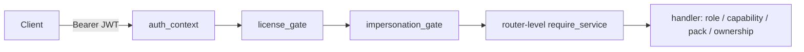

# Onsumm Platform — API Reference

| | |
|---|---|
| **Document** | 05 — API Reference |
| **As of** | 2026-10-31 (commit `6e1278f`) |
| **Base URLs** | Prod `https://api.onsumm.ai` · Dev `https://api.onsumm.ai/dev` · International `https://inter.collabup.co.in` · Nova service `:8100` |
| **Size** | 44 router modules, 308 route decorators, + `GET /metrics`, + 9 Nova service routes |
| **Related** | [02 LLD](02_LLD.md) · [03 User Flows](03_USER_FLOWS.md) · [07 Security](07_SECURITY.md) |

---

## Table of contents

1. [Conventions](#1-conventions)
2. [Router map](#2-router-map)
3. [Auth and identity](#3-auth-and-identity)
4. [Platform admin](#4-platform-admin)
5. [Bills and approvals](#5-bills-and-approvals)
6. [Upload, OCR and reports](#6-upload-ocr-and-reports)
7. [Vendors](#7-vendors)
8. [Org, settings, ledger](#8-org-settings-ledger)
9. [TDS and FX](#9-tds-and-fx)
10. [INR disbursement](#10-inr-disbursement)
11. [Crypto rail](#11-crypto-rail)
12. [Audit and proofs](#12-audit-and-proofs)
13. [Review Hub](#13-review-hub)
14. [Agents, Fact Graph, email](#14-agents-fact-graph-email)
15. [Integrations: Tally, SAP, Nova](#15-integrations-tally-sap-nova)
16. [System](#16-system)
17. [Nova reconciliation service](#17-nova-reconciliation-service)
18. [Error codes](#18-error-codes)
19. [Example payloads](#19-example-payloads)

---

## 1. Conventions

| Item | Convention |
|---|---|
| Auth header | `Authorization: Bearer <access JWT>` |
| Tenant | Always taken from the JWT; any `company_id` in the request is ignored |
| Content type | `application/json`; uploads are `multipart/form-data` (max part 50 MB) |
| Request id | Send `X-Request-ID` or one is generated and echoed back |
| Errors | `{"detail": "..."}`; 5xx bodies are generic |
| Foreign rows | `404`, never `403` |
| Licence | Unlicensed service → `403` when `LICENSE_ENFORCEMENT=enforce` (default `log`) |
| Public routes | marked **public** below |
| Role notes | **admin** = `require_role("admin")`; **cap:X** = `require_capability(X)`; **pack:X** = `require_pack(X)` |



---

## 2. Router map

| Router | Prefix | Routes | Router-level gate | Licence service |
|---|---|---|---|---|
| auth | `/api` | 6 | — | core |
| sso | `/api/auth/sso` | 2 | — | core |
| users | `/api/users` | 4 | — | users |
| admin | `/api/admin` | 22 | platform JWT | exempt |
| bills | `/api/bills` | 5 | — | bills |
| bill_approvals | `/api/bills` | 4 | — | approvals |
| bill_attachments | `/api/bills/{id}/attachments` | 6 | — | bills |
| bill_export | `/api/bills` | 1 | — | bills |
| bill_tds | `/api/bills` | 2 | — | tds |
| invoices | `/api` | 5 | — | upload_ocr |
| reports | `/api/reports` | 3 | — | reports / data_extraction |
| vendors | `/api/vendors` | 12 | — | vendors |
| vendor_banking | `/api/vendors/{id}` | 6 | — | vendors / kyc_verification |
| vendor_contacts | `/api/vendors/{id}/contacts` | 4 | — | vendors |
| vendor_gstins | `/api/vendors/{id}/gstins` | 5 | — | vendors |
| vendor_documents | `/api/vendors/{id}/documents` | 13 | — | vendors |
| vendor_doc_classify | `/api/vendors/{id}/documents` | 1 | — | vendors |
| vendor_activity | `/api/vendors/{id}` | 1 | — | vendors |
| vendor_logos | `/api` | 4 | — | vendors |
| bank_logos | `/api/bank-logos` | 2 | — | vendors |
| org | `/api` | 12 | — | settings / brands |
| settings | `/api/settings` | 11 | — | settings / approvals |
| categories | `/api` | 10 | — | ledger |
| ledgers | `/api` | 6 | — | ledger |
| item_mapping | `/api` | 6 | — | sap_matching |
| jurisdiction | `/api` | 2 | — | settings |
| system | `/` | 3 | — | core |
| tds | `/api/settings/tds` | 22 | `require_service(tds)` | tds |
| fx | `/api` | 13 | `require_service(fx)` | fx |
| disbursement | `/api` | 14 | `require_service(disbursement)` | disbursement |
| crypto_payouts | `/api` | 8 | `require_service(crypto_payouts)` | crypto_payouts |
| crypto_onboarding | `/api` | 11 | — | crypto_payouts |
| crypto_wallets | `/api` | 6 | — | crypto_payouts |
| vendor_portal | `/api/vendor-portal` | 4 | **public**, HMAC link token | — |
| onchain | `/api` | 7 | — | crypto_payouts |
| audit_proof | `/api` | 7 | — | audit_anchor |
| nova_credentials | `/api/nova` | 3 | `require_service(nova_billing)` | nova_billing |
| billing | `/api/billing` | 1 | `require_service(nova_billing)` | nova_billing |
| review_hub | `/api/review` | 15 | — | review_hub |
| agent | `/api/agent` | 11 | — | agent_hub |
| agent_hub | `/api/agents` | 5 | — | agent_hub / fact_graph |
| email_connection | `/api` | 17 | — | email_sending |
| tally_agent | `/api/tally`, `/agent` | 6 | — | tally_connector |

---

## 3. Auth and identity

| Method | Path | Access | Purpose |
|---|---|---|---|
| POST | `/api/login` | public | Username + password → access + refresh tokens |
| POST | `/api/auth/refresh` | public (refresh token) | Rotate token pair; reuse revokes family |
| POST | `/api/auth/logout` | public (refresh token) | Revoke refresh token |
| POST | `/api/auth/forgot-password` | public | Email 6-digit OTP (10 min) |
| POST | `/api/auth/verify-otp` | public | Check reset OTP |
| POST | `/api/auth/reset-password` | public | Set new password (≥ 6 chars) |
| GET | `/api/auth/sso/authorize?provider=google\|microsoft` | public | Provider auth URL |
| POST | `/api/auth/sso/exchange` | public | Single-use SSO code → tokens |
| GET | `/api/users` | tenant | List users |
| POST | `/api/users` | admin | Create user |
| PUT | `/api/users/{username}` | admin | Update user |
| DELETE | `/api/users/{username}` | admin | Delete user |

---

## 4. Platform admin

All under `/api/admin`, platform JWT (`PLATFORM_JWT_SECRET`); role rank `readonly < support < admin < owner`.

| Method | Path | Min role | Purpose |
|---|---|---|---|
| POST | `/login` | public | Platform sign-in (423 if locked) |
| POST | `/auth/refresh`, `/auth/logout` | — | Platform session |
| GET | `/me` | readonly | Current platform user |
| GET | `/services`, `/packages` | readonly | Service catalogue, packages |
| GET | `/tenants` | readonly | List tenants |
| GET | `/tenants/{tenant_id}` | readonly | Tenant detail |
| PATCH | `/tenants/{tenant_id}` | admin | Suspend / activate / edit |
| PUT | `/tenants/{id}/services[?force]` | admin | Toggle services (`force` to revoke core) |
| POST | `/tenants/{id}/apply-package` | admin | Copy package rows to `tenant_service` |
| GET | `/tenants/{id}/usage?months=` | readonly | Metered usage |
| GET | `/tenants/{id}/users` | readonly | Tenant users |
| POST | `/onboarding/validate` | admin | Pre-check provisioning |
| POST | `/onboarding/provision` | admin | Create tenant, brand, chain, admin user, services |
| POST | `/tenants/{id}/impersonate` | support | Read-only support session (reason ≥ 10 chars) |
| POST | `/impersonations/{session_id}/revoke` | support | End session |
| GET | `/impersonations` | readonly | Sessions |
| GET / POST | `/platform-users` | admin / owner | List / create ops users |
| PATCH | `/platform-users/{user_id}` | owner | Edit ops user |
| GET | `/audit` | readonly | `admin_audit_log` |

---

## 5. Bills and approvals

| Method | Path | Access | Purpose |
|---|---|---|---|
| GET | `/api/bills?role=&username=&brand_id=&soft_status=&cost_center_id=` | tenant | List (non-admin/accountant/FC see only their queue + acted-on) |
| GET | `/api/bills/{invoice_id}` | owned | Detail incl. `chain`, `allowed_roles`, `allowed_usernames` |
| PUT | `/api/bills/{invoice_id}` | owned | Edit fields / line items / priority |
| POST | `/api/bills/{id}/payment` | owned | Manual `payment_status` + `amount_paid` |
| PATCH | `/api/bills/{id}/soft-status?status=active\|on_hold\|deleted` | owned | Hold / delete / restore |
| GET | `/api/bills/approve-link?token=` | **public** (signed token) | Email approve / send back → HTML page |
| POST | `/api/bills/{id}/action` | owned | `submit`, `approve`, `send_back`, `priority_change` |
| POST | `/api/bills/{id}/reconcile-action` | owned | Nova `approve` / `reject` |
| POST | `/api/bills/bulk-action` | tenant | `APPROVE`, `PUSH_TALLY` (admin), `MARK_PAID` (admin) |
| GET / POST | `/api/bills/{id}/attachments` | owned | List / upload |
| GET | `/api/bills/{id}/attachments/{aid}/download` | owned | Download |
| PUT / DELETE | `/api/bills/{id}/attachments/{aid}` | owned | Replace / delete |
| GET | `/api/bills/{id}/attachments/{aid}/edits` | owned | Edit history |
| GET | `/api/bills/{id}/export-pdf` | owned | Bill PDF |
| POST | `/api/bills/{id}/recalc-tds` | pack:tds_india | Recompute TDS |
| POST | `/api/bills/{id}/tds-override` | pack:tds_india | Manual TDS |

---

## 6. Upload, OCR and reports

| Method | Path | Purpose |
|---|---|---|
| POST | `/api/invoices/ocr` | Single file OCR (multipart `file`) → payload or `_not_invoice` |
| POST | `/api/invoices/ocr-bulk` | Bulk OCR |
| GET | `/api/docs/{upload_id}` | Serve source document |
| POST | `/api/enrich-invoice` | LLM ledger/category, vendor bank match |
| POST | `/api/invoices/ingest` | Persist reviewed payload → bill (DRAFT) |
| GET | `/api/reports/activity` | Activity report |
| GET | `/api/reports/expense-xlsx` | Expense export (XLSX) |
| GET | `/api/reports/expense-csv` | Expense export (CSV) |

---

## 7. Vendors

| Method | Path | Access | Purpose |
|---|---|---|---|
| GET / POST | `/api/vendors` | tenant | List / create (India: GSTIN, international: country) |
| GET / PATCH | `/api/vendors/{supplier_id}` | owned | Detail / edit |
| PATCH | `/api/vendors/{id}/brand` | owned | Assign brand |
| POST | `/api/vendors/{id}/names` | owned | Alternate names |
| GET | `/api/vendors/{id}/pan-duplicates` | owned | Vendors sharing PAN |
| POST | `/api/vendors/{id}/merge` | owned | Merge duplicate |
| POST | `/api/vendors/{id}/defer-dedup` | owned | Defer dedup prompt |
| POST | `/api/vendors/{id}/request-info` | owned | Email vendor for missing info |
| GET | `/api/vendors/{id}/outreach` | owned | Outreach log |
| POST | `/api/vendors/bulk-excel` | tenant | Bulk import |
| POST | `/api/vendors/{id}/verify-bank` | pack:bank_india | Penny-less verify |
| GET / POST | `/api/vendors/{id}/bank-accounts` | owned | Accounts |
| DELETE | `/api/vendors/{id}/bank-accounts/{account_id}` | owned | Remove |
| POST | `/api/vendors/{id}/bank-accounts/{account_id}/set-primary` | owned | Primary |
| POST | `/api/vendors/{id}/reverify-bank` | pack:bank_india | Re-verify |
| GET / POST | `/api/vendors/{id}/contacts` | owned | Contacts |
| DELETE | `/api/vendors/{id}/contacts/{cid}` | owned | Remove |
| POST | `/api/vendors/{id}/contacts/{cid}/set-primary` | owned | Primary |
| GET / POST | `/api/vendors/{id}/gstins` | pack:gst | GSTINs |
| POST | `/api/vendors/{id}/gstins/primary/reverify` | pack:gst | Re-verify primary |
| POST | `/api/vendors/{id}/gstins/{gstin_id}/reverify` | pack:gst | Re-verify one |
| DELETE | `/api/vendors/{id}/gstins/{gstin_id}` | pack:gst | Remove |
| GET / POST | `/api/vendors/{id}/documents` | owned | Documents |
| GET | `/api/vendor-document-types` | tenant | Types |
| PATCH | `/api/vendors/{id}/documents/{doc}/type` | owned | Set type |
| GET | `/api/vendors/{id}/documents/{doc}/download` | owned | Download |
| GET | `/api/vendors/{id}/documents/{doc}/claims` | owned | Extracted claims |
| POST | `…/claims/{index}/approve`, `…/claims/approve-all`, `…/claims/{index}/discard` | owned | Apply / discard claims |
| PATCH | `…/claims/{index}` | owned | Edit claim |
| PUT / DELETE | `/api/vendors/{id}/documents/{doc}` | owned | Replace / delete |
| GET | `/api/vendors/{id}/documents/{doc}/edits` | owned | History |
| POST | `/api/vendors/{id}/documents/classify` | owned | Classify document |
| GET | `/api/vendors/{id}/activity` | owned | Activity feed (USDC amounts shown in USDC) |
| GET | `/api/vendor-logos` | tenant | Logo map |
| GET / PUT / DELETE | `/api/vendors/{id}/logo` | owned | Logo |
| GET | `/api/bank-logos`, `/api/bank-logos/{code}.png` | tenant | Bank logos |

---

## 8. Org, settings, ledger

| Method | Path | Purpose |
|---|---|---|
| GET | `/api/tenant/features` | Feature flags |
| GET | `/api/tenant/entitlements` | Licensed services |
| GET / POST | `/api/cost-centers` · PATCH / DELETE `/api/cost-centers/{cc_id}` | Cost centres |
| GET / POST | `/api/brands` · PUT / DELETE `/api/brands/{id}` · POST / GET `/api/brands/{id}/logo` | Brands |
| GET / PUT | `/api/tenant/jurisdiction` (PUT admin) | Country rules, packs, rails |
| GET / PUT | `/api/settings/priority-labels` | Priority labels |
| GET | `/api/settings/chain/default` | Default chain |
| GET / POST | `/api/settings/chain` | Department chain |
| POST | `/api/settings/chain/save-default` | Save as default |
| GET / POST | `/api/settings/departments` · DELETE `/api/settings/departments/{department}` | Departments |
| GET | `/api/settings/user-departments` | User → department |
| POST | `/api/settings/extract-chain` | LLM extracts chain from a document |
| GET / POST | `/api/charges` · PUT / DELETE `/api/charges/{id}` | Charges |
| GET / POST | `/api/categories` · PATCH / DELETE `/api/categories/{id}` | Categories |
| GET / PUT | `/api/category-exp-heads` | Expense heads |
| POST | `/api/ledgers/suggest` | Ledger suggestion |
| GET | `/api/ledgers` | Ledger list |
| GET / POST | `/api/coa-rules` · PUT / DELETE `/api/coa-rules/{rule_id}` | COA rules |
| POST | `/api/mapping/match`, `/match-batch`, `/search`, `/vendor-code` | SAP item matching |
| POST | `/api/sap/generate-token` · GET `/api/sap/connection` | SAP connection |

---

## 9. TDS and FX

### TDS (`/api/settings/tds`, `require_service(tds)`)

| Method | Path |
|---|---|
| GET / POST | `/sections` · PUT / DELETE `/sections/{id}` |
| GET / POST | `/vendor-categories` · PUT / DELETE `/vendor-categories/{id}` |
| GET / POST | `/mapping-rules` · PUT `/mapping-rules/reorder` · PUT / DELETE `/mapping-rules/{rule_id}` |
| GET / POST | `/vendor-overrides` · PUT / DELETE `/vendor-overrides/{id}` · POST `/vendor-overrides/{id}/catchup-decision` |
| GET | `/fy-state` |
| GET / PUT | `/preferences` |
| POST | `/preview` |

### FX (`require_service(fx)`)

| Method | Path | Purpose |
|---|---|---|
| GET | `/api/fx/rates`, `/api/fx/rate`, `/api/fx/history`, `/api/fx/exposure` | Rates and exposure |
| POST | `/api/bills/{bill_id}/fx-payment` | Record FX payment |
| GET | `/api/bills/{bill_id}/fx-payments` | FX payments on bill |
| GET | `/api/fx/alerts` · POST `/api/fx/alerts/{alert_id}/dismiss` | Alerts |
| GET / PUT | `/api/fx/settings` | Settings |
| GET | `/api/fx/report`, `/api/fx/agent-note`, `/api/fx/agent-briefing` | Reports and AI notes |

---

## 10. INR disbursement

Prefix `/api`, `require_service(disbursement)`.

| Method | Path | Access | Purpose |
|---|---|---|---|
| GET | `/vendors/{supplier_id}/payment-profile` | tenant | GSTINs, bank accounts, pending bills |
| GET | `/disbursements/banks` | tenant | Supported banks |
| GET / PUT | `/disbursements/demo-settings` | PUT admin | Demo payments config |
| GET | `/disbursements/stats`, `/disbursements/queue`, `/disbursements/recent` | tenant | Hub data |
| GET | `/bills/{invoice_id}/disbursements` | owned | History |
| POST | `/bills/{invoice_id}/disbursements` | admin | Initiate (IMPS) or prepare (`rail: USDC`) |
| POST | `/vendors/{supplier_id}/disbursements/bulk` | admin | Same-vendor batch, one OTP |
| POST | `/disbursements/batch-verify-otp` | admin | Verify batch (refuses USDC) |
| POST | `/disbursements/{id}/resend-otp` | admin | New OTP while `PENDING_OTP` |
| POST | `/disbursements/{id}/verify-otp` | admin | Verify → bank call (IMPS) or Safe proposal (USDC) |
| POST | `/disbursements/{id}/refresh-status` | tenant | Poll Lendix status |

---

## 11. Crypto rail

### Payouts (`require_service(crypto_payouts)`)

| Method | Path | Access | Purpose |
|---|---|---|---|
| GET | `/api/withholding/preview?invoice_id&amount&rail=USDC` | tenant | Gross/withholding/net + pre-flight |
| GET | `/api/disbursements/{id}/safe-tx` | tenant | EIP-712 typed data to sign |
| POST | `/api/disbursements/{id}/signatures` | tenant (Safe owner) | Submit owner signature |
| GET | `/api/disbursements/{id}/crypto-status` | tenant | Sub-status, tx hash, confirmations |
| GET | `/api/disbursements/pending-usdc` | tenant | Unsent payouts |
| POST | `/api/disbursements/{id}/keep-only` | admin | Cancel vendor's other unsent payouts, repropose |
| POST | `/api/disbursements/{id}/repropose` | admin | New nonce, signatures cleared |
| POST | `/api/disbursements/{id}/cancel` | admin | Cancel before submission |

### Onboarding

| Method | Path | Access |
|---|---|---|
| GET | `/api/onboarding/profile` | tenant |
| POST | `/api/onboarding/kyb` | admin |
| POST | `/api/onboarding/kyb/decision` (`APPROVED` / `REJECTED`) | admin |
| GET / POST | `/api/onboarding/ubos` · DELETE `/api/onboarding/ubos/{ubo_id}` | admin for writes |
| GET / POST | `/api/treasury/wallets` · POST `/api/treasury/wallets/{id}/refresh` | admin for writes |
| GET / PUT | `/api/tenant/rail-policy` | admin for PUT |

### Vendor wallets

| Method | Path | Access |
|---|---|---|
| POST | `/api/vendors/{id}/wallet-invites` | admin |
| GET | `/api/vendors/{id}/wallets` | tenant |
| POST | `/api/vendors/{id}/wallets/{wallet_id}/approve` | admin |
| POST | `/api/vendors/{id}/wallets/{wallet_id}/freeze` | admin |
| GET / PUT | `/api/vendors/{id}/contract-rates` | PUT admin |

### Vendor portal (**public**, HMAC link token, 72 h)

| Method | Path |
|---|---|
| GET | `/api/vendor-portal/{token}` |
| GET | `/api/vendor-portal/{token}/wallet/challenge?chain&address` |
| POST | `/api/vendor-portal/{token}/wallet/verify` |
| POST | `/api/vendor-portal/{token}/tax-docs` |

### On-chain

| Method | Path | Access |
|---|---|---|
| GET | `/api/onchain/status`, `/api/onchain/transfers` | tenant |
| POST | `/api/onchain/rescan` | admin |
| GET | `/api/onchain/statements/{day}` | tenant |
| GET | `/api/onchain/postings`, `/api/onchain/postings/{posting_id}/voucher` | tenant |
| POST | `/api/bills/{invoice_id}/crypto-checks` | tenant |

---

## 12. Audit and proofs

| Method | Path | Access | Purpose |
|---|---|---|---|
| GET | `/api/audit/log` | tenant | Hash-chained log |
| GET | `/api/audit/verify-chain` | tenant | First broken `seq`, if any |
| POST | `/api/audit/anchor` | admin | Anchor now |
| GET | `/api/audit/anchors` | tenant | Anchor history |
| GET | `/api/audit/proof/{log_id}` | tenant | Proof bundle + share token |
| GET | `/api/public/proofs/{share_token}` | **public** | Proof for verifier |
| GET | `/api/public/anchors/{anchor_id}` | **public** | Anchor detail |

---

## 13. Review Hub

Prefix `/api/review`.

| Method | Path | Capability | Purpose |
|---|---|---|---|
| GET | `/findings?status=open\|snoozed\|resolved` | view | Keyset-paginated list |
| GET | `/counts` | view | Counts by lane/family |
| GET | `/audit` | view | Activity |
| GET | `/findings/{id}`, `/findings/{id}/rollup`, `/findings/{id}/preview/{preview_id}` | view | Detail |
| POST | `/findings/{id}/status` | view; RESOLVED/DISMISSED need edit | Status change, returns undo token |
| POST | `/findings/{id}/undo` | view | Undo within 30 s |
| POST | `/findings/bulk` | edit | Bulk status |
| POST | `/act/approve-bill` | approve | Approve bill from hub |
| POST | `/bill-coding/apply` | edit | Apply suggested coding |
| POST | `/rescan` | view | Queue agent review (`tier`) |
| POST | `/act/merge-misread-vendor` | edit | Merge OCR-misread vendor |
| POST | `/act/notify` | view | Notify vendor contact / role / user |
| GET | `/types` | view | Finding types |

---

## 14. Agents, Fact Graph, email

| Method | Path | Purpose |
|---|---|---|
| GET | `/api/agent/status` | Mailbox agent status |
| POST | `/api/agent/toggle`, `/api/agent/scan` | On/off, scan now |
| GET | `/api/agent/events`, `/api/agent/pocs` | Activity, watched POCs |
| PATCH | `/api/vendors/{id}/contacts/{contact_id}/agent` | Watch flag |
| GET | `/api/agent/drafts`, `/api/agent/drafts/{id}`, `/api/agent/drafts/{id}/file` | Drafts |
| POST | `/api/agent/drafts/{id}/submitted` | Mark submitted |
| DELETE | `/api/agent/drafts/{id}` | Discard |
| GET | `/api/agents/fact-graph`, `/fact-graph/search`, `/fact-graph/neighbors`, `/payment-context` | Fact graph |
| GET | `/api/agents/fact-graph/stream` | SSE stream |
| GET / DELETE | `/api/me/email-connection` | Mailbox status / disconnect |
| GET | `/api/me/email-connection/authorize` | OAuth URL |
| GET | `/api/oauth/email/callback` | **public** OAuth callback (connect + SSO) |
| POST | `/api/vendors/{id}/contacts/{cid}/email` | Send to contact |
| GET | `/api/vendors/{id}/contacts/{cid}/threads`, `/thread`, `/attachment` | Threads |
| POST | `/api/vendors/{id}/contacts/{cid}/thread/summarize` | Summarise |
| GET | `/api/vendors/{id}/inbox`, `/inbox/thread`, `/inbox/attachment` | Vendor inbox |
| POST | `/api/vendors/{id}/inbox/thread/summarize`, `/send`, `/thread/state`, `/draft`, `/attachment/save` | Inbox actions |

---

## 15. Integrations: Tally, SAP, Nova

| Method | Path | Access | Purpose |
|---|---|---|---|
| POST | `/api/tally/generate-token` | tenant | Pairing token (30 min) |
| GET | `/api/tally/connection` | tenant | Connection status |
| POST | `/api/tally/pair` | pairing token | Agent pairing → api_key |
| POST | `/api/tally/ingest` | agent api_key | Push ledgers/vouchers XML |
| GET | `/api/tally/agent/status` | agent api_key | Heartbeat |
| GET | `/agent/download` | public | Agent exe |
| GET | `/agent/version` | public | Version manifest + sha256 |
| GET / POST / DELETE | `/api/nova/credentials` | nova_billing | Tenant Nova key (Fernet) |
| GET | `/api/billing/bill/{invoice_id}/reconcile[?refresh&combined]` | nova_billing | Proxy to Nova service |

---

## 16. System

| Method | Path | Purpose |
|---|---|---|
| GET | `/health` | Liveness |
| GET | `/api/notifications/count` | Badge count by role |
| GET | `/metrics` | Prometheus (needs `METRICS_TOKEN`; 503 if unset) |

---

## 17. Nova reconciliation service

Standalone FastAPI, default `http://localhost:8100`.

| Method | Path | Purpose |
|---|---|---|
| GET | `/health` | Liveness |
| POST | `/v1/reconcile` | Reconcile one bill (`ReconcileRequest`) |
| GET | `/v1/reconciliation` | Result for bill |
| GET | `/v1/reconciliation/combined` | Combined across cost centres |
| GET | `/v1/nova/options` | Vendors/months available |
| GET | `/v1/nova/raw` | Raw Nova API data |
| GET | `/v1/dashboard/summary` | Dashboard totals |
| POST | `/v1/orchestrator/run-once` | Manual sweep |
| GET | `/v1/orchestrator/status` | Orchestrator state |

OpenAPI: `docs/nova-reconciliation-service.openapi.yaml`.

---

## 18. Error codes

| HTTP | Meaning |
|---|---|
| 400 | Validation, wrong state, OTP errors, policy refusals |
| 401 | Missing/invalid token, refresh reuse, bad SSO code |
| 403 | Role/capability failure, licence (enforce mode), impersonation write, `NOT_A_SAFE_OWNER` |
| 404 | Not found **or** belongs to another tenant |
| 409 | Conflicts (in-flight payment, duplicates) |
| 423 | Platform account locked |
| 503 | `CHAIN_NOT_CONFIGURED`, `METRICS_TOKEN` unset, platform secret unset |

| Domain code | Source |
|---|---|
| `CRYPTO_DISABLED_RESIDENT_INDIA`, `CRYPTO_NOT_ENABLED`, `CHAIN_NOT_ALLOWED`, `TOKEN_NOT_ALLOWED`, `WALLET_NOT_ACTIVE`, `WALLET_COOLING`, `SCREENING_HIT`, `SCREENING_UNAVAILABLE`, `OVER_PER_TX_LIMIT`, `OVER_DAILY_LIMIT`, `INSUFFICIENT_TREASURY_BALANCE`, `ALREADY_IN_FLIGHT`, `DUPLICATE_ACROSS_RAILS`, `NO_TAX_WALLET` | `PolicyEngine`, `PayoutService` |
| `FX_RATE_UNAVAILABLE` | `FxService` |
| `RELAYER_NOT_CONFIGURED`, `RELAYER_OUT_OF_GAS`, `RELAY_FAILED` | `GasRelayer` |
| `REPLAYED` and other `SiweError` codes | `SiweVerifier` |
| `NOT_A_SAFE_OWNER` | `add_signature` |
| SSO: `email_unverified`, `no_account`, `ambiguous_account`, `no_email`, `cancelled`, `error` | `sso.py` redirect query |

---

## 19. Example payloads

### Login

```http
POST /api/login
Content-Type: application/json

{"username": "ap.clerk", "password": "••••••"}
```

```json
{
  "token": "<JWT>",
  "refresh_token": "<opaque>",
  "expires_in": 3600,
  "user": {"username": "ap.clerk", "role": "accountant", "name": "…", "company_id": "<uuid>", "department": "Finance"}
}
```

### Approve a bill

```http
POST /api/bills/{invoice_id}/action
{"action": "approve", "actor_role": "approver", "actor_name": "Priya", "comment": "OK"}
```

```json
{"status": "PENDING_ACCOUNTANT"}
```

### Initiate IMPS payment

```http
POST /api/bills/{invoice_id}/disbursements
{"amount": 11800.00, "bank_provider": "ICICI"}
```

```json
{"disbursement_id": "<uuid>", "otp_sent_to": "fi***@acme.com", "status": "PENDING_OTP", "otp_expires_at": 1793450000.0}
```

### Prepare USDC payout

```http
POST /api/bills/{invoice_id}/disbursements
{"rail": "USDC", "amount": 3600.00}
```

```json
{"disbursement_id": "<uuid>", "status": "PENDING_OTP", "sub_status": "AWAITING_RELEASE",
 "gross_units": 3600000000, "withholding_units": 0, "net_units": 3600000000}
```

### Submit a Safe signature

```http
POST /api/disbursements/{id}/signatures
{"signer": "0xOwner…", "signature": "0x…"}
```

```json
{"sub_status": "PARTIALLY_SIGNED", "signatures": 1, "threshold": 2}
```

### Change a finding's status

```http
POST /api/review/findings/{id}/status
{"status": "DISMISSED", "reason": "already_handled"}
```

```json
{"status": "DISMISSED", "undo_token": "<token>", "undo_expires_in": 30}
```

> Response shapes above are representative of the fields the code returns; check the router for the exact keys before integrating.
