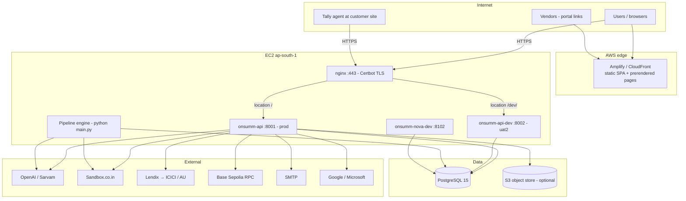
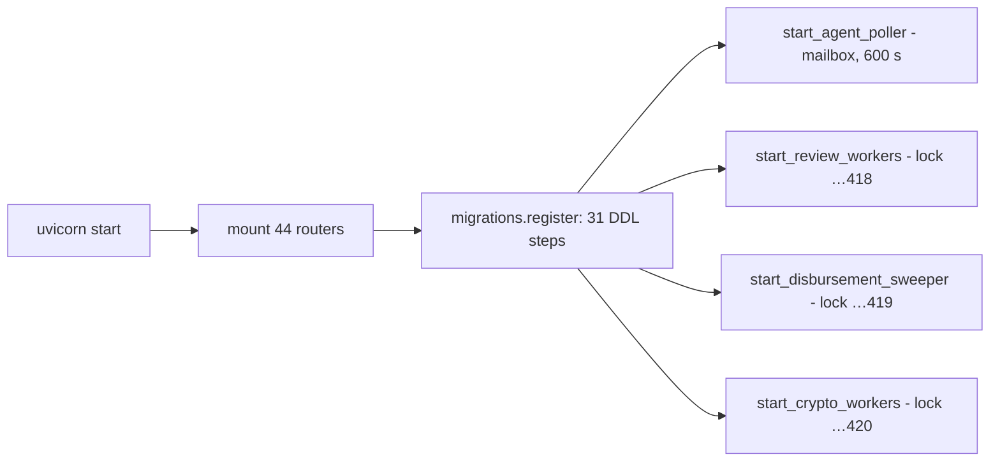
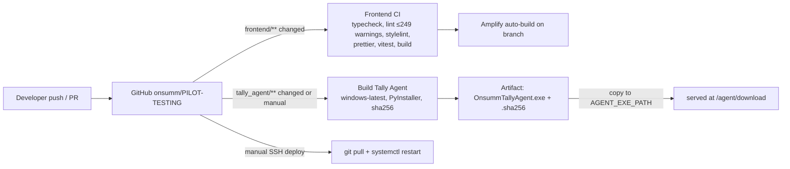
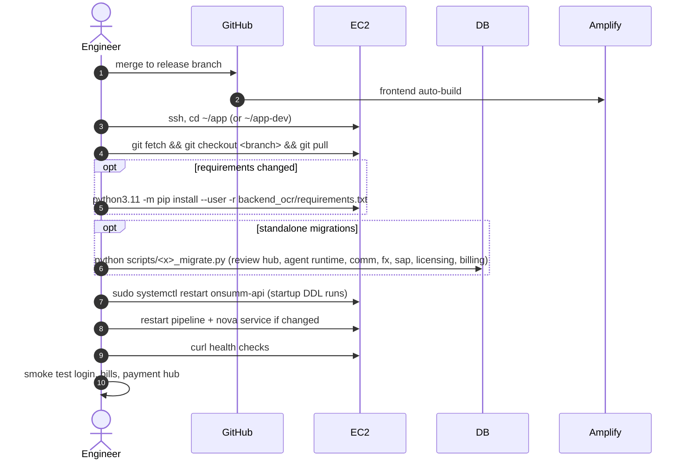
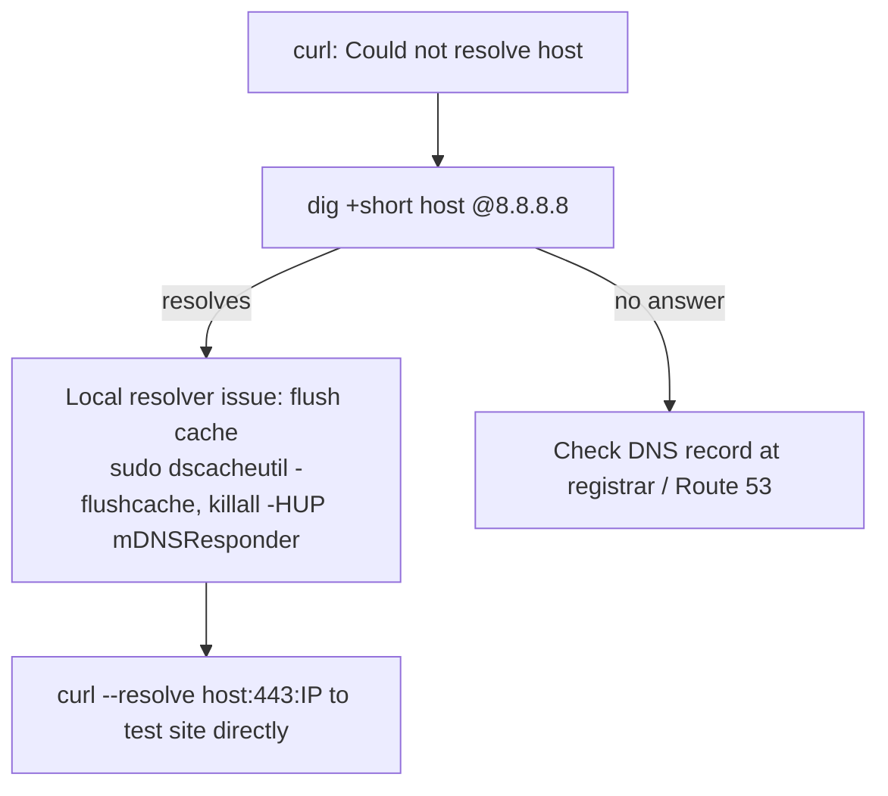
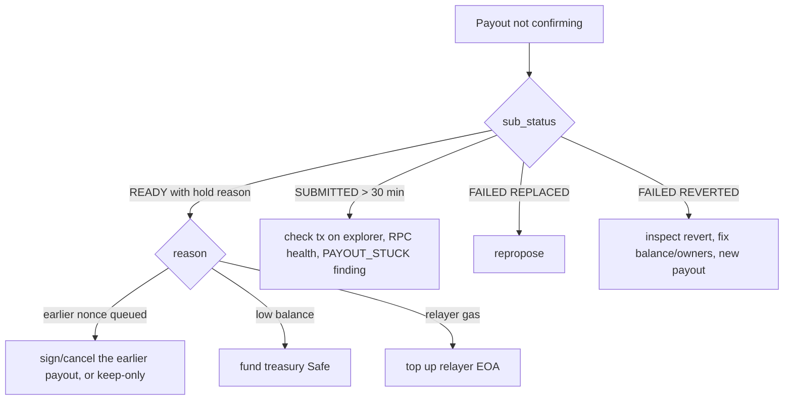

# Onsumm Platform — Deployment & Operations

| | |
|---|---|
| **Document** | 06 — Deployment & Operations |
| **As of** | 2026-10-31 (commit `6e1278f`) |
| **Region** | AWS ap-south-1 (Mumbai) |
| **Related** | [01 HLD](01_HLD.md) · [07 Security](07_SECURITY.md) · `docs/DEV_ENVIRONMENT.md` · `docs/postgres-selfhost-ec2.md` |

---

## Table of contents

1. [Environments](#1-environments)
2. [Deployment topology](#2-deployment-topology)
3. [Components and how they run](#3-components-and-how-they-run)
4. [Build and release pipelines](#4-build-and-release-pipelines)
5. [Release procedure](#5-release-procedure)
6. [Database operations](#6-database-operations)
7. [Background jobs and schedules](#7-background-jobs-and-schedules)
8. [Monitoring and alerting](#8-monitoring-and-alerting)
9. [Runbooks](#9-runbooks)
10. [Capacity and scaling](#10-capacity-and-scaling)
11. [Backup and disaster recovery](#11-backup-and-disaster-recovery)
12. [Operational risks](#12-operational-risks)

---

## 1. Environments

| Environment | Frontend | API | Branch | Database | Notes |
|---|---|---|---|---|---|
| **Prod (India)** | `www.onsumm.ai` (Amplify) | `https://api.onsumm.ai` → `:8001` `onsumm-api` | `subhash` | shared Postgres | IMPS rail |
| **Dev** | Amplify app on `uat2` | `https://api.onsumm.ai/dev` → `:8002` `onsumm-api-dev` | `uat2` | **same DB as prod** | writes are real |
| **International** | `onsumm.collabup.co.in` (CloudFront) | `https://inter.collabup.co.in` | `main` (this repo) | per host `.env` | USDC rail on Base Sepolia |
| **Nova (dev)** | — | `127.0.0.1:8102` `onsumm-nova-dev` | `uat2` | dev DB | port 8100 reserved for prod Nova |
| **Local** | `vite` dev server | `uvicorn … --port 8001 --reload` (`backend_ocr/run.sh`) | any | local or tunnelled | |

> Dev shares the production database, `JWT_SECRET` and `APP_URL`. Treat every dev write as a production write until dev gets its own database.

> The architecture doc names AWS RDS (PostgreSQL 15). `docs/postgres-selfhost-ec2.md` also describes a Postgres-in-Docker instance on EC2 with DLM snapshots. Confirm which one backs each environment before any DB operation.

---

## 2. Deployment topology

nginx: `location /dev/ { proxy_pass http://127.0.0.1:8002/; }` (trailing slash strips `/dev`), `proxy_read_timeout 300`, `client_max_body_size 50M`; `location / { proxy_pass http://127.0.0.1:8001; }`.

---

## 3. Components and how they run

| Component | Process | Start command | Supervisor | Logs |
|---|---|---|---|---|
| API (prod) | Uvicorn | `python3.11 -m uvicorn app.main:app --host 0.0.0.0 --port 8001` | systemd `onsumm-api`, `Restart=always` | `journalctl -u onsumm-api` |
| API (dev) | Uvicorn | same, port 8002 | systemd `onsumm-api-dev` | `journalctl -u onsumm-api-dev` |
| Pipeline | asyncio | `python main.py` (repo root) | systemd/supervisor | `logs/pipeline.log`, `logs/<worker>.log` |
| Nova service | Uvicorn | `python3.11 -m uvicorn app.main:app --host 127.0.0.1 --port 8102` | systemd `onsumm-nova-dev` | journald |
| Frontend | static | Amplify build `npm ci && npm run build` → `dist/` | Amplify | Amplify console |
| Tally agent | Windows exe | `OnsummTallyAgent.exe` (tray, Run key) | Windows | dashboard log tab |
| Render (alt) | Uvicorn | `render.yaml` service `onsumm-api` | Render | Render |
| Vercel (alt FE) | static | `vercel.json`, `/api/*` → `onsumm.onrender.com` | Vercel | Vercel |

Inside the API process at startup:

---

## 4. Build and release pipelines

| Workflow | Trigger | Steps |
|---|---|---|
| `frontend-ci.yml` | push to `ui-revamp`, `uat2`, `uat`, `master`; PRs touching `frontend/**` | `npm ci`, typecheck, lint, stylelint, format check, tests, build |
| `build-agent.yml` | push to `master`, `uat2`, `seo/audit-fixes` on `tally_agent/**`, or manual (`server`: auto/dev/prod) | set `BUILD_SERVER_URL`, PyInstaller one-file, SHA-256, upload artifact (90 days) |

Backend has no CD pipeline: deploys are manual over SSH.

---

## 5. Release procedure

Health checks:

| Check | Command | Expect |
|---|---|---|
| Prod API | `curl -o /dev/null -w "%{http_code}" https://api.onsumm.ai/docs` | 200 |
| Dev API | `curl -o /dev/null -w "%{http_code}" https://api.onsumm.ai/dev/openapi.json` | 200 |
| Liveness | `GET /health` | 200 |
| Nova | `GET http://127.0.0.1:8102/health` | 200 |
| Frontend pages differ | `for p in / /product /pricing /contact; do curl -s https://www.onsumm.ai$p \| md5; done` | 4 distinct hashes |
| Sitemap | `curl -sI https://www.onsumm.ai/sitemap.xml` | XML content type |

Rollback: `git checkout <previous sha>` + restart. DDL is additive (`IF NOT EXISTS`), so a code rollback normally leaves the schema compatible.

Amplify manual step: rewrite rules must list `/product`, `/pricing`, `/contact` **before** the SPA catch-all, and the catch-all extension list must include `xml`, `webp`, `avif`, `pdf` (see `frontend/amplify.yml` header).

---

## 6. Database operations

| Task | How |
|---|---|
| Core DDL | runs on every API boot (`migrations.py`, `crypto_migrations.py`, `audit_migrations.py`); also `scripts/run_api_migrations.py` |
| Feature DDL | `scripts/review_hub_migrate.py`, `agent_runtime_migrate.py`, `comm_agent_migrate.py`, `fx_migrate.py`, `sap_catalog_migrate.py`, `licensing_migrate.py`, `billing_reconciliation_migrate(_v2).py` |
| Trigger install | pipeline start: `pipelines/cdc.py:create_notify_triggers` |
| Schema doc | `scripts/generate_full_schema_doc.py` → `docs/full_database_schema.md` (not exhaustive) |
| Backfills | `scripts/backfill_*.py`, `fx_rebook_historical_rates.py`, `fix_tds_*.py`, `resolve_vendor_duplicates.py` |
| FY reset | `jobs/tds_fy_reset.py` at the start of each April |
| Pool health | watch `db_pool_connections_in_use` (climbing without returning = leak) |

---

## 7. Background jobs and schedules

```mermaid
gantt
    title Recurring jobs (relative cadence, not to scale)
    dateFormat  X
    axisFormat  %s
    section Crypto
    Chain watcher + matcher (4 s)        :0, 4
    Relay retry (30 s)                   :0, 30
    Ledger poster (30 s)                 :0, 30
    section Payments
    IMPS sweeper (300 s)                 :0, 300
    section Agents
    Mailbox poll (600 s)                 :0, 600
    Tally agent sync (900 s)             :0, 900
    section Nova
    Orchestrator sweep (120 s)           :0, 120
```

| Job | Cadence | Owner process | Lock |
|---|---|---|---|
| CDC workers | on NOTIFY + 60 s safety poll | pipeline | `…417` |
| Approval nudges / escalations | poll | pipeline | `…417` |
| FX rates + revaluation | daily | pipeline | `…417` |
| Review adapters / agent / comm extraction | on NOTIFY | API | `…418` |
| IMPS status sweeper | 300 s, min age 60 s, give up 7 d, batch 25 | API | `…419` |
| Chain watcher + matcher | 4 s | API | `…420` |
| Safe relay retry | 30 s | API | `…420` |
| Ledger poster | 30 s | API | `…420` |
| Audit anchor | daily 00:05 UTC (needs `ANCHOR_SIGNER_KEY`) | API | `…420` + `…421` |
| Mailbox agent | 600 s | API (daemon thread) | — |
| Nova orchestrator | 120 s | Nova service | — |
| Tally agent | 900 s | customer machine | — |

---

## 8. Monitoring and alerting

| Signal | Source | Suggested alert |
|---|---|---|
| 5xx rate | `REQUESTS{status=~"5.."}` | > 1% over 5 min |
| Latency p95 | `LATENCY` histogram | > 2 s on `/api/bills*` |
| Unhandled exceptions | `UNHANDLED` | any increase |
| DB pool | `db_pool_connections_in_use / db_pool_connections_max` | > 80% for 10 min |
| Pipeline backlog | `raw_invoice_uploads` not DONE/ERROR older than 15 min | > 0 |
| IMPS stuck | `fact_disbursements` PENDING older than 1 h | > 0 |
| Crypto stuck | `PAYOUT_STUCK` findings | any |
| Relayer gas | `GasRelayer.gas_balance` < `RELAYER_MIN_GAS_WEI` | below |
| Anchor | `ANCHOR_FAILED` / `AUDIT_CHAIN_BROKEN` findings | any |
| LLM spend | `agent_budgets` vs `AGENT_DAILY_CAP_USD` | > 80% |
| Tally agent | `int_connections.consecutive_failures` | ≥ 3 |
| Errors | Sentry (`SENTRY_DSN`) | new issue |

`/metrics` needs `METRICS_TOKEN`; it answers 503 when the token is unset.

---

## 9. Runbooks

### 9.1 DNS lookup fails for a frontend domain

Seen on 2026-10-30: `onsumm.collabup.co.in` resolved via 8.8.8.8 to CloudFront and served HTTP 301 → HTTPS 200, but the local resolver failed.

### 9.2 IMPS payment stuck in PENDING

1. `POST /api/disbursements/{id}/refresh-status`.
2. Check `disbursement_gateway_calls` for the last Lendix response and `act_code`.
3. If still pending after 7 days, the sweeper stops; confirm with the bank using `tran_ref_no` / `bank_rrn`.
4. Never create a second payment for the same bill while one is `PENDING` (the in-flight guard blocks it).

### 9.3 USDC payout stuck

### 9.4 Pipeline not processing uploads

1. `systemctl status` for the pipeline unit; check `logs/upload_ocr.log`.
2. Another instance may hold advisory lock `875_291_004_417` (runner exits with code 1).
3. Confirm triggers exist (restart runs `create_notify_triggers`).
4. Check `raw_ingestion_errors` for the upload.

### 9.5 Review Hub findings not appearing

1. API logs for `review_adapters`; lock `…418` held by another replica?
2. Is the adapter's `source_service` licensed for the tenant?
3. Is the user's role/department in the finding audience?

### 9.6 Rotate secrets

| Secret | Impact of rotation |
|---|---|
| `JWT_SECRET` | all sessions invalid (dev shares prod secret today) |
| `APPROVAL_SECRET` | outstanding email-approval links and vendor portal links invalid |
| `PLATFORM_JWT_SECRET` | ops sessions invalid |
| Fernet keys (`NOVA_KEY_ENCRYPTION_KEY`, OAuth) | re-encrypt stored credentials first |
| `RELAYER_KEY` | move gas to new EOA |
| `ANCHOR_SIGNER_KEY` | call `setAnchorer` on the contract (owner) |
| GitHub token | see `GITHUB_TOKEN_ROTATION.md` |

---

## 10. Capacity and scaling

| Component | Today | Blocker to scale out | Path |
|---|---|---|---|
| API | 1 replica per env | per-process caches (chain, entitlements, notifications), in-memory reset OTP, boot-time DDL | move caches to Postgres/Redis, OTP to DB, migrations as deploy step |
| Pipeline | 1 instance (lock) | by design | shard by tenant (`PIPELINE_TENANT_ID`) |
| In-API schedulers | 1 active per lock | — | already replica-safe via advisory locks |
| DB | single instance | — | vertical + read replica for reports |
| Frontend | CDN | — | — |

---

## 11. Backup and disaster recovery

| Asset | Backup | RPO / RTO target |
|---|---|---|
| Postgres | RDS automated backups, or DLM EBS snapshots + weekly logical dump (self-hosted runbook) | RPO 24 h / RTO 4 h (pilot) |
| Object store | S3 versioning (if enabled) or EBS snapshot of upload dirs | 24 h |
| Audit integrity | on-chain anchors are independent evidence | — |
| Secrets | `.env` per host — keep an encrypted offline copy | — |
| Agent exe | GitHub artifacts (90 days) | — |

Test a restore monthly (`docs/postgres-selfhost-ec2.md` §1.3).

---

## 12. Operational risks

| Risk | Mitigation |
|---|---|
| Dev writes to prod DB | separate DB + secrets for dev |
| Manual SSH deploys | add a CD workflow with health-gated restart |
| Boot-time DDL on every restart | move to explicit migration step |
| Single EC2 for prod + dev | separate instances; at least separate users/dirs (already) |
| Bank caps not mirrored in app (UAT ₹10, staging ₹1,000, prod ₹1,50,000; ICICI hard ₹5,00,000) | add per-env caps in `BankAdapter.check_amount` config |
| Relayer gas exhaustion | alert on balance |
| Static sanctions list staleness | scheduled refresh or provider API |
