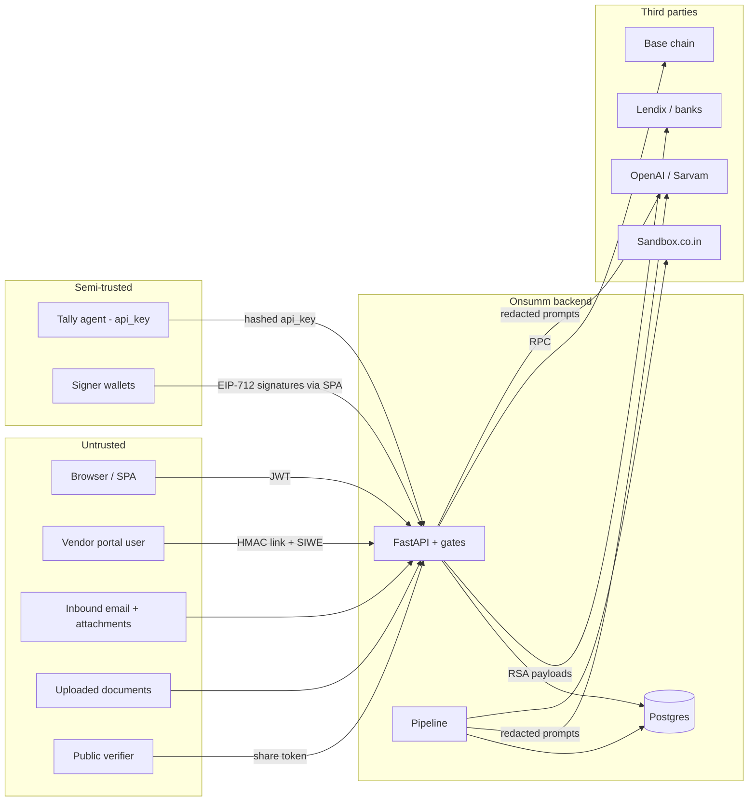
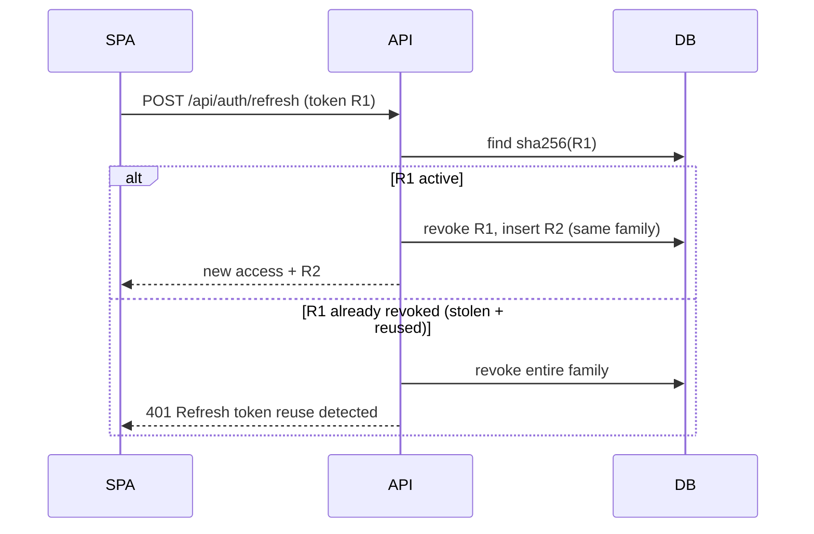
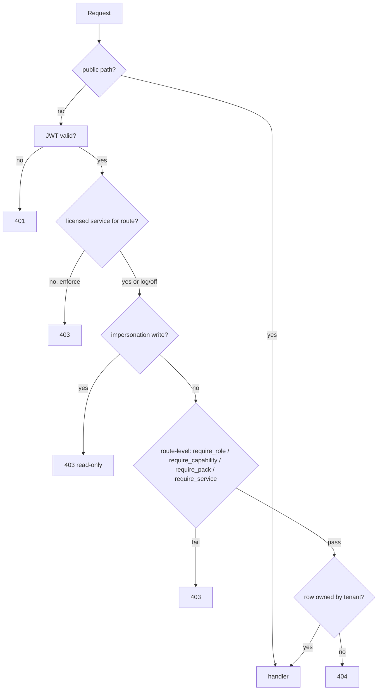
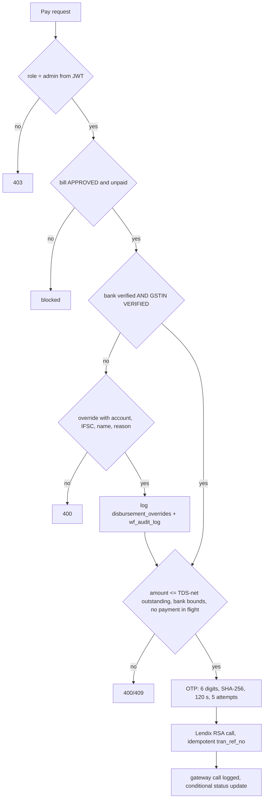
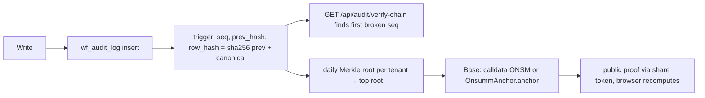

# Onsumm Platform — Security Architecture & Threat Model

| | |
|---|---|
| **Document** | 07 — Security |
| **As of** | 2026-10-31 (commit `6e1278f`) |
| **Related** | [01 HLD](01_HLD.md) · [02 LLD](02_LLD.md) · `docs/PAYMENT_GUARDRAILS.md` · `docs/LICENSING_AND_ADMIN.md` |

---

## Table of contents

1. [Security objectives](#1-security-objectives)
2. [Trust boundaries](#2-trust-boundaries)
3. [Authentication](#3-authentication)
4. [Authorisation](#4-authorisation)
5. [Tenant isolation](#5-tenant-isolation)
6. [Payment controls — INR](#6-payment-controls--inr)
7. [Payment controls — USDC](#7-payment-controls--usdc)
8. [Audit integrity](#8-audit-integrity)
9. [Data protection and secrets](#9-data-protection-and-secrets)
10. [AI / LLM safety](#10-ai--llm-safety)
11. [Threat model (STRIDE)](#11-threat-model-stride)
12. [Open findings and remediation plan](#12-open-findings-and-remediation-plan)

---

## 1. Security objectives

| Objective | Meaning for Onsumm |
|---|---|
| Money only reaches the right party | Beneficiary comes from the verified vendor master; never from an invoice |
| No single person can move money alone | OTP step + admin role for INR; Safe threshold signatures for USDC; dual control above $10,000 |
| Tenants never see each other | Every query scoped by the JWT tenant; 404 on foreign ids |
| Every change is provable | Hash-chained audit log, anchored on-chain daily |
| Least privilege | Role → capability; licence gates; read-only impersonation |
| Secrets never in URLs or at rest in clear | Single-use SSO codes; hashed refresh tokens, OTPs, agent keys; Fernet for OAuth/Nova keys |

---

## 2. Trust boundaries

Untrusted content (emails, documents, OCR text) is fenced before reaching an LLM (`review/redact.fence_untrusted`) and LLM claims are re-verified against the database (`review/verifier.py`).

---

## 3. Authentication

| Principal | Mechanism | Storage | Lifetime |
|---|---|---|---|
| Tenant user (password) | bcrypt check → HS256 JWT + opaque refresh token | refresh token SHA-256 in `auth_refresh_tokens` | access 60 min, refresh 30 days, rotation with family revoke on reuse |
| Tenant user (SSO) | Google/Microsoft OAuth → single-use code → same tokens | code SHA-256 in `auth_sso_codes` | code 120 s |
| Password reset | 6-digit OTP by email | **process memory** | 10 min |
| Platform user | bcrypt → platform JWT (`PLATFORM_JWT_SECRET`, `typ=platform`, `aud`) | `platform_refresh_tokens` | lockout → 423 |
| Impersonation | tenant-shaped JWT with `act` + `jti` | `platform_impersonation`, `admin_audit_log` | ≤ 15 min (`IMPERSONATION_MAX_TTL_MIN`), no refresh |
| Email approver | itsdangerous token `{invoice_id, action, role}` signed with `APPROVAL_SECRET` | — | 7 days |
| Vendor (portal) | HMAC token `{tenant, supplier, expiry}` (key derived from `APPROVAL_SECRET`/`JWT_SECRET`) | — | 72 h |
| Vendor wallet | SIWE (EIP-4361) signature, single-use nonce | `vendor_portal_nonces` | 10 min |
| Safe owner | EIP-712 signature over the Safe tx | `crypto_payout_signatures` | per payout |
| Tally agent | pairing token → api_key | api_key SHA-256 in `int_connections` | pairing 30 min |
| Metrics scraper | `METRICS_TOKEN` | env | — |

SSO never auto-provisions: the provider email must match exactly one existing `users.email`. No JWT ever appears in a redirect URL.

---

## 4. Authorisation

| Layer | Implementation |
|---|---|
| Role | `require_role("admin")` on users, jurisdiction, payments, crypto admin, audit anchor |
| Capability | `CAPABILITY_ROLES`: view (all), edit (admin, FC, accountant), approve (admin, FC, approver), verify (admin, FC, accountant), pay (admin, FC), admin (admin) |
| Approval chain | step role + admin, filtered by named assignees |
| Licence | 26 services; `license_gate` + router-level `require_service` |
| Jurisdiction | `require_pack("gst" / "bank_india" / "tds_india")` |
| Review visibility | `visibility_sql`: global-view roles (admin, FC, auditor) see all; others see findings addressed to their role/user/department |
| Platform | `readonly < support < admin < owner` |

---

## 5. Tenant isolation

| Control | Detail |
|---|---|
| Tenant source | JWT claim (`tenant_id` / `company_id` / `org_id`) → contextvar; client-supplied ids ignored |
| Query scoping | `AND tenant_id = %s` on every tenant table |
| Ownership | `tenancy.assert_owned` → 404 |
| Route coverage | `test_tenant_route_map.py` classifies all routes (scoped/public/exempt) with a snapshot |
| Batch isolation | `test_disbursement_batch_isolation.py` |
| Platform separation | `test_platform_auth_isolation.py`; platform tokens cannot call tenant routes |
| Audit chain | per-tenant `seq`, salt and Merkle root (one tenant's proof reveals nothing about another's rows) |
| Workers | process all tenants unless `PIPELINE_TENANT_ID` is set |
| Database | **no Row-Level Security** — isolation is application-enforced |

---

## 6. Payment controls — INR

Bank-side caps (UAT ₹10, staging ₹1,000, prod ₹1,50,000; ICICI hard ₹5,00,000) are not mirrored in the app yet.

---

## 7. Payment controls — USDC

| Control | Where |
|---|---|
| India-resident tenants never get USDC | `UsdcRail.available_for`, `PolicyEngine.check_tenant`, `RailRouter` |
| Tenant KYB + UBO screening | crypto onboarding |
| Wallet proof of ownership (SIWE), single-use nonce, exact message round-trip | `SiweVerifier`, `vendor_portal_nonces` |
| Sanctions screening at proof time and fresh (≤ 24 h) at payout | `StaticListScreening`, `_fresh_screening` |
| 24 h cooling before a new wallet can be approved | `cooling_minutes` |
| Wallet change freezes the old wallet and alerts | `WALLET_CHANGED` |
| Invoice wallet is never used (only compared) | `check_invoice_wallet` → `WALLET_MISMATCH` |
| Per-tx and daily USD limits, dual control above $10,000 | `PolicyEngine` |
| Treasury balance minus in-flight checked | `available_units` |
| No duplicate across rails | `DUPLICATE_ACROSS_RAILS` |
| OTP before proposal | `release_after_otp` |
| Threshold signatures from Safe owners (read live from chain) | `add_signature` |
| Onsumm holds no custody keys; relayer pays gas only (`gasPrice 0`, `refundReceiver 0`) | `GasRelayer` |
| Strict nonce ordering; replaced nonce fails the payout | nonce queue |
| Exact on-chain match (contract, address, units) with 3 confirmations; reorg handling | `OnchainMatcher`, `ChainWatcher` |
| FX frozen at prepare; withholding uses the same snapshot | `FxSnapshot` |

---

## 8. Audit integrity

Other audit trails: `bill_approval_chain`, `rh_audit_log` (Review Hub mutations with before/after, secrets masked), `admin_audit_log`, `disbursement_gateway_calls`, `vendor_activity_log`, `int_sync_log`, `agent_runs`.

---

## 9. Data protection and secrets

| Data | Protection |
|---|---|
| Passwords | bcrypt |
| Refresh tokens, SSO codes, OTPs, Tally api_key | SHA-256 hashes only |
| OAuth tokens, Nova API keys | Fernet encryption |
| Bank payloads | RSA-encrypted to Lendix |
| DB connection | TLS (`DB_SSL=require`, `global-bundle.pem`) |
| Transport | HTTPS via nginx (Certbot) / CloudFront |
| Uploads | 50 MB part cap; served only via authed endpoints (`authedFiles.ts`) |
| Logs | 5xx bodies scrubbed; request ids; Review audit masks secrets |
| LLM prompts | PII redacted (`Redactor.scrub/restore`) |
| Secrets location | `.env` per host (not in git); `docs/onsumm-db-credentials.secret.md` and `.env` exist in the working tree — ensure both stay git-ignored |

---

## 10. AI / LLM safety

| Risk | Control |
|---|---|
| Prompt injection via emails/documents | `fence_untrusted`; LLM never calls money-moving actions |
| Hallucinated findings | `verifier.verify_claims` re-checks values in DB; refuted → `rh_finding_rejects` |
| Runaway spend | `AGENT_DAILY_CAP_USD`, `agent_budgets`, `LLM_KILL_SWITCH` |
| Auto-acting on AI output | mailbox agent only creates drafts; review hub payment actions are navigation only |
| Data leakage | redaction before send; model calls server-side only |

---

## 11. Threat model (STRIDE)

| # | Category | Threat | Existing control | Residual |
|---|---|---|---|---|
| 1 | Spoofing | Stolen refresh token reused | rotation + family revoke | low |
| 2 | Spoofing | Approver role forged in request body | chain check uses **body** `actor_role` | **high — fix** |
| 3 | Spoofing | Vendor wallet swapped via phishing invoice | wallet only from verified master; WALLET_MISMATCH | low |
| 4 | Spoofing | Attacker proves own wallet with stolen portal link | 72 h HMAC link, cooling 24 h, admin approval, change alerts | medium |
| 5 | Tampering | Audit rows edited in DB | hash chain + on-chain anchor | low (detectable) |
| 6 | Tampering | Bank details changed before payout | reset triggers clear verification; override logged | low |
| 7 | Tampering | Safe tx altered after signing | hash recomputed and compared; owners read live | low |
| 8 | Repudiation | Approver denies approving | `bill_approval_chain` + audit chain | low |
| 9 | Information disclosure | Cross-tenant id probing | 404 not 403; route map tests | low |
| 10 | Information disclosure | LLM leaks PII | redaction | medium |
| 11 | Information disclosure | Dev environment reads prod data | shared DB today | **high — separate dev DB** |
| 12 | Denial of service | Large uploads / OCR cost | 50 MB cap, page limit, LLM budget | medium |
| 13 | Denial of service | RPC outage blocks payouts | RPC failover URL | medium |
| 14 | Elevation | Non-admin edits settings/chain/vendors via API | **UI-only checks** | **high — add server checks** |
| 15 | Elevation | Support staff modify tenant data | impersonation read-only | low |
| 16 | Elevation | Unlicensed feature use | `LICENSE_ENFORCEMENT=log` default | medium |

---

## 12. Open findings and remediation plan

| Priority | Finding | Fix |
|---|---|---|
| P0 | Approval actions trust body `actor_role`/`actor_name` | derive role and name from the JWT in `bill_action`, `reconcile-action`, `bulk-action` |
| P0 | Settings/chain/category/COA/vendor/soft-status writes lack server role checks | add `require_role` / `require_capability("edit"/"admin")` |
| P0 | Dev shares prod DB and `JWT_SECRET` | separate database and secrets |
| P1 | `LICENSE_ENFORCEMENT=log` | switch to `enforce` after a log review |
| P1 | CORS `*` with credentials | restrict origins to app domains |
| P1 | Password-reset OTP in memory | store hashed OTP in DB with TTL |
| P1 | No RLS | add RLS policies as defence in depth |
| P2 | Static sanctions list | integrate a screening provider |
| P2 | Bank caps not mirrored | per-env caps in adapters |
| P2 | Licence cache invalidation across workers missing | implement `pg_notify` listener |
