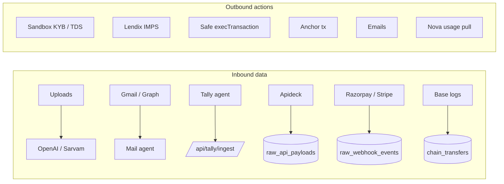
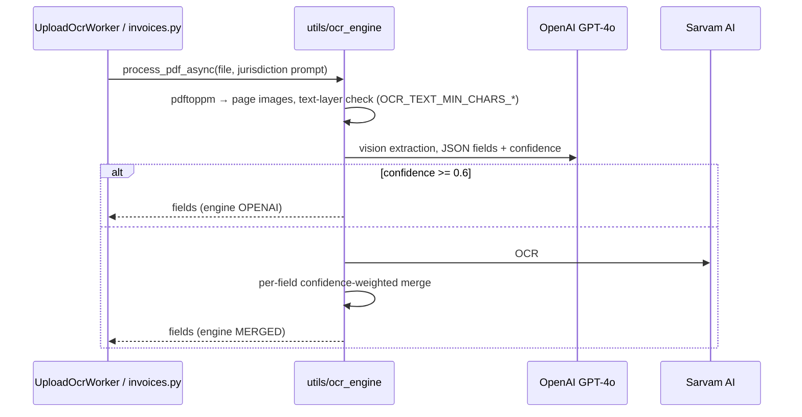
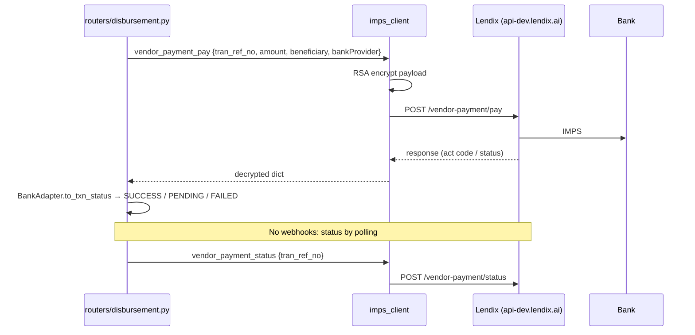
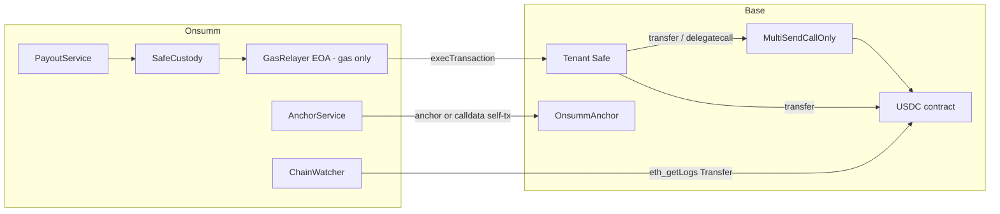
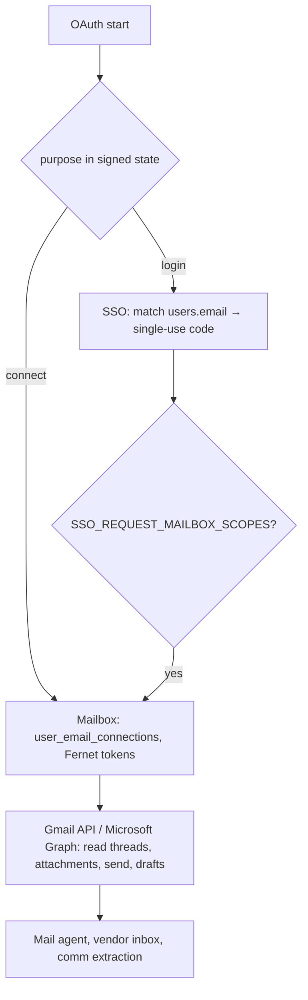
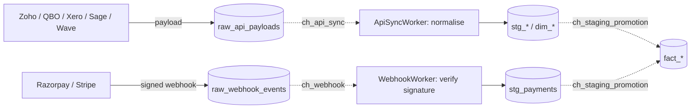

# Onsumm Platform — Integrations

| | |
|---|---|
| **Document** | 08 — Integrations |
| **As of** | 2026-10-31 (commit `6e1278f`) |
| **Related** | [01 HLD](01_HLD.md) · [02 LLD](02_LLD.md) · `docs/DISBURSEMENT_IMPS_API.md` · `docs/Sandbox_GST_COMPLIANCE_INTERGRATION.md` · `docs/NOVA_RECONCILIATION_LOGIC.md` · `docs/VENDOR_BILL_AGENT.md` |

---

## Table of contents

1. [Integration inventory](#1-integration-inventory)
2. [OCR: OpenAI GPT-4o and Sarvam AI](#2-ocr-openai-gpt-4o-and-sarvam-ai)
3. [KYB and tax: Sandbox.co.in](#3-kyb-and-tax-sandboxcoin)
4. [Payments: Lendix → ICICI / AU / HDFC](#4-payments-lendix--icici--au--hdfc)
5. [Blockchain: Base, USDC, Safe, relayer, anchor](#5-blockchain-base-usdc-safe-relayer-anchor)
6. [Sanctions screening](#6-sanctions-screening)
7. [Identity and mail: Google, Microsoft, SMTP](#7-identity-and-mail-google-microsoft-smtp)
8. [Accounting: Tally Prime](#8-accounting-tally-prime)
9. [ERP intake: Apideck connectors and webhooks](#9-erp-intake-apideck-connectors-and-webhooks)
10. [SAP item catalogue](#10-sap-item-catalogue)
11. [Nova billing (Lendix)](#11-nova-billing-lendix)
12. [Failure handling matrix](#12-failure-handling-matrix)

---

## 1. Integration inventory

| Integration | Type | Client code | Auth | Pattern | Fallback |
|---|---|---|---|---|---|
| OpenAI | AI | `utils/ocr_engine.py`, `ai/llm.py`, `domain/fact_graph.py` | API key | sync request | Sarvam for OCR; retries ×3 |
| Sarvam AI | OCR | `utils/ocr_engine.py` | API key | sync | — |
| Sandbox.co.in | KYB / TDS | `integrations/sandbox_kyb.py`, `pipelines/gst_verification.py`, `utils/tds_engine.py` | key + secret → token | async worker, 5 concurrent | local TDS rate table |
| Lendix | Payments | `integrations/imps_client.py` | RSA-encrypted payloads | request + polling | none between banks |
| Bank adapters | Status mapping | `integrations/payments/{icici,hdfc,au_bank}.py` | — | pure mapping | — |
| Base RPC | Chain | `integrations/chains/evm.py` | URL | JSON-RPC | `RPC_URL_FALLBACK` |
| Safe | Custody | `integrations/custody/safe.py` | owner signatures | EIP-712 + execTransaction | `PartnerCustody` (stub) |
| Gas relayer | Chain | `integrations/custody/relayer.py` | `RELAYER_KEY` | tx submit | — |
| OnsummAnchor | Chain | `domain/audit/anchor.py` | `ANCHOR_SIGNER_KEY` | tx submit | calldata mode |
| Screening | Compliance | `integrations/screening` | file | local lookup | ERROR → wallet stays PENDING_PROOF |
| Google | Identity, mail | `integrations/email_oauth.py` | OAuth2 | redirect | — |
| Microsoft | Identity, mail | `integrations/email_graph.py` | OAuth2 | redirect | — |
| SMTP | Mail | various | user/password | send | receipt `manual_required` |
| Tally Prime | Accounting | `tally_agent/`, `tally2database/` | api_key | agent push | server pull (disabled) |
| Apideck ERPs | Intake | `pipelines/api_sync.py` | — | raw payload table | — |
| Razorpay / Stripe webhooks | Payments in | `pipelines/webhook.py` | signature | raw table | unsigned rejected |
| SAP | Item codes | `routers/item_mapping.py`, `scripts/sap_*` | token | embeddings + aliases | review queue |
| Nova | Usage | `services/nova_reconciliation/app/nova_client.py` | per-tenant key | polling 120 s | retries, max 5 |

---

## 2. OCR: OpenAI GPT-4o and Sarvam AI

| Setting | Purpose |
|---|---|
| `OCR_TO_USE`, `OPENAI_OCR_MODEL` | engine and model |
| `OCR_TEXT_MIN_CHARS_PER_PAGE`, `OCR_TEXT_MIN_CHARS_ANY_PAGE` | text-layer thresholds |
| `POPPLER_PATH` | `pdftoppm` location |
| Jurisdiction | GST prompt (India) vs VAT prompt (international) |

---

## 3. KYB and tax: Sandbox.co.in

| Call | Used by | Result handling |
|---|---|---|
| Auth (key + secret → token) | `GstVerificationWorker._get_token` | cached |
| GSTIN search | GST worker, vendor GSTIN reverify | VERIFIED / FAILED (`invalid_gstin`, `gstin_status_x`, `pan_mismatch`, API error); legal name overwrite → finding |
| PAN verification | KYB | compared with GSTIN-derived PAN |
| Bank account (penny-less) | `verify-bank`, bank worker (disabled) | verified / not found (NULL, no retry) / transient (false) |
| TDS calculator | TDS worker | section + rate; fallback to local table on failure |

Concurrency: 5 calls via `asyncio.Semaphore`. Jurisdiction gate: India packs only.

---

## 4. Payments: Lendix → ICICI / AU / HDFC

| Bank | Role | Limits |
|---|---|---|
| ICICI | primary (`DEFAULT_BANK`) | ₹1 min, ₹5,00,000 hard cap per tx |
| AU Bank | secondary, no automatic fallback | per adapter |
| HDFC | status-code adapter present | per adapter |

Rules: retries must reuse `tran_ref_no`; every call logged to `disbursement_gateway_calls`; an unknown gateway answer is treated as `PENDING`, never `FAILED`. Reference: `docs/DISBURSEMENT_IMPS_API.md`, `docs/PAYMENT_GUARDRAILS.md`.

---

## 5. Blockchain: Base, USDC, Safe, relayer, anchor

| Item | Value |
|---|---|
| Chain | `base-sepolia`, chain id 84532 |
| Token | USDC, 6 decimals, `0x036CbD53842c5426634e7929541eC2318f3dCF7e` (Circle test USDC — verify before use) |
| Safe | client-owned, v1.3.0+; MultiSendCallOnly `0x9641d764fc13c8B624c04430C7356C1C7C8102e2` (v1.4.1) |
| Explorer | `https://sepolia.basescan.org` |
| Confirmations | 3 |
| Watch poll | 4 s |
| Settlement | `CRYPTO_SETTLEMENT=chain` or `demo` (dry-run via `eth_call`) |

Safe transaction details: EIP-712 typed data (`typed_data`, `safe_tx_hash`), signatures packed in ascending owner order, `gasPrice = 0`, `refundReceiver = 0`, operation CALL for one transfer or DELEGATECALL to MultiSendCallOnly for vendor + tax legs (`assert_safe_operation` guards anything else).

---

## 6. Sanctions screening

| Item | Detail |
|---|---|
| Interface | `ScreeningProvider` protocol: `screen(chain, address)`, `screen_name(name)` |
| Implementation | `StaticListScreening` reading `sanctioned_addresses.json` (`SCREENING_LIST_PATH`) |
| Results | `CLEAR`, `HIT`, `ERROR` recorded in `wallet_screenings` |
| When | wallet proof; fresh check (≤ 24 h) before each payout; UBO screening at onboarding |
| Planned | Chainalysis / TRM / ComplyAdvantage via the same protocol |

---

## 7. Identity and mail: Google, Microsoft, SMTP

SMTP sends: OTPs (reset, payment), approval links, receipts (PDF), wallet invites, wallet-change alerts, vendor info requests. Config: `SMTP_HOST/PORT/USER/PASSWORD`, `SMTP_ADMIN_EMAIL`.

---

## 8. Accounting: Tally Prime

| Mode | Status | How |
|---|---|---|
| Agent push | **active** | `OnsummTallyAgent.exe` on customer LAN pulls XML from `localhost:9000` every 900 s (90-day window) and pushes to `/api/tally/ingest` |
| Server pull | disabled | `TallyReadWorker` (15 min) needs LAN access to Tally |
| Server sync | disabled | `TallySyncWorker` (60 s) bidirectional |
| Crypto vouchers | active | `LedgerPoster` builds payment voucher XML; agent imports → `POSTED` |

Voucher for a USDC payout: Dr vendor (gross) · Cr `USDC Wallet` (net) · Cr `Crypto Withholding Payable` (tax) · optional Dr `Crypto Network Fees`.

---

## 9. ERP intake: Apideck connectors and webhooks

Connector limits in `int_connector_limits`; conflicts in `int_conflict_log` (`OUTBOUND_WRITE`, `SKIP`, `LOG_CONFLICT`).

---

## 10. SAP item catalogue

| Piece | Detail |
|---|---|
| Tables | `sap_item_catalog`, `sap_item_embeddings`, `sap_item_aliases`, `sap_item_vendors`, `mapping_review_queue` |
| Endpoints | `/api/mapping/match`, `/match-batch`, `/search`, `/vendor-code`; `/api/sap/generate-token`, `/api/sap/connection` |
| On ingest | line items auto-mapped (`sap_map_status='AUTO'`), low-confidence → review queue → `MappingQueueAdapter` finding |
| Scripts | `sap_catalog_load.py`, `sap_catalog_migrate.py`, `sap_item_match.py`, `sap_catalog_toon.py` |

---

## 11. Nova billing (Lendix)

| Piece | Detail |
|---|---|
| Purpose | 3-way check for vendors billed through Nova (e.g. Signzy): invoice line × Nova usage × certified rate card |
| Credentials | per tenant, Fernet-encrypted in `int_nova_credentials` |
| Base URL | `NOVA_BILLING_BASE_URL` (default `https://api.lendix.ai`) |
| Rate card | `lendix/nova_vendor_mapping.json` (hot-reloaded) |
| Service | `services/nova_reconciliation` (orchestrator every 120 s, max 5 attempts) |
| Checks | certification → quantity vs billable operations → rate × ops = total within tolerance |
| Output | runs + lines, rollup GREEN/YELLOW/RED, Review Hub `BillingDiscrepanciesAdapter` findings |

---

## 12. Failure handling matrix

| Integration | Failure | Behaviour |
|---|---|---|
| OpenAI OCR | low confidence | Sarvam fallback + merge |
| OpenAI OCR | error | upload `ERROR`, `raw_ingestion_errors`, `IngestionErrorsAdapter` finding |
| LLM (agent) | budget exceeded / kill switch | request `SKIPPED` / `REFUSED` |
| Sandbox GST | API error | status `FAILED` with reason; reverify available |
| Sandbox TDS | API error | local rate table |
| Lendix | timeout after hand-off | `PENDING`, sweeper polls, never re-initiates |
| Lendix | FAILED | `FAILED` + `act_code` explanation, `PaymentFailuresAdapter` |
| RPC | range refused | watcher halves range |
| RPC | node down | failover URL |
| Relayer | no gas | `RELAYER_OUT_OF_GAS`, payout held `READY` |
| Safe | nonce consumed | `REPLACED` → repropose |
| Chain | reorg | rewind 20 blocks, rows flagged `removed`, `REORG_DETECTED` |
| Anchor | tx failed | `FAILED`, `ANCHOR_FAILED` per tenant |
| Screening | list unreadable | `ERROR` → wallet stays `PENDING_PROOF`; payout refused `SCREENING_UNAVAILABLE` |
| SMTP | send failed | receipt `failed` / `manual_required`; notify action returns `manual_required` |
| Tally agent | push failed | `consecutive_failures++`, `int_connections` ERROR, agent tray shows error |
| Nova | API error | queue `ERROR`, retried up to 5 |
