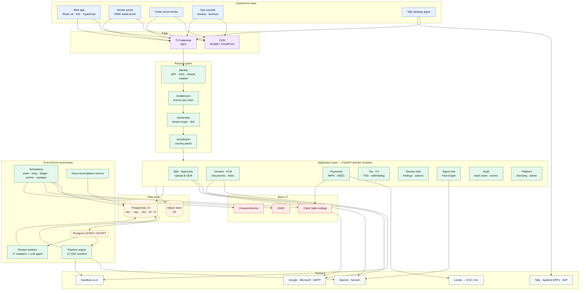
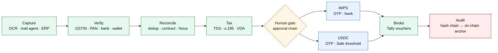
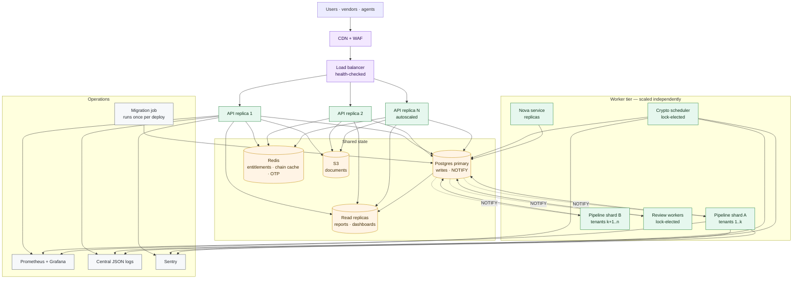
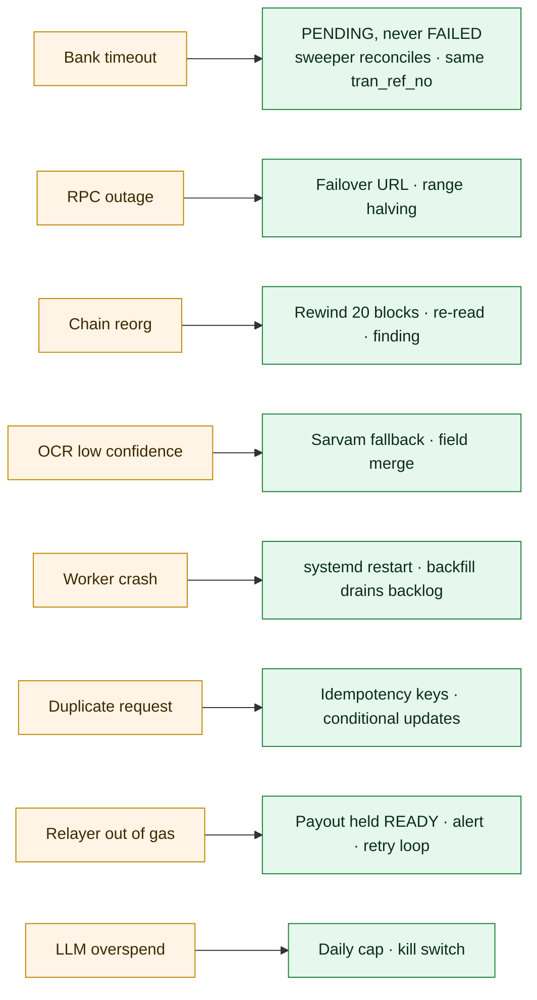
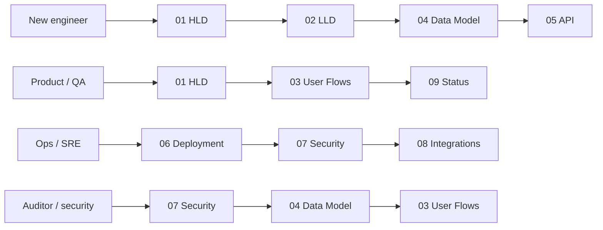

# Onsumm Platform — Architecture & Diagram Atlas

**Onsumm.ai** is a multi-tenant, event-driven accounts-payable platform. Every bill moves through one governed pipeline — **Capture → Verify → Reconcile → Tax → Human gate → Payout → Books → Audit** — and settles on two rails: **INR over IMPS** (Lendix → ICICI / AU Bank) and **USDC through a client-owned Safe multisig on Base**. Every state change is written to a hash-chained audit log whose Merkle root is anchored on-chain daily.

This README is the single entry point to the platform documentation. It holds the architecture summary, the scalability design, and an **atlas of every diagram** in the documentation set, each linked to the section that explains it.

| | |
|---|---|
| **As of** | 2026-10-31 · commit `6e1278f` |
| **Diagram format** | Mermaid (renders natively on GitHub, GitLab, VS Code, Notion) |
| **Audience** | Engineering, product, QA, operations, security and audit |

---

## Contents

1. [Platform at a glance](#1-platform-at-a-glance)
2. [Reference architecture](#2-reference-architecture)
3. [Architecture principles](#3-architecture-principles)
4. [Scalability and reliability design](#4-scalability-and-reliability-design)
5. [Security posture](#5-security-posture)
6. [Documentation set](#6-documentation-set)
7. [Getting started](#7-getting-started)
8. [Diagram atlas](#8-diagram-atlas)

---

## 1. Platform at a glance

| Dimension | Value |
|---|---|
| Deployable units | 4 — React SPA, FastAPI API, pipeline engine, Nova reconciliation service (+ Windows Tally agent, Solidity anchor contract) |
| HTTP surface | 44 routers · 308 routes · OpenAPI · Prometheus `/metrics` |
| Event-driven workers | 12 CDC pipeline workers + 3 Review Hub workers + 4 in-API schedulers |
| Compliance detectors | 17 deterministic adapters + LLM review agent with claim verification |
| Payment rails | IMPS (INR) · USDC on Base (Safe multisig, threshold signatures) |
| Licensable services | 26 services across 5 categories · 3 packages (starter, growth, enterprise) |
| Jurisdictions | Country packs (`gst`, `pan`, `tds_india`, `bank_india`, `imps`, `msme`) — India and international from one codebase |
| Integrations | OpenAI, Sarvam, Sandbox.co.in, Lendix, Base RPC, Safe, Google, Microsoft, SMTP, Tally, Apideck ERPs, SAP, Nova |
| Audit | Per-tenant SHA-256 hash chain · daily Merkle anchor on Base · public, browser-verifiable proofs |
| Quality gates | Architecture snapshot tests (tenant scoping, licence mapping, 404-not-403), ~70 pytest modules, Foundry tests, Vitest, CI on every frontend PR |
| Documentation | 9 documents · ~7,000 lines · __DIAGRAM_COUNT__ diagrams |

---

## 2. Reference architecture





---

## 3. Architecture principles

| Principle | How the platform applies it |
|---|---|
| **Event-driven core** | Postgres triggers emit `NOTIFY` in the same transaction as the write; workers drain on startup, then react to events with a safety poll. No message broker to operate. |
| **Medallion data model** | `raw_` (as received) → `stg_` (validated) → `fact_` (system of record). Every value traces back to its source document. |
| **Modular monolith with hard seams** | 44 domain routers; routers never import routers; shared logic lives in `core/` and `domain/`. Any module can be extracted into a service without rewriting callers. |
| **Ports and adapters** | `Rail`, `BankAdapter`, `CustodyProvider`, `ScreeningProvider`, `RulePack` and `FindingAdapter` are protocols. New banks, custodians, screening vendors, tax regimes and detectors plug in without touching callers. |
| **Defence in depth** | Identity → entitlement → impersonation → role/capability → ownership → jurisdiction, each a separate module and each pinned by tests. |
| **Verified-only money movement** | Beneficiaries come only from the verified vendor master; OTP on every payout; threshold signatures for USDC; the platform never holds client keys. |
| **Idempotency everywhere** | `tran_ref_no` reuse, payout idempotency keys, Safe nonce queue, unique chain-log keys, open-finding keys, atomic claims. |
| **Tamper-evident by construction** | DB-trigger hash chain; daily per-tenant Merkle roots anchored on Base; proofs verifiable by anyone in a browser. |
| **Configuration over code for jurisdictions** | Country packs and rails switch features per tenant; India and international run on one codebase. |
| **Human-in-the-loop AI** | LLM output is redacted in, verified out, budget-capped, and never moves money; agents create drafts and findings, people decide. |

---

## 4. Scalability and reliability design

### 4.1 What scales today

| Mechanism | Effect |
|---|---|
| Stateless SPA on a CDN | Frontend scales with no servers |
| Advisory-lock singletons (`875_291_004_417`–`421`) | Pipeline, review workers, sweeper, crypto scheduler and anchor builder are safe to run on many replicas — exactly one instance is active per loop |
| `FOR UPDATE SKIP LOCKED` claiming | Workers process rows in parallel without double-processing |
| Batch + backoff tuning per worker | Backfill 200 / incremental 50 rows, 5 s poll, 60 s idle, exponential error backoff capped at 120 s |
| Tenant sharding hook | `PIPELINE_TENANT_ID` pins a pipeline instance to a tenant set |
| Independent services | Nova reconciliation deploys and scales separately; Tally agents run at customer sites |
| Bounded external calls | Sandbox semaphore (5), RPC range halving and failover, LLM timeouts, retries and daily cost caps |
| Metrics by route template | Cardinality-safe Prometheus metrics; DB-pool gauge exposes connection leaks before they cause outages |

### 4.2 Target scale-out architecture

> **Target state.** Production today runs one API replica per environment. The diagram below is the scale-out design the current seams were built for; section 4.3 lists the work that unlocks it.



### 4.3 Scale-out roadmap

| Step | Change | Unlocks |
|---|---|---|
| 1 | Move per-process caches (approval chain, entitlements, notifications) and the password-reset OTP to Postgres or Redis | Multiple API replicas behind a load balancer |
| 2 | Run DDL as a one-off migration job per deploy instead of on every boot | Fast, safe rolling restarts |
| 3 | Close DB connections in `finally` (85 sites) and alert on the pool gauge | Stable pools under load |
| 4 | Read replica for reports, dashboards and Review Hub counts | Read scaling without loading the primary |
| 5 | Shard pipeline workers by tenant via `PIPELINE_TENANT_ID` / `pipeline_enabled` | Linear worker throughput |
| 6 | Separate dev database and secrets; CD pipeline with health-gated rollout | Safe, frequent releases |
| 7 | Postgres Row-Level Security as a second isolation layer | Defence in depth for large multi-tenant scale |
| 8 | Provider-backed sanctions screening and live FX through existing protocols | Production-grade crypto rail |

### 4.4 Reliability controls



---

## 5. Security posture

| Control area | Implementation |
|---|---|
| Identity | bcrypt, HS256 JWT (60 min), rotating refresh tokens with reuse detection, SSO via single-use codes, no tokens in URLs |
| Authorisation | Role → capability model, per-route licensing, jurisdiction packs, read-only impersonation |
| Tenant isolation | JWT-derived tenant on every query, 404 on foreign rows, route-coverage snapshot tests |
| Money movement | Verified beneficiaries, OTP, admin role, logged overrides, Safe threshold signatures, dual control above $10,000, sanctions screening, 24 h wallet cooling |
| Secrets | Hashes for tokens, OTPs and agent keys; Fernet for OAuth and partner keys; RSA payloads to the bank |
| Audit | Hash chain + on-chain anchoring + public proofs; approval, admin, gateway and review audit trails |
| Open items | Tracked with priorities in [07 Security §12](docs/platform/07_SECURITY.md#12-open-findings-and-remediation-plan) |

---

## 6. Documentation set

| # | Document | Scope |
|---|---|---|
| 01 | [High-Level Design](docs/platform/01_HLD.md) | Context, containers, modules, rails, events, data, integrations, security, deployment, NFRs, decisions, risks |
| 02 | [Low-Level Design](docs/platform/02_LLD.md) | Code layout, request pipeline, class diagrams for every module, internal sequences, algorithms, concurrency, configuration, testing |
| 03 | [User Flows](docs/platform/03_USER_FLOWS.md) | Routes, roles, 25 end-to-end flows, error catalogue |
| 04 | [Data Model](docs/platform/04_DATA_MODEL.md) | Schema sources, ER diagrams, every state machine, triggers, tenancy |
| 05 | [API Reference](docs/platform/05_API_REFERENCE.md) | 44 routers, 308 routes, access rules, error codes, examples |
| 06 | [Deployment & Operations](docs/platform/06_DEPLOYMENT_OPERATIONS.md) | Environments, CI, releases, jobs, monitoring, runbooks, DR |
| 07 | [Security](docs/platform/07_SECURITY.md) | Trust boundaries, controls, STRIDE threat model, remediation plan |
| 08 | [Integrations](docs/platform/08_INTEGRATIONS.md) | Every partner integration and its failure handling |
| 09 | [Glossary & Status](docs/platform/09_GLOSSARY_AND_STATUS.md) | Terms, feature status, decision log, open questions |



---

## 7. Getting started

### Prerequisites

| Tool | Version |
|---|---|
| Python | 3.11 (`backend_ocr/.python-version`) |
| PostgreSQL | 15 |
| Node.js | 18+ |
| Poppler | `brew install poppler` (PDF → image for OCR) |
| Foundry | only for `contracts/` |

### Run locally

```bash
# 1. Backend dependencies
pip install -r backend_ocr/requirements.txt -r requirements.txt

# 2. Environment
cp .env.example .env        # set DB_*, OPENAI_API_KEY, JWT_SECRET, APPROVAL_SECRET at minimum

# 3. API on :8001 (runs startup DDL)
./backend_ocr/run.sh

# 4. Pipeline engine (12 CDC workers)
python main.py

# 5. Frontend on :5173
cd frontend && npm install && npm run dev
```

Optional: Nova service `cd services/nova_reconciliation && uvicorn app.main:app --port 8100`; crypto rail needs `RPC_URL` and `USDC_ADDRESS` (Base Sepolia) — see [02 LLD §20](docs/platform/02_LLD.md#20-configuration-reference).

### Verify and test

```bash
curl http://localhost:8001/health          # backend
tail -f logs/pipeline.log                   # pipeline: triggers installed, workers started
pytest tests/ -v --tb=short                 # backend tests
cd frontend && npm run verify               # typecheck, lint, format, tests
cd contracts && forge test                  # smart contract
```

### Repository layout

| Path | Contents |
|---|---|
| `backend_ocr/app/` | FastAPI API: `routers/`, `domain/`, `core/`, `security/`, `integrations/`, `review/`, `ai/` |
| `main.py`, `pipelines/`, `utils/` | Pipeline engine and shared OCR / TDS / fiscal utilities |
| `frontend/` | React SPA, admin console, vendor portal, proof verifier |
| `services/nova_reconciliation/` | Nova 3-way reconciliation microservice |
| `tally_agent/`, `tally2database/` | Windows Tally agent and Tally XML library |
| `contracts/` | `OnsummAnchor.sol` (Foundry) |
| `scripts/`, `jobs/` | Migrations, backfills, seeds, FY reset |
| `tests/` | pytest suites (incl. `tests/crypto/`) |
| `docs/platform/` | This documentation set |
| `docs/TECHNICAL_REFERENCE.md` | Previous endpoint-by-endpoint technical reference |

---

## 8. Diagram atlas

Every diagram from the documentation set, in document order. Each entry names its type and links to the section that explains it.

