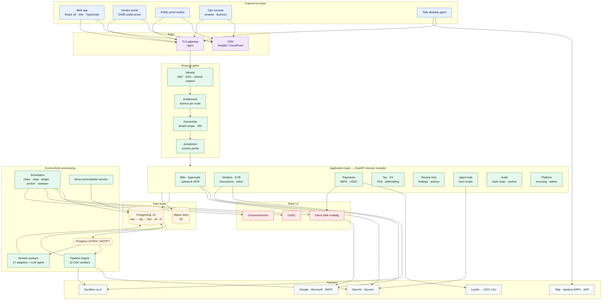
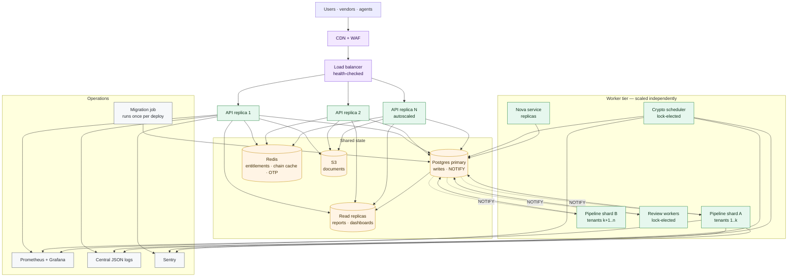
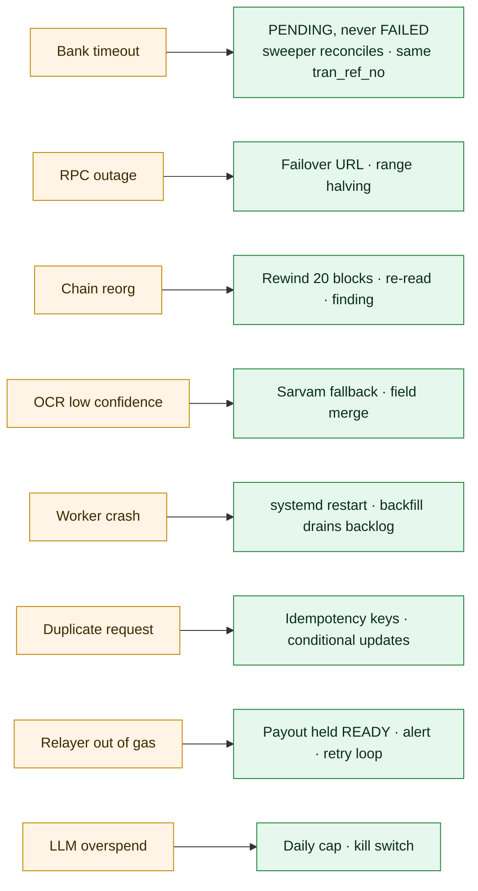

# Onsumm.ai

**One finance layer for every rupee and every token.** Onsumm turns a vendor's invoice into a verified, approved, paid and provable payable. It pays Indian vendors in rupees over IMPS and international vendors in USDC through a multisig the customer owns. Every step leaves a tamper-evident record anchored on a public blockchain.

This README tells the product's story end to end: what problem it solves, who uses it, what happens to a bill from the moment it arrives, how money moves, and how the system is built, secured, run and scaled. Each chapter starts with the business view and then opens the hood. Every diagram from the platform documentation appears where the story needs it.

| | |
|---|---|
| **As of** | 2026-10-31 · commit `6e1278f` |
| **Read this if you are** | a founder, investor, customer, product manager, engineer, operator or auditor |
| **Product document** | [Onsumm product doc (Google Drive)](https://drive.google.com/file/d/1ufVwbaIemoXzzf0D4QpIKz4CfFgMEhM5/view?usp=sharing) |
| **Deep dives** | [`docs/platform/`](docs/platform/README.md) — HLD, LLD, user flows, data model, API, operations, security, integrations, glossary |

---

## Contents

- [Prologue — Why accounts payable is broken](#prologue--why-accounts-payable-is-broken)
- [Chapter 1 — What Onsumm is](#chapter-1--what-onsumm-is)
- [Chapter 2 — How it is built](#chapter-2--how-it-is-built)
- [Chapter 3 — A new customer arrives](#chapter-3--a-new-customer-arrives)
- [Chapter 4 — Meeting the vendors](#chapter-4--meeting-the-vendors)
- [Chapter 5 — A bill arrives](#chapter-5--a-bill-arrives)
- [Chapter 6 — The engine underneath](#chapter-6--the-engine-underneath)
- [Chapter 7 — Catching problems before money moves](#chapter-7--catching-problems-before-money-moves)
- [Chapter 8 — The human gate](#chapter-8--the-human-gate)
- [Chapter 9 — Paying in India](#chapter-9--paying-in-india)
- [Chapter 10 — Paying the world in USDC](#chapter-10--paying-the-world-in-usdc)
- [Chapter 11 — Closing the books](#chapter-11--closing-the-books)
- [Chapter 12 — Proving it happened](#chapter-12--proving-it-happened)
- [Chapter 13 — Keeping it safe](#chapter-13--keeping-it-safe)
- [Chapter 14 — The building blocks](#chapter-14--the-building-blocks)
- [Chapter 15 — Running it in production](#chapter-15--running-it-in-production)
- [Chapter 16 — Built to scale](#chapter-16--built-to-scale)
- [Epilogue — Where we are and what comes next](#epilogue--where-we-are-and-what-comes-next)
- [Getting started](#getting-started)

---

## Prologue — Why accounts payable is broken

A mid-sized company pays hundreds of vendors a month. Invoices arrive as PDFs, scans, email attachments and chat messages. Someone types them into a spreadsheet or an ERP. Someone else checks the vendor's GST number, chases a manager for approval on WhatsApp, works out the tax to withhold, logs into a bank portal, pays, and later reconciles the bank statement with the books.

Every handoff is a chance to lose money:

| Pain | What it costs |
|---|---|
| Manual data entry | Hours per week per clerk; typos in amounts and bank details |
| Weak vendor checks | Payments to fake or wrong accounts; GST credit lost on invalid registrations |
| Duplicate and inflated invoices | The same bill paid twice; usage billed above contract |
| Tax complexity (TDS, GST, cross-border withholding) | Penalties and notices when the rate or section is wrong |
| Approvals in chat and email | No record of who approved what, bills stuck for days |
| Paying foreign vendors | Slow SWIFT wires, high fees, opaque FX |
| Weak audit trail | Months of work at year-end; no way to prove a record was not changed |

Onsumm replaces the handoffs with one governed pipeline, so a finance team of two can run payables that used to need ten — and can prove every decision afterwards.

---

## Chapter 1 — What Onsumm is

### The promise

Every bill takes the same path, whether it came from a scanner in Mumbai or an email from a design studio in New York.

{{D01-01}}

**Capture** reads the bill. **Verify** checks the vendor is real and the details are right. **Reconcile** compares the bill with contracts, usage and past bills. **Tax** works out what to withhold. The **human gate** is where people approve. **Payout** moves money on the right rail. **Books** posts the entry to the ledger. **Audit** seals the record so nobody can quietly change it later.

### Who uses it

A tenant is one customer company. Inside it, each person has a role with clear powers. Outside it, vendors, Safe signers and public verifiers each touch a small, controlled surface. Onsumm's own operations staff manage tenants from a separate console.

{{D01-02}}

### What it connects to

Onsumm sits between the finance team and the services they already depend on: OCR models, tax and KYB registries, banks, a blockchain, email and identity providers, and accounting systems.

{{D01-03}}

### The journey of one bill

Here is how it feels for the people involved, from the vendor sending an invoice to the auditor seeing proof of payment.

{{D03-04}}

And the same journey as a flow of states, which the rest of this story unpacks chapter by chapter:

{{D03-05}}

---

## Chapter 2 — How it is built

### The big picture

Business view: four deployable pieces do all the work, and they talk through one database. That keeps the system simple to run while each piece can grow on its own.



Technical view: a React single-page app, a FastAPI backend with 44 domain routers and 308 routes, an asyncio pipeline engine with 12 change-data-capture workers, and a standalone Nova reconciliation service, all sharing PostgreSQL 15. Postgres `LISTEN/NOTIFY` is the event bus, so there is no message broker to operate.

{{D01-04}}

### The product, module by module

Twenty-five functional modules group into five families. Each one is a licensable service, so a customer pays only for what it uses.

{{D01-06}}

### Rules that keep the code honest

Routers handle HTTP and never import each other; shared logic lives in `core/` and `domain/`; outbound clients live in `integrations/`. Tests fail the build if any route forgets the tenant, the licence check or the 404-not-403 rule.

{{D02-01}}

### What happens on every request

Every call passes the same gates in the same order: request id and metrics, identity, licence, impersonation, then the handler's own role, capability, jurisdiction and ownership checks.

{{D02-02}}

---

## Chapter 3 — A new customer arrives

### Signing the customer

Business view: an Onsumm operator onboards a new company in one form. In one transaction the company gets its tenant, a default brand, a default approval chain, its first admin and the services in its plan.

{{D03-10}}

Plans and add-ons are rows, not code. Operators can apply a package, toggle a single service, or open a read-only support session to help a customer — with a reason, a time limit and an audit entry.

{{D03-51}}

{{D04-07}}

### One codebase, many countries

A tenant carries a jurisdiction (country, currency, fiscal year, which compliance packs are on) and a set of licensed services. India gets GST, PAN, TDS, Indian bank checks and IMPS. An international tenant switches those off and can switch the USDC rail on.

{{D01-14}}

### The admin sets up the house

The customer's admin invites the team, designs the approval chain, adds brands and cost centres, sets country rules, tax rules and integrations, and connects a mailbox.

{{D03-11}}

The approval chain can differ per department, and each step can name specific people.

{{D03-12}}

### People sign in

Business view: staff sign in with a password or with Google or Microsoft. Nobody gets an account by accident — single sign-on only works for people the admin already added.

{{D03-06}}

{{D03-07}}

{{D03-08}}

Sessions stay alive with short-lived access tokens and rotating refresh tokens. If a stolen refresh token is ever replayed, the whole token family is revoked.

{{D03-09}}

{{D07-02}}

### Everyone sees their own workspace

The web app decides what to show based on who is signed in and what the company has licensed.

{{D03-01}}

{{D03-02}}

A member uploads, an approver approves, an accountant codes and verifies, a finance controller releases, an admin configures and pays, an auditor reads.

{{D03-03}}

---

## Chapter 4 — Meeting the vendors

### Adding a vendor

Business view: the form adapts to the country. An Indian vendor needs a valid GSTIN; a foreign vendor needs a country and is paid later in USDC to a wallet it proves it owns.

{{D03-13}}

{{D03-14}}

### Is this vendor real?

For Indian vendors, Onsumm checks the GSTIN with the government registry, matches the PAN, and verifies the bank account without moving money. A vendor can be paid only when both checks pass — or when an admin overrides with a written reason.

{{D03-15}}

{{D03-16}}

If anyone edits the GSTIN or bank details later, database triggers reset the verification and the checks run again.

{{D04-19}}

### Everything about a vendor in one card

Documents, extracted facts, email threads, compliance and activity live on one card. When a vendor emails a new bank letter, the AI extracts the claim and a person approves it before it touches the master record.

{{D03-47}}

{{D03-48}}

---

## Chapter 5 — A bill arrives

### Upload, read, review, submit

Business view: a clerk drops a pile of PDFs. Onsumm reads each one, skips anything that is not an invoice, pre-fills the ledger, category, tax and vendor, and the clerk only confirms and sends for approval.

{{D03-17}}

{{D03-18}}

Technical view: the upload endpoint picks a GST or VAT prompt by jurisdiction, normalises images to PDF, rejects non-invoices, and runs OCR.

{{D02-31}}

GPT-4o vision reads the bill first. If its confidence is below 0.6, Sarvam AI reads it again and the two results are merged field by field.

{{D08-02}}

{{D02-08}}

When the clerk submits, one database transaction creates or updates the vendor, stores the file and OCR result, writes the staging row and the bill, maps line items and flags duplicates.

{{D02-30}}

The upload and its staging row each have a clear lifecycle.

{{D04-10}}

{{D04-11}}

### What the system does next, on its own

Saving the bill fires events. Workers pick them up: tax is calculated, the category is filled in, duplicates are hunted, the vendor's GSTIN is checked, compliance findings are raised.

{{D03-19}}

### Bills that arrive by email

Business view: many vendors simply email their invoices. The mailbox agent watches the vendor contacts the team flags, recognises bills, reads them and leaves a draft for a person to review. It never submits on its own.

{{D03-20}}

{{D04-24}}

### Bills that arrive from other systems

Bills and payments from Zoho, QuickBooks, Xero, Sage, Wave and payment-gateway webhooks land in raw tables and flow through the same pipeline.

{{D08-06}}

### Where the data lives

Every record moves through layers: raw as received, staged after validation, and fact once it is the system of record. Any number can be traced back to the page it came from.

{{D04-01}}

{{D01-11}}

---

## Chapter 6 — The engine underneath

Business view: the pipeline is what makes Onsumm automation rather than a form over a database. It reacts to every change on its own, in seconds, and catches up automatically after any restart.

{{D01-10}}

Technical view: every worker inherits one base class. Each knows its event channel, its batch sizes and how to back off when idle or failing.

{{D02-05}}

A worker first drains whatever is waiting, then sleeps until Postgres notifies it (with a safety poll), or polls with exponential backoff.

{{D02-06}}

One runner starts them all and holds an advisory lock, so two pipeline instances can never fight over the same rows.

{{D02-07}}

Put together, this is the logical life of a bill across every subsystem:

{{D01-05}}

---

## Chapter 7 — Catching problems before money moves

### The Review Hub: one inbox for everything that looks wrong

Business view: instead of a dozen reports, the finance team gets one ranked queue of issues — a vendor name that changed, an invoice above contract, a payment that failed, an approval stuck for days — each routed to the right person with a suggested action.

{{D03-40}}

Technical view: seventeen deterministic detectors plus an LLM agent produce findings in one shape. Each detector is a small class, so adding a new check needs no new UI.

{{D02-09}}

{{D02-10}}

Detectors re-run on every relevant change. A finding re-opens if its evidence changes and closes itself when the problem goes away.

{{D02-11}}

The AI reviewer works on a redacted dossier, and every claim it makes is checked against the database before it becomes a finding.

{{D02-12}}

{{D04-22}}

{{D04-23}}

The user can act, snooze, resolve or dismiss with a reason, and undo within 30 seconds. Money is never moved from the hub — payment actions only open the payment screen.

{{D03-41}}

{{D04-06}}

### Getting tax right

TDS is worked out automatically: vendor overrides first, then mapping rules, then the government calculator, with a local rate table if the API is down. The amount payable is always net of tax.

{{D03-42}}

### Watching currency risk

For foreign-currency bills, Onsumm tracks daily rates, revalues exposure, raises alerts and writes short AI briefings.

{{D03-43}}

### Checking usage-based bills against reality

Some vendors bill per API call. The Nova service compares three numbers: what the vendor invoiced, what the usage ledger says was used, and the contracted rate. A mismatch turns the bill red before anyone approves it.

{{D03-44}}

{{D03-45}}

{{D02-34}}

{{D04-08}}

### The AI layer and the Fact Graph

One LLM client handles every model call with timeouts, retries, cost tracking and a daily cap. The Fact Graph links tenants, vendors, bills, contacts and facts so agents can answer questions with context.

{{D02-29}}

{{D03-49}}

---

## Chapter 8 — The human gate

Business view: no money moves until the right people say yes, in the right order, and every yes is recorded.

{{D03-21}}

Technical view: the chain comes from the department's configuration, falls back to the company default, then to the built-in default. Each step becomes a pending status, and only the step's role (or an admin) can act.

{{D02-32}}

{{D02-33}}

{{D04-12}}

Approvers can act in the app, from a signed link in an email, or in bulk.

{{D03-22}}

{{D03-23}}

{{D03-24}}

The bill, its vendor, its approval trail and everything around it form the core of the data model:

{{D04-02}}

---

## Chapter 9 — Paying in India

### Choosing the rail

Business view: Indian companies pay over IMPS. International companies can also pay in USDC if their policy allows it. An India-resident company never sees the crypto rail.

{{D01-07}}

### Paying a bill

The admin picks bills, confirms the verified beneficiary, receives a one-time code by email, enters it, and Onsumm sends the payment through Lendix to ICICI or AU Bank.

{{D01-08}}

{{D03-25}}

{{D03-26}}

Technical view: bank adapters translate each bank's codes into one status model; the IMPS client encrypts payloads with RSA and reuses the same reference on any retry.

{{D02-13}}

{{D08-03}}

The OTP check is strict: 120 seconds, five attempts, hashed at rest. If the bank call times out after the hand-off, the payment is marked pending, never failed, so it can never be paid twice.

{{D02-14}}

{{D04-15}}

### Paying many bills at once

Several bills to one vendor go in one batch with one code.

{{D03-27}}

### Nothing left hanging

The bank sends no webhooks, so a sweeper asks about pending payments every five minutes until they settle.

{{D03-28}}

The Payment Hub shows the queue, recent payments and every action an operator might need.

{{D03-29}}

When a payment succeeds, the bill's paid amount, outstanding balance and status update, and a receipt goes to the vendor.

{{D04-13}}

{{D04-14}}

{{D04-03}}

The controls around every rupee:

{{D07-04}}

---

## Chapter 10 — Paying the world in USDC

### Why a second rail

Business view: a Singapore company paying a US design studio waits days for a wire and loses money on fees and FX. With USDC on Base the transfer settles in seconds for cents. Onsumm keeps the same controls as the bank rail and adds blockchain-native ones, while the customer keeps custody of its funds.

{{D01-09}}

### Getting the company ready

The company completes business verification, lists its beneficial owners, connects its treasury Safe, and sets its policy: allowed chains and tokens, per-payment and daily limits, dual control above a threshold, and a cooling period for new wallets.

{{D03-30}}

{{D03-31}}

{{D04-18}}

### The vendor proves its wallet

The vendor opens a private link, connects its wallet and signs a message. Onsumm checks the signature, screens the address against sanctions lists, and starts a 24-hour cooling period before an admin can approve it.

{{D03-32}}

{{D04-17}}

If a vendor's wallet ever changes, the old one is frozen and the team is alerted. A wallet printed on an invoice is never used — this blocks the most common crypto payables fraud.

{{D03-33}}

Technical view: custody, chain access, screening and wallet proof are all interfaces with swappable implementations.

{{D02-16}}

### Paying in USDC

Business view: the admin sees gross amount, tax withheld and net before committing. Every policy check must pass, a code is emailed, then the Safe's owners each sign and the payment goes out.

{{D03-34}}

{{D03-35}}

Technical view: the payout service composes the policy engine, FX, withholding, settings, chain and custody.

{{D02-15}}

{{D02-21}}

Withholding is a set of rule packs — Indian services, non-resident (s.195), virtual digital assets, or rules a foreign tax adviser configures.

{{D02-17}}

{{D02-18}}

After the code is verified, the Safe transaction is built at the next nonce — a single transfer, or a batch that pays the vendor and the tax wallet together.

{{D02-22}}

Owners sign the exact transaction. When enough have signed, a relayer that only pays gas submits it.

{{D03-36}}

{{D02-23}}

{{D04-16}}

For demos, the same flow runs as a dry-run against the real Safe without spending anything.

{{D03-37}}

{{D08-04}}

Four background loops keep the rail moving: watch the chain, retry ready payouts, post ledger entries, and anchor the audit log.

{{D02-20}}

{{D04-04}}

---

## Chapter 11 — Closing the books

### Matching the chain to the books

Business view: every USDC payment is reconciled automatically. A transfer that does not match an expected payment raises an alarm.

{{D03-38}}

Technical view: the watcher reads USDC transfer logs for the company's wallets, handles chain reorganisations, and tracks confirmations.

{{D02-25}}

{{D02-19}}

Once all legs match with three confirmations, the bill is marked paid, tax is marked withheld and a ledger posting is queued.

{{D02-24}}

{{D04-20}}

### Tally, where the accountants live

A small Windows agent on the customer's network reads Tally and pushes ledgers and vouchers to Onsumm, and imports Onsumm's payment vouchers back.

{{D03-46}}

{{D02-35}}

{{D04-25}}

### Reports

Activity, expense and FX reports, plus spreadsheet exports for the accountant.

{{D03-50}}

---

## Chapter 12 — Proving it happened

Business view: at audit time, the question is not "what does the system say" but "can you prove nobody changed it". Onsumm can. Every audit record is chained to the previous one, and once a day a single fingerprint of all new records is written to a public blockchain. Anyone with a share link can verify a record in their browser.

{{D07-05}}

Technical view: a database trigger hashes each audit row with the previous row's hash. A daily job builds a Merkle tree per tenant, combines them into one root, and anchors it on Base.

{{D02-26}}

{{D02-27}}

The anchor contract is tiny and holds no funds.

{{D02-28}}

{{D03-39}}

{{D04-21}}

{{D04-05}}

---

## Chapter 13 — Keeping it safe

Business view: money only reaches verified parties, no single person can move money alone, customers never see each other's data, and every change is provable.

Technical view: here are the trust boundaries — what Onsumm trusts, partly trusts and never trusts.

{{D07-01}}

{{D01-13}}

Every request is checked for identity, licence, impersonation, role, and ownership of the record. A record from another customer returns "not found", so the response never confirms that it exists.

{{D07-03}}

{{D05-01}}

{{D02-03}}

Tenant isolation runs from the token to the SQL.

{{D04-26}}

---

## Chapter 14 — The building blocks

For engineers: the shared core, the integration layer, the frontend and the error model.

{{D02-04}}

{{D01-12}}

{{D08-01}}

{{D08-05}}

{{D04-09}}

The frontend is organised around auth and entitlement contexts, route guards, page modules and typed API clients.

{{D02-36}}

{{D02-37}}

Errors map to clear HTTP codes, 5xx bodies are scrubbed, and every log line carries a request id.

{{D02-38}}

---

## Chapter 15 — Running it in production

Business view: the platform runs in AWS Mumbai, with the web app on a CDN and the API behind TLS.

{{D01-15}}

{{D06-01}}

Technical view: inside the API process, startup also launches the mailbox poller, review workers, payment sweeper and crypto schedulers.

{{D06-02}}

{{D06-03}}

{{D06-04}}

{{D06-05}}

When something goes wrong, there is a runbook.

{{D06-06}}

{{D06-07}}

---

## Chapter 16 — Built to scale

### What scales today

| Mechanism | Effect |
|---|---|
| Stateless web app on a CDN | Frontend scales with no servers |
| Advisory-lock singletons (`875_291_004_417`–`421`) | Pipeline, review workers, sweeper, crypto scheduler and anchor builder are safe on many replicas — exactly one runs each loop |
| `FOR UPDATE SKIP LOCKED` claiming | Workers process rows in parallel without double-processing |
| Per-worker batch and backoff tuning | Backfill 200 / incremental 50 rows, 5 s poll, 60 s idle, backoff capped at 120 s |
| Tenant sharding hook | `PIPELINE_TENANT_ID` pins a pipeline instance to a set of tenants |
| Independent services | Nova reconciliation scales on its own; Tally agents run at customer sites |
| Ports and adapters | New banks, custodians, screening vendors, tax packs and detectors plug in without touching callers |
| Idempotency everywhere | Bank references, payout keys, Safe nonces, chain-log keys and finding keys make retries safe |

### Where it is going

> **Target state.** Production runs one API replica per environment today. This is the scale-out design the current structure was built for.



| Step | Change | Unlocks |
|---|---|---|
| 1 | Move per-process caches and the password-reset OTP to Postgres or Redis | Many API replicas behind a load balancer |
| 2 | Run DDL as a one-off migration job per deploy | Fast, safe rolling restarts |
| 3 | Close DB connections in `finally` and alert on the pool gauge | Stable pools under load |
| 4 | Read replica for reports, dashboards and Review Hub counts | Read scaling without loading the primary |
| 5 | Shard pipeline workers by tenant | Linear worker throughput |
| 6 | Separate dev database and secrets; health-gated CD | Safe, frequent releases |
| 7 | Postgres Row-Level Security | A second isolation layer at large multi-tenant scale |
| 8 | Provider-backed sanctions screening and live FX | Production-grade crypto rail |

### When things fail, it recovers



---

## Epilogue — Where we are and what comes next

| Live today | Next |
|---|---|
| OCR capture, mailbox agent, ERP intake | WhatsApp capture |
| GSTIN/PAN verification, on-demand bank verification | Re-enable the background bank-verification worker |
| Review Hub with 17 detectors and an AI reviewer | More detectors from the same base class |
| Configurable approvals in app, email and bulk | Server-side role checks on every approval and settings write ([security plan](docs/platform/07_SECURITY.md#12-open-findings-and-remediation-plan)) |
| IMPS payouts with OTP, overrides, sweeper and receipts | Per-environment bank caps in the app |
| USDC payouts through Safe on Base Sepolia | Mainnet after legal, audit and screening-provider readiness |
| Hash-chained audit with daily on-chain anchors | — |
| Tally agent sync, crypto ledger vouchers | Fix AP bills in the Tally push bridge |
| Licensing, packages, read-only support sessions | Move licence enforcement from `log` to `enforce` |

For the product view, read the [Onsumm product document](https://drive.google.com/file/d/1ufVwbaIemoXzzf0D4QpIKz4CfFgMEhM5/view?usp=sharing) (Google Drive).

To go deeper on the platform itself, read the platform documents:

| # | Document | Scope |
|---|---|---|
| 01 | [High-Level Design](docs/platform/01_HLD.md) | Context, containers, modules, rails, events, data, integrations, security, deployment, NFRs, decisions, risks |
| 02 | [Low-Level Design](docs/platform/02_LLD.md) | Code layout, request pipeline, class diagrams, internal sequences, algorithms, concurrency, configuration, testing |
| 03 | [User Flows](docs/platform/03_USER_FLOWS.md) | Routes, roles, 25 end-to-end flows, error catalogue |
| 04 | [Data Model](docs/platform/04_DATA_MODEL.md) | Schema sources, ER diagrams, state machines, triggers, tenancy |
| 05 | [API Reference](docs/platform/05_API_REFERENCE.md) | 44 routers, 308 routes, access rules, error codes, examples |
| 06 | [Deployment & Operations](docs/platform/06_DEPLOYMENT_OPERATIONS.md) | Environments, CI, releases, jobs, monitoring, runbooks, DR |
| 07 | [Security](docs/platform/07_SECURITY.md) | Trust boundaries, controls, threat model, remediation plan |
| 08 | [Integrations](docs/platform/08_INTEGRATIONS.md) | Partner integrations and failure handling |
| 09 | [Glossary & Status](docs/platform/09_GLOSSARY_AND_STATUS.md) | Terms, feature status, decision log, open questions |

---

## Getting started

### Prerequisites

| Tool | Version |
|---|---|
| Python | 3.11 (`backend_ocr/.python-version`) |
| PostgreSQL | 15 |
| Node.js | 18+ |
| Poppler | `brew install poppler` (PDF → image for OCR) |
| Foundry | only for `contracts/` |

### Run locally

```bash
# 1. Backend dependencies
pip install -r backend_ocr/requirements.txt -r requirements.txt

# 2. Environment
cp .env.example .env        # set DB_*, OPENAI_API_KEY, JWT_SECRET, APPROVAL_SECRET at minimum

# 3. API on :8001 (runs startup DDL)
./backend_ocr/run.sh

# 4. Pipeline engine (12 CDC workers)
python main.py

# 5. Frontend on :5173
cd frontend && npm install && npm run dev
```

Optional: the Nova service runs with `cd services/nova_reconciliation && uvicorn app.main:app --port 8100`. The crypto rail needs `RPC_URL` and `USDC_ADDRESS` for Base Sepolia — see the [configuration reference](docs/platform/02_LLD.md#20-configuration-reference).

### Verify and test

```bash
curl http://localhost:8001/health          # backend
tail -f logs/pipeline.log                   # pipeline: triggers installed, workers started
pytest tests/ -v --tb=short                 # backend tests
cd frontend && npm run verify               # typecheck, lint, format, tests
cd contracts && forge test                  # smart contract
```

### Repository layout

| Path | Contents |
|---|---|
| `backend_ocr/app/` | FastAPI API: `routers/`, `domain/`, `core/`, `security/`, `integrations/`, `review/`, `ai/` |
| `main.py`, `pipelines/`, `utils/` | Pipeline engine and shared OCR / TDS / fiscal utilities |
| `frontend/` | React app, ops console, vendor portal, proof verifier |
| `services/nova_reconciliation/` | Nova 3-way reconciliation service |
| `tally_agent/`, `tally2database/` | Windows Tally agent and Tally XML library |
| `contracts/` | `OnsummAnchor.sol` (Foundry) |
| `scripts/`, `jobs/` | Migrations, backfills, seeds, fiscal-year reset |
| `tests/` | pytest suites, including `tests/crypto/` |
| `docs/platform/` | Platform documentation |
| `docs/TECHNICAL_REFERENCE.md` | Previous endpoint-by-endpoint reference |

This README is generated: edit `docs/platform/_build/README.story.md` or the platform documents, then run `python scripts/build_docs_readme.py`.
